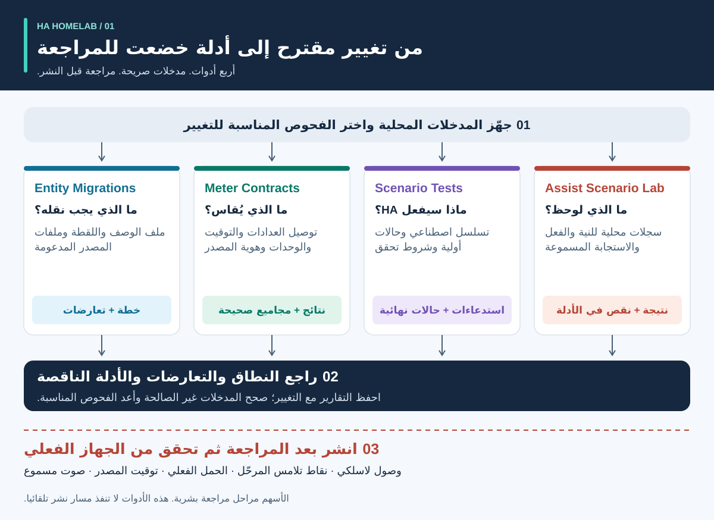
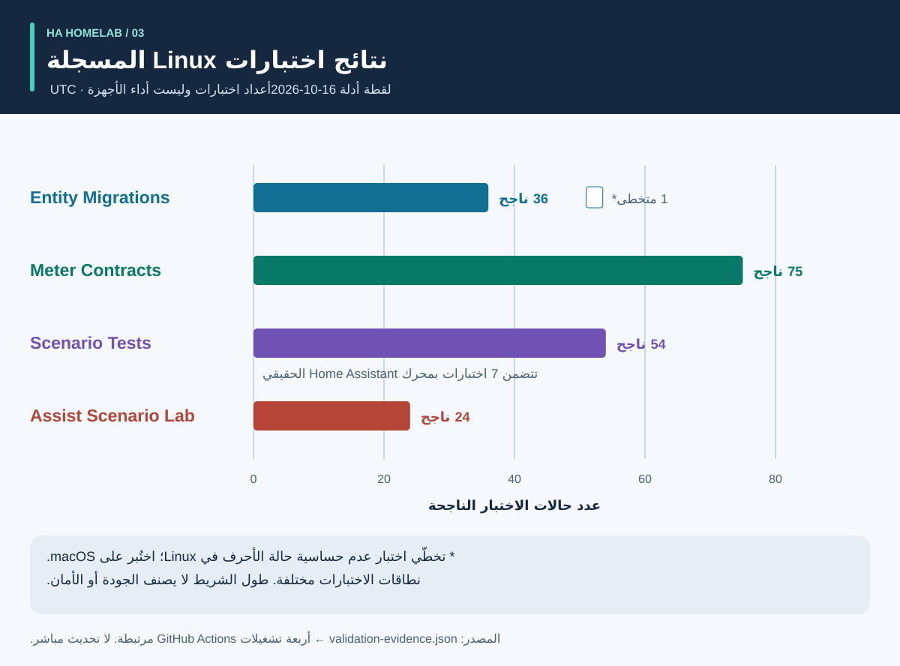
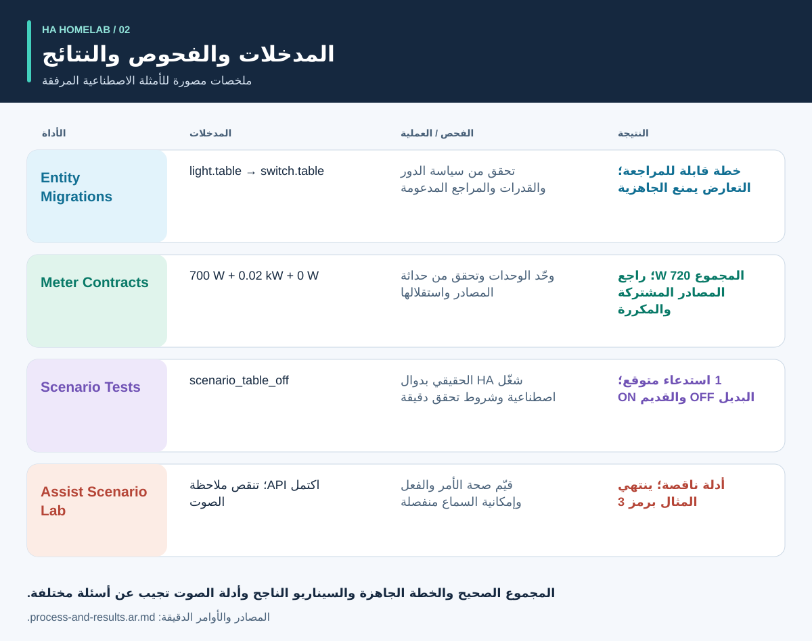

<div dir="rtl">

# الأدلة قبل الأتمتة

<!-- language-navigation:start -->
<p dir="ltr">
<a href="README.md" lang="en" dir="ltr">English</a> · <a href="README.ar.md" lang="ar" dir="rtl">العربية</a> · <a href="README.bn.md" lang="bn" dir="ltr">বাংলা</a> · <a href="README.cs.md" lang="cs" dir="ltr">Čeština</a> · <a href="README.de.md" lang="de" dir="ltr">Deutsch</a> · <a href="README.es.md" lang="es" dir="ltr">Español</a> · <a href="README.fa.md" lang="fa" dir="rtl">فارسی</a> · <a href="README.fr.md" lang="fr" dir="ltr">Français</a><br>
<a href="README.he.md" lang="he" dir="rtl">עברית</a> · <a href="README.hi.md" lang="hi" dir="ltr">हिन्दी</a> · <a href="README.id.md" lang="id" dir="ltr">Bahasa Indonesia</a> · <a href="README.it.md" lang="it" dir="ltr">Italiano</a> · <a href="README.ja.md" lang="ja" dir="ltr">日本語</a> · <a href="README.ko.md" lang="ko" dir="ltr">한국어</a> · <a href="README.nl.md" lang="nl" dir="ltr">Nederlands</a> · <a href="README.pl.md" lang="pl" dir="ltr">Polski</a><br>
<a href="README.pt.md" lang="pt" dir="ltr">Português</a> · <a href="README.ru.md" lang="ru" dir="ltr">Русский</a> · <a href="README.th.md" lang="th" dir="ltr">ไทย</a> · <a href="README.tr.md" lang="tr" dir="ltr">Türkçe</a> · <a href="README.uk.md" lang="uk" dir="ltr">Українська</a> · <a href="README.vi.md" lang="vi" dir="ltr">Tiếng Việt</a> · <a href="README.zh-Hans.md" lang="zh-Hans" dir="ltr">简体中文</a> · <a href="README.zh-Hant.md" lang="zh-Hant" dir="ltr">繁體中文</a>
</p>
<!-- language-navigation:end -->

ترجمة هذه الوثائق لا تضيف دعما للغات جديدة إلى CLI أو إلى التعرف على الكلام وتوليده؛ راجع اللغات التي يدعمها كل مشروع.

تساعد أربع أدوات صغيرة مشروع مجتمع Home Assistant في الإجابة على أربعة أسئلة مختلفة: **ما الذي يجب أن يصبح عليه دور الجهاز، وما الذي يغطيه القياس، وما الذي يفعله محرك التشغيل الآلي فعليًا، وما هو الدليل الذي يدعم النتيجة الصوتية؟** تعمل إصداراتهم الأولى مع الملفات المحلية وبيانات الاختبار الاصطناعية. إنهم لا ينشرون التكوين المنزلي أو يصادقون على الأجهزة المادية.



[الإرشادات المرئية: العملية والمخرجات والنتائج](process-and-results.ar.md) · [مخطط تغيير الحالة](role-transfer.ar.svg) · [مخطط أدلة الاختبار](validation.ar.svg)

## المشاريع الأربعة

- تنتج [HA Entity Migrations](https://github.com/ha-homelab/ha-entity-migrations) خطة ترحيل دون اتصال. تمنع السياسات والإمكانات وبصمات الملفات الصريحة المتعلقة بالأدوار/الأجهزة عملية إعادة التسمية الروتينية من تعيين أتمتة الإضاءة بصمت إلى مأخذ طاقة مُعاد استخدامه. تنطبق الخطة الجاهزة فقط على نطاق التكوين المدعوم والمزود.

- تتحقق [HA Meter Contracts](https://github.com/ha-homelab/ha-meter-contracts) من النطاق المادي للقياس، وأصل البيانات، والوحدات، وحداثة العينات، وقواعد الجمع. لا يتحول عداد مشترك كهربائي إلى عداد مستقل لمضخة بمجرد تغيير اسمه. ولا يجوز جمع تمثيلات مكررة لمحوّل تيار واحد كما لو كانت أحمالا منفصلة.

- تنفذ [HA Scenario Tests](https://github.com/ha-homelab/ha-scenario-tests) سيناريو اصطناعيا مقيدا داخل محرك الأتمتة والبرامج النصية الحقيقي في Home Assistant. تتحقق من ترتيب الاستدعاءات، والاستدعاءات المحظورة، والحالات الاصطناعية النهائية. بيئة التشغيل الأولى محددة بالإصدارات HA 2026.10.0 وPython 3.14.2–3.14.x؛ استخدم لها بيئة منفصلة عن الأدوات الأخرى.

- يقوم [Assist Scenario Lab](https://github.com/ha-homelab/assist-scenario-lab) بتقييم الأدلة الصوتية المحلية. فهو يفصل بين صحة الأمر وإكمال API والإخراج المسموع. جميع التوقيتات المضمنة هي اصطناعية، ولم يتم التحقق من الملاحظات المقدمة بشكل مستقل.

لكل مشروع دليل تثبيت خاص به، ورسائل CLI بالإنجليزية والروسية والألمانية والإسبانية. اتبع عقود الإصدارات الموثقة، ولا تفترض أن رموز الخروج تعني الشيء نفسه في جميع الأدوات. تشير أسهم المخططات إلى **مراحل مراجعة بشرية**، ولا تمثل تكاملات تلقائية منفذة. لا توجد خدمة مركزية أو أمر نشر موحد.

مواقع الويكي المستضافة: [Entity Migrations](https://github.com/ha-homelab/ha-entity-migrations/wiki) · [Meter Contracts](https://github.com/ha-homelab/ha-meter-contracts/wiki) · [Scenario Tests](https://github.com/ha-homelab/ha-scenario-tests/wiki) · [Assist Scenario Lab](https://github.com/ha-homelab/assist-scenario-lab/wiki) · [ZAC93 + ESP32](https://github.com/ha-homelab/zac93-esp32/wiki)

<a id="validation-evidence--2026-10-16-utc"></a>

## أدلة التحقق — 2026-10-16 UTC

هذه فحوص برمجية لإصدارات محددة تستخدم بيانات اصطناعية؛ وهي ليست شهادة للأجهزة أو اختبار أداء لمنزل فعلي.



تُظهر الأشرطة الأعداد، وليس التغطية أو تصنيف الجودة. سجلات المصدر المؤرخة موجودة في [validation-evidence.json](validation-evidence.json).

- **Entity Migrations:** نجح محليا 37 اختبارا و9 اختبارات فرعية، بما فيها اختبارات منع تكرار أخطاء أسماء المصادر البديلة. نجح [تشغيل Linux على main](https://github.com/ha-homelab/ha-entity-migrations/actions/runs/38843701264) في 36 اختبارا وتخطّى حالة نظام الملفات غير الحساس لحالة الأحرف، التي اختُبرت محليا.

- **Meter Contracts:** [نجح 75 اختبارا في Linux CI](https://github.com/ha-homelab/ha-meter-contracts/actions/runs/38843671896)، بما في ذلك تعارض المصدر وقبول ملف المصدر ودلالات القياس.

- **Assist Scenario Lab:** [نجح 24 اختبارا في Linux CI](https://github.com/ha-homelab/assist-scenario-lab/actions/runs/38843304306). تتحقق هذه الاختبارات من صحة الأدلة المقدمة والأمثلة الاصطناعية؛ لا تتم المطالبة بأي مقارنة صوتية فعلية.

- **Scenario Tests:** [نجح 54 اختبارا دون تخطي أي اختبار في Linux CI](https://github.com/ha-homelab/ha-scenario-tests/actions/runs/38843681199) باستخدام CPython 3.14.8 وHome Assistant 2026.10.0 الفعلي. يشمل ذلك سبع حالات تشغيل، إحداها تختبر المثال المكمل لنقل الدور. اكتملت مجموعة الاختبارات في 21.42 ثانية.

Linux هو نظام التشغيل الذي اختُبر عليه التنفيذ. يظل [فشل الإنهاء الأصلي الموثق على macOS](https://github.com/ha-homelab/ha-scenario-tests/blob/main/docs/validation.md) قيدا قائما؛ فظهور JSON المتوقع قبل تعطل العملية لا يجعل التشغيل ناجحا. لا ندّعي تنفيذ الاختبارات في Docker أو إتمام اختبارات قبول الأجهزة الفعلية.

## العملية والنتائج المصورة



اتبع [الدليل المرئي](process-and-results.ar.md) لتفسير كل مخرجات، وتتبع حالة الجهاز البديل والجهاز الذي أزيل من الدور، وتمييز دليل البرنامج عن اختبارات القبول الميدانية. النتائج الموضحة تلخص الأمثلة الاصطناعية المجمعة؛ فهي ليست لقطات شاشة للتقرير الخام.

<a id="a-concrete-migration-to-test-workflow"></a>

## مسار عملي من الترحيل إلى الاختبار

1. في `ha-entity-migrations`، قم بتشغيل مثال تغيير المجال المجمع بعد تثبيت هذا المستودع:

   <div dir="ltr">

   ```sh
   ha-entity-migrations --lang en plan --manifest examples/domain-change/manifest.json --snapshot examples/domain-change/snapshot.json --root examples/domain-change
   ```

   </div>

   قم بمراجعة التغييرات المقترحة `light.table` → `switch.table` و`light.turn_off` → `switch.turn_off`. تعامل مع بصمات الملفات والمراجع المدعومة كحدود للنطاق. الخطة المحجوبة تحتاج إلى التحقيق؛ لا تستبدل أدلة القدرة المفقودة بالبحث والاستبدال غير المشروط.

2. ترجمة السلوك الذي تمت مراجعته إلى اختبار اصطناعي. [role-transfer.scenario.json](role-transfer.scenario.json) هو مثال مكمل مكتوب يدويا، **وليس تصديرًا تلقائيًا** لخطة الترحيل. فهو يرسل حدث "إيقاف الطاولة" الاصطناعي، ويتوقع استدعاءً واحدًا للدور البديل ويمنع إيقاف تشغيل الأجهزة التي أزيلت من هذا الدور. ويؤكد أيضًا أن الأجهزة التي أزيلت من هذا الدور تظل قيد التشغيل. من مجلد هذا الدليل، مع تثبيت مشغل السيناريو في بيئته الخاصة:

   <div dir="ltr">

   ```sh
   ha-scenario validate role-transfer.scenario.json
   ha-scenario run role-transfer.scenario.json
   ```

   </div>

   هذا المثال مطابق بايتا ببايت لـ [بيانات اختبار نقل الدور](https://github.com/ha-homelab/ha-scenario-tests/blob/0ea7e5a5d24dc89ebe896b1a2387396b3fce18f4/tests/fixtures/role_transfer.json) الذي تم اختباره في [تم تشغيل Linux بنجاح](https://github.com/ha-homelab/ha-scenario-tests/actions/runs/38843681199). SHA-256 هو `bb8544517eeb4895b80b049cf9e242d04635e7785bd198c1d57a7cf3f5fc8ab4`. يظل فشل إنهاء العملية السابقة لـ macOS موثقًا ولا يُحسب تشغيلا ناجحا.

   يستخدم السيناريو محرك HA الحقيقي مع دوال رد نداء للمشغلات تعمل في الذاكرة. يثبت النجاح سلوك المحرك في التسلسل الاصطناعي المقدم، ولا يثبت وصول الإشارة اللاسلكية أو إغلاق نقاط التلامس أو وصول الطاقة إلى الجهاز. هذا الحدث الواحد لا يغطي إعدادات منزل كامل.

3. أضف تسلسلات الفشل المناسبة قبل النشر: انقطاع حالة الغياب بسبب عدم توفر المستشعر، أو تثبيت يدوي للحالة، أو إعادة تحميل الأتمتة، أو تكرار المُحفّزات، أو استعادة الحالة. تغطي أمثلة أداة التنفيذ الحضور والتثبيت اليدوي والمدخلات القديمة والمطابقة بعد إعادة التحميل. تستخدم الأداة الزمن الحقيقي المنقضي، لذلك لا يتحقق مثال قصير من فترة عشرين دقيقة في الإنتاج. توضح وثائق HA أن فترات الانتظار `for` لا تستمر بعد إعادة التشغيل أو التحميل؛ اختر واختبر مطابقة صريحة للحالة أو مواعيد نهائية محفوظة عند الحاجة. [وثائق محفزات HA](https://www.home-assistant.io/docs/automation/trigger/)

4. قم بمراجعة أدلة العداد بشكل مستقل. من مستودع العدادات:

   <div dir="ltr">

   ```sh
   ha-meter-contracts check examples/valid-three-meters.json --at 2026-01-01T12:00:05Z --json
   ha-meter-contracts check examples/kmc-shared-meter.json --at 2026-01-01T12:00:05Z --json
   ha-meter-contracts check examples/duplicate-emporia.json --at 2026-01-01T12:00:05Z --json
   ```

   </div>

   ينجح المثال الصحيح. أما المثالان الآخران فينتهيان عمدا برمز 1: الأول يحاول نسبة قراءة المشترك الكهربائي كله إلى مخرج واحد، والثاني يتضمن تمثيلات مكررة للمصدر نفسه. اعتبرهما حالتي فشل متوقعتين عند تشغيل الأمثلة آليا. لا تستخدم قدرة المشترك كله بالواط مع حد حماية عُيّر أصلا للمضخة وحدها. معايرة الجهد لا تعني معايرة التيار أو القدرة. البيانات المفقودة أو القديمة تظل غير متاحة ولا تصبح صفرا. [دلالات مستشعرات وإحصاءات HA](https://developers.home-assistant.io/docs/core/entity/sensor/#long-term-statistics)

5. إذا كان الصوت هو المحفز أو مسار ردود الفعل، فقم بتقييم الأدلة بشكل منفصل في مستودع الصوت:

   <div dir="ltr">

   ```sh
   assist-lab evaluate examples/synthetic-pass.json
   assist-lab evaluate examples/synthetic-incomplete.json
   ```

   </div>

   ينتهي المثال غير المكتمل عمدا برمز 3 لأن اكتمال API لا يكفي لإثبات أن الصوت كان مسموعا. تتطلب المقارنة الفعلية موافقة على التسجيل، وساعة ومنهجا معلنين، وظروفا قابلة للمقارنة، وملاحظة مستقلة للفعل والاستجابة المسموعة. لا تنشر تسجيلات المنزل أو نصوصها أو رموز الوصول المصدّرة. أول مقطع صوتي في الخادم لا يساوي أول صوت يصل إلى المستمع. [مسارات HA Assist](https://developers.home-assistant.io/docs/voice/pipelines/)

6. احتفظ بكل تقرير مع التغيير الذي خضع للمراجعة. طبّق التغيير عبر إجراءات المراجعة والنشر المعتمدة في الموقع، ثم نفّذ اختبارات القبول الخاصة بالجهاز. يتطلب التحقق من التشغيل والإطفاء الفعليين، وقطبية المؤشر، والسلوك بعد إعادة التشغيل، وتوقيت المصدر، ومعايرة كل كمية على حدة ملاحظات فعلية. هذه الأدوات الأربع لا تنفذ تلك الخطوة ولا تحل محلها.

## ما لا تثبته الفحوص

الحالة المهيأة، واستدعاء الخدمة المقبول، والقدرة الكهربائية المرصودة، وتدفق الماء أنواع مختلفة من الأدلة. لا يحدد عداد إجمالي لثلاثة أحمال أيّ حمل استهلك القدرة. ولا تثبت حالة اصطناعية «مطفأ» أن نقاط تلامس المرحّل قد فُتحت. أداة العدادات واختبار السيناريو ليسا متحكمي أمان للمياه أو السخانات أو الدخول أو غيرها من الأحمال ذات العواقب المهمة.

هذه الأدوات لا تفرض نتائج بعضها البعض. يمكن أن يستهلك التكامل المستقبلي JSON المستقر، ولكن يجب أن يحدد بوضوح مستويات التحذير المقبولة وتوافق الإصدار وما يعنيه "الدليل الكامل". لا تقم بتقليل `ready`، و`available`، و`passed`، و`audible` إلى قيمة منطقية واحدة قابلة للتبديل.

## خريطة الطريق: أربعة عشر فكرة، وحالتها الفعلية

تتوفر مخرجات التعليمات البرمجية الأربعة الأولى أدناه كأدوات أولية غير متصلة بالإنترنت. تظل جميع أعمال المتابعة المذكورة مقترحة؛ لا يعني اسم المستودع أو الرسم التخطيطي أن الأجهزة قد تم تشغيلها.

1. **ترحيل الأدوار — أداة أولية منفذة.** وسّع صيغ المراجع المدعومة فقط مع اختبارات القراءة والكتابة العكسية واختبارات التعارض؛ وحافظ على الحدود الصريحة للمدخلات غير المدعومة.

2. **عقود العدادات — أداة أولية منفذة.** جرّب بشكل خاص ملاحظات فعلية ذات طوابع زمنية؛ وقس التيار والقدرة بصورة مستقلة قبل الادعاء بمعايرتهما. لا تزال نسبة القياس إلى مخرج معين تتطلب أدلة لذلك المخرج.

3. **اختبارات سيناريوهات الأتمتة — أداة أولية منفذة.** أضف سياسات خضعت للمراجعة وحالات إعادة التشغيل والمواعيد النهائية؛ واختبر مدد الإنتاج الفعلية بصورة منفصلة عند الحاجة.

4. **الأدلة الصوتية — أداة أولية منفذة؛ المقارنة الميدانية معلقة.** اختر وحدات الصوت وطريقة الملاحظة واحصل على موافقة التسجيل قبل جمع جلسات قابلة للمقارنة. لا يوجد تصنيف للأجهزة حتى الآن.

5. **تنسيق جودة الهواء — بانتظار التحقق من المستشعرات والمشغلات.** تحقق مما إذا كان الجهاز يقيس CO₂ أو الجسيمات، ومن عمر البيانات ودقتها، وما الذي يمكن للتهوية أو الترشيح تغييره. تحقق من الظروف الخارجية قبل اعتماد سياسة للتهوية.

6. **أدلة الرادار والحضور — بانتظار إعداد الأجهزة والتحقق منها ميدانيا.** تحقق من لوحة LD2450 والتغذية والحاوية والبروتوكول والتغطية. الأهداف المرصودة ليست هويات أشخاص، وعمر الاستقبال ليس قياسا لزمن تأخر المستشعر. لا يزال CSI تجريبيا.

7. **رصد المياه والمضخات — بانتظار أدلة مستقلة.** ميّز بين السماح بتغذية المضخة، واستهلاكها الكهربائي، وتدفق الماء، ومستوى الماء. لا يوفر عداد المشترك الإجمالي إشارة حماية مفقودة خاصة بالمضخة. تجنب إعادة المحاولة التلقائية للأوامر الحرجة دون حالة مرصودة ومراجعة خاصة بالموقع.

8. **قياسات BLE — بانتظار وكلاء متوافقين واختبارات التغطية.** تحقق من المستشعرات الفعلية ونطاق الحرارة والبطاريات ومواضعها. أجهزة ESP8266 ليست وكلاء BLE؛ ولا يمثل RSSI هوية أو تصريحا لفتح القفل. [وكيل Bluetooth في ESPHome](https://esphome.io/components/bluetooth_proxy/)

9. **تفسيرات تعتمد على الحضور والأجهزة المنزلية — بانتظار التحقق من القدرات.** وضّح أي ملاحظة أبقت الضوء مضاء؛ واستخدم أحداث الغسالة والمجفف الفعلية إذا كانت مدعومة. لا تستنتج دورة جهاز من عداد مشترك وحده، ولا تختلق ثقة إحصائية من إشارات مستشعرات غير مترابطة.

10. **جسر Z-Wave — بانتظار التسليم والتجميع واختبارات القبول اللاسلكية.** يمثل [دليل ZAC93 + ESP32](https://github.com/ha-homelab/zac93-esp32) مسارا مستقلا للأجهزة. تحقق على اللوحة الفعلية من التوصيلات والتردد الإقليمي والنقل التسلسلي والإدراج في Z-Wave JS. دعم المتحكم لـ Long Range لا يحوّل مستشعرا قديما إلى جهاز Long Range. [دليل Z-Wave JS](https://zwave-js.github.io/zwave-js/#/getting-started/index)

11. **قبول مقابس ESPHome — بانتظار الاختبارات الفردية للأجهزة.** سجّل أدلة الزر والمرحّل والمؤشر وإعادة التشغيل لكل مراجعة عتادية، مع معايرة منفصلة للجهد والتيار والقدرة. نجاح كتابة البرنامج الثابت لا يعني اكتمال القبول. لا تنفذ دورات تشغيل وإطفاء جماعية دون إشراف للأجهزة المتصلة.

12. **مقارنة التنبؤات — بانتظار تراكم البيانات.** احفظ التنبؤات الصادرة والقيم الفعلية اللاحقة، واحتفظ بوقت الإصدار، وقيّم الآفاق الزمنية دون تسريب معلومات المستقبل إلى التقييم. يتطلب ذلك وقتا فعليا للملاحظة، لا ادعاء توفير الطاقة بناء على مثال اصطناعي.

13. **تحكم محدود للضيوف — بانتظار مراجعة أذونات الخادم.** تحقق من الهوية والتفويض على جانب الخادم. إخفاء عناصر لوحة التحكم وحده لا يحد الوصول. لا تضعف المصادقة لتبسيط اللوحة.

14. **جدولة الأحمال القابلة للتأجيل — بانتظار قياس القيود والتحقق من القدرات.** ادمج أدوات جدولة معروفة بعد التحقق من العدادات وتغذية الحالة الراجعة والتنبؤات. حدد الأحمال التي يمكن تأجيلها أو تعديلها فعليا، ومواعيدها النهائية والتجاوزات اليدوية. ابدأ بتوصيات خضعت للمراجعة، دون وفورات تخمينية أو ضمانات أمان. [EMHASS](https://emhass.readthedocs.io/en/latest/emhass.html) · [evcc](https://docs.evcc.io/en/)

## المساهمة وإعادة إنتاج هذا الدليل

هذا العرض والسيناريو الاصطناعي والمخططات مواد أصلية بترخيص MIT؛ راجع [LICENSE](LICENSE). أعد إنشاء جميع مخططات SVG المترجمة باستخدام `python3 render_architecture.py`. لا تحتوي على صور خارجية أو برامج نصية أو معرّفات منزلية أو بيانات مقاسة من منزل فعلي. يشرح [الدليل المرئي](process-and-results.ar.md#reproduce-or-translate-the-illustrations) سجلات المصدر وفحوص إعادة التوليد. أبق بيانات الاختبار العامة اصطناعية، واحتفظ بالتصديرات الخاصة خارج Git. اتبع إرشادات الأمان والمساهمة في كل مستودع عند إجراء تغييرات.

</div>
