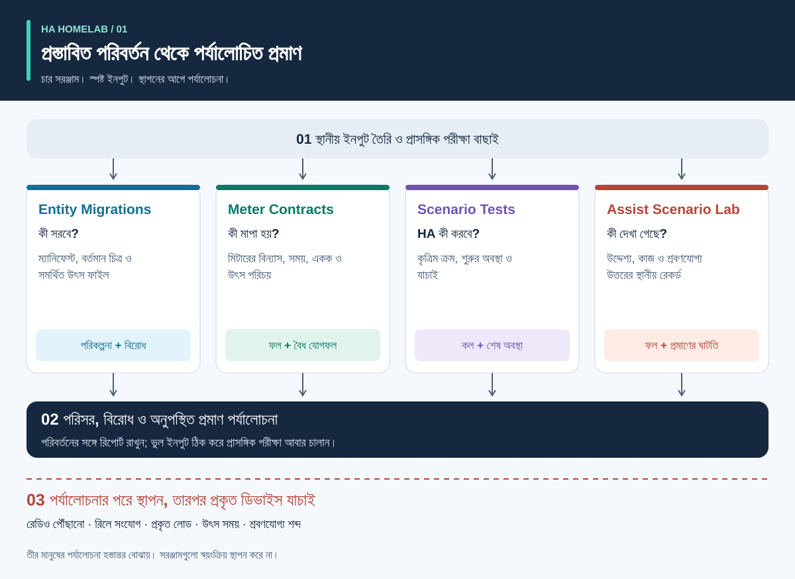
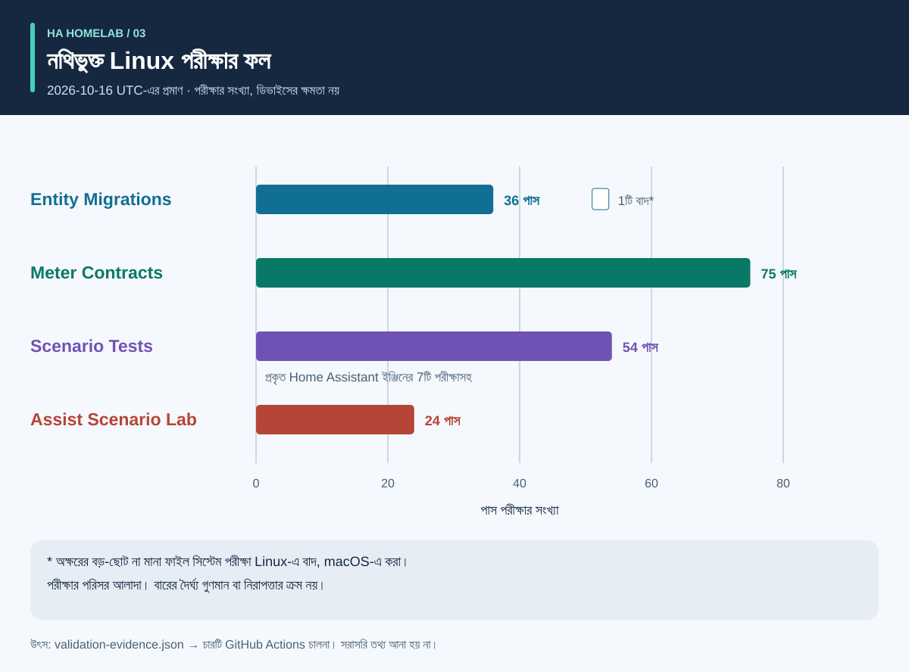
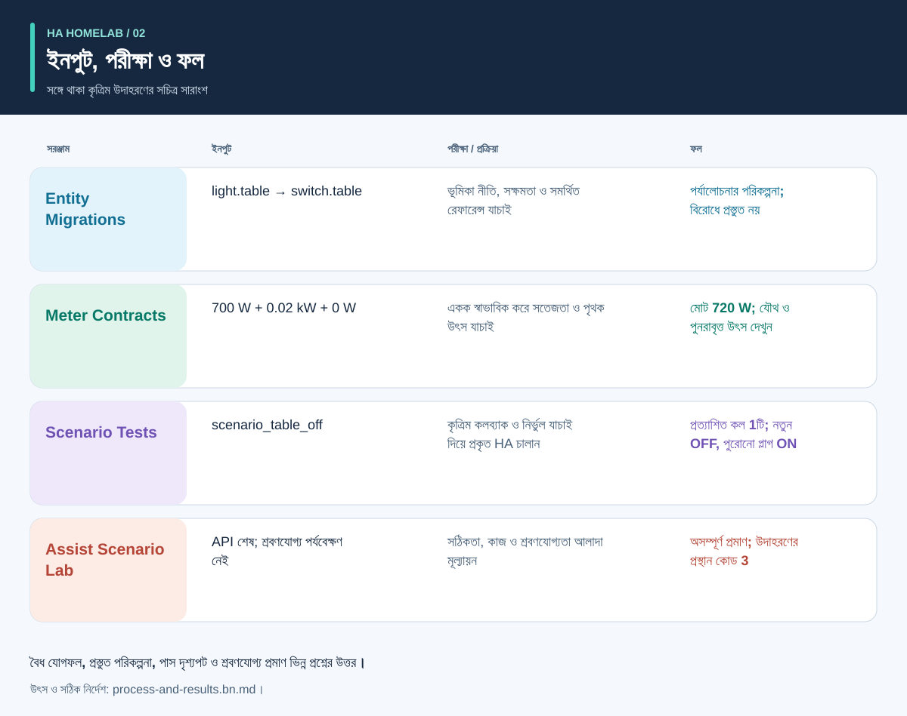

# স্বয়ংক্রিয়তার আগে প্রমাণ

<!-- language-navigation:start -->
<p dir="ltr">
<a href="README.md" lang="en" dir="ltr">English</a> · <a href="README.ar.md" lang="ar" dir="rtl">العربية</a> · <a href="README.bn.md" lang="bn" dir="ltr">বাংলা</a> · <a href="README.cs.md" lang="cs" dir="ltr">Čeština</a> · <a href="README.de.md" lang="de" dir="ltr">Deutsch</a> · <a href="README.es.md" lang="es" dir="ltr">Español</a> · <a href="README.fa.md" lang="fa" dir="rtl">فارسی</a> · <a href="README.fr.md" lang="fr" dir="ltr">Français</a><br>
<a href="README.he.md" lang="he" dir="rtl">עברית</a> · <a href="README.hi.md" lang="hi" dir="ltr">हिन्दी</a> · <a href="README.id.md" lang="id" dir="ltr">Bahasa Indonesia</a> · <a href="README.it.md" lang="it" dir="ltr">Italiano</a> · <a href="README.ja.md" lang="ja" dir="ltr">日本語</a> · <a href="README.ko.md" lang="ko" dir="ltr">한국어</a> · <a href="README.nl.md" lang="nl" dir="ltr">Nederlands</a> · <a href="README.pl.md" lang="pl" dir="ltr">Polski</a><br>
<a href="README.pt.md" lang="pt" dir="ltr">Português</a> · <a href="README.ru.md" lang="ru" dir="ltr">Русский</a> · <a href="README.th.md" lang="th" dir="ltr">ไทย</a> · <a href="README.tr.md" lang="tr" dir="ltr">Türkçe</a> · <a href="README.uk.md" lang="uk" dir="ltr">Українська</a> · <a href="README.vi.md" lang="vi" dir="ltr">Tiếng Việt</a> · <a href="README.zh-Hans.md" lang="zh-Hans" dir="ltr">简体中文</a> · <a href="README.zh-Hant.md" lang="zh-Hant" dir="ltr">繁體中文</a>
</p>
<!-- language-navigation:end -->

এই নথির অনুবাদ CLI বা কথনের সমর্থিত ভাষা বাড়ায় না; প্রতিটি প্রকল্প কোন ভাষা সমর্থন করে তা দেখুন।

চারটি ছোট সরঞ্জাম Home Assistant কমিউনিটি প্রকল্পকে চারটি আলাদা প্রশ্নের উত্তর দিতে সাহায্য করে: **ডিভাইসের ভূমিকা কী হবে, পরিমাপ কী অন্তর্ভুক্ত করে, অটোমেশন ইঞ্জিন আসলে কী করে এবং কোন প্রমাণ ভয়েসের ফল সমর্থন করে?** প্রাথমিক সংস্করণগুলো স্থানীয় ফাইল ও কৃত্রিম পরীক্ষার তথ্য নিয়ে কাজ করে। এগুলো বাড়ির কনফিগারেশন স্থাপন বা বাস্তব ডিভাইস প্রত্যয়িত করে না।



[সচিত্র নির্দেশিকা: প্রক্রিয়া, আউটপুট ও ফল](process-and-results.bn.md) · [অবস্থা পরিবর্তনের চিত্র](role-transfer.bn.svg) · [পরীক্ষার প্রমাণচিত্র](validation.bn.svg)

## চারটি প্রকল্প

- [HA Entity Migrations](https://github.com/ha-homelab/ha-entity-migrations) অফলাইন স্থানান্তর পরিকল্পনা তৈরি করে। স্পষ্ট ভূমিকা/হার্ডওয়্যার নীতি, সক্ষমতা ও ফাইলের ছাপ নিশ্চিত করে যে সাধারণ নাম পরিবর্তনে আলোর অটোমেশন অজান্তে অন্য কাজে লাগানো বিদ্যুৎ সকেটে চলে না যায়। প্রস্তুত পরিকল্পনাও শুধু দেওয়া ও সমর্থিত কনফিগারেশনের পরিসরে প্রযোজ্য।

- [HA Meter Contracts](https://github.com/ha-homelab/ha-meter-contracts) বাস্তব পরিমাপের পরিসর, উৎস, একক, নমুনার সতেজতা ও যোগের নিয়ম পরীক্ষা করে। পুরো মাল্টিপ্লাগের মিটার নাম পাল্টালেই পৃথক পাম্পের মিটার হয় না। একটি কারেন্ট ট্রান্সফরমারের একাধিক প্রতিরূপকে পৃথক লোড হিসেবে যোগ করা যায় না।

- [HA Scenario Tests](https://github.com/ha-homelab/ha-scenario-tests) প্রকৃত Home Assistant অটোমেশন/স্ক্রিপ্ট ইঞ্জিনে সীমিত কৃত্রিম দৃশ্যপট চালায়। এটি কলের ক্রম, নিষিদ্ধ কল ও চূড়ান্ত কৃত্রিম অবস্থা পরীক্ষা করে। বর্তমান রানটাইম HA 2026.10.1 এবং Python 3.14.2–3.14.x-এ নির্দিষ্ট; অন্য সরঞ্জাম থেকে আলাদা পরিবেশ ব্যবহার করুন।

- [Assist Scenario Lab](https://github.com/ha-homelab/assist-scenario-lab) স্থানীয় ভয়েস প্রমাণ মূল্যায়ন করে। নির্দেশের সঠিকতা, API শেষ হওয়া ও শ্রবণযোগ্য আউটপুট আলাদা করে। দেওয়া সব সময় কৃত্রিম এবং পর্যবেক্ষণগুলো স্বাধীনভাবে যাচাই করা হয়নি।

প্রকল্পগুলোর নিজস্ব স্থাপন নির্দেশিকা এবং ইংরেজি/রুশ/জার্মান/স্প্যানিশ CLI বার্তা আছে। সব প্রস্থান কোডের একই অর্থ ধরে না নিয়ে সংস্করণভিত্তিক চুক্তি অনুসরণ করুন। চিত্রের তীরগুলো **পর্যালোচনার হস্তান্তর**, বাস্তবায়িত স্বয়ংক্রিয় ইন্টিগ্রেশন নয়। কোনো কেন্দ্রীয় ডেমন বা সর্বজনীন স্থাপন নির্দেশ নেই।

প্রকাশিত উইকি: [Entity Migrations](https://github.com/ha-homelab/ha-entity-migrations/wiki) · [Meter Contracts](https://github.com/ha-homelab/ha-meter-contracts/wiki) · [Scenario Tests](https://github.com/ha-homelab/ha-scenario-tests/wiki) · [Assist Scenario Lab](https://github.com/ha-homelab/assist-scenario-lab/wiki) · [ZAC93 + ESP32](https://github.com/ha-homelab/zac93-esp32/wiki)

<a id="validation-evidence--2026-10-16-utc"></a>

## যাচাইয়ের প্রমাণ — 2026-10-16 UTC

এগুলো কৃত্রিম তথ্য দিয়ে নির্দিষ্ট সংস্করণের সফ্টওয়্যার পরীক্ষা; হার্ডওয়্যার প্রত্যয়ন বা বাড়ির বেঞ্চমার্ক নয়।



বারগুলো সংখ্যা দেখায়; কভারেজ বা গুণমানের ক্রম নয়। তারিখসহ মূল রেকর্ড [validation-evidence.json](validation-evidence.json)-এ আছে।

- **Entity Migrations:** উৎসের বিকল্প নামের পুনরাবৃত্ত ত্রুটির পরীক্ষাসহ স্থানীয়ভাবে 37 পরীক্ষা ও 9 উপপরীক্ষা পাস করেছে। [main-এর Linux চালনা](https://github.com/ha-homelab/ha-entity-migrations/actions/runs/38843701264) 36টি পাস করেছে এবং বড়-ছোট অক্ষর আলাদা না করা ফাইল সিস্টেমের পরীক্ষাটি বাদ দিয়েছে; সেটি স্থানীয়ভাবে চালানো হয়েছে।
- **Meter Contracts:** [Linux CI-তে 75 পরীক্ষা পাস](https://github.com/ha-homelab/ha-meter-contracts/actions/runs/38843671896), যার মধ্যে উৎসের বিরোধ, উৎস ফাইল গ্রহণ ও পরিমাপের অর্থ রয়েছে।
- **Assist Scenario Lab:** [Linux CI-তে 24 পরীক্ষা পাস](https://github.com/ha-homelab/assist-scenario-lab/actions/runs/38843304306)। এগুলো দেওয়া প্রমাণ ও কৃত্রিম উদাহরণ যাচাই করে; বাস্তব ভয়েসের তুলনা দাবি করা হয় না।
- **Scenario Tests:** CPython 3.14.8 এবং প্রকৃত Home Assistant 2026.10.0 দিয়ে [Linux CI-তে বাদ না দিয়ে 54 পরীক্ষা পাস](https://github.com/ha-homelab/ha-scenario-tests/actions/runs/38843681199)। এতে সাতটি রানটাইম পরীক্ষা আছে, যার একটি ভূমিকা স্থানান্তরের সহায়ক দৃশ্যপট পরীক্ষা করে। পুরো পরীক্ষা 21.42 সেকেন্ডে শেষ হয়েছে।

Linux হলো পরীক্ষিত চালনা পরিবেশ। [নথিভুক্ত নেটিভ macOS সমাপনী পরিষ্কারকরণ ব্যর্থতা](https://github.com/ha-homelab/ha-scenario-tests/blob/main/docs/validation.md) এখনো সীমাবদ্ধতা; প্রক্রিয়া ক্র্যাশের আগে প্রত্যাশিত JSON এলেও চালনাটি ব্যর্থ। 16 অক্টোবরের নথি Docker চালনা বা বাস্তব ডিভাইসের গ্রহণযোগ্যতা যাচাই সম্পন্ন হয়েছে বলে দাবি করে না।

19 অক্টোবর 2026-এর হালনাগাদ: [Linux CI](https://github.com/ha-homelab/ha-scenario-tests/actions/runs/39264346721) প্যাকেজ করা রানটাইমের Docker-এ প্রাথমিক চালনা পরীক্ষাও পাস করেছে। এটি বাস্তব ডিভাইসের গ্রহণযোগ্যতা প্রমাণ করে না।

## প্রক্রিয়া ও সচিত্র ফলাফল



প্রতিটি আউটপুট বোঝা, প্রতিস্থাপক ও পুরোনো ডিভাইসের অবস্থা অনুসরণ এবং সফ্টওয়্যার প্রমাণ থেকে বাস্তব যাচাই আলাদা করতে [সচিত্র নির্দেশিকা](process-and-results.bn.md) দেখুন। ফলের চিত্রগুলো সঙ্গে থাকা কৃত্রিম উদাহরণের সারাংশ; কাঁচা রিপোর্টের স্ক্রিনশট নয়।

<a id="a-concrete-migration-to-test-workflow"></a>

## স্থানান্তর থেকে পরীক্ষার নির্দিষ্ট কর্মপ্রবাহ

1. `ha-entity-migrations` রিপোজিটরি স্থাপনের পরে সঙ্গে থাকা ডোমেইন পরিবর্তনের উদাহরণ চালান:

   ```sh
   ha-entity-migrations --lang en plan --manifest examples/domain-change/manifest.json --snapshot examples/domain-change/snapshot.json --root examples/domain-change
   ```

   প্রস্তাবিত `light.table` → `switch.table` এবং `light.turn_off` → `switch.turn_off` পরিবর্তন পরীক্ষা করুন। ফাইলের ছাপ ও সমর্থিত রেফারেন্সকে পরিসরের সীমা হিসেবে ধরুন। আটকে যাওয়া পরিকল্পনার কারণ খুঁজতে হবে; সক্ষমতার অনুপস্থিত প্রমাণের বদলে শর্তহীন খুঁজে-প্রতিস্থাপন করবেন না।

2. পর্যালোচিত আচরণকে কৃত্রিম পরীক্ষায় রূপ দিন। [role-transfer.scenario.json](role-transfer.scenario.json) হাতে লেখা সহায়ক ফাইল, স্থানান্তর পরিকল্পনার **স্বয়ংক্রিয় রপ্তানি নয়**। এটি কৃত্রিম “table off” ঘটনা পাঠায়, প্রতিস্থাপক ভূমিকায় একবার কল প্রত্যাশা করে এবং পুরোনো হার্ডওয়্যার বন্ধ করা নিষিদ্ধ করে। পুরোনো হার্ডওয়্যার চালুই আছে কি না তাও নিশ্চিত করে। নিজস্ব পরিবেশে দৃশ্যপট চালক স্থাপন করে এই নির্দেশিকার ডিরেক্টরি থেকে চালান:

   ```sh
   ha-scenario validate role-transfer.scenario.json
   ha-scenario run role-transfer.scenario.json
   ```

   সহায়ক ফাইলটি [সফল Linux চালনায়](https://github.com/ha-homelab/ha-scenario-tests/actions/runs/38843681199) পরীক্ষিত [ভূমিকা স্থানান্তরের তথ্য](https://github.com/ha-homelab/ha-scenario-tests/blob/0ea7e5a5d24dc89ebe896b1a2387396b3fce18f4/tests/fixtures/role_transfer.json)-এর সঙ্গে প্রতি বাইটে অভিন্ন। এর SHA-256 হলো `bb8544517eeb4895b80b049cf9e242d04635e7785bd198c1d57a7cf3f5fc8ab4`। আগের macOS সমাপনী ব্যর্থতা নথিভুক্ত থাকে এবং সফল চালনা হিসেবে গণনা করা হয় না।

   দৃশ্যপট প্রকৃত HA ইঞ্জিন এবং মেমরিতে থাকা অ্যাকচুয়েটর কলব্যাক ব্যবহার করে। পাস করা শুধু দেওয়া কৃত্রিম ক্রমে ইঞ্জিনের আচরণ প্রমাণ করে; রেডিও পৌঁছানো, সংযোগ বন্ধ হওয়া বা যন্ত্রে বিদ্যুৎ আসা নয়। একটি ঘটনা দিয়ে পুরো বাড়ির কনফিগারেশন যাচাই হয় না।

3. স্থাপনের আগে প্রাসঙ্গিক ব্যর্থতার ক্রম যোগ করুন: সেন্সর অনুপলব্ধ হওয়ায় অনুপস্থিতির অপেক্ষা ভাঙা, ব্যবহারকারীর নির্দেশে অবস্থা ধরে রাখা, অটোমেশন আবার লোড, একই ট্রিগার একাধিকবার আসা এবং অবস্থা পুনরুদ্ধার। সঙ্গে থাকা উদাহরণে উপস্থিতি, ব্যবহারকারীর নির্দেশে অবস্থা ধরে রাখা, পুরোনো ইনপুট ও পুনরায় লোডের সমন্বয় আছে। প্রকৃত অতিবাহিত সময়ের ঘড়ি ব্যবহৃত হওয়ায় ছোট পরীক্ষার তথ্য বাস্তব ব্যবহারের বিশ মিনিটের ব্যবধান যাচাই করে না। HA জানায়, `for` অপেক্ষা পুনরারম্ভ/পুনরায় লোডের পর থাকে না; প্রয়োজনে স্পষ্ট সমন্বয় বা স্থায়ীভাবে রাখা সময়সীমা বেছে পরীক্ষা করুন। [HA ট্রিগার নথি](https://www.home-assistant.io/docs/automation/trigger/)

4. মিটারের প্রমাণ স্বাধীনভাবে পরীক্ষা করুন। মিটার রিপোজিটরি থেকে:

   ```sh
   ha-meter-contracts check examples/valid-three-meters.json --at 2026-01-01T12:00:05Z --json
   ha-meter-contracts check examples/kmc-shared-meter.json --at 2026-01-01T12:00:05Z --json
   ha-meter-contracts check examples/duplicate-emporia.json --at 2026-01-01T12:00:05Z --json
   ```

   বৈধ উদাহরণ সফল হয়। পরের দুটি ইচ্ছাকৃতভাবে কোড 1 দিয়ে শেষ হয়: যথাক্রমে পুরো মাল্টিপ্লাগের মিটার থেকে পৃথক সকেটের মান ধরার চেষ্টা এবং একই উৎসের একাধিক প্রতিরূপ। উদাহরণের স্ক্রিপ্ট লিখলে এগুলোকে প্রত্যাশিত ব্যর্থতা ধরুন। শুধু পাম্পের জন্য ক্যালিব্রেট করা সুরক্ষা সীমায় পুরো মাল্টিপ্লাগের ওয়াট দেবেন না। ভোল্টেজ ক্যালিব্রেশন কারেন্ট বা পাওয়ারের ক্যালিব্রেশন নয়। অনুপস্থিত বা পুরোনো প্রমাণ অনুপলব্ধই থাকবে, শূন্য হবে না। [HA সেন্সর/পরিসংখ্যানের অর্থ](https://developers.home-assistant.io/docs/core/entity/sensor/#long-term-statistics)

5. ভয়েস ট্রিগার বা প্রতিক্রিয়ার পথ হলে, ভয়েস রিপোজিটরিতে আলাদা করে প্রমাণ মূল্যায়ন করুন:

   ```sh
   assist-lab evaluate examples/synthetic-pass.json
   assist-lab evaluate examples/synthetic-incomplete.json
   ```

   অসম্পূর্ণ উদাহরণ ইচ্ছাকৃতভাবে কোড 3 দেয়, কারণ API শেষ হওয়া শ্রবণযোগ্যতার যথেষ্ট প্রমাণ নয়। প্রকৃত বেঞ্চমার্কে রেকর্ডের সম্মতি, ঘোষিত ঘড়ি/পদ্ধতি, তুলনাযোগ্য পরিবেশ এবং কাজ ও শোনা উত্তরের স্বাধীন পর্যবেক্ষণ দরকার। বাড়ির রেকর্ডিং, প্রতিলিপি বা রপ্তানিকৃত টোকেন প্রকাশ করবেন না। সার্ভারের প্রথম অডিও খণ্ড শ্রোতার কানে প্রথম শোনা শব্দ নয়। [HA Assist পাইপলাইন](https://developers.home-assistant.io/docs/voice/pipelines/)

6. প্রতিটি রিপোর্ট পর্যালোচিত পরিবর্তনের সঙ্গে রাখুন। স্থানের প্রতিষ্ঠিত পর্যালোচনা/স্থাপন পদ্ধতিতে প্রয়োগ করে পরে ডিভাইসভিত্তিক গ্রহণযোগ্যতা যাচাই করুন। বাস্তবে চালু/বন্ধ, নির্দেশক বাতির পোলারিটি, পুনরারম্ভের আচরণ, উৎসের সময় ও প্রতিটি রাশির ক্যালিব্রেশনে বাস্তব পর্যবেক্ষণ দরকার। চার সরঞ্জাম এই ধাপ সম্পাদন বা প্রতিস্থাপন করে না।

## পরীক্ষায় যা প্রমাণিত হয় না

কনফিগার করা অবস্থা, গৃহীত সার্ভিস কল, পর্যবেক্ষিত বিদ্যুৎ খরচ ও পানির প্রবাহ আলাদা প্রমাণ। তিন লোডের মোট মিটার বলতে পারে না কোন লোড বিদ্যুৎ নিয়েছে। কৃত্রিম “off” অবস্থা রিলের সংযোগ খুলেছে প্রমাণ করে না। মিটার সরঞ্জাম বা দৃশ্যপট পরীক্ষা পানি, হিটার, প্রবেশাধিকার বা অন্য গুরুত্বপূর্ণ লোডের সুরক্ষা নিয়ন্ত্রক নয়।

সরঞ্জামগুলো একে অন্যের ফল বাধ্যতামূলক করে না। ভবিষ্যৎ ইন্টিগ্রেশন তাদের স্থিতিশীল JSON নিতে পারে, কিন্তু গ্রহণযোগ্য সতর্কতার স্তর, সংস্করণের সামঞ্জস্য ও “সম্পূর্ণ প্রমাণ”-এর অর্থ স্পষ্ট করতে হবে। `ready`, `available`, `passed` ও `audible`-কে পরস্পর বদলযোগ্য এক বুলিয়ানে নামিয়ে আনবেন না।

## রোডম্যাপ: চৌদ্দটি ধারণা ও প্রকৃত প্রস্তুতির অবস্থা

নিচের প্রথম চারটি কোডভিত্তিক কাজ প্রাথমিক অফলাইন সরঞ্জাম হিসেবে পাওয়া যায়। সব পরবর্তী কাজ এখনো প্রস্তাবিত; রিপোজিটরির নাম বা চিত্র থাকা মানেই হার্ডওয়্যার চালু করে যাচাই শেষ নয়।

1. **ভূমিকা স্থানান্তর — প্রাথমিক সরঞ্জাম বাস্তবায়িত।** যাওয়া-আসা রূপান্তর ও বিরোধের পরীক্ষা থাকলেই সমর্থিত রেফারেন্স ফরম্যাট বাড়ান; অসমর্থিত ইনপুটের স্পষ্ট সীমা রাখুন।

2. **মিটার চুক্তি — প্রাথমিক সরঞ্জাম বাস্তবায়িত।** সময়যুক্ত বাস্তব পর্যবেক্ষণ দিয়ে ব্যক্তিগত পরীক্ষামূলক ব্যবহার করুন; ক্যালিব্রেশনের দাবি করার আগে কারেন্ট/পাওয়ার স্বাধীনভাবে মাপুন। সকেটভিত্তিক মান ধরতে সকেটভিত্তিক প্রমাণ লাগবে।

3. **অটোমেশন দৃশ্যপট পরীক্ষা — প্রাথমিক সরঞ্জাম বাস্তবায়িত।** পর্যালোচিত নীতি ও পুনরারম্ভ/সময়সীমার ঘটনা যোগ করুন; প্রয়োজনে প্রকৃত ব্যবহারের সময়কাল আলাদা পরীক্ষা করুন।

4. **ভয়েস প্রমাণ — প্রাথমিক সরঞ্জাম বাস্তবায়িত; বাস্তব বেঞ্চমার্ক বাকি।** তুলনাযোগ্য সেশন নেওয়ার আগে স্যাটেলাইট ডিভাইস, পর্যবেক্ষণ পদ্ধতি ও রেকর্ডের সম্মতি ঠিক করুন। এখনো হার্ডওয়্যারের ক্রমতালিকা নেই।

5. **বায়ুমানের সমন্বয় — সেন্সর/অ্যাকচুয়েটর যাচাই বাকি।** ডিভাইস CO₂ না কণা মাপে, তার বয়স/নির্ভুলতা এবং বায়ুচলাচল বা ফিল্টারের প্রভাব কী তা পরীক্ষা করুন। বায়ুচলাচল নীতি ঠিক করার আগে বাইরের অবস্থা নিশ্চিত করুন।

6. **রাডার/উপস্থিতির প্রমাণ — হার্ডওয়্যার চালু করে যাচাই বাকি।** LD2450 বোর্ড, পাওয়ার সাপ্লাই, বাক্স, প্রোটোকল ও আওতা যাচাই করুন। শনাক্ত লক্ষ্য মানুষের পরিচয় নয়, আর তথ্য গ্রহণের পর বয়স মাপা সেন্সর বিলম্ব নয়। CSI এখনো পরীক্ষামূলক।

7. **পানি/পাম্প পর্যবেক্ষণ — স্বাধীন প্রমাণ বাকি।** পাম্পে বিদ্যুৎ দেওয়ার অনুমতি, বিদ্যুৎ খরচ, পানির প্রবাহ ও পানির উচ্চতা আলাদা করুন। পুরো মাল্টিপ্লাগের মিটার অনুপস্থিত পাম্প-নির্দিষ্ট সুরক্ষা সংকেত দিতে পারে না। পর্যবেক্ষিত অবস্থা ও স্থানভিত্তিক পর্যালোচনা ছাড়া গুরুত্বপূর্ণ নির্দেশ স্বয়ংক্রিয়ভাবে আবার পাঠানোর নীতি এড়ান।

8. **BLE টেলিমেট্রি — সামঞ্জস্যপূর্ণ প্রক্সি ও আওতার পরীক্ষা বাকি।** প্রকৃত সেন্সর, তাপমাত্রার পরিসর, ব্যাটারি ও অবস্থান যাচাই করুন। ESP8266 ডিভাইস BLE প্রক্সি নয়; RSSI পরিচয় বা তালা খোলার অনুমোদন নয়। [ESPHome Bluetooth প্রক্সি](https://esphome.io/components/bluetooth_proxy/)

9. **উপস্থিতিভিত্তিক ব্যাখ্যা ও গৃহযন্ত্র — সক্ষমতা যাচাই বাকি।** কোন পর্যবেক্ষণে আলো জ্বলে আছে তা ব্যাখ্যা করুন; সমর্থিত হলে ওয়াশার/ড্রায়ারের প্রকৃত ঘটনা ব্যবহার করুন। শুধু যৌথ মিটার থেকে যন্ত্রের চক্র অনুমান বা সম্পর্কহীন সেন্সর ফ্ল্যাগ থেকে পরিসংখ্যানগত আস্থা বানাবেন না।

10. **Z-Wave ব্রিজ — সরবরাহ/সংযোজন ও রেডিও যাচাই বাকি।** [ZAC93 + ESP32 নির্দেশিকা](https://github.com/ha-homelab/zac93-esp32) আলাদা হার্ডওয়্যার কাজ। বাস্তব বোর্ডে তার, আঞ্চলিক কম্পাঙ্ক, সিরিয়াল যোগাযোগ ও Z-Wave JS-এ অন্তর্ভুক্তি যাচাই করুন। নিয়ন্ত্রক Long Range সমর্থন করলেই পুরোনো সেন্সর Long Range ডিভাইস হয় না। [Z-Wave JS নির্দেশিকা](https://zwave-js.github.io/zwave-js/#/getting-started/index)

11. **ESPHome প্লাগ গ্রহণযোগ্যতা — প্রতিটি হার্ডওয়্যারের পরীক্ষা বাকি।** প্রতি সংস্করণের বোতাম, রিলে, নির্দেশক ও পুনরারম্ভের প্রমাণ এবং পৃথক ভোল্টেজ/কারেন্ট/পাওয়ার ক্যালিব্রেশন লিখুন। সফল ফ্ল্যাশিং মানেই যাচাই শেষ নয়। সংযুক্ত যন্ত্রের বিদ্যুৎ তত্ত্বাবধানহীনভাবে একসঙ্গে বারবার বন্ধ-চালু করবেন না।

12. **পূর্বাভাস বেঞ্চমার্ক — তথ্য সংগ্রহ বাকি।** প্রকাশিত পূর্বাভাস ও পরের প্রকৃত তথ্য সংরক্ষণ করুন, প্রকাশের সময় রাখুন এবং ভবিষ্যতের তথ্য ঢুকে না পড়ে এমনভাবে সময়পরিসর মূল্যায়ন করুন। এতে প্রকৃত পর্যবেক্ষণের সময় লাগে; কৃত্রিম উদাহরণ থেকে শক্তি সাশ্রয়ের দাবি যথেষ্ট নয়।

13. **সীমিত অতিথি নিয়ন্ত্রণ — ব্যাকএন্ড অনুমতির পর্যালোচনা বাকি।** পরিচয় ও সার্ভারের অনুমোদন যাচাই করুন। ড্যাশবোর্ডের নিয়ন্ত্রণ লুকালেই প্রবেশাধিকার কমে না। প্যানেল সহজ করতে প্রমাণীকরণ দুর্বল করবেন না।

14. **পিছিয়ে দেওয়া যায় এমন লোডের সময়সূচি — মাপা সীমা ও সক্ষমতা বাকি।** মিটার, অবস্থার প্রতিক্রিয়া ও পূর্বাভাস যাচাই করে প্রতিষ্ঠিত সময়সূচির সরঞ্জাম যুক্ত করুন। কোন লোড সত্যিই পিছানো বা নিয়ন্ত্রণযোগ্য, তার সময়সীমা ও হাতে নির্দেশ বদলানো নিশ্চিত করুন। অনুমানভিত্তিক সাশ্রয় বা নিরাপত্তার নিশ্চয়তা না দিয়ে পর্যালোচিত সুপারিশ দিয়ে শুরু করুন। [EMHASS](https://emhass.readthedocs.io/en/latest/emhass.html) · [evcc](https://docs.evcc.io/en/)

## অবদান ও নির্দেশিকা পুনরুৎপাদন

এই পরিচিতি, কৃত্রিম দৃশ্যপট ও চিত্র মৌলিক MIT-লাইসেন্সপ্রাপ্ত উপকরণ; [LICENSE](LICENSE) দেখুন। `python3 render_architecture.py` দিয়ে সব অনূদিত SVG আবার তৈরি করুন। এগুলোয় বাহ্যিক ছবি, স্ক্রিপ্ট, বাড়ির শনাক্তকারী বা বাড়ির মাপা তথ্য নেই। [সচিত্র নির্দেশিকা](process-and-results.bn.md#reproduce-or-translate-the-illustrations) উৎস রেকর্ড ও পুনর্নির্মাণ পরীক্ষা ব্যাখ্যা করে। প্রকাশ্য পরীক্ষার তথ্য কৃত্রিম রাখুন এবং ব্যক্তিগত রপ্তানি Git-এর বাইরে রাখুন। পরিবর্তনের ক্ষেত্রে প্রতিটি রিপোজিটরির নিরাপত্তা ও অবদানের নির্দেশ মানুন।

