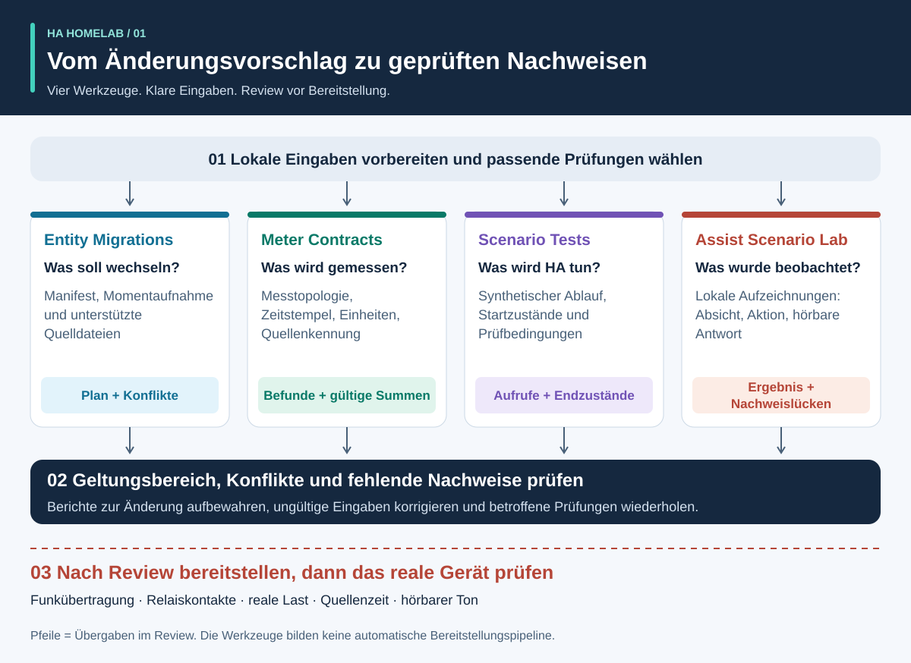
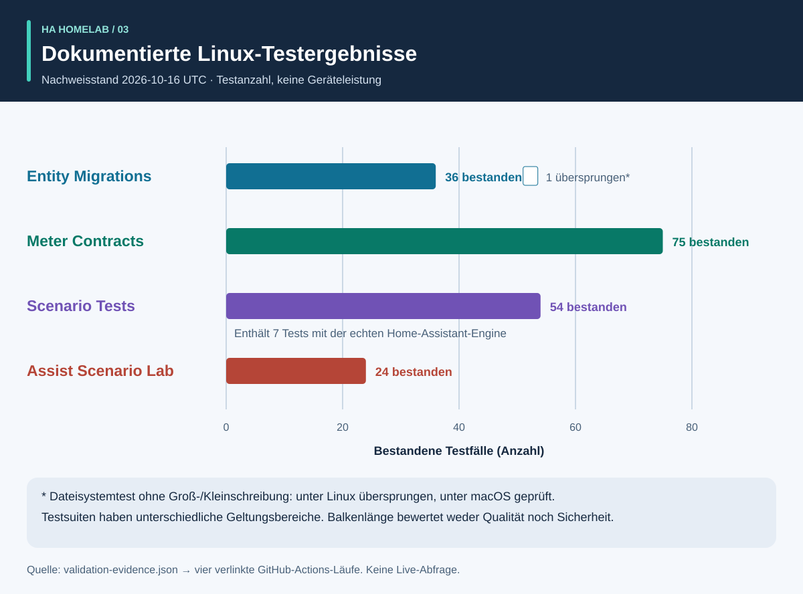
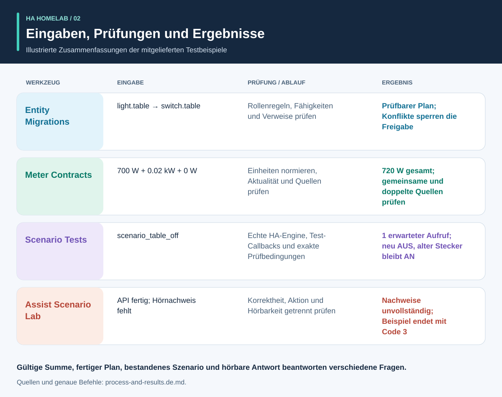

# Erst Nachweise, dann Automation

<!-- language-navigation:start -->
<p dir="ltr">
<a href="README.md" lang="en" dir="ltr">English</a> · <a href="README.ar.md" lang="ar" dir="rtl">العربية</a> · <a href="README.bn.md" lang="bn" dir="ltr">বাংলা</a> · <a href="README.cs.md" lang="cs" dir="ltr">Čeština</a> · <a href="README.de.md" lang="de" dir="ltr">Deutsch</a> · <a href="README.es.md" lang="es" dir="ltr">Español</a> · <a href="README.fa.md" lang="fa" dir="rtl">فارسی</a> · <a href="README.fr.md" lang="fr" dir="ltr">Français</a><br>
<a href="README.he.md" lang="he" dir="rtl">עברית</a> · <a href="README.hi.md" lang="hi" dir="ltr">हिन्दी</a> · <a href="README.id.md" lang="id" dir="ltr">Bahasa Indonesia</a> · <a href="README.it.md" lang="it" dir="ltr">Italiano</a> · <a href="README.ja.md" lang="ja" dir="ltr">日本語</a> · <a href="README.ko.md" lang="ko" dir="ltr">한국어</a> · <a href="README.nl.md" lang="nl" dir="ltr">Nederlands</a> · <a href="README.pl.md" lang="pl" dir="ltr">Polski</a><br>
<a href="README.pt.md" lang="pt" dir="ltr">Português</a> · <a href="README.ru.md" lang="ru" dir="ltr">Русский</a> · <a href="README.th.md" lang="th" dir="ltr">ไทย</a> · <a href="README.tr.md" lang="tr" dir="ltr">Türkçe</a> · <a href="README.uk.md" lang="uk" dir="ltr">Українська</a> · <a href="README.vi.md" lang="vi" dir="ltr">Tiếng Việt</a> · <a href="README.zh-Hans.md" lang="zh-Hans" dir="ltr">简体中文</a> · <a href="README.zh-Hant.md" lang="zh-Hant" dir="ltr">繁體中文</a>
</p>
<!-- language-navigation:end -->

Vier kleine Werkzeuge helfen einem Home-Assistant-Community-Projekt, vier unterschiedliche Fragen zu beantworten: **Welche Rolle soll ein Gerät übernehmen, was umfasst eine Messung, was führt die Automationsengine tatsächlich aus, und welche Nachweise stützen ein Sprachergebnis?** Ihre ersten Releases arbeiten mit lokalen Dateien und synthetischen Testdaten. Sie spielen keine Haushaltskonfiguration ein und zertifizieren keine physischen Geräte.



[Visueller Rundgang: Ablauf, Ausgaben und Ergebnisse](process-and-results.de.md) · [Zustandsdiagramm](role-transfer.de.svg) · [Diagramm der Testnachweise](validation.de.svg)

## Die vier Projekte

- [HA Entity Migrations](https://github.com/ha-homelab/ha-entity-migrations) erzeugt einen Offline-Migrationsplan. Ausdrückliche Regeln für Rollen und Hardware, Fähigkeiten sowie Datei-Fingerprints verhindern, dass eine einfache Umbenennung unbemerkt eine Lichtautomation einer inzwischen anders genutzten Steckdose zuordnet. Ein freigabefähiger Plan gilt nur für den übergebenen, unterstützten Konfigurationsumfang.
- [HA Meter Contracts](https://github.com/ha-homelab/ha-meter-contracts) prüft den physischen Messumfang, die Herkunft der Quellen, Einheiten, Aktualität der Messwerte und Additionsregeln. Durch Umbenennen wird ein Zähler für eine Steckdosenleiste nicht zum Einzelzähler einer Pumpe. Mehrfache Darstellungen desselben Stromwandlers dürfen nicht als getrennte Lasten addiert werden.
- [HA Scenario Tests](https://github.com/ha-homelab/ha-scenario-tests) führt ein begrenztes synthetisches Szenario in der echten Automations- und Skriptengine von Home Assistant aus. Es prüft Aufrufreihenfolgen, verbotene Aufrufe und synthetische Endzustände. Die aktuelle Laufzeitumgebung ist auf HA 2026.10.1 und Python 3.14.2–3.14.x festgelegt; verwende eine von den anderen Werkzeugen getrennte Umgebung.
- [Assist Scenario Lab](https://github.com/ha-homelab/assist-scenario-lab) wertet lokale Sprachnachweise aus. Es trennt die Korrektheit eines Befehls vom API-Abschluss und der hörbaren Ausgabe. Alle mitgelieferten Zeitangaben sind synthetisch; übergebene Beobachtungen werden nicht unabhängig verifiziert.

Die Projekte haben eigene Installationsanleitungen, englische/russische Dokumentation und CLI-Meldungen auf Englisch, Russisch, Deutsch und Spanisch. Beachte ihre versionierten Verträge, statt für alle Exit-Codes dieselbe Bedeutung anzunehmen. Die Diagrammpfeile sind **Übergaben im Review**, keine implementierten automatischen Integrationen. Es gibt keinen zentralen Daemon und keinen universellen Bereitstellungsbefehl. Übersetzte Dokumentation erweitert weder die CLI-Sprachen noch die unterstützten Sprachen der Sprachfunktionen; maßgeblich sind die tatsächlichen Sprachangaben des jeweiligen Projekts.

Gehostete Wikis: [Entity Migrations](https://github.com/ha-homelab/ha-entity-migrations/wiki) · [Meter Contracts](https://github.com/ha-homelab/ha-meter-contracts/wiki) · [Scenario Tests](https://github.com/ha-homelab/ha-scenario-tests/wiki) · [Assist Scenario Lab](https://github.com/ha-homelab/assist-scenario-lab/wiki) · [ZAC93 + ESP32](https://github.com/ha-homelab/zac93-esp32/wiki)

## Prüfnachweise — 2026-10-16 UTC

Dies sind versionsbezogene Softwareprüfungen mit synthetischen Daten, keine Hardwarezertifizierung und kein Haushaltsbenchmark.



Die Balken zeigen Anzahlen, keine Testabdeckung oder Qualitätsrangliste. Die datierten Quellen stehen in [validation-evidence.json](validation-evidence.json).

- **Entity Migrations:** Lokal bestanden 37 Tests plus 9 Untertests, einschließlich der Regressionstests für Quellenaliasnamen. Der [Linux-Lauf auf main](https://github.com/ha-homelab/ha-entity-migrations/actions/runs/38843701264) bestand 36 Tests und übersprang den Test für Dateisysteme ohne Unterscheidung von Groß- und Kleinschreibung; dieser wurde lokal ausgeführt.
- **Meter Contracts:** [75 Tests bestanden in der Linux-CI](https://github.com/ha-homelab/ha-meter-contracts/actions/runs/38843671896), einschließlich Herkunftskonflikten, Prüfung zulässiger Quelldateien und Messsemantik.
- **Assist Scenario Lab:** [24 Tests bestanden in der Linux-CI](https://github.com/ha-homelab/assist-scenario-lab/actions/runs/38843304306). Sie validieren übergebene Nachweise und synthetische Beispiele; ein physischer Sprachvergleich wird nicht behauptet.
- **Scenario Tests:** [54 Tests bestanden ohne übersprungene Fälle in der Linux-CI](https://github.com/ha-homelab/ha-scenario-tests/actions/runs/38843681199) auf CPython 3.14.8 mit echtem Home Assistant 2026.10.0. Darunter sind sieben Laufzeitfälle; einer prüft das begleitende Rollenwechsel-Szenario. Die gesamte Testsuite lief in 21.42 Sekunden durch.

Linux ist die geprüfte Ausführungsumgebung. Der [dokumentierte Fehler beim nativen Beenden unter macOS](https://github.com/ha-homelab/ha-scenario-tests/blob/main/docs/validation.md) bleibt eine Einschränkung; ein erwartetes JSON-Ergebnis vor einem Prozessabsturz macht den Lauf nicht erfolgreich. Der Nachweis vom 16. Oktober behauptet weder eine Ausführung in Docker noch die Abnahme physischer Geräte.

Aktualisierung vom 19. Oktober 2026: Die [Linux-CI](https://github.com/ha-homelab/ha-scenario-tests/actions/runs/39264346721) hat auch einen Docker-Smoke-Test der paketierten Laufzeitumgebung bestanden. Dies belegt keine Abnahme physischer Geräte.

## Ablauf und illustrierte Ergebnisse



Der [visuelle Rundgang](process-and-results.de.md) erklärt jede Ausgabe, verfolgt die Zustände des Ersatzgeräts und der bisher verwendeten Hardware und trennt Softwarenachweise von der physischen Abnahme. Die illustrierten Ergebnisse fassen mitgelieferte synthetische Beispiele zusammen; sie sind keine Screenshots unbearbeiteter Berichte.

## Ein konkreter Ablauf von der Migration zum Test

1. Führe in `ha-entity-migrations` nach der Installation dieses Repositorys das mitgelieferte Beispiel für einen Domänenwechsel aus:

   ```sh
   ha-entity-migrations --lang en plan --manifest examples/domain-change/manifest.json --snapshot examples/domain-change/snapshot.json --root examples/domain-change
   ```

   Prüfe die vorgeschlagenen Änderungen `light.table` → `switch.table` und `light.turn_off` → `switch.turn_off`. Fingerprints und unterstützte Verweise begrenzen den Geltungsbereich. Ein blockierter Plan muss untersucht werden; ersetze fehlende Fähigkeitsnachweise nicht durch bedingungsloses Suchen und Ersetzen.

2. Übertrage das geprüfte Verhalten in einen synthetischen Test. [role-transfer.scenario.json](role-transfer.scenario.json) ist ein von Hand erstelltes Begleitszenario, **kein automatischer Export** des Migrationsplans. Es sendet ein synthetisches Ereignis „Tisch aus“, erwartet einen Aufruf für den Ersatz der Rolle und verbietet das Ausschalten der bisher verwendeten Hardware. Außerdem prüft es, dass diese Hardware eingeschaltet bleibt. Führe im Verzeichnis dieses Leitfadens Folgendes aus; der Szenariorunner muss in seiner eigenen Umgebung installiert sein:

   ```sh
   ha-scenario validate role-transfer.scenario.json
   ha-scenario run role-transfer.scenario.json
   ```

   Dieses Begleitszenario ist bytegleich mit den [Rollenwechsel-Testdaten](https://github.com/ha-homelab/ha-scenario-tests/blob/0ea7e5a5d24dc89ebe896b1a2387396b3fce18f4/tests/fixtures/role_transfer.json), die im [erfolgreichen Linux-Lauf](https://github.com/ha-homelab/ha-scenario-tests/actions/runs/38843681199) geprüft wurden. Sein SHA-256 lautet `bb8544517eeb4895b80b049cf9e242d04635e7785bd198c1d57a7cf3f5fc8ab4`. Der frühere Fehler beim Beenden unter macOS bleibt dokumentiert und wird nicht als bestandener Lauf gezählt.

   Das Szenario verwendet die echte HA-Engine mit Aktor-Callbacks im Speicher. Ein erfolgreiches Ergebnis belegt das Engine-Verhalten für die übergebene synthetische Folge, nicht die Funkübertragung, das Schließen von Kontakten oder die Stromversorgung eines Geräts. Das einzelne Ereignis deckt keine gesamte Haushaltskonfiguration ab.

3. Ergänze vor der Bereitstellung relevante Fehlerfolgen: durch Sensorausfall unterbrochene Abwesenheit, manuelles Festhalten eines Zustands, Neuladen der Automation, doppelte Trigger und wiederhergestellten Zustand. Die mitgelieferten Beispiele des Runners decken Anwesenheit, manuelles Festhalten, veraltete Eingaben und Zustandsabgleich nach Neuladen ab. Da seine Uhr mit real verstrichener Zeit arbeitet, validiert ein kurzes Testbeispiel kein produktives Intervall von zwanzig Minuten. Laut HA-Dokumentation überdauern `for`-Wartezeiten keinen Neustart und kein Neuladen; wähle und teste bei Bedarf einen ausdrücklichen Zustandsabgleich oder dauerhaft gespeicherte Fristen. [HA-Trigger-Dokumentation](https://www.home-assistant.io/docs/automation/trigger/)

4. Prüfe Messnachweise unabhängig davon. Führe im Messwerkzeug-Repository Folgendes aus:

   ```sh
   ha-meter-contracts check examples/valid-three-meters.json --at 2026-01-01T12:00:05Z --json
   ha-meter-contracts check examples/kmc-shared-meter.json --at 2026-01-01T12:00:05Z --json
   ha-meter-contracts check examples/duplicate-emporia.json --at 2026-01-01T12:00:05Z --json
   ```

   Das gültige Beispiel ist erfolgreich. Die beiden anderen enden absichtlich mit Exit-Code 1: einmal wegen der versuchten Zuordnung eines Leisten-Gesamtwerts zu einer einzelnen Steckdose, einmal wegen mehrfacher Darstellungen derselben Quelle. Behandle diese Ergebnisse beim Skripten als erwartete Fehler. Verwende die Gesamtleistung einer Steckdosenleiste nicht für eine Schutzschwelle, die ursprünglich nur für eine Pumpe kalibriert wurde. Eine Spannungskalibrierung ist keine Strom- oder Leistungskalibrierung. Fehlende oder veraltete Nachweise bleiben nicht verfügbar und werden nicht zu null. [HA-Sensor- und Statistiksemantik](https://developers.home-assistant.io/docs/core/entity/sensor/#long-term-statistics)

5. Wenn Sprache als Auslöser oder Rückmeldung dient, werte die Nachweise separat im Sprach-Repository aus:

   ```sh
   assist-lab evaluate examples/synthetic-pass.json
   assist-lab evaluate examples/synthetic-incomplete.json
   ```

   Das unvollständige Beispiel endet absichtlich mit Exit-Code 3, weil ein API-Abschluss die Hörbarkeit nicht ausreichend belegt. Ein echter Benchmark benötigt Zustimmung zur Aufzeichnung, eine festgelegte Uhr und Methode, vergleichbare Bedingungen sowie unabhängige Beobachtungen der Aktion und der hörbaren Antwort. Veröffentliche keine Haushaltsaufnahmen, Transkripte oder exportierten Tokens. Der erste Audioblock eines Servers ist nicht der erste Ton beim Zuhörer. [HA-Assist-Pipelines](https://developers.home-assistant.io/docs/voice/pipelines/)

6. Bewahre jeden Bericht zusammen mit der geprüften Änderung auf. Wende die Änderung über das etablierte Review- und Bereitstellungsverfahren der Installation an und führe anschließend die gerätespezifische Abnahme durch. Physisches Ein-/Ausschalten, Anzeigepolarität, Neustartverhalten, Quellenzeit und Kalibrierung je Messgröße erfordern reale Beobachtungen. Diese vier Werkzeuge führen diesen Schritt weder aus noch ersetzen sie ihn.

## Was die Prüfungen nicht belegen

Ein konfigurierter Zustand, ein angenommener Dienstaufruf, beobachteter Stromverbrauch und Wasserfluss sind unterschiedliche Nachweise. Ein Gesamtzähler für drei Lasten kann nicht bestimmen, welche Last den Strom bezogen hat. Ein synthetischer Zustand „aus“ beweist nicht, dass Relaiskontakte geöffnet haben. Weder das Messwerkzeug noch ein Szenariotest ist eine Sicherheitssteuerung für Wasser, Heizgeräte, Zugangssysteme oder andere Lasten mit erheblichen Auswirkungen.

Die Werkzeuge erzwingen die Ergebnisse der jeweils anderen nicht. Eine zukünftige Integration kann ihr stabiles JSON verarbeiten, muss aber akzeptierte Warnstufen, Versionskompatibilität und die Bedeutung „vollständiger Nachweise“ ausdrücklich festlegen. Fasse `ready`, `available`, `passed` und `audible` nicht zu einem austauschbaren booleschen Wert zusammen.

## Roadmap: vierzehn Ideen mit klarem Reifegrad

Die ersten vier unten genannten Code-Ergebnisse stehen als erste Offline-Werkzeuge bereit. Alle genannten Folgearbeiten sind weiterhin Vorschläge; ein Repositoryname oder Diagramm bedeutet nicht, dass Hardware in Betrieb genommen wurde.

1. **Rollenmigrationen — erstes Werkzeug implementiert.** Unterstützte Verweisformate nur mit Roundtrip- und Konflikttests erweitern; die ausdrückliche Grenze für nicht unterstützte Eingaben beibehalten.
2. **Messverträge — erstes Werkzeug implementiert.** Private reale Beobachtungen mit Zeitstempeln erproben; Strom und Leistung unabhängig messen, bevor eine Kalibrierung behauptet wird. Eine Zuordnung je Steckdose benötigt weiterhin Nachweise je Steckdose.
3. **Automationsszenarien — erstes Werkzeug implementiert.** Geprüfte Regeln sowie Neustart- und Fristfälle ergänzen; Zeitverhalten über produktive Zeiträume bei Bedarf separat prüfen.
4. **Sprachnachweise — erstes Werkzeug implementiert; physischer Benchmark ausstehend.** Satelliten, Beobachtungsmethode und Zustimmung zur Aufnahme festlegen, bevor vergleichbare Sitzungen aufgezeichnet werden. Noch keine Hardware-Rangliste.
5. **Luftqualitätssteuerung — Prüfung von Sensoren und Aktoren ausstehend.** Prüfen, ob ein Gerät CO₂ oder Partikel misst, wie alt und genau es ist und was Lüftung oder Filterung beeinflussen können. Außenbedingungen vor einer Lüftungsregel bestätigen.
6. **Radar- und Anwesenheitsnachweise — Hardware-Inbetriebnahme ausstehend.** LD2450-Platine, Versorgung, Gehäuse, Protokoll und Abdeckung prüfen. Erkannte Ziele sind keine Personenidentitäten; das Alter eines Empfangs ist keine gemessene Sensorlatenz. CSI bleibt experimentell.
7. **Wasser- und Pumpenbeobachtung — unabhängige Nachweise ausstehend.** Freigabe zur Pumpenversorgung, elektrische Leistungsaufnahme, Wasserfluss und Wasserstand unterscheiden. Ein Gesamtzähler einer Steckdosenleiste kann ein fehlendes pumpenspezifisches Schutzsignal nicht liefern. Automatische Wiederholungen kritischer Befehle ohne beobachteten Zustand und installationsbezogenes Review vermeiden.
8. **BLE-Telemetrie — kompatible Proxys und Abdeckungstests ausstehend.** Die tatsächlichen Sensoren, Temperaturbereiche, Batterien und Platzierungen validieren. ESP8266-Geräte sind keine BLE-Proxys; RSSI ist weder Identität noch Entriegelungsberechtigung. [ESPHome-Bluetooth-Proxy](https://esphome.io/components/bluetooth_proxy/)
9. **Anwesenheitsbasierte Erklärungen und Haushaltsgeräte — Fähigkeitsprüfung ausstehend.** Erklären, welche Beobachtung ein Licht eingeschaltet hielt; sofern unterstützt, tatsächliche Waschmaschinen- und Trocknerereignisse nutzen. Einen Gerätezyklus nicht allein aus einem gemeinsam genutzten Zähler ableiten und aus nicht zusammengehörenden Sensorflags keine statistische Sicherheit erfinden.
10. **Z-Wave-Bridge — Lieferung, Aufbau und Funkabnahme ausstehend.** Der [ZAC93-ESP32-Leitfaden](https://github.com/ha-homelab/zac93-esp32) ist ein separater Hardwarepfad. Verdrahtung, regionale Frequenz, seriellen Transport und Einbindung in Z-Wave JS an der tatsächlichen Platine prüfen. Die Long-Range-Unterstützung eines Controllers macht einen älteren Sensor nicht zum Long-Range-Gerät. [Z-Wave-JS-Leitfaden](https://zwave-js.github.io/zwave-js/#/getting-started/index)
11. **ESPHome-Steckdosenabnahme — Einzeltests der Hardware ausstehend.** Für jede Revision Nachweise zu Taste, Relais, Anzeige und Neustart sowie separate Spannungs-, Strom- und Leistungskalibrierungen erfassen. Erfolgreiches Flashen ist keine abgeschlossene Abnahme. Kein unbeaufsichtigtes massenhaftes Aus- und Einschalten angeschlossener Geräte.
12. **Prognosevergleich — angesammelte Daten ausstehend.** Ausgegebene Prognosen und spätere Istwerte archivieren, den Ausgabezeitpunkt erhalten und Prognosehorizonte ohne Vorgriff auf zukünftige Daten bewerten. Das erfordert verstrichene Beobachtungszeit; ein synthetisches Beispiel belegt keine Energieeinsparung.
13. **Begrenzte Gaststeuerung — Prüfung der Backend-Berechtigungen ausstehend.** Identität und serverseitige Autorisierung prüfen. Versteckte Dashboard-Bedienelemente allein begrenzen keinen Zugriff. Die Authentifizierung nicht abschwächen, nur um ein Panel leichter einzurichten.
14. **Zeitplanung verschiebbarer Lasten — gemessene Randbedingungen und Fähigkeiten ausstehend.** Etablierte Planungswerkzeuge nach Validierung von Messgeräten, Zustandsrückmeldungen und Prognosen einbinden. Bestätigen, welche Lasten tatsächlich verschoben oder moduliert werden können, welche Fristen gelten und welche manuellen Übersteuerungen existieren. Mit geprüften Empfehlungen beginnen, ohne spekulative Einsparungen oder Sicherheitsgarantien. [EMHASS](https://emhass.readthedocs.io/en/latest/emhass.html) · [evcc](https://docs.evcc.io/en/)

## Beiträge und Reproduktion dieses Leitfadens

Diese Übersicht, das synthetische Szenario und das Diagramm sind originales Material unter MIT-Lizenz; siehe [LICENSE](LICENSE). Erzeuge alle lokalisierten SVGs mit `python3 render_architecture.py` neu. Sie enthalten keine externen Bilder, Skripte, Haushaltskennungen oder gemessenen Haushaltsdaten. Der [visuelle Rundgang](process-and-results.de.md#illustrationen-reproduzieren-oder-übersetzen) erklärt die Quelldaten und Prüfungen bei der Neuerzeugung. Öffentliche Testdaten bleiben synthetisch, private Exporte außerhalb von Git. Für Änderungen gelten die Sicherheits- und Beitragsrichtlinien des jeweiligen Repositorys.
