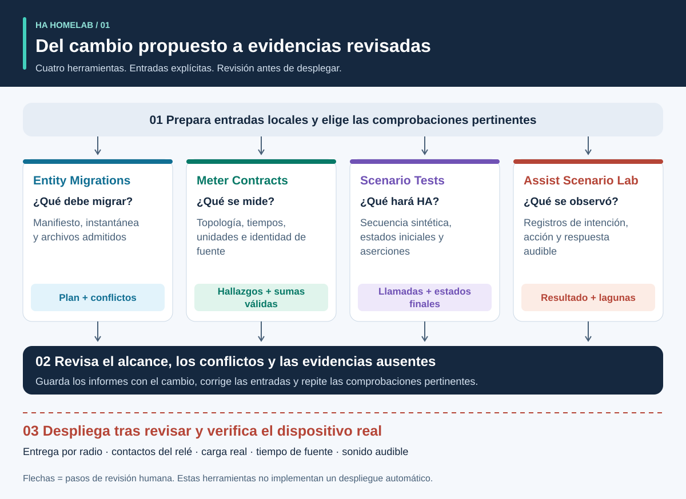
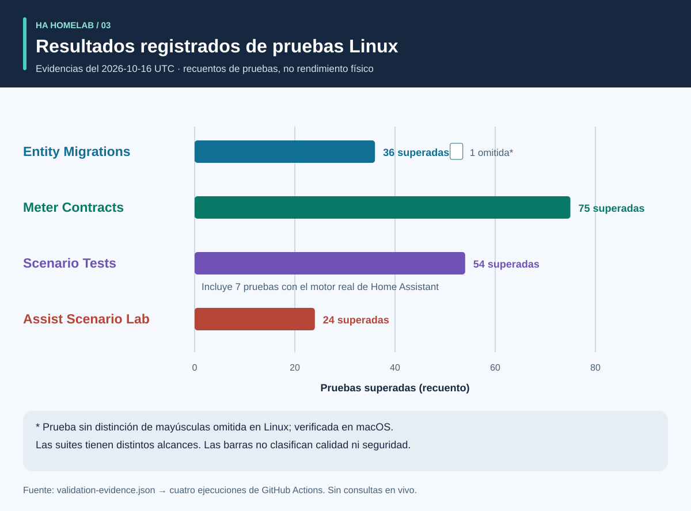
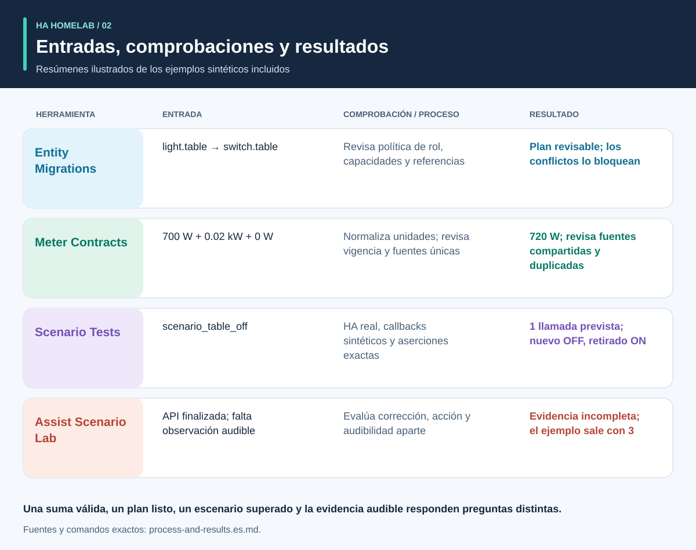

# Evidencias antes de automatizar

<!-- language-navigation:start -->
<p dir="ltr">
<a href="README.md" lang="en" dir="ltr">English</a> · <a href="README.ar.md" lang="ar" dir="rtl">العربية</a> · <a href="README.bn.md" lang="bn" dir="ltr">বাংলা</a> · <a href="README.cs.md" lang="cs" dir="ltr">Čeština</a> · <a href="README.de.md" lang="de" dir="ltr">Deutsch</a> · <a href="README.es.md" lang="es" dir="ltr">Español</a> · <a href="README.fa.md" lang="fa" dir="rtl">فارسی</a> · <a href="README.fr.md" lang="fr" dir="ltr">Français</a><br>
<a href="README.he.md" lang="he" dir="rtl">עברית</a> · <a href="README.hi.md" lang="hi" dir="ltr">हिन्दी</a> · <a href="README.id.md" lang="id" dir="ltr">Bahasa Indonesia</a> · <a href="README.it.md" lang="it" dir="ltr">Italiano</a> · <a href="README.ja.md" lang="ja" dir="ltr">日本語</a> · <a href="README.ko.md" lang="ko" dir="ltr">한국어</a> · <a href="README.nl.md" lang="nl" dir="ltr">Nederlands</a> · <a href="README.pl.md" lang="pl" dir="ltr">Polski</a><br>
<a href="README.pt.md" lang="pt" dir="ltr">Português</a> · <a href="README.ru.md" lang="ru" dir="ltr">Русский</a> · <a href="README.th.md" lang="th" dir="ltr">ไทย</a> · <a href="README.tr.md" lang="tr" dir="ltr">Türkçe</a> · <a href="README.uk.md" lang="uk" dir="ltr">Українська</a> · <a href="README.vi.md" lang="vi" dir="ltr">Tiếng Việt</a> · <a href="README.zh-Hans.md" lang="zh-Hans" dir="ltr">简体中文</a> · <a href="README.zh-Hant.md" lang="zh-Hant" dir="ltr">繁體中文</a>
</p>
<!-- language-navigation:end -->

Cuatro pequeñas herramientas ayudan a un proyecto comunitario de Home Assistant a responder cuatro preguntas distintas: **¿en qué debe convertirse el rol de un dispositivo, qué abarca una medición, qué hace realmente el motor de automatización y qué evidencias respaldan un resultado de voz?** Sus primeras versiones trabajan con archivos locales y datos de prueba sintéticos. No despliegan configuraciones del hogar ni certifican dispositivos físicos.



[Recorrido visual: proceso, salidas y resultados](process-and-results.es.md) · [Diagrama de cambios de estado](role-transfer.es.svg) · [Gráfico de evidencias de pruebas](validation.es.svg)

## Los cuatro proyectos

- [HA Entity Migrations](https://github.com/ha-homelab/ha-entity-migrations) genera un plan de migración sin conexión. Las políticas explícitas de rol y hardware, las capacidades y las huellas de los archivos evitan que un cambio de nombre rutinario asigne silenciosamente una automatización de iluminación a un enchufe reutilizado para otra función. Un plan listo solo se aplica al ámbito de configuración proporcionado y compatible.
- [HA Meter Contracts](https://github.com/ha-homelab/ha-meter-contracts) comprueba el alcance físico de las mediciones, la procedencia de las fuentes, las unidades, la vigencia de las muestras y las reglas de suma. Cambiar el nombre de un medidor de regleta no lo convierte en un medidor individual de bomba. Las representaciones duplicadas de un mismo transformador de corriente no se pueden sumar como cargas independientes.
- [HA Scenario Tests](https://github.com/ha-homelab/ha-scenario-tests) ejecuta un escenario sintético restringido en el motor real de automatizaciones y scripts de Home Assistant. Comprueba llamadas ordenadas, llamadas prohibidas y estados sintéticos finales. Su entorno de ejecución actual está fijado a HA 2026.10.1 y Python 3.14.2–3.14.x; utiliza un entorno separado del de las otras herramientas.
- [Assist Scenario Lab](https://github.com/ha-homelab/assist-scenario-lab) evalúa evidencias locales de voz. Distingue la corrección del comando, la finalización de la API y la salida audible. Todos los tiempos incluidos son sintéticos, y las observaciones proporcionadas no se verifican de forma independiente.

Los proyectos tienen sus propias guías de instalación, documentación en inglés y ruso y mensajes de CLI en inglés, ruso, alemán y español. Sigue sus contratos versionados en lugar de suponer que todos los códigos de salida significan lo mismo. Las flechas de los diagramas representan **pasos de revisión**, no integraciones automáticas implementadas. No hay un proceso central ni un comando universal de despliegue.

La documentación traducida no amplía los idiomas de la CLI ni del reconocimiento o la síntesis de voz. Consulta los idiomas compatibles de cada proyecto.

Wikis alojadas: [Entity Migrations](https://github.com/ha-homelab/ha-entity-migrations/wiki) · [Meter Contracts](https://github.com/ha-homelab/ha-meter-contracts/wiki) · [Scenario Tests](https://github.com/ha-homelab/ha-scenario-tests/wiki) · [Assist Scenario Lab](https://github.com/ha-homelab/assist-scenario-lab/wiki) · [ZAC93 + ESP32](https://github.com/ha-homelab/zac93-esp32/wiki)

<a id="validation-evidence--2026-10-16-utc"></a>
## Evidencias de validación — 2026-10-16 UTC

Son comprobaciones de software para versiones concretas con datos sintéticos, no una certificación del hardware ni una comparativa de un hogar.



Las barras muestran recuentos, no cobertura ni una clasificación de calidad. Los registros de origen fechados están en [validation-evidence.json](validation-evidence.json).

- **Entity Migrations:** 37 pruebas y 9 subpruebas superadas localmente, incluidas las regresiones de alias de origen. La [ejecución Linux de main](https://github.com/ha-homelab/ha-entity-migrations/actions/runs/38843701264) superó 36 pruebas y omitió el caso del sistema de archivos que no distingue mayúsculas de minúsculas, que se comprobó localmente.
- **Meter Contracts:** [75 pruebas superadas en CI sobre Linux](https://github.com/ha-homelab/ha-meter-contracts/actions/runs/38843671896), incluidos conflictos de procedencia, admisión de archivos de origen y semántica de mediciones.
- **Assist Scenario Lab:** [24 pruebas superadas en CI sobre Linux](https://github.com/ha-homelab/assist-scenario-lab/actions/runs/38843304306). Validan las evidencias proporcionadas y los ejemplos sintéticos; no se afirma haber comparado dispositivos físicos de voz.
- **Scenario Tests:** [54 pruebas superadas sin omisiones en CI sobre Linux](https://github.com/ha-homelab/ha-scenario-tests/actions/runs/38843681199) con CPython 3.14.8 y Home Assistant 2026.10.0 real, incluidos siete casos de ejecución, uno de los cuales prueba el escenario complementario de transferencia de rol. La suite completa terminó en 21.42 segundos.

Linux es el entorno de ejecución probado. El [fallo documentado durante la finalización nativa en macOS](https://github.com/ha-homelab/ha-scenario-tests/blob/main/docs/validation.md) sigue siendo una limitación; obtener el JSON esperado antes de que el proceso se bloquee sigue siendo una ejecución fallida. El registro del 16 de octubre no afirma haber ejecutado Docker ni completado la aceptación de dispositivos físicos.

Actualización del 19 de octubre de 2026: la [CI de Linux](https://github.com/ha-homelab/ha-scenario-tests/actions/runs/39264346721) también superó una prueba básica en Docker del entorno de ejecución empaquetado. Esto no demuestra la aceptación de dispositivos físicos.

## Proceso y resultados ilustrados



Sigue el [recorrido visual](process-and-results.es.md) para interpretar cada salida, seguir los estados del dispositivo sustituto y del retirado y distinguir las evidencias de software de la aceptación física. Los resultados ilustrados resumen los ejemplos sintéticos incluidos; no son capturas de informes sin procesar.

<a id="a-concrete-migration-to-test-workflow"></a>
## Un proceso concreto: de la migración a la prueba

1. En `ha-entity-migrations`, ejecuta el ejemplo de cambio de dominio incluido tras instalar ese repositorio:

   ```sh
   ha-entity-migrations --lang en plan --manifest examples/domain-change/manifest.json --snapshot examples/domain-change/snapshot.json --root examples/domain-change
   ```

   Revisa los cambios propuestos de `light.table` → `switch.table` y `light.turn_off` → `switch.turn_off`. Considera las huellas y las referencias compatibles como límites del alcance. Un plan bloqueado requiere investigación; no sustituyas las evidencias de capacidad que faltan por una búsqueda y sustitución incondicional.

2. Convierte el comportamiento revisado en una prueba sintética. [role-transfer.scenario.json](role-transfer.scenario.json) es un ejemplo complementario escrito a mano, **no una exportación automática** del plan de migración. Envía un evento sintético «apagar mesa», espera una llamada al rol sustituto y prohíbe apagar el hardware retirado. También verifica que el hardware retirado permanezca encendido. Desde el directorio de esta guía, con el ejecutor de escenarios instalado en su propio entorno:

   ```sh
   ha-scenario validate role-transfer.scenario.json
   ha-scenario run role-transfer.scenario.json
   ```

   Este ejemplo es idéntico byte a byte al [caso de prueba de transferencia de rol](https://github.com/ha-homelab/ha-scenario-tests/blob/0ea7e5a5d24dc89ebe896b1a2387396b3fce18f4/tests/fixtures/role_transfer.json) probado en la [ejecución Linux correcta](https://github.com/ha-homelab/ha-scenario-tests/actions/runs/38843681199). Su SHA-256 es `bb8544517eeb4895b80b049cf9e242d04635e7785bd198c1d57a7cf3f5fc8ab4`. El fallo anterior de finalización en macOS sigue documentado y no se cuenta como una ejecución superada.

   El escenario usa el motor real de HA con callbacks de actuadores en memoria. Superarlo demuestra el comportamiento del motor para esa secuencia sintética proporcionada, no la entrega por radio, el cierre de contactos ni la alimentación de un aparato. Su único evento no cubre toda la configuración de un hogar.

3. Añade secuencias de fallo pertinentes antes del despliegue: ausencia interrumpida por indisponibilidad del sensor, una retención manual, recarga de automatizaciones, activaciones duplicadas y estado restaurado. Los ejemplos incluidos cubren presencia, retención manual, entradas caducadas y reconciliación tras recarga. Como el ejecutor usa tiempo real transcurrido, un caso breve no valida un intervalo de veinte minutos en producción. HA documenta que las esperas `for` no sobreviven a reinicios o recargas; elige y prueba una reconciliación explícita o plazos persistentes cuando sea necesario. [Documentación de activadores de HA](https://www.home-assistant.io/docs/automation/trigger/)

4. Revisa las evidencias de los medidores de forma independiente. Desde el repositorio de mediciones:

   ```sh
   ha-meter-contracts check examples/valid-three-meters.json --at 2026-01-01T12:00:05Z --json
   ha-meter-contracts check examples/kmc-shared-meter.json --at 2026-01-01T12:00:05Z --json
   ha-meter-contracts check examples/duplicate-emporia.json --at 2026-01-01T12:00:05Z --json
   ```

   El ejemplo válido termina correctamente. Los otros dos salen intencionadamente con código 1: respectivamente, intentan atribuir una lectura de toda una regleta a un enchufe y representan por duplicado una misma fuente. Trátalos como fallos esperados al automatizar los ejemplos. No introduzcas los vatios de toda una regleta en un umbral de protección calibrado originalmente solo para una bomba. Calibrar la tensión no equivale a calibrar la corriente o la potencia. Las evidencias ausentes o caducadas siguen sin estar disponibles; no se convierten en cero. [Semántica de sensores y estadísticas de HA](https://developers.home-assistant.io/docs/core/entity/sensor/#long-term-statistics)

5. Si la voz es un activador o un medio de respuesta, evalúa sus evidencias por separado en el repositorio de voz:

   ```sh
   assist-lab evaluate examples/synthetic-pass.json
   assist-lab evaluate examples/synthetic-incomplete.json
   ```

   El ejemplo incompleto sale intencionadamente con código 3 porque completar una API no basta para demostrar audibilidad. Una comparativa real requiere consentimiento para grabar, un reloj y método declarados, condiciones comparables y observación independiente de la acción y la respuesta audible. No publiques grabaciones del hogar, transcripciones ni tokens exportados. El primer fragmento de audio de un servidor no es el primer sonido que llega al oyente. [Canalizaciones Assist de HA](https://developers.home-assistant.io/docs/voice/pipelines/)

6. Conserva cada informe junto al cambio revisado. Aplica el cambio mediante el procedimiento de revisión y despliegue establecido para la instalación y después realiza la aceptación específica de los dispositivos. El encendido y apagado físicos, la polaridad de los indicadores, el comportamiento tras un reinicio, el tiempo de la fuente y la calibración por magnitud requieren observaciones reales. Estas cuatro herramientas no realizan ni sustituyen ese paso.

## Lo que las comprobaciones no demuestran

Un estado configurado, una llamada de servicio aceptada, un consumo observado y un caudal de agua son evidencias diferentes. Un medidor total de tres cargas no puede identificar cuál consumió la potencia. Un estado sintético «apagado» no demuestra que se hayan abierto los contactos de un relé. Ni la herramienta de mediciones ni una prueba de escenario es un controlador de seguridad para agua, calefactores, acceso u otras cargas con consecuencias importantes.

Estas herramientas no imponen los resultados de las demás. Una futura integración puede consumir su JSON estable, pero debe definir explícitamente los niveles de advertencia aceptables, la compatibilidad de versiones y qué significa «evidencias completas». No reduzcas `ready`, `available`, `passed` y `audible` a un único booleano intercambiable.

## Hoja de ruta: catorce ideas y su estado real

Las primeras cuatro entregas de código siguientes están disponibles como herramientas iniciales sin conexión. Todo el trabajo posterior descrito sigue siendo una propuesta; un nombre de repositorio o un diagrama no significa que el hardware esté puesto en servicio.

1. **Migraciones de roles — herramienta inicial implementada.** Amplía los formatos de referencias compatibles solo con pruebas de ida y vuelta y de conflictos; conserva el límite explícito de entradas no compatibles.
2. **Contratos de medición — herramienta inicial implementada.** Prueba en privado con observaciones reales y fechadas; mide corriente y potencia de forma independiente antes de afirmar que están calibradas. La atribución por enchufe sigue requiriendo evidencias por enchufe.
3. **Pruebas de escenarios de automatización — herramienta inicial implementada.** Añade políticas revisadas y casos de reinicios y plazos; prueba por separado los tiempos de duración de producción cuando sea necesario.
4. **Evidencias de voz — herramienta inicial implementada; comparativa física pendiente.** Selecciona los satélites, el método de observación y el consentimiento para grabar antes de recopilar sesiones comparables. Todavía no hay una clasificación del hardware.
5. **Coordinación de calidad del aire — verificación de sensores y actuadores pendiente.** Comprueba si un dispositivo mide CO₂ o partículas, la antigüedad y precisión de sus datos y qué puede modificar la ventilación o filtración. Confirma las condiciones exteriores antes de definir una política de ventilación.
6. **Evidencias de radar y presencia — puesta en servicio del hardware pendiente.** Verifica la placa LD2450, la alimentación, la carcasa, el protocolo y la cobertura. Los objetivos detectados no son identidades humanas, y la antigüedad de recepción no es una latencia medida del sensor. CSI sigue siendo experimental.
7. **Observabilidad de agua y bombas — evidencias independientes pendientes.** Distingue el permiso para alimentar una bomba, su consumo eléctrico, el caudal y el nivel de agua. Un medidor agregado de regleta no puede aportar la señal de protección individual de bomba que falta. Evita políticas de reintento automático para comandos críticos sin estado observado y una revisión específica de la instalación.
8. **Telemetría BLE — proxies compatibles y pruebas de cobertura pendientes.** Valida los sensores reales, su rango de temperatura, baterías y ubicación. Los dispositivos ESP8266 no son proxies BLE; RSSI no es una identidad ni una credencial de desbloqueo. [Proxy Bluetooth de ESPHome](https://esphome.io/components/bluetooth_proxy/)
9. **Explicaciones basadas en presencia y electrodomésticos — verificación de capacidades pendiente.** Explica qué observación mantuvo una luz encendida; usa eventos reales de lavadora y secadora si están disponibles. No deduzcas el ciclo de un aparato solo a partir de un medidor compartido ni inventes confianza estadística a partir de indicadores de sensores no relacionados.
10. **Puente Z-Wave — entrega, montaje y aceptación por radio pendientes.** La [guía ZAC93 + ESP32](https://github.com/ha-homelab/zac93-esp32) es una línea de hardware independiente. Verifica el cableado, la frecuencia regional, el transporte serie y la inclusión con Z-Wave JS en la placa real. Que el controlador admita Long Range no convierte un sensor antiguo en un dispositivo Long Range. [Guía Z-Wave JS](https://zwave-js.github.io/zwave-js/#/getting-started/index)
11. **Aceptación de enchufes ESPHome — pruebas individuales de hardware pendientes.** Registra las evidencias de botón, relé, indicador y reinicio para cada revisión, además de calibraciones separadas de tensión, corriente y potencia. Grabar correctamente el firmware no completa la aceptación. No realices ciclos masivos de alimentación sin supervisión en aparatos conectados.
12. **Comparativa de previsiones — acumulación de datos pendiente.** Archiva las previsiones emitidas y las mediciones reales posteriores, conserva el momento de emisión y evalúa los horizontes sin incorporar información futura. Requiere tiempo real de observación, no afirmar ahorros energéticos a partir de un ejemplo sintético.
13. **Controles limitados para invitados — revisión de permisos del backend pendiente.** Verifica la identidad y la autorización en el servidor. Ocultar controles del panel no limita por sí solo el acceso. No debilites la autenticación para simplificar un panel.
14. **Programación de cargas aplazables — restricciones medidas y capacidades pendientes.** Integra herramientas consolidadas de programación tras validar medidores, información de estado y previsiones. Confirma qué cargas se pueden aplazar o modular realmente, sus plazos y las anulaciones manuales. Empieza con recomendaciones revisadas, sin ahorros especulativos ni garantías de seguridad. [EMHASS](https://emhass.readthedocs.io/en/latest/emhass.html) · [evcc](https://docs.evcc.io/en/)

## Contribuir y reproducir esta guía

Esta descripción, el escenario sintético y el diagrama son material original con licencia MIT; consulta [LICENSE](LICENSE). Regenera los SVG de todos los idiomas compatibles con `python3 render_architecture.py`. No contienen imágenes externas, scripts, identificadores del hogar ni datos medidos en hogares. El [recorrido visual](process-and-results.es.md#reproduce-or-translate-the-illustrations) explica los registros de origen y las comprobaciones de regeneración. Mantén sintéticos los casos de prueba públicos y las exportaciones privadas fuera de Git. Para los cambios, sigue las guías de seguridad y contribución de cada repositorio.
