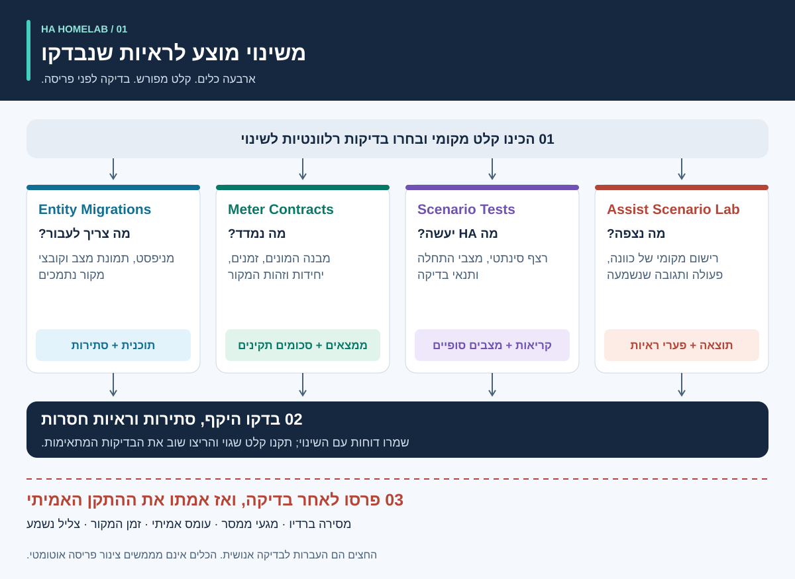
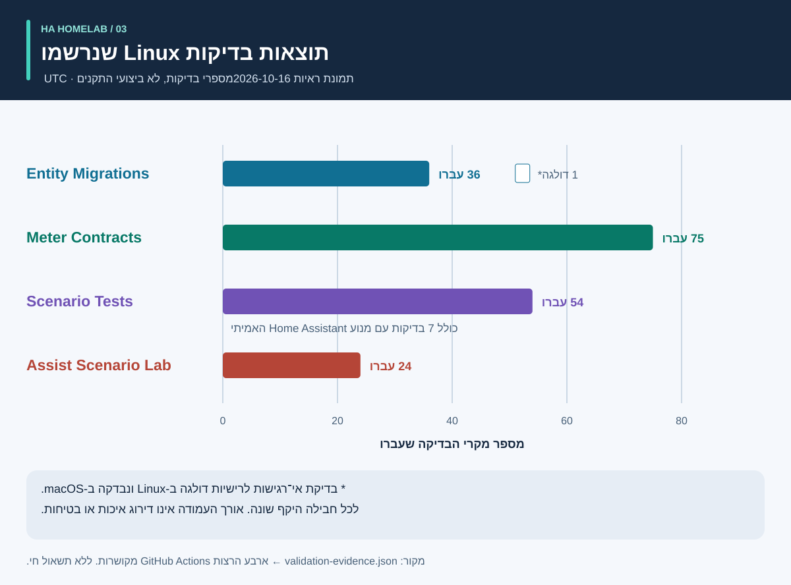
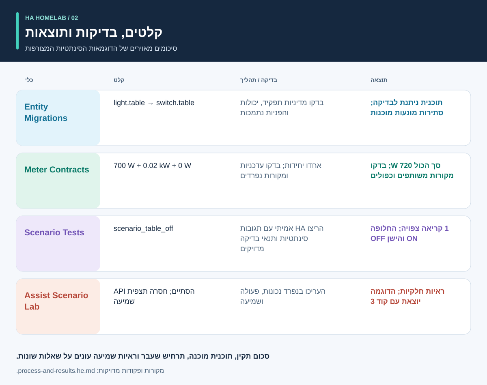

<div dir="rtl">

# ראיות לפני אוטומציה

<!-- language-navigation:start -->
<p dir="ltr">
<a href="README.md" lang="en" dir="ltr">English</a> · <a href="README.ar.md" lang="ar" dir="rtl">العربية</a> · <a href="README.bn.md" lang="bn" dir="ltr">বাংলা</a> · <a href="README.cs.md" lang="cs" dir="ltr">Čeština</a> · <a href="README.de.md" lang="de" dir="ltr">Deutsch</a> · <a href="README.es.md" lang="es" dir="ltr">Español</a> · <a href="README.fa.md" lang="fa" dir="rtl">فارسی</a> · <a href="README.fr.md" lang="fr" dir="ltr">Français</a><br>
<a href="README.he.md" lang="he" dir="rtl">עברית</a> · <a href="README.hi.md" lang="hi" dir="ltr">हिन्दी</a> · <a href="README.id.md" lang="id" dir="ltr">Bahasa Indonesia</a> · <a href="README.it.md" lang="it" dir="ltr">Italiano</a> · <a href="README.ja.md" lang="ja" dir="ltr">日本語</a> · <a href="README.ko.md" lang="ko" dir="ltr">한국어</a> · <a href="README.nl.md" lang="nl" dir="ltr">Nederlands</a> · <a href="README.pl.md" lang="pl" dir="ltr">Polski</a><br>
<a href="README.pt.md" lang="pt" dir="ltr">Português</a> · <a href="README.ru.md" lang="ru" dir="ltr">Русский</a> · <a href="README.th.md" lang="th" dir="ltr">ไทย</a> · <a href="README.tr.md" lang="tr" dir="ltr">Türkçe</a> · <a href="README.uk.md" lang="uk" dir="ltr">Українська</a> · <a href="README.vi.md" lang="vi" dir="ltr">Tiếng Việt</a> · <a href="README.zh-Hans.md" lang="zh-Hans" dir="ltr">简体中文</a> · <a href="README.zh-Hant.md" lang="zh-Hant" dir="ltr">繁體中文</a>
</p>
<!-- language-navigation:end -->

תרגום התיעוד אינו מרחיב את תמיכת השפות של ה-CLI או של הדיבור; בדקו אילו שפות נתמכות בכל פרויקט.

ארבעה כלים קטנים עוזרים לפרויקט קהילתי של Home Assistant לענות על ארבע שאלות שונות: **לאן צריך לעבור תפקידו של התקן, מה המדידה מכסה, מה מנוע האוטומציה עושה בפועל, ואילו ראיות תומכות בתוצאה קולית?** הגרסאות הראשונות פועלות על קבצים מקומיים ונתוני בדיקה סינתטיים. הן אינן פורסות תצורה ביתית ואינן מסמיכות התקנים פיזיים.



[הדרכה חזותית: תהליך, פלטים ותוצאות](process-and-results.he.md) · [תרשים שינוי מצב](role-transfer.he.svg) · [תרשים ראיות הבדיקה](validation.he.svg)

## ארבעת הפרויקטים

- [HA Entity Migrations](https://github.com/ha-homelab/ha-entity-migrations) יוצר תוכנית הסבה לא מקוונת. מדיניות מפורשת לתפקיד ולחומרה, יכולות וטביעות אצבע של קבצים מונעות משינוי שם שגרתי לשייך בשקט אוטומציית תאורה לשקע שקיבל שימוש אחר. תוכנית מוכנה תקפה רק לתצורה שסופקה ובתחום הנתמך.
- [HA Meter Contracts](https://github.com/ha-homelab/ha-meter-contracts) בודק את תחום המדידה הפיזי, מקור הנתונים, היחידות, עדכניות הדגימה וכללי החיבור. שינוי שם של מונה מפצל אינו הופך אותו למונה נפרד למשאבה. אין לחבר ייצוגים כפולים של אותו שנאי זרם כאילו היו עומסים נפרדים.
- [HA Scenario Tests](https://github.com/ha-homelab/ha-scenario-tests) מריץ תרחיש סינתטי מוגבל במנוע האוטומציות והסקריפטים האמיתי של Home Assistant. הוא בודק את סדר הקריאות, קריאות אסורות ומצבים סינתטיים סופיים. סביבת הריצה הראשונה מקובעת ל-HA 2026.10.0 ול-Python 3.14.2–3.14.x; השתמשו בסביבה נפרדת מזו של הכלים האחרים.
- [Assist Scenario Lab](https://github.com/ha-homelab/assist-scenario-lab) מעריך ראיות קוליות מקומיות. הוא מפריד בין נכונות הפקודה, השלמת API ופלט שנשמע. כל נתוני התזמון המצורפים סינתטיים, והתצפיות שסופקו אינן מאומתות באופן עצמאי.

לכל פרויקט מדריך התקנה משלו והודעות CLI באנגלית, ברוסית, בגרמנית ובספרדית. פעלו לפי החוזים של הגרסה המתאימה ואל תניחו שכל קודי היציאה מציינים אותו דבר. החצים בתרשים מייצגים **העברה לבדיקה אנושית**, ולא אינטגרציות אוטומטיות שכבר מומשו. אין שירות מרכזי או פקודת פריסה אוניברסלית.

אתרי ויקי: [Entity Migrations](https://github.com/ha-homelab/ha-entity-migrations/wiki) · [Meter Contracts](https://github.com/ha-homelab/ha-meter-contracts/wiki) · [Scenario Tests](https://github.com/ha-homelab/ha-scenario-tests/wiki) · [Assist Scenario Lab](https://github.com/ha-homelab/assist-scenario-lab/wiki) · [ZAC93 + ESP32](https://github.com/ha-homelab/zac93-esp32/wiki)

<a id="validation-evidence--2026-10-16-utc"></a>

## ראיות אימות — <span dir="ltr">2026-10-16 UTC</span>

אלה בדיקות תוכנה לגרסאות מסוימות עם נתונים סינתטיים, לא הסמכת חומרה או מדד ביצועים של בית.



העמודות מציגות מספרים, לא כיסוי ולא דירוג איכות. רשומות המקור המתוארכות נמצאות ב-[validation-evidence.json](validation-evidence.json).

- **Entity Migrations:** עברו מקומית 37 בדיקות ועוד 9 בדיקות משנה, כולל בדיקות נסיגה לכינויי מקור. [הרצת Linux על main](https://github.com/ha-homelab/ha-entity-migrations/actions/runs/38843701264) עברה 36 בדיקות ודילגה על מקרה מערכת הקבצים שאינה רגישה לרישיות, אשר נבדק מקומית.
- **Meter Contracts:** [75 בדיקות עברו ב-Linux CI](https://github.com/ha-homelab/ha-meter-contracts/actions/runs/38843671896), כולל סתירות במקור הנתונים, קבלת קובצי מקור ומשמעות המדידות.
- **Assist Scenario Lab:** [24 בדיקות עברו ב-Linux CI](https://github.com/ha-homelab/assist-scenario-lab/actions/runs/38843304306). הן מאמתות ראיות שסופקו ודוגמאות סינתטיות; אין טענה להשוואה קולית של התקנים פיזיים.
- **Scenario Tests:** [54 בדיקות עברו ללא דילוגים ב-Linux CI](https://github.com/ha-homelab/ha-scenario-tests/actions/runs/38843681199) על CPython 3.14.8 עם Home Assistant 2026.10.0 אמיתי, כולל שבעה מקרי ריצה שאחד מהם בודק את הדוגמה המשלימה להעברת תפקיד. החבילה המלאה הסתיימה בתוך 21.42 שניות.

Linux היא סביבת ההרצה שנבדקה. [כשל הסיום המתועד בריצה מקומית על macOS](https://github.com/ha-homelab/ha-scenario-tests/blob/main/docs/validation.md) נותר מגבלה; JSON צפוי שמופיע לפני קריסת התהליך עדיין אינו הופך הרצה כושלת להצלחה. אין טענה להרצה ב-Docker או לביצוע בדיקות קבלה של התקנים פיזיים.

## התהליך והתוצאות המאוירות



עקבו אחר [ההדרכה החזותית](process-and-results.he.md) כדי לפרש כל פלט, לעקוב אחר מצב ההתקן החלופי וההתקן שהוצא מתפקידו, ולהבחין בין ראיות תוכנה לקבלה פיזית. התוצאות המאוירות מסכמות דוגמאות סינתטיות מצורפות; הן אינן צילומי מסך של דוחות גולמיים.

<a id="a-concrete-migration-to-test-workflow"></a>

## תהליך מעשי: מהסבה לבדיקה

1. במאגר `ha-entity-migrations`, לאחר ההתקנה, הריצו את דוגמת שינוי התחום המצורפת:

   <div dir="ltr">

   ```sh
   ha-entity-migrations --lang en plan --manifest examples/domain-change/manifest.json --snapshot examples/domain-change/snapshot.json --root examples/domain-change
   ```

   </div>

   בדקו את השינויים המוצעים `light.table` → `switch.table` ו-`light.turn_off` → `switch.turn_off`. טביעות האצבע וההפניות הנתמכות מגדירות את גבולות הבדיקה. תוכנית חסומה דורשת בירור; אל תחליפו ראיות חסרות ליכולת בחיפוש והחלפה ללא תנאים.

2. הפכו את ההתנהגות שנבדקה לתרחיש סינתטי. [role-transfer.scenario.json](role-transfer.scenario.json) הוא דוגמה משלימה שנכתבה ידנית, **לא ייצוא אוטומטי** של תוכנית ההסבה. היא שולחת אירוע סינתטי של כיבוי השולחן, מצפה לקריאה אחת לתפקיד החלופי ואוסרת לכבות את החומרה שהוצאה מהתפקיד. היא גם בודקת שהחומרה הקודמת נשארת פועלת. מתיקיית מדריך זה, לאחר התקנת מריץ התרחישים בסביבתו הנפרדת:

   <div dir="ltr">

   ```sh
   ha-scenario validate role-transfer.scenario.json
   ha-scenario run role-transfer.scenario.json
   ```

   </div>

   דוגמה זו זהה בית לבית ל[נתוני בדיקת העברת התפקיד](https://github.com/ha-homelab/ha-scenario-tests/blob/0ea7e5a5d24dc89ebe896b1a2387396b3fce18f4/tests/fixtures/role_transfer.json) שנבדקו ב[הרצת Linux המוצלחת](https://github.com/ha-homelab/ha-scenario-tests/actions/runs/38843681199). ערך SHA-256 שלה הוא `bb8544517eeb4895b80b049cf9e242d04635e7785bd198c1d57a7cf3f5fc8ab4`. כשל הסיום הקודם ב-macOS נשאר מתועד ואינו נספר כהצלחה.

   התרחיש משתמש במנוע HA האמיתי עם פונקציות תגובה למפעילים בתוך הזיכרון. הצלחה מוכיחה את התנהגות המנוע עבור הרצף הסינתטי שסופק, לא מסירה ברדיו, סגירת מגעים או אספקת חשמל למכשיר. האירוע היחיד אינו מכסה תצורת בית שלם.

3. הוסיפו לפני הפריסה רצפי כשל רלוונטיים: היעדרות שנקטעת בשל חיישן לא זמין, קיבוע ידני, טעינה מחדש של האוטומציה, טריגרים כפולים ומצב ששוחזר. הדוגמאות המצורפות מכסות נוכחות, קיבוע ידני, קלט מיושן והתאמת מצב לאחר טעינה מחדש. המריץ משתמש בזמן אמיתי שחלף, ולכן דוגמה קצרה אינה מאמתת מרווח של עשרים דקות בסביבת הייצור. תיעוד HA מסביר שהמתנות `for` אינן נשמרות לאחר הפעלה או טעינה מחדש; בחרו ובדקו התאמת מצב מפורשת או מועדי יעד הנשמרים באחסון, לפי הצורך. [תיעוד הטריגרים של HA](https://www.home-assistant.io/docs/automation/trigger/)

4. בדקו ראיות מדידה באופן עצמאי. ממאגר המדידות:

   <div dir="ltr">

   ```sh
   ha-meter-contracts check examples/valid-three-meters.json --at 2026-01-01T12:00:05Z --json
   ha-meter-contracts check examples/kmc-shared-meter.json --at 2026-01-01T12:00:05Z --json
   ha-meter-contracts check examples/duplicate-emporia.json --at 2026-01-01T12:00:05Z --json
   ```

   </div>

   הדוגמה התקינה מצליחה. שתי האחרות יוצאות במכוון עם קוד 1: ניסיון לשייך מדידת מפצל שלם לשקע יחיד, וייצוגים כפולים של אותו מקור. התייחסו לכך כאל כשל צפוי בסקריפטים המריצים את הדוגמאות. אל תזינו את הספק המפצל כולו לסף הגנה שכויל עבור המשאבה בלבד. כיול מתח אינו כיול זרם או הספק. ראיות חסרות או ישנות נשארות לא זמינות, לא אפס. [משמעות חיישנים וסטטיסטיקות ב-HA](https://developers.home-assistant.io/docs/core/entity/sensor/#long-term-statistics)

5. אם הקול הוא טריגר או מסלול משוב, העריכו את הראיות בנפרד במאגר הקול:

   <div dir="ltr">

   ```sh
   assist-lab evaluate examples/synthetic-pass.json
   assist-lab evaluate examples/synthetic-incomplete.json
   ```

   </div>

   הדוגמה החלקית יוצאת במכוון עם קוד 3 משום שהשלמת API אינה ראיה מספקת לשמיעה. השוואה אמיתית דורשת הסכמה להקלטה, שעון ושיטה מוצהרים, תנאים בני השוואה ותצפית עצמאית בפעולה ובתגובה שנשמעה. אל תפרסמו הקלטות ביתיות, תמלילים או אסימונים שיוצאו. מקטע השמע הראשון בשרת אינו הצליל הראשון שמגיע למאזין. [צינורות Assist של HA](https://developers.home-assistant.io/docs/voice/pipelines/)

6. שמרו כל דוח יחד עם השינוי שנבדק. החילו את השינוי באמצעות נוהל הבדיקה והפריסה הקיים באתר, ואז בצעו בדיקות קבלה ייעודיות להתקן. הפעלה וכיבוי פיזיים, קוטביות חיווי, התנהגות לאחר הפעלה מחדש, זמן המקור וכיול לכל גודל נמדד דורשים תצפיות אמיתיות. ארבעת הכלים אינם מבצעים שלב זה ואינם מחליפים אותו.

## מה הבדיקות אינן מוכיחות

מצב שהוגדר, קריאת שירות שהתקבלה, צריכת הספק שנצפתה וזרימת מים הם ראיות נפרדות. מונה כולל לשלושה עומסים אינו יכול לזהות איזה מהם צרך את ההספק. מצב סינתטי כבוי אינו מוכיח שמגעי הממסר נפתחו. כלי המדידות ובדיקת התרחיש אינם בקרי בטיחות למים, לתנורי חימום, לגישה או לעומסים אחרים בעלי השלכות משמעותיות.

הכלים אינם אוכפים זה את תוצאותיו של זה. אינטגרציה עתידית יכולה לצרוך את ה-JSON היציב שלהם, אך עליה להגדיר במפורש רמות אזהרה מותרות, תאימות גרסאות ומה נחשב ראיות מלאות. אל תאחדו את `ready`, ‏`available`, ‏`passed` ו-`audible` לערך בוליאני אחד הניתן להחלפה.

## מפת דרכים: ארבעה עשר רעיונות ומוכנותם בפועל

ארבעת תוצרי הקוד הראשונים זמינים ככלים ראשוניים לא מקוונים. כל עבודת ההמשך המוזכרת עדיין מוצעת בלבד; שם מאגר או תרשים אינם מעידים שהחומרה הוקמה ונבדקה.

1. **הסבת תפקידים — כלי ראשוני ממומש.** הרחיבו פורמטי הפניות נתמכים רק עם בדיקות קריאה וכתיבה חוזרת ובדיקות התנגשות; שמרו על גבול מפורש לקלט לא נתמך.
2. **חוזי מדידה — כלי ראשוני ממומש.** בצעו ניסוי פרטי בתצפיות אמיתיות עם חותמות זמן; מדדו זרם והספק בנפרד לפני טענה לכיולם. שיוך לשקע עדיין מחייב ראיות עבור אותו שקע.
3. **בדיקת תרחישי אוטומציה — כלי ראשוני ממומש.** הוסיפו מדיניות שנבדקה ומקרי הפעלה מחדש ומועדי יעד; בדקו בנפרד תזמון באורך סביבת הייצור כאשר נדרש.
4. **ראיות קוליות — כלי ראשוני ממומש; השוואה פיזית ממתינה.** בחרו יחידות קוליות ושיטת תצפית וקבלו הסכמה להקלטה לפני איסוף מפגשים בני השוואה. עדיין אין דירוג חומרה.
5. **תיאום איכות אוויר — ממתין לאימות חיישנים ומפעילים.** בדקו אם ההתקן מודד CO₂ או חלקיקים, את גיל ההתקן ודיוקו, ועל מה אוורור או סינון יכולים להשפיע. ודאו את תנאי החוץ לפני מדיניות אוורור.
6. **ראיות מכ״ם ונוכחות — ממתינות להקמה ובדיקה של חומרה.** בדקו לוח LD2450, ספק כוח, מארז, פרוטוקול וכיסוי. מטרות אינן זהויות של אנשים, וגיל הקבלה אינו מדידת השהיית החיישן. CSI נשאר ניסיוני.
7. **ניטור מים ומשאבות — ממתין לראיות עצמאיות.** הבדילו בין רשות להזין משאבה, צריכת חשמל, זרימת מים ומפלס מים. מדידה כוללת של מפצל אינה משלימה אות הגנה חסר המיועד למשאבה בלבד. הימנעו מחזרה אוטומטית על פקודות קריטיות ללא מצב נצפה ובדיקה המותאמת לאתר.
8. **טלמטריית BLE — ממתינה לפרוקסי תואמים ולבדיקות כיסוי.** אמתו את החיישנים בפועל, תחום הטמפרטורה, הסוללות והמיקום. התקני ESP8266 אינם פרוקסי BLE; ‏RSSI אינו זהות או הרשאת פתיחת נעילה. [פרוקסי Bluetooth של ESPHome](https://esphome.io/components/bluetooth_proxy/)
9. **הסברים מבוססי נוכחות ומכשירי חשמל — ממתינים לאימות יכולות.** הסבירו איזו תצפית השאירה אור דולק; השתמשו באירועים אמיתיים של מכונת כביסה ומייבש אם הם נתמכים. אל תסיקו מחזור מכשיר ממונה משותף בלבד ואל תמציאו ביטחון סטטיסטי מדגלי חיישנים לא קשורים.
10. **גשר Z-Wave — ממתין לאספקה, להרכבה ולקבלה ברדיו.** [מדריך ZAC93 + ESP32](https://github.com/ha-homelab/zac93-esp32) הוא מסלול חומרה נפרד. בדקו חיווט, תדר אזורי, תעבורה טורית וצירוף ב-Z-Wave JS מול הלוח האמיתי. תמיכת הבקר ב-Long Range אינה הופכת חיישן ישן להתקן Long Range. [מדריך Z-Wave JS](https://zwave-js.github.io/zwave-js/#/getting-started/index)
11. **קבלת שקעי ESPHome — ממתינה לבדיקות חומרה פרטניות.** תעדו ראיות לכפתור, ממסר, חיווי והפעלה מחדש לכל גרסת חומרה, וכן כיול נפרד למתח, זרם והספק. צריבה מוצלחת אינה קבלה שהושלמה. אין לבצע מחזורי כיבוי והפעלה המוניים ללא השגחה במכשירים מחוברים.
12. **השוואת תחזיות — ממתינה לנתונים מצטברים.** שמרו תחזיות שפורסמו ואת התוצאות בפועל שהגיעו אחריהן, שמרו את זמן הפרסום והעריכו טווחי תחזית ללא דליפת מידע מהעתיד. נדרש זמן תצפית אמיתי, לא טענה לחיסכון באנרגיה מדוגמה סינתטית.
13. **שליטה מוגבלת לאורחים — ממתינה לבדיקת הרשאות שרת.** אמתו זהות והרשאה בצד השרת. הסתרת בקרות בלוח אינה מגבילה גישה כשלעצמה. אל תחלישו אימות כדי לפשט לוח בקרה.
14. **תזמון עומסים שניתן לדחות — ממתין לאילוצים מדודים וליכולות מאומתות.** שלבו כלי תזמון מבוססים אחרי אימות המונים, משוב המצב והתחזיות. ודאו אילו עומסים אכן ניתנים לדחייה או לוויסות, מה מועדי היעד שלהם ואיך עוקפים אותם ידנית. התחילו בהמלצות שנבדקו, ללא חיסכון משוער או הבטחות בטיחות. [EMHASS](https://emhass.readthedocs.io/en/latest/emhass.html) · [evcc](https://docs.evcc.io/en/)

## תרומה ושחזור המדריך

הסקירה, התרחיש הסינתטי והתרשימים הם תוכן מקורי ברישיון MIT; ראו [LICENSE](LICENSE). שחזרו את כל קובצי ה-SVG המקומיים באמצעות `python3 render_architecture.py`. הם אינם מכילים תמונות חיצוניות, סקריפטים, מזהי בית או נתונים שנמדדו בבית. [ההדרכה החזותית](process-and-results.he.md#reproduce-or-translate-the-illustrations) מסבירה את רשומות המקור ובדיקות היצירה מחדש. שמרו את נתוני הבדיקה הציבוריים סינתטיים ואת הייצוא הפרטי מחוץ ל-Git. לשינויים, פעלו לפי הנחיות האבטחה והתרומה של כל מאגר.

</div>
