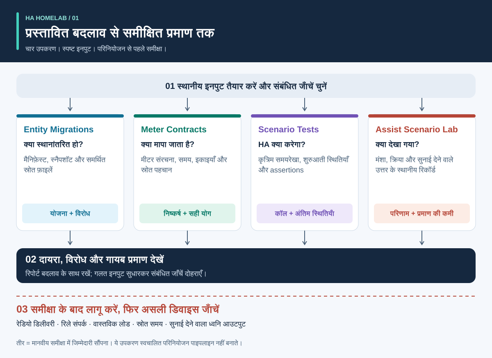
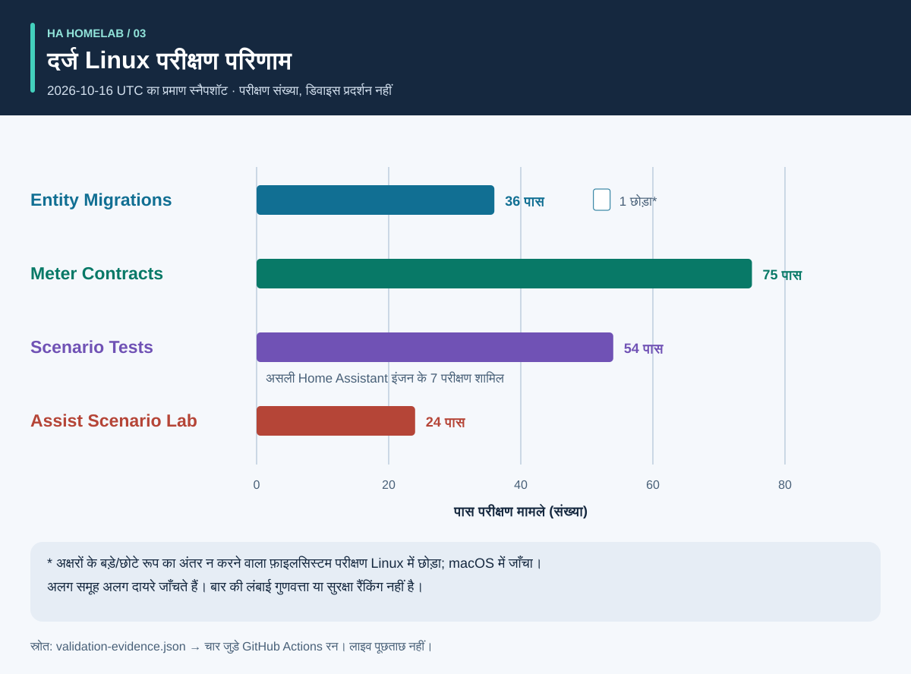
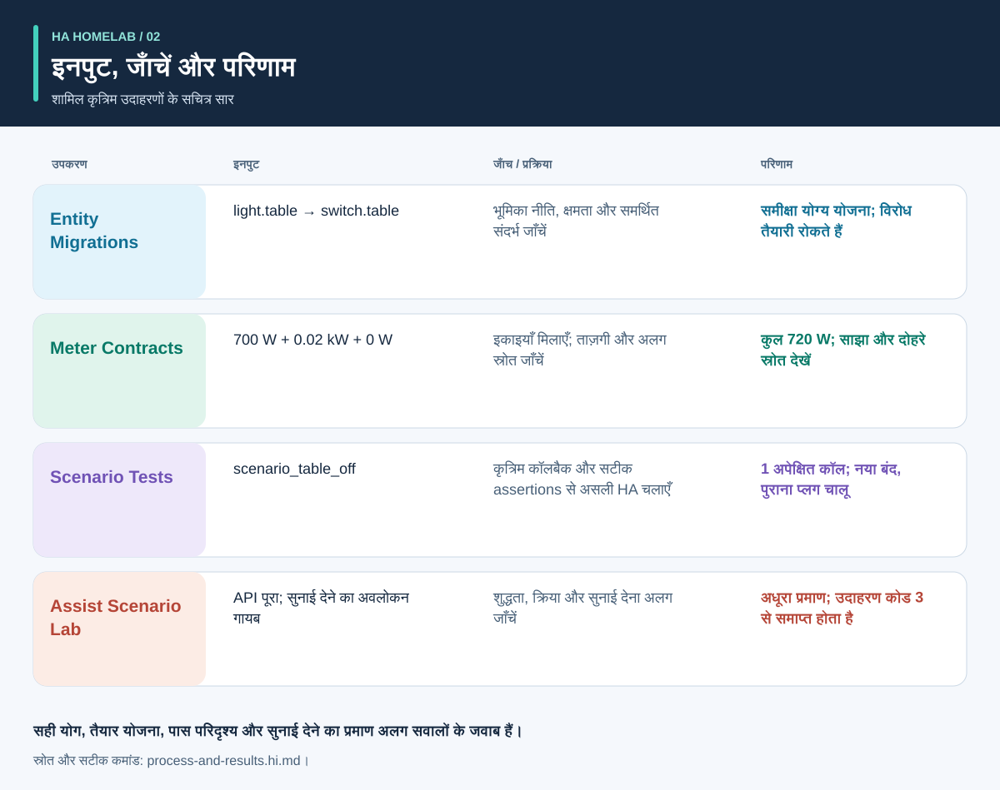

# स्वचालन से पहले प्रमाण

<!-- language-navigation:start -->
<p dir="ltr">
<a href="README.md" lang="en" dir="ltr">English</a> · <a href="README.ar.md" lang="ar" dir="rtl">العربية</a> · <a href="README.bn.md" lang="bn" dir="ltr">বাংলা</a> · <a href="README.cs.md" lang="cs" dir="ltr">Čeština</a> · <a href="README.de.md" lang="de" dir="ltr">Deutsch</a> · <a href="README.es.md" lang="es" dir="ltr">Español</a> · <a href="README.fa.md" lang="fa" dir="rtl">فارسی</a> · <a href="README.fr.md" lang="fr" dir="ltr">Français</a><br>
<a href="README.he.md" lang="he" dir="rtl">עברית</a> · <a href="README.hi.md" lang="hi" dir="ltr">हिन्दी</a> · <a href="README.id.md" lang="id" dir="ltr">Bahasa Indonesia</a> · <a href="README.it.md" lang="it" dir="ltr">Italiano</a> · <a href="README.ja.md" lang="ja" dir="ltr">日本語</a> · <a href="README.ko.md" lang="ko" dir="ltr">한국어</a> · <a href="README.nl.md" lang="nl" dir="ltr">Nederlands</a> · <a href="README.pl.md" lang="pl" dir="ltr">Polski</a><br>
<a href="README.pt.md" lang="pt" dir="ltr">Português</a> · <a href="README.ru.md" lang="ru" dir="ltr">Русский</a> · <a href="README.th.md" lang="th" dir="ltr">ไทย</a> · <a href="README.tr.md" lang="tr" dir="ltr">Türkçe</a> · <a href="README.uk.md" lang="uk" dir="ltr">Українська</a> · <a href="README.vi.md" lang="vi" dir="ltr">Tiếng Việt</a> · <a href="README.zh-Hans.md" lang="zh-Hans" dir="ltr">简体中文</a> · <a href="README.zh-Hant.md" lang="zh-Hant" dir="ltr">繁體中文</a>
</p>
<!-- language-navigation:end -->

इन दस्तावेज़ अनुवादों से CLI या वॉइस सुविधाओं का भाषा समर्थन नहीं बढ़ता; प्रत्येक परियोजना की समर्थित भाषाएँ जाँचें।

चार छोटे उपकरण Home Assistant समुदाय की परियोजना को चार अलग सवालों के जवाब देने में मदद करते हैं: **डिवाइस की भूमिका क्या बननी चाहिए, मापन क्या शामिल करता है, स्वचालन इंजन वास्तव में क्या करता है और वॉइस परिणाम का समर्थन कौन-सा प्रमाण करता है?** शुरुआती रिलीज़ स्थानीय फ़ाइलों और कृत्रिम परीक्षण डेटा पर काम करते हैं। वे घरेलू कॉन्फ़िगरेशन परिनियोजित नहीं करते और भौतिक डिवाइस प्रमाणित नहीं करते।



[दृश्य मार्गदर्शिका: प्रक्रिया, आउटपुट और परिणाम](process-and-results.hi.md) · [स्थिति-बदलाव चित्र](role-transfer.hi.svg) · [परीक्षण प्रमाण चार्ट](validation.hi.svg)

## चार परियोजनाएँ

- [HA Entity Migrations](https://github.com/ha-homelab/ha-entity-migrations) ऑफ़लाइन माइग्रेशन योजना बनाता है। स्पष्ट भूमिका/हार्डवेयर नीतियाँ, क्षमताएँ और फ़ाइल फ़िंगरप्रिंट साधारण नाम-बदलाव को चुपचाप प्रकाश स्वचालन किसी दूसरे उपयोग वाले सॉकेट को देने से रोकते हैं। तैयार योजना केवल दिए गए, समर्थित कॉन्फ़िगरेशन दायरे में लागू होती है।
- [HA Meter Contracts](https://github.com/ha-homelab/ha-meter-contracts) भौतिक मापन दायरा, स्रोत की उत्पत्ति, इकाइयाँ, नमूने की ताज़गी और जोड़ने के नियम जाँचता है। मल्टी-सॉकेट पट्टी के मीटर का नाम बदलने से वह अकेले पंप का मीटर नहीं बन जाता। एक ही करंट ट्रांसफ़ॉर्मर के दोहराए रूप अलग लोड मानकर नहीं जोड़े जा सकते।
- [HA Scenario Tests](https://github.com/ha-homelab/ha-scenario-tests) वास्तविक Home Assistant स्वचालन/स्क्रिप्ट इंजन में सीमित कृत्रिम परिदृश्य चलाता है। यह क्रमबद्ध कॉल, निषिद्ध कॉल और अंतिम कृत्रिम स्थितियाँ जाँचता है। पहला रनटाइम HA 2026.10.0 और Python 3.14.2–3.14.x पर स्थिर है; अन्य उपकरणों से अलग वातावरण इस्तेमाल करें।
- [Assist Scenario Lab](https://github.com/ha-homelab/assist-scenario-lab) स्थानीय वॉइस प्रमाण का मूल्यांकन करता है। यह कमांड की शुद्धता, API पूर्णता और सुनाई देने वाले आउटपुट को अलग करता है। शामिल सभी समय कृत्रिम हैं और दिए गए अवलोकन स्वतंत्र रूप से सत्यापित नहीं किए जाते।

परियोजनाओं की अपनी स्थापना गाइड, अंग्रेज़ी/रूसी दस्तावेज़ और अंग्रेज़ी/रूसी/जर्मन/स्पैनिश CLI संदेश हैं। सभी एग्ज़िट कोड का एक अर्थ मानने के बजाय संस्करणबद्ध अनुबंधों का पालन करें। चित्रों के तीर **समीक्षा में जिम्मेदारी सौंपना** दिखाते हैं, लागू स्वचालित एकीकरण नहीं। कोई केंद्रीय डेमन या सार्वभौमिक परिनियोजन कमांड नहीं है।

होस्ट किए गए विकी: [Entity Migrations](https://github.com/ha-homelab/ha-entity-migrations/wiki) · [Meter Contracts](https://github.com/ha-homelab/ha-meter-contracts/wiki) · [Scenario Tests](https://github.com/ha-homelab/ha-scenario-tests/wiki) · [Assist Scenario Lab](https://github.com/ha-homelab/assist-scenario-lab/wiki) · [ZAC93 + ESP32](https://github.com/ha-homelab/zac93-esp32/wiki)

<a id="validation-evidence--2026-10-16-utc"></a>

## सत्यापन प्रमाण — 2026-10-16 UTC

ये कृत्रिम डेटा वाली संस्करण-विशिष्ट सॉफ़्टवेयर जाँचें हैं, हार्डवेयर प्रमाणीकरण या घरेलू बेंचमार्क नहीं।



बार संख्याएँ दिखाते हैं, कवरेज या गुणवत्ता रैंकिंग नहीं। दिनांकित स्रोत रिकॉर्ड [validation-evidence.json](validation-evidence.json) में हैं।

- **Entity Migrations:** स्रोत-एलियास रिग्रेशन सहित स्थानीय रूप से 37 परीक्षण और 9 उपपरीक्षण पास हुए। [Main पर Linux रन](https://github.com/ha-homelab/ha-entity-migrations/actions/runs/38843701264) में 36 परीक्षण पास हुए और अक्षरों के बड़े/छोटे रूप में अंतर न करने वाले फ़ाइलसिस्टम का केस छोड़ा गया, जिसे स्थानीय रूप से जाँचा गया था।
- **Meter Contracts:** स्रोत-विरोध, स्रोत फ़ाइल स्वीकार्यता और मापन अर्थ सहित [Linux CI में 75 परीक्षण पास हुए](https://github.com/ha-homelab/ha-meter-contracts/actions/runs/38843671896)।
- **Assist Scenario Lab:** [Linux CI में 24 परीक्षण पास हुए](https://github.com/ha-homelab/assist-scenario-lab/actions/runs/38843304306)। ये दिए गए प्रमाण और कृत्रिम उदाहरण जाँचते हैं; भौतिक आवाज़ तुलना का दावा नहीं है।
- **Scenario Tests:** CPython 3.14.8 और वास्तविक Home Assistant 2026.10.0 पर [Linux CI में 54 परीक्षण बिना छोड़े पास हुए](https://github.com/ha-homelab/ha-scenario-tests/actions/runs/38843681199)। इनमें सात रनटाइम केस हैं, जिनमें एक भूमिका-हस्तांतरण सहायक उदाहरण जाँचता है। पूरा परीक्षण समूह 21.42 सेकंड में समाप्त हुआ।

Linux जाँचा गया रनर वातावरण है। [macOS पर दस्तावेज़ित मूल शटडाउन विफलता](https://github.com/ha-homelab/ha-scenario-tests/blob/main/docs/validation.md) एक सीमा बनी हुई है; प्रक्रिया क्रैश से पहले अपेक्षित JSON मिलना भी असफल रन ही है। Docker निष्पादन या भौतिक डिवाइस स्वीकृति का दावा नहीं है।

## प्रक्रिया और सचित्र परिणाम



हर आउटपुट समझने, नए और पुराने डिवाइस की स्थिति देखने तथा सॉफ़्टवेयर प्रमाण को भौतिक स्वीकृति से अलग करने के लिए [दृश्य मार्गदर्शिका](process-and-results.hi.md) पढ़ें। सचित्र नतीजे शामिल कृत्रिम उदाहरणों का सार हैं; ये कच्चे रिपोर्ट स्क्रीनशॉट नहीं हैं।

<a id="a-concrete-migration-to-test-workflow"></a>

## माइग्रेशन से परीक्षण तक ठोस कार्यप्रवाह

1. `ha-entity-migrations` रिपॉज़िटरी स्थापित करने के बाद शामिल डोमेन-बदलाव उदाहरण चलाएँ:

   ```sh
   ha-entity-migrations --lang en plan --manifest examples/domain-change/manifest.json --snapshot examples/domain-change/snapshot.json --root examples/domain-change
   ```

   प्रस्तावित `light.table` → `switch.table` और `light.turn_off` → `switch.turn_off` बदलावों की समीक्षा करें। फ़िंगरप्रिंट और समर्थित संदर्भों को दायरे की सीमा मानें। अवरुद्ध योजना की जाँच आवश्यक है; क्षमता का प्रमाण न होने पर बिना शर्त खोजें-बदलें न चलाएँ।

2. समीक्षा किए गए व्यवहार को कृत्रिम परीक्षण में बदलें। [role-transfer.scenario.json](role-transfer.scenario.json) हाथ से लिखा सहायक उदाहरण है, माइग्रेशन योजना का **स्वचालित निर्यात नहीं**। यह कृत्रिम “टेबल बंद” इवेंट भेजता है, नई भूमिका के लिए एक कॉल की अपेक्षा रखता है और पुराने हार्डवेयर को बंद करना निषिद्ध करता है। यह यह भी जाँचता है कि पुराना हार्डवेयर चालू रहे। इस गाइड के फ़ोल्डर से, अपने अलग वातावरण में स्थापित परिदृश्य रनर के साथ:

   ```sh
   ha-scenario validate role-transfer.scenario.json
   ha-scenario run role-transfer.scenario.json
   ```

   यह सहायक उदाहरण [भूमिका-हस्तांतरण फ़िक्स्चर](https://github.com/ha-homelab/ha-scenario-tests/blob/0ea7e5a5d24dc89ebe896b1a2387396b3fce18f4/tests/fixtures/role_transfer.json) के बाइट-दर-बाइट समान है, जिसे [सफल Linux रन](https://github.com/ha-homelab/ha-scenario-tests/actions/runs/38843681199) में जाँचा गया था। इसका SHA-256 `bb8544517eeb4895b80b049cf9e242d04635e7785bd198c1d57a7cf3f5fc8ab4` है। पुरानी macOS शटडाउन विफलता दस्तावेज़ित है और पास हुए रन में नहीं गिनी जाती।

   यह परिदृश्य वास्तविक HA इंजन और मेमोरी में एक्ट्यूएटर कॉलबैक इस्तेमाल करता है। पास होना दी गई कृत्रिम क्रमावली के इंजन व्यवहार को सिद्ध करता है, रेडियो डिलीवरी, संपर्क जुड़ना या उपकरण पर बिजली पहुँचना नहीं। इसका एक इवेंट पूरी घरेलू कॉन्फ़िगरेशन नहीं जाँचता।

3. परिनियोजन से पहले संबंधित विफलता क्रम जोड़ें: सेंसर अनुपलब्ध होने से बाधित अनुपस्थिति, मैनुअल होल्ड, स्वचालन रीलोड, दोहरे ट्रिगर और बहाल स्थिति। रनर के उदाहरण उपस्थिति, मैनुअल होल्ड, पुराने इनपुट और रीलोड के बाद स्थिति-सामंजस्य शामिल करते हैं। इसकी घड़ी वास्तविक बीता समय मापती है, इसलिए छोटा फ़िक्स्चर उत्पादन का बीस-मिनट अंतराल सत्यापित नहीं करता। HA बताता है कि `for` प्रतीक्षा रीस्टार्ट/रीलोड के बाद नहीं बचती; ज़रूरत पर स्पष्ट सामंजस्य या स्थायी समय-सीमाएँ चुनें और जाँचें। [HA ट्रिगर दस्तावेज़](https://www.home-assistant.io/docs/automation/trigger/)

4. मीटर के प्रमाण की स्वतंत्र समीक्षा करें। मीटर रिपॉज़िटरी से:

   ```sh
   ha-meter-contracts check examples/valid-three-meters.json --at 2026-01-01T12:00:05Z --json
   ha-meter-contracts check examples/kmc-shared-meter.json --at 2026-01-01T12:00:05Z --json
   ha-meter-contracts check examples/duplicate-emporia.json --at 2026-01-01T12:00:05Z --json
   ```

   सही उदाहरण सफल होता है। अंतिम दो जानबूझकर कोड 1 से समाप्त होते हैं: क्रमशः पूरी पट्टी के मीटर से एक सॉकेट का उपयोग तय करने की कोशिश और एक स्रोत के दोहराए रूप। उदाहरण स्क्रिप्ट में इन्हें अपेक्षित विफलता मानें। केवल पंप के लिए कैलिब्रेट सुरक्षा सीमा में पूरी पट्टी के वाट न डालें। वोल्टेज कैलिब्रेशन, करंट या पावर कैलिब्रेशन नहीं है। गायब या पुराना प्रमाण अनुपलब्ध रहता है, शून्य नहीं बनता। [HA सेंसर/सांख्यिकी अर्थ](https://developers.home-assistant.io/docs/core/entity/sensor/#long-term-statistics)

5. अगर आवाज़ ट्रिगर या फीडबैक का रास्ता है, तो वॉइस रिपॉज़िटरी में प्रमाण अलग से जाँचें:

   ```sh
   assist-lab evaluate examples/synthetic-pass.json
   assist-lab evaluate examples/synthetic-incomplete.json
   ```

   अधूरा उदाहरण जानबूझकर कोड 3 से समाप्त होता है, क्योंकि API पूर्णता सुनाई देने का पर्याप्त प्रमाण नहीं। वास्तविक बेंचमार्क के लिए रिकॉर्डिंग की सहमति, घोषित घड़ी/तरीका, तुलनीय परिस्थितियाँ और क्रिया व सुनाई देने वाले उत्तर का स्वतंत्र अवलोकन चाहिए। घरेलू रिकॉर्डिंग, ट्रांसक्रिप्ट या निर्यात किए टोकन प्रकाशित न करें। सर्वर का पहला ऑडियो भाग, श्रोता तक पहुँची पहली आवाज़ नहीं है। [HA Assist पाइपलाइन](https://developers.home-assistant.io/docs/voice/pipelines/)

6. हर रिपोर्ट समीक्षा किए बदलाव के साथ रखें। स्थापना की तय समीक्षा/परिनियोजन प्रक्रिया से बदलाव लागू करें, फिर डिवाइस-विशिष्ट स्वीकृति जाँचें। भौतिक चालू/बंद, संकेतक ध्रुवता, रीस्टार्ट व्यवहार, स्रोत समय और हर मात्रा के कैलिब्रेशन के लिए असली अवलोकन चाहिए। चारों उपकरण उस चरण को न करते हैं, न उसकी जगह लेते हैं।

## जाँचें क्या सिद्ध नहीं करतीं

कॉन्फ़िगर स्थिति, स्वीकार किया सर्विस कॉल, देखा बिजली उपयोग और पानी का प्रवाह अलग प्रमाण हैं। तीन लोड का कुल मीटर नहीं बता सकता कि किस लोड ने पावर ली। कृत्रिम “बंद” स्थिति नहीं सिद्ध करती कि रिले संपर्क खुले। मीटर उपकरण या परिदृश्य परीक्षण पानी, हीटर, पहुँच या अन्य गंभीर प्रभाव वाले लोड के सुरक्षा नियंत्रक नहीं हैं।

ये उपकरण एक-दूसरे के परिणाम लागू नहीं करवाते। भविष्य का एकीकरण उनका स्थिर JSON उपयोग कर सकता है, लेकिन उसे स्वीकृत चेतावनी स्तर, संस्करण संगतता और “पूर्ण प्रमाण” का अर्थ स्पष्ट करना होगा। `ready`, `available`, `passed` और `audible` को एक-दूसरे की जगह आने वाले एक बूलियन में न समेटें।

## रोडमैप: तैयारी की सही स्थिति वाले चौदह विचार

नीचे के पहले चार कोड परिणाम शुरुआती ऑफ़लाइन उपकरणों के रूप में उपलब्ध हैं। सभी बताए अगले काम अभी प्रस्ताव हैं; रिपॉज़िटरी का नाम या चित्र हार्डवेयर चालू और सत्यापित होने का अर्थ नहीं है।

1. **भूमिका माइग्रेशन — शुरुआती उपकरण लागू है।** समर्थित संदर्भ फ़ॉर्मेट केवल राउंड-ट्रिप और विरोध परीक्षणों के साथ बढ़ाएँ; असमर्थित इनपुट की स्पष्ट सीमा रखें।
2. **मीटर अनुबंध — शुरुआती उपकरण लागू है।** निजी वास्तविक टाइमस्टैम्प वाले अवलोकन आज़माएँ; कैलिब्रेशन का दावा करने से पहले करंट/पावर स्वतंत्र रूप से मापें। सॉकेट-विशिष्ट निर्धारण को हर सॉकेट का प्रमाण अभी भी चाहिए।
3. **स्वचालन परिदृश्य परीक्षण — शुरुआती उपकरण लागू है।** समीक्षा की नीतियाँ और रीस्टार्ट/समय-सीमा केस जोड़ें; ज़रूरत पर उत्पादन अवधि के समय का अलग परीक्षण करें।
4. **वॉइस प्रमाण — शुरुआती उपकरण लागू है; भौतिक बेंचमार्क लंबित।** तुलनीय सत्र रिकॉर्ड करने से पहले सैटेलाइट, अवलोकन विधि और रिकॉर्डिंग सहमति तय करें। अभी हार्डवेयर रैंकिंग नहीं है।
5. **वायु-गुणवत्ता समन्वय — सेंसर/एक्ट्यूएटर सत्यापन लंबित।** जाँचें कि डिवाइस CO₂ मापता है या कण, उसकी उम्र/सटीकता क्या है और वेंटिलेशन या फ़िल्टरिंग क्या बदल सकते हैं। वेंटिलेशन नीति से पहले बाहर की परिस्थितियाँ सुनिश्चित करें।
6. **रडार/उपस्थिति प्रमाण — हार्डवेयर शुरू करके जाँचना लंबित।** LD2450 बोर्ड, बिजली सप्लाई, आवरण, प्रोटोकॉल और कवरेज सत्यापित करें। लक्ष्य इंसानी पहचान नहीं हैं और प्राप्ति की उम्र मापी हुई सेंसर देरी नहीं। CSI प्रयोगात्मक है।
7. **पानी/पंप की अवलोकनीयता — स्वतंत्र प्रमाण लंबित।** पंप को पावर देने की अनुमति, बिजली उपयोग, पानी के प्रवाह और स्तर को अलग करें। पूरी पट्टी का मीटर केवल पंप के गायब सुरक्षा संकेत की जगह नहीं ले सकता। देखी गई स्थिति और स्थापना-विशिष्ट समीक्षा के बिना गंभीर कमांड स्वतः दोहराने से बचें।
8. **BLE टेलीमेट्री — संगत प्रॉक्सी और कवरेज परीक्षण लंबित।** वास्तविक सेंसर, तापमान सीमा, बैटरी और स्थान सत्यापित करें। ESP8266 डिवाइस BLE प्रॉक्सी नहीं हैं; RSSI न पहचान है न अनलॉक अनुमति। [ESPHome Bluetooth प्रॉक्सी](https://esphome.io/components/bluetooth_proxy/)
9. **उपस्थिति-आधारित स्पष्टीकरण और उपकरण — क्षमता सत्यापन लंबित।** समझाएँ कि किस अवलोकन ने लाइट चालू रखी; समर्थन हो तो वास्तविक वॉशर/ड्रायर इवेंट इस्तेमाल करें। केवल साझा मीटर से उपकरण चक्र का निष्कर्ष न निकालें और असंबंधित सेंसर फ़्लैग से सांख्यिकीय विश्वास न गढ़ें।
10. **Z-Wave ब्रिज — डिलीवरी/असेंबली और रेडियो स्वीकृति लंबित।** [ZAC93 + ESP32 गाइड](https://github.com/ha-homelab/zac93-esp32) अलग हार्डवेयर रास्ता है। वास्तविक बोर्ड पर वायरिंग, क्षेत्रीय आवृत्ति, सीरियल ट्रांसपोर्ट और Z-Wave JS में जोड़ना जाँचें। नियंत्रक का Long Range समर्थन पुराने सेंसर को Long Range डिवाइस नहीं बनाता। [Z-Wave JS गाइड](https://zwave-js.github.io/zwave-js/#/getting-started/index)
11. **ESPHome प्लग स्वीकृति — व्यक्तिगत हार्डवेयर परीक्षण लंबित।** हर संशोधन के लिए बटन, रिले, संकेतक और रीस्टार्ट प्रमाण रिकॉर्ड करें, साथ ही अलग वोल्टेज/करंट/पावर कैलिब्रेशन। फ़्लैशिंग सफल होना पूरी स्वीकृति नहीं है। जुड़े उपकरणों की बिना निगरानी सामूहिक पावर-साइक्लिंग न करें।
12. **पूर्वानुमान बेंचमार्क — जमा डेटा लंबित।** जारी पूर्वानुमान और बाद के वास्तविक आँकड़े रखें, जारी होने का समय बचाएँ और भविष्य की जानकारी लीक किए बिना समय-क्षितिज का मूल्यांकन करें। इसके लिए बीता अवलोकन समय चाहिए, कृत्रिम उदाहरण से ऊर्जा बचत का दावा नहीं।
13. **सीमित अतिथि नियंत्रण — बैकएंड अनुमति समीक्षा लंबित।** पहचान और सर्वर-साइड प्राधिकरण सत्यापित करें। केवल डैशबोर्ड नियंत्रण छिपाने से पहुँच सीमित नहीं होती। पैनल सरल बनाने के लिए प्रमाणीकरण कमज़ोर न करें।
14. **टाले जा सकने वाले लोड का समय-निर्धारण — मापी सीमाएँ और क्षमताएँ लंबित।** मीटर, स्थिति फीडबैक और पूर्वानुमान जाँचने के बाद स्थापित शेड्यूलिंग उपकरण जोड़ें। सुनिश्चित करें कि कौन-से लोड सचमुच टल या नियंत्रित हो सकते हैं, उनकी समय-सीमाएँ और मैनुअल ओवरराइड क्या हैं। समीक्षा की सिफारिशों से शुरू करें, अनुमानित बचत या सुरक्षा गारंटी से नहीं। [EMHASS](https://emhass.readthedocs.io/en/latest/emhass.html) · [evcc](https://docs.evcc.io/en/)

## योगदान और इस गाइड को दोबारा बनाना

यह परिचय, कृत्रिम परिदृश्य और चित्र मूल MIT-लाइसेंस सामग्री हैं; [LICENSE](LICENSE) देखें। सभी स्थानीयकृत SVG को `python3 render_architecture.py` से दोबारा बनाएँ। उनमें बाहरी चित्र, स्क्रिप्ट, घरेलू पहचानकर्ता या मापा घरेलू डेटा नहीं है। [दृश्य मार्गदर्शिका](process-and-results.hi.md#reproduce-or-translate-the-illustrations) स्रोत रिकॉर्ड और पुनर्निर्माण जाँचें समझाती है। सार्वजनिक फ़िक्स्चर कृत्रिम रखें और निजी निर्यात Git के बाहर। बदलाव के लिए प्रत्येक रिपॉज़िटरी की सुरक्षा और योगदान गाइड अपनाएँ।
