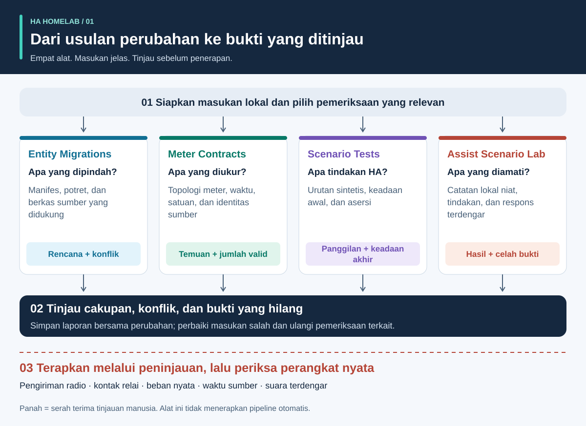
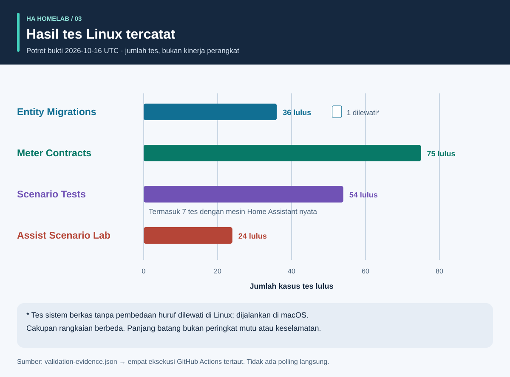
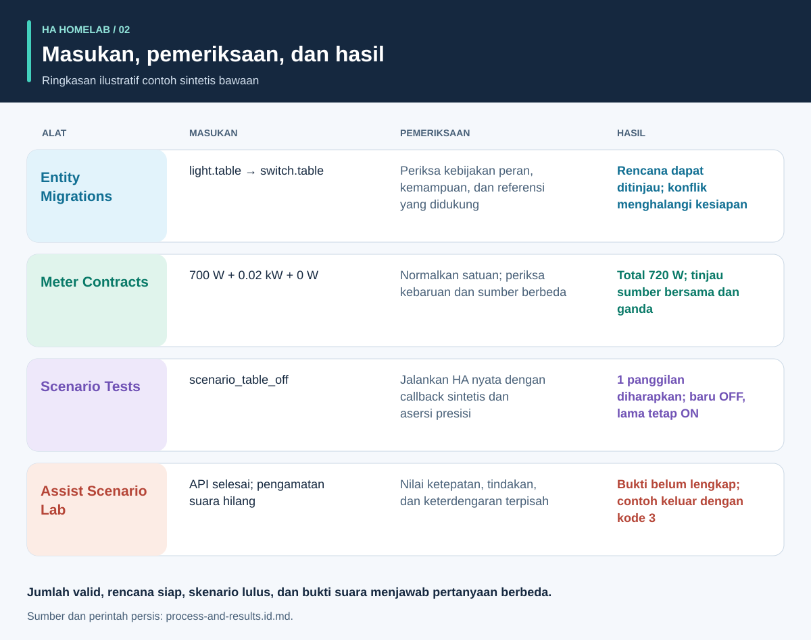

# Bukti sebelum otomasi

<!-- language-navigation:start -->
<p dir="ltr">
<a href="README.md" lang="en" dir="ltr">English</a> · <a href="README.ar.md" lang="ar" dir="rtl">العربية</a> · <a href="README.bn.md" lang="bn" dir="ltr">বাংলা</a> · <a href="README.cs.md" lang="cs" dir="ltr">Čeština</a> · <a href="README.de.md" lang="de" dir="ltr">Deutsch</a> · <a href="README.es.md" lang="es" dir="ltr">Español</a> · <a href="README.fa.md" lang="fa" dir="rtl">فارسی</a> · <a href="README.fr.md" lang="fr" dir="ltr">Français</a><br>
<a href="README.he.md" lang="he" dir="rtl">עברית</a> · <a href="README.hi.md" lang="hi" dir="ltr">हिन्दी</a> · <a href="README.id.md" lang="id" dir="ltr">Bahasa Indonesia</a> · <a href="README.it.md" lang="it" dir="ltr">Italiano</a> · <a href="README.ja.md" lang="ja" dir="ltr">日本語</a> · <a href="README.ko.md" lang="ko" dir="ltr">한국어</a> · <a href="README.nl.md" lang="nl" dir="ltr">Nederlands</a> · <a href="README.pl.md" lang="pl" dir="ltr">Polski</a><br>
<a href="README.pt.md" lang="pt" dir="ltr">Português</a> · <a href="README.ru.md" lang="ru" dir="ltr">Русский</a> · <a href="README.th.md" lang="th" dir="ltr">ไทย</a> · <a href="README.tr.md" lang="tr" dir="ltr">Türkçe</a> · <a href="README.uk.md" lang="uk" dir="ltr">Українська</a> · <a href="README.vi.md" lang="vi" dir="ltr">Tiếng Việt</a> · <a href="README.zh-Hans.md" lang="zh-Hans" dir="ltr">简体中文</a> · <a href="README.zh-Hant.md" lang="zh-Hant" dir="ltr">繁體中文</a>
</p>
<!-- language-navigation:end -->

<!-- community-beta-releases:start -->
<p dir="ltr">
<a href="https://github.com/ha-homelab/ha-entity-migrations/releases/tag/v0.1.1b1">Entity Migrations · 0.1.1b1</a> ·
<a href="https://github.com/ha-homelab/ha-meter-contracts/releases/tag/v0.1.1b1">Meter Contracts · 0.1.1b1</a> ·
<a href="https://github.com/ha-homelab/ha-scenario-tests/releases/tag/v0.1.1b1">Scenario Tests · 0.1.1b1</a> ·
<a href="https://github.com/ha-homelab/assist-scenario-lab/releases/tag/v0.1.1b1">Assist Scenario Lab · 0.1.1b1</a>
</p>
<!-- community-beta-releases:end -->

Terjemahan dokumentasi ini tidak menambah dukungan bahasa CLI atau ucapan; periksa bahasa yang didukung setiap proyek.

Empat alat kecil membantu proyek komunitas Home Assistant menjawab empat pertanyaan berbeda: **peran perangkat harus menjadi apa, apa cakupan pengukuran, apa yang sebenarnya dilakukan mesin otomasi, dan bukti apa yang mendukung hasil suara?** Rilis pertamanya bekerja dengan berkas lokal dan data uji sintetis. Alat ini tidak menerapkan konfigurasi rumah atau mensertifikasi perangkat fisik.



[Panduan visual: proses, keluaran, dan hasil](process-and-results.id.md) · [Diagram perubahan keadaan](role-transfer.id.svg) · [Grafik bukti pengujian](validation.id.svg)

## Empat proyek

- [HA Entity Migrations](https://github.com/ha-homelab/ha-entity-migrations) menghasilkan rencana migrasi luring. Kebijakan peran/perangkat keras, kemampuan, dan sidik berkas yang eksplisit mencegah penggantian nama biasa diam-diam menugaskan otomasi lampu ke stopkontak yang telah berganti fungsi. Rencana siap hanya berlaku untuk lingkup konfigurasi yang diberikan dan didukung.

- [HA Meter Contracts](https://github.com/ha-homelab/ha-meter-contracts) memeriksa cakupan fisik pengukuran, asal sumber, satuan, kebaruan sampel, dan aturan penjumlahan. Meter seluruh terminal listrik tidak menjadi meter pompa tersendiri hanya dengan mengganti namanya. Representasi ganda satu transformator arus tidak boleh dijumlahkan sebagai beban terpisah.

- [HA Scenario Tests](https://github.com/ha-homelab/ha-scenario-tests) menjalankan skenario sintetis terbatas di mesin otomasi/skrip Home Assistant yang sebenarnya. Alat ini memeriksa urutan panggilan, panggilan terlarang, dan keadaan sintetis akhir. Runtime saat ini dipatok ke HA 2026.10.1 dan Python 3.14.2–3.14.x; gunakan lingkungan terpisah dari alat lain.

- [Assist Scenario Lab](https://github.com/ha-homelab/assist-scenario-lab) mengevaluasi bukti suara lokal. Alat ini memisahkan ketepatan perintah, penyelesaian API, dan keluaran yang terdengar. Seluruh waktu yang disertakan sintetis, dan pengamatan yang diberikan tidak diverifikasi secara independen.

Masing-masing proyek memiliki panduan pemasangan serta pesan CLI dalam bahasa Inggris/Rusia/Jerman/Spanyol. Ikuti kontrak berversi, jangan menganggap semua kode keluar bermakna sama. Panah diagram adalah **serah terima peninjauan**, bukan integrasi otomatis yang sudah diimplementasikan. Tidak ada daemon pusat atau perintah penerapan universal.

Wiki tersedia: [Entity Migrations](https://github.com/ha-homelab/ha-entity-migrations/wiki) · [Meter Contracts](https://github.com/ha-homelab/ha-meter-contracts/wiki) · [Scenario Tests](https://github.com/ha-homelab/ha-scenario-tests/wiki) · [Assist Scenario Lab](https://github.com/ha-homelab/assist-scenario-lab/wiki) · [ZAC93 + ESP32](https://github.com/ha-homelab/zac93-esp32/wiki)

<a id="validation-evidence--2026-10-16-utc"></a>

## Bukti validasi — 2026-10-16 UTC

Ini pemeriksaan perangkat lunak khusus versi dengan data sintetis, bukan sertifikasi perangkat keras atau tolok ukur rumah.



Batang menunjukkan jumlah, bukan cakupan atau peringkat mutu. Catatan sumber bertanggal tersedia dalam [validation-evidence.json](validation-evidence.json).

- **Entity Migrations:** 37 tes ditambah 9 subtes lulus secara lokal, termasuk regresi alias sumber. [Eksekusi Linux pada main](https://github.com/ha-homelab/ha-entity-migrations/actions/runs/38843701264) meluluskan 36 tes dan melewati kasus sistem berkas yang tidak membedakan huruf besar-kecil, yang sudah dijalankan secara lokal.
- **Meter Contracts:** [75 tes lulus di CI Linux](https://github.com/ha-homelab/ha-meter-contracts/actions/runs/38843671896), termasuk konflik asal-usul, penerimaan berkas sumber, dan semantik pengukuran.
- **Assist Scenario Lab:** [24 tes lulus di CI Linux](https://github.com/ha-homelab/assist-scenario-lab/actions/runs/38843304306). Ini memvalidasi bukti yang diberikan dan contoh sintetis; tidak mengklaim perbandingan suara fisik.
- **Scenario Tests:** [54 tes lulus tanpa dilewati di CI Linux](https://github.com/ha-homelab/ha-scenario-tests/actions/runs/38843681199) pada CPython 3.14.8 dengan Home Assistant 2026.10.0 sebenarnya, termasuk tujuh kasus runtime; salah satunya menguji pendamping pemindahan peran. Seluruh rangkaian selesai dalam 21.42 detik.

Linux adalah lingkungan pelaksana yang diuji. [Kegagalan pembersihan akhir di macOS native yang terdokumentasi](https://github.com/ha-homelab/ha-scenario-tests/blob/main/docs/validation.md) tetap menjadi batasan; hasil JSON yang benar sebelum proses jatuh tetap merupakan eksekusi gagal. Catatan 16 Oktober tidak mengklaim eksekusi Docker atau penerimaan perangkat fisik.

Pembaruan 19 Oktober 2026: [CI Linux](https://github.com/ha-homelab/ha-scenario-tests/actions/runs/39264346721) juga lulus uji dasar pengoperasian runtime terkemas di Docker. Ini tidak membuktikan penerimaan perangkat fisik.

## Proses dan hasil berilustrasi



Ikuti [panduan visual](process-and-results.id.md) untuk menafsirkan keluaran, menelusuri keadaan perangkat pengganti dan lama, serta membedakan bukti perangkat lunak dari penerimaan fisik. Hasil ilustrasi merangkum contoh sintetis bawaan, bukan tangkapan laporan mentah.

<a id="a-concrete-migration-to-test-workflow"></a>

## Alur konkret dari migrasi ke pengujian

1. Di `ha-entity-migrations`, jalankan contoh perubahan domain bawaan setelah memasang repositori tersebut:

   ```sh
   ha-entity-migrations --lang en plan --manifest examples/domain-change/manifest.json --snapshot examples/domain-change/snapshot.json --root examples/domain-change
   ```

   Tinjau usulan perubahan `light.table` → `switch.table` dan `light.turn_off` → `switch.turn_off`. Perlakukan sidik berkas dan referensi yang didukung sebagai batas cakupan. Rencana terblokir perlu diselidiki; jangan mengganti bukti kemampuan yang hilang dengan pencarian-penggantian tanpa syarat.

2. Terjemahkan perilaku yang ditinjau menjadi tes sintetis. [role-transfer.scenario.json](role-transfer.scenario.json) merupakan pendamping yang ditulis manual, **bukan ekspor otomatis** rencana migrasi. Skenario mengirim peristiwa sintetis “table off”, mengharapkan satu panggilan ke peran pengganti, dan melarang mematikan perangkat lama. Skenario juga memastikan perangkat lama tetap hidup. Dari direktori panduan ini, dengan pelaksana skenario terpasang pada lingkungan sendiri:

   ```sh
   ha-scenario validate role-transfer.scenario.json
   ha-scenario run role-transfer.scenario.json
   ```

   Pendamping ini identik per bita dengan [data uji pemindahan peran](https://github.com/ha-homelab/ha-scenario-tests/blob/0ea7e5a5d24dc89ebe896b1a2387396b3fce18f4/tests/fixtures/role_transfer.json) yang diuji dalam [eksekusi Linux yang berhasil](https://github.com/ha-homelab/ha-scenario-tests/actions/runs/38843681199). SHA-256-nya adalah `bb8544517eeb4895b80b049cf9e242d04635e7785bd198c1d57a7cf3f5fc8ab4`. Kegagalan pembersihan akhir macOS sebelumnya tetap terdokumentasi dan tidak dihitung sebagai lulus.

   Skenario menggunakan mesin HA nyata dengan callback aktuator dalam memori. Hasil lulus membuktikan perilaku mesin pada urutan sintetis yang diberikan, bukan pengiriman radio, penutupan kontak, atau daya pada peralatan. Satu peristiwanya tidak mencakup konfigurasi rumah keseluruhan.

3. Tambahkan urutan kegagalan yang relevan sebelum penerapan: penantian ketidakhadiran terputus karena sensor tidak tersedia, penahanan manual, pemuatan ulang otomasi, pemicu ganda, dan keadaan dipulihkan. Contoh bawaan mencakup kehadiran, penahanan manual, masukan usang, dan rekonsiliasi pemuatan ulang. Karena jamnya memakai waktu nyata yang berlalu, data uji singkat tidak memvalidasi interval produksi dua puluh menit. HA mendokumentasikan bahwa penantian `for` tidak bertahan setelah mulai ulang/pemuatan ulang; pilih dan uji rekonsiliasi eksplisit atau tenggat persisten jika diperlukan. [Dokumentasi pemicu HA](https://www.home-assistant.io/docs/automation/trigger/)

4. Tinjau bukti meter secara independen. Dari repositori meter:

   ```sh
   ha-meter-contracts check examples/valid-three-meters.json --at 2026-01-01T12:00:05Z --json
   ha-meter-contracts check examples/kmc-shared-meter.json --at 2026-01-01T12:00:05Z --json
   ha-meter-contracts check examples/duplicate-emporia.json --at 2026-01-01T12:00:05Z --json
   ```

   Contoh valid berhasil. Dua berikutnya sengaja keluar dengan kode 1: masing-masing upaya atribusi stopkontak dari meter seluruh terminal dan representasi ganda satu sumber. Perlakukan ini sebagai kegagalan yang diharapkan saat membuat skrip contoh. Jangan memasukkan watt seluruh terminal ke ambang perlindungan yang dikalibrasi hanya untuk pompa. Kalibrasi tegangan bukan kalibrasi arus atau daya. Bukti hilang atau usang tetap tidak tersedia, bukan nol. [Semantik sensor/statistik HA](https://developers.home-assistant.io/docs/core/entity/sensor/#long-term-statistics)

5. Jika suara menjadi pemicu atau jalur umpan balik, evaluasi buktinya secara terpisah di repositori suara:

   ```sh
   assist-lab evaluate examples/synthetic-pass.json
   assist-lab evaluate examples/synthetic-incomplete.json
   ```

   Contoh tidak lengkap sengaja keluar dengan kode 3 karena penyelesaian API tidak cukup membuktikan keterdengaran. Tolok ukur nyata memerlukan persetujuan merekam, jam/metode yang dinyatakan, kondisi sebanding, serta pengamatan independen atas tindakan dan respons terdengar. Jangan menerbitkan rekaman rumah, transkrip, atau token hasil ekspor. Potongan audio pertama server bukan suara pertama di telinga pendengar. [Pipeline HA Assist](https://developers.home-assistant.io/docs/voice/pipelines/)

6. Simpan setiap laporan bersama perubahan yang ditinjau. Terapkan melalui prosedur peninjauan/penerapan yang ditetapkan di lokasi, lalu lakukan penerimaan khusus perangkat. Nyala/mati fisik, polaritas indikator, perilaku mulai ulang, waktu sumber, dan kalibrasi per besaran memerlukan pengamatan nyata. Empat alat ini tidak menjalankan atau menggantikan langkah tersebut.

## Yang tidak dibuktikan pemeriksaan

Keadaan terkonfigurasi, panggilan layanan diterima, konsumsi daya teramati, dan aliran air adalah bukti berbeda. Meter total tiga beban tidak dapat mengidentifikasi beban mana yang mengonsumsi daya. Keadaan “off” sintetis tidak membuktikan kontak relai terbuka. Alat meter maupun tes skenario bukan pengendali keselamatan untuk air, pemanas, akses, atau beban berdampak penting lainnya.

Alat ini tidak memaksakan hasil satu sama lain. Integrasi mendatang dapat memakai JSON stabilnya, tetapi harus mendefinisikan tingkat peringatan yang diterima, kompatibilitas versi, dan arti “bukti lengkap” secara eksplisit. Jangan menyederhanakan `ready`, `available`, `passed`, dan `audible` menjadi satu boolean yang saling menggantikan.

## Peta jalan: empat belas ide dengan kesiapan yang jujur

Empat hasil kode pertama di bawah tersedia sebagai alat luring awal. Seluruh pekerjaan lanjutan yang disebutkan masih berupa usulan; nama repositori atau diagram tidak berarti perangkat keras telah diuji pengoperasiannya.

1. **Migrasi peran — alat awal diimplementasikan.** Perluas format referensi hanya dengan tes konversi bolak-balik dan konflik; pertahankan batas masukan yang tidak didukung secara eksplisit.

2. **Kontrak meter — alat awal diimplementasikan.** Uji coba pengamatan nyata bertimestamp secara privat; ukur arus/daya secara independen sebelum mengklaim kalibrasinya. Atribusi per stopkontak tetap memerlukan bukti per stopkontak.

3. **Pengujian skenario otomasi — alat awal diimplementasikan.** Tambahkan kebijakan yang ditinjau dan kasus mulai ulang/tenggat; uji durasi produksi secara terpisah bila diperlukan.

4. **Bukti suara — alat awal diimplementasikan; tolok ukur fisik menunggu.** Pilih satelit, metode pengamatan, dan persetujuan rekaman sebelum mengumpulkan sesi sebanding. Belum ada peringkat perangkat keras.

5. **Koordinasi kualitas udara — menunggu verifikasi sensor/aktuator.** Periksa apakah perangkat mengukur CO₂ atau partikel, usia/akurasinya, dan pengaruh ventilasi atau penyaringan. Pastikan kondisi luar sebelum menetapkan kebijakan ventilasi.

6. **Bukti radar/kehadiran — menunggu pengoperasian perangkat keras.** Verifikasi papan LD2450, catu daya, kotak, protokol, dan jangkauan. Sasaran bukan identitas manusia, dan usia penerimaan bukan latensi sensor terukur. CSI tetap eksperimental.

7. **Observabilitas air/pompa — menunggu bukti independen.** Bedakan izin memberi daya pompa, konsumsi listrik, aliran air, dan ketinggian air. Meter terminal agregat tidak dapat menyediakan sinyal perlindungan khusus pompa yang hilang. Hindari percobaan ulang otomatis untuk perintah kritis tanpa keadaan teramati dan peninjauan khusus lokasi.

8. **Telemetri BLE — menunggu proksi kompatibel dan tes jangkauan.** Validasi sensor nyata, rentang suhu, baterai, dan penempatan. Perangkat ESP8266 bukan proksi BLE; RSSI bukan identitas atau kredensial pembukaan kunci. [Proksi Bluetooth ESPHome](https://esphome.io/components/bluetooth_proxy/)

9. **Penjelasan berbasis kehadiran dan peralatan — menunggu verifikasi kemampuan.** Jelaskan pengamatan yang mempertahankan lampu menyala; gunakan peristiwa mesin cuci/pengering nyata jika didukung. Jangan menyimpulkan siklus alat hanya dari meter bersama atau mengarang keyakinan statistik dari flag sensor yang tidak terkait.

10. **Jembatan Z-Wave — menunggu pengiriman/perakitan dan penerimaan radio.** [Panduan ZAC93 + ESP32](https://github.com/ha-homelab/zac93-esp32) adalah jalur perangkat keras terpisah. Verifikasi pengawatan, frekuensi wilayah, transport serial, dan inklusi Z-Wave JS pada papan sebenarnya. Dukungan pengendali Long Range tidak mengubah sensor lama menjadi perangkat Long Range. [Panduan Z-Wave JS](https://zwave-js.github.io/zwave-js/#/getting-started/index)

11. **Penerimaan stopkontak ESPHome — menunggu tes perangkat keras individual.** Catat bukti tombol, relai, indikator, dan mulai ulang untuk tiap revisi, serta kalibrasi tegangan/arus/daya terpisah. Flashing berhasil bukan penerimaan selesai. Jangan melakukan siklus daya massal tanpa pengawasan pada peralatan yang terhubung.

12. **Tolok ukur prakiraan — menunggu akumulasi data.** Arsipkan prakiraan yang diterbitkan dan nilai aktual kemudian, simpan waktu penerbitan, dan nilai tiap horizon tanpa kebocoran informasi masa depan. Ini memerlukan waktu pengamatan berlalu, bukan klaim penghematan energi dari contoh sintetis.

13. **Kontrol tamu terbatas — menunggu peninjauan izin backend.** Verifikasi identitas dan otorisasi sisi server. Menyembunyikan kontrol dasbor saja tidak membatasi akses. Jangan melemahkan autentikasi untuk menyederhanakan panel.

14. **Penjadwalan beban yang dapat ditunda — menunggu batasan terukur dan kemampuan.** Integrasikan alat penjadwalan mapan setelah memvalidasi meter, umpan balik keadaan, dan prakiraan. Pastikan beban yang benar-benar dapat ditunda atau dimodulasi, tenggatnya, dan pengambilalihan manual. Mulai dari rekomendasi yang ditinjau, tanpa penghematan spekulatif atau jaminan keselamatan. [EMHASS](https://emhass.readthedocs.io/en/latest/emhass.html) · [evcc](https://docs.evcc.io/en/)

## Berkontribusi dan mereproduksi panduan

Ikhtisar, skenario sintetis, dan diagram ini merupakan materi asli berlisensi MIT; lihat [LICENSE](LICENSE). Buat ulang seluruh SVG terjemahan dengan `python3 render_architecture.py`. Tidak ada gambar eksternal, skrip, identitas rumah, atau data rumah terukur. [Panduan visual](process-and-results.id.md#reproduce-or-translate-the-illustrations) menjelaskan catatan sumber dan pemeriksaan regenerasi. Jaga data uji publik tetap sintetis dan ekspor privat di luar Git. Ikuti panduan keamanan dan kontribusi setiap repositori untuk perubahan.

