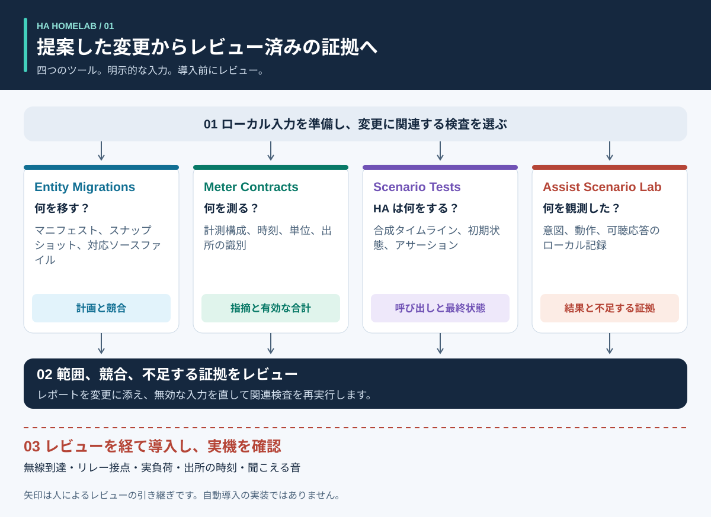
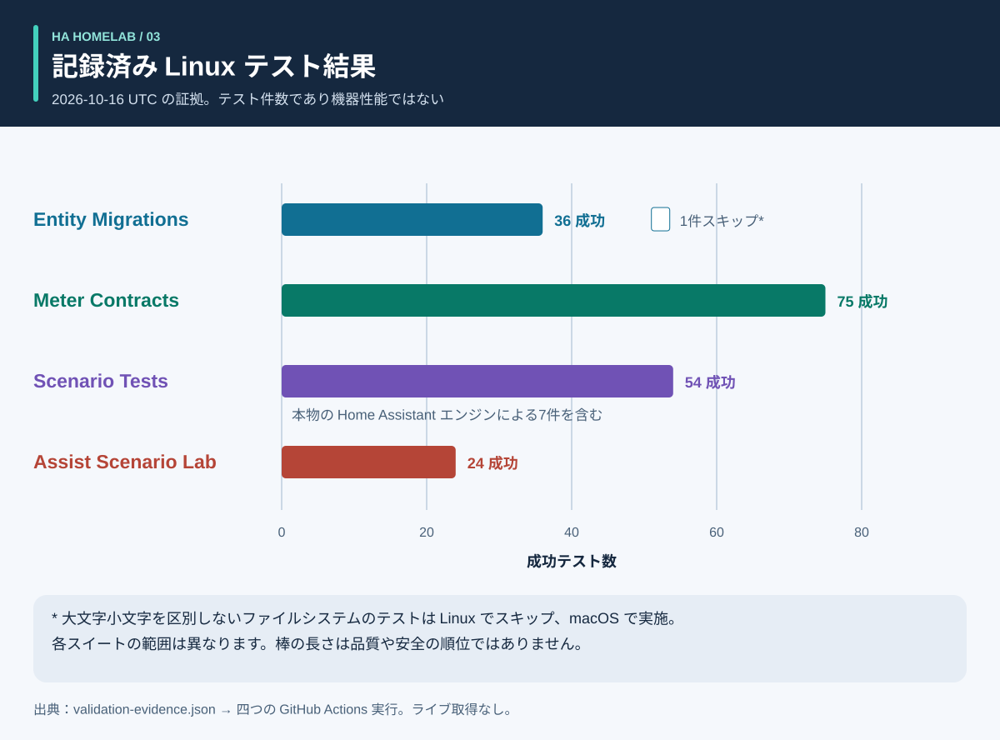
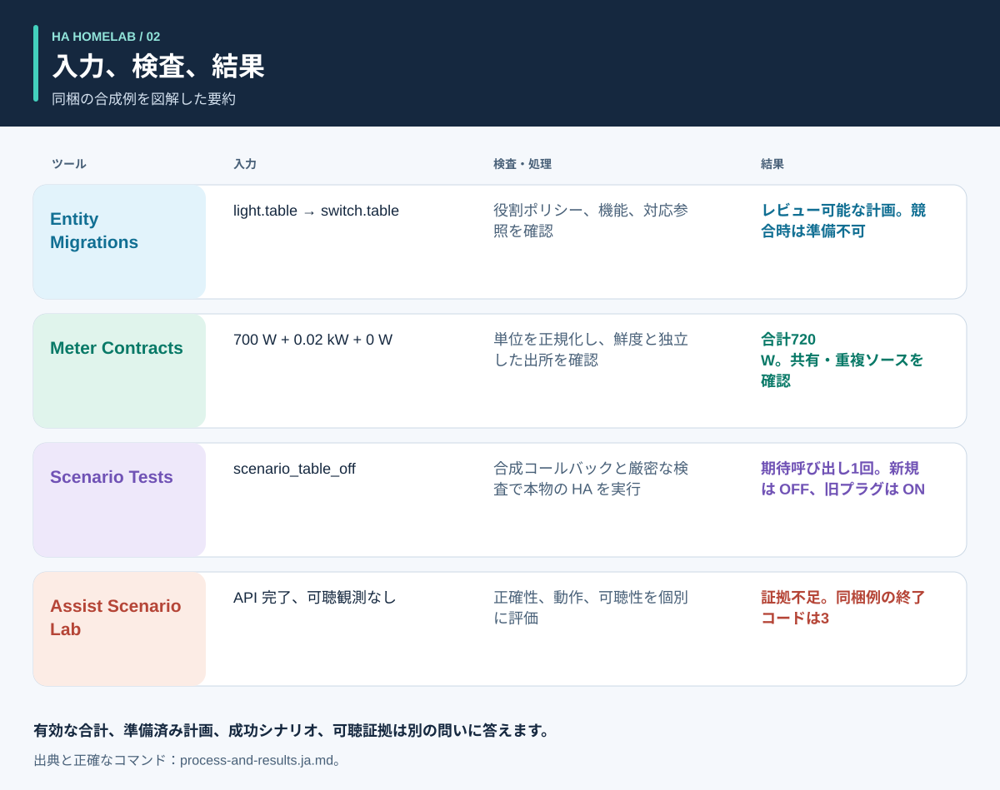

# 自動化の前に根拠を

<!-- language-navigation:start -->
<p dir="ltr">
<a href="README.md" lang="en" dir="ltr">English</a> · <a href="README.ar.md" lang="ar" dir="rtl">العربية</a> · <a href="README.bn.md" lang="bn" dir="ltr">বাংলা</a> · <a href="README.cs.md" lang="cs" dir="ltr">Čeština</a> · <a href="README.de.md" lang="de" dir="ltr">Deutsch</a> · <a href="README.es.md" lang="es" dir="ltr">Español</a> · <a href="README.fa.md" lang="fa" dir="rtl">فارسی</a> · <a href="README.fr.md" lang="fr" dir="ltr">Français</a><br>
<a href="README.he.md" lang="he" dir="rtl">עברית</a> · <a href="README.hi.md" lang="hi" dir="ltr">हिन्दी</a> · <a href="README.id.md" lang="id" dir="ltr">Bahasa Indonesia</a> · <a href="README.it.md" lang="it" dir="ltr">Italiano</a> · <a href="README.ja.md" lang="ja" dir="ltr">日本語</a> · <a href="README.ko.md" lang="ko" dir="ltr">한국어</a> · <a href="README.nl.md" lang="nl" dir="ltr">Nederlands</a> · <a href="README.pl.md" lang="pl" dir="ltr">Polski</a><br>
<a href="README.pt.md" lang="pt" dir="ltr">Português</a> · <a href="README.ru.md" lang="ru" dir="ltr">Русский</a> · <a href="README.th.md" lang="th" dir="ltr">ไทย</a> · <a href="README.tr.md" lang="tr" dir="ltr">Türkçe</a> · <a href="README.uk.md" lang="uk" dir="ltr">Українська</a> · <a href="README.vi.md" lang="vi" dir="ltr">Tiếng Việt</a> · <a href="README.zh-Hans.md" lang="zh-Hans" dir="ltr">简体中文</a> · <a href="README.zh-Hant.md" lang="zh-Hant" dir="ltr">繁體中文</a>
</p>
<!-- language-navigation:end -->

<!-- community-beta-releases:start -->
<p dir="ltr">
<a href="https://github.com/ha-homelab/ha-entity-migrations/releases/tag/v0.1.1b1">Entity Migrations · 0.1.1b1</a> ·
<a href="https://github.com/ha-homelab/ha-meter-contracts/releases/tag/v0.1.1b1">Meter Contracts · 0.1.1b1</a> ·
<a href="https://github.com/ha-homelab/ha-scenario-tests/releases/tag/v0.1.1b1">Scenario Tests · 0.1.1b1</a> ·
<a href="https://github.com/ha-homelab/assist-scenario-lab/releases/tag/v0.1.1b1">Assist Scenario Lab · 0.1.1b1</a>
</p>
<!-- community-beta-releases:end -->

この文書の翻訳によって CLI や音声の対応言語が増えるわけではありません。各プロジェクトの対応言語を確認してください。

四つの小さなツールが、Home Assistant のコミュニティプロジェクトで異なる四つの問いに答えます。**機器の役割をどう移すか、計測は何を含むか、自動化エンジンは実際に何をするか、音声の結果を裏付ける証拠は何か。** 初期リリースはローカルファイルと合成テストデータを使います。家庭の設定を導入したり、実機を認証したりするものではありません。



[図解ガイド：処理、出力、結果](process-and-results.ja.md) · [状態変化図](role-transfer.ja.svg) · [テストの証拠グラフ](validation.ja.svg)

## 四つのプロジェクト

- [HA Entity Migrations](https://github.com/ha-homelab/ha-entity-migrations) はオフラインの移行計画を作成します。明示的な役割・機器ポリシー、機能情報、ファイル指紋により、単なる名前変更で照明の自動化が別用途に転用したコンセントへ知らないうちに割り当てられるのを防ぎます。準備完了の計画でも、提供された対応範囲の設定にのみ適用できます。

- [HA Meter Contracts](https://github.com/ha-homelab/ha-meter-contracts) は物理的な計測範囲、出所、単位、サンプルの鮮度、加算規則を検査します。電源タップ全体のメーターは、名前を変更しても個別のポンプ用メーターにはなりません。一つの変流器の重複表現を、別々の負荷として加算することもできません。

- [HA Scenario Tests](https://github.com/ha-homelab/ha-scenario-tests) は、範囲を制限した合成シナリオを本物の Home Assistant 自動化・スクリプトエンジンで実行します。呼び出し順序、禁止された呼び出し、最終的な合成状態を検査します。現在のランタイムは HA 2026.10.1 と Python 3.14.2–3.14.x に固定されています。他のツールとは別の環境を使ってください。

- [Assist Scenario Lab](https://github.com/ha-homelab/assist-scenario-lab) はローカルの音声証拠を評価します。コマンドの正しさ、API の完了、聞こえる出力を区別します。同梱の時間値はすべて合成値であり、提供された観測は独立に検証されていません。

各プロジェクトには独自の導入ガイドと、英語・ロシア語・ドイツ語・スペイン語の CLI メッセージがあります。終了コードの意味がすべて同じだと仮定せず、バージョンごとの契約仕様に従ってください。図の矢印は**レビュー上の引き継ぎ**であり、実装済みの自動連携ではありません。中央デーモンや汎用のデプロイコマンドはありません。

公開 Wiki：[Entity Migrations](https://github.com/ha-homelab/ha-entity-migrations/wiki) · [Meter Contracts](https://github.com/ha-homelab/ha-meter-contracts/wiki) · [Scenario Tests](https://github.com/ha-homelab/ha-scenario-tests/wiki) · [Assist Scenario Lab](https://github.com/ha-homelab/assist-scenario-lab/wiki) · [ZAC93 + ESP32](https://github.com/ha-homelab/zac93-esp32/wiki)

<a id="validation-evidence--2026-10-16-utc"></a>

## 検証の証拠 — 2026-10-16 UTC

これは合成データを使った、特定バージョンのソフトウェア検査です。ハードウェア認証や家庭環境のベンチマークではありません。



棒の長さは件数を示し、カバレッジや品質順位ではありません。日付付きの元記録は [validation-evidence.json](validation-evidence.json) にあります。

- **Entity Migrations：** ソース別名の回帰テストを含む37テストと9サブテストがローカルで成功しました。[main の Linux 実行](https://github.com/ha-homelab/ha-entity-migrations/actions/runs/38843701264)では36テストが成功し、大文字小文字を区別しないファイルシステムのケースはスキップされました。このケースはローカルで実行しています。
- **Meter Contracts：** [Linux CI で75テストが成功](https://github.com/ha-homelab/ha-meter-contracts/actions/runs/38843671896)。出所の競合、ソースファイルの受け入れ、計測の意味を含みます。
- **Assist Scenario Lab：** [Linux CI で24テストが成功](https://github.com/ha-homelab/assist-scenario-lab/actions/runs/38843304306)。提供された証拠と合成例を検証したもので、実際の音声機器の比較を主張するものではありません。
- **Scenario Tests：** CPython 3.14.8 と本物の Home Assistant 2026.10.0 を使い、[Linux CI でスキップなしの54テストが成功](https://github.com/ha-homelab/ha-scenario-tests/actions/runs/38843681199)しました。七つのランタイムケースのうち一つは役割移行の補助シナリオをテストします。スイート全体は21.42秒で完了しました。

テスト済みの実行環境は Linux です。[文書化されたネイティブ macOS の終了処理失敗](https://github.com/ha-homelab/ha-scenario-tests/blob/main/docs/validation.md)は未解消の制限です。期待どおりの JSON が出ても、その後プロセスが異常終了すれば失敗です。10月16日の記録は、Docker での実行や実機受け入れ完了を主張していません。

2026年10月19日の更新：[Linux CI](https://github.com/ha-homelab/ha-scenario-tests/actions/runs/39264346721) では、パッケージ化した実行環境の Docker による基本動作テストも成功しました。これは実機の受け入れ完了を証明するものではありません。

## 処理と図解結果



[図解ガイド](process-and-results.ja.md)では、各出力の解釈、置換先と旧機器の状態遷移、ソフトウェア上の証拠と実機確認の違いを説明します。図示した結果は同梱の合成例の要約であり、生のレポート画面ではありません。

<a id="a-concrete-migration-to-test-workflow"></a>

## 移行からテストまでの具体的な手順

1. `ha-entity-migrations` のリポジトリをインストールした後、同梱のドメイン変更例を実行します。

   ```sh
   ha-entity-migrations --lang en plan --manifest examples/domain-change/manifest.json --snapshot examples/domain-change/snapshot.json --root examples/domain-change
   ```

   提案された `light.table` → `switch.table` と `light.turn_off` → `switch.turn_off` の変更を確認してください。指紋と対応参照を範囲の境界として扱います。ブロックされた計画には調査が必要です。機能の証拠がない部分を、無条件の検索置換で済ませないでください。

2. レビューした挙動を合成テストに落とし込みます。[role-transfer.scenario.json](role-transfer.scenario.json) は手書きの補助シナリオで、移行計画の**自動エクスポートではありません**。合成の「table off」イベントを送り、置換先の役割に一度だけ呼び出しがあることを期待し、旧機器の電源を切ることを禁止します。旧機器がオンのままであることも検査します。シナリオランナーを専用環境にインストールし、このガイドのディレクトリから実行します。

   ```sh
   ha-scenario validate role-transfer.scenario.json
   ha-scenario run role-transfer.scenario.json
   ```

   この補助シナリオは、[成功した Linux 実行](https://github.com/ha-homelab/ha-scenario-tests/actions/runs/38843681199)で検証した[役割移行テストデータ](https://github.com/ha-homelab/ha-scenario-tests/blob/0ea7e5a5d24dc89ebe896b1a2387396b3fce18f4/tests/fixtures/role_transfer.json)とバイト単位で同一です。SHA-256 は `bb8544517eeb4895b80b049cf9e242d04635e7785bd198c1d57a7cf3f5fc8ab4` です。以前の macOS 終了処理失敗は引き続き記録されており、成功として数えません。

   シナリオは本物の HA エンジンを使い、アクチュエーターのコールバックはメモリー内で動きます。成功が証明するのは、与えられた合成シーケンスでのエンジンの挙動です。無線到達、接点の閉成、機器への給電を証明しません。一つのイベントで家庭の設定全体を網羅することもできません。

3. 導入前に関連する失敗シーケンスを追加します。センサー利用不可による不在待機の中断、手動保持、自動化の再読み込み、重複トリガー、状態復元などです。同梱例は在室、手動保持、古い入力、再読み込み時の整合を扱います。実際の経過時間を使うため、短いテストでは本番の20分間隔を検証できません。HA の説明では `for` の待機は再起動・再読み込みを越えて維持されません。必要に応じて明示的な再整合処理や永続化した期限を選び、テストしてください。[HA トリガーの文書](https://www.home-assistant.io/docs/automation/trigger/)

4. 計測の証拠は独立に確認します。メーター用リポジトリから実行してください。

   ```sh
   ha-meter-contracts check examples/valid-three-meters.json --at 2026-01-01T12:00:05Z --json
   ha-meter-contracts check examples/kmc-shared-meter.json --at 2026-01-01T12:00:05Z --json
   ha-meter-contracts check examples/duplicate-emporia.json --at 2026-01-01T12:00:05Z --json
   ```

   正常例は成功します。後の二つは意図的に終了コード1になります。それぞれタップ全体のメーターから個別コンセントへ帰属させようとする例と、一つの出所を重複表現した例です。サンプルをスクリプト化するときは期待された失敗として扱ってください。ポンプ単体で校正した保護閾値に、タップ全体のワット値を入れないでください。電圧校正は電流や電力の校正とは異なります。欠落または古い証拠は利用不可のままにし、ゼロにしません。[HA センサーと統計の意味](https://developers.home-assistant.io/docs/core/entity/sensor/#long-term-statistics)

5. 音声をトリガーやフィードバックに使う場合、音声リポジトリで証拠を別途評価します。

   ```sh
   assist-lab evaluate examples/synthetic-pass.json
   assist-lab evaluate examples/synthetic-incomplete.json
   ```

   不完全な例は意図的に終了コード3になります。API の完了だけでは聞こえた証拠として不十分だからです。実測のベンチマークには、録音への同意、明示された時計と方法、比較可能な条件、動作と聞こえる応答の独立した観測が必要です。家庭内の録音、文字起こし、エクスポートしたトークンを公開しないでください。サーバーの最初の音声チャンクは、聞き手に届く最初の音とは異なります。[HA Assist パイプライン](https://developers.home-assistant.io/docs/voice/pipelines/)

6. 各レポートをレビュー済み変更と一緒に保管します。環境で定めたレビュー・導入手順を通じて適用し、その後に機器固有の受け入れ確認を行います。物理的なオン・オフ、表示灯の極性、再起動時の挙動、出所の時刻、量ごとの校正には実際の観測が必要です。この四つのツールは、その工程を実施することも代替することもありません。

## 検査では証明できないこと

設定上の状態、受理されたサービス呼び出し、観測された消費電力、水流は別々の証拠です。三つの負荷の合計メーターでは、どの負荷が電力を消費したかは特定できません。合成の「off」状態はリレー接点が開いた証拠ではありません。メーターツールもシナリオテストも、水、ヒーター、アクセス制御など影響の大きい負荷の安全制御装置ではありません。

各ツールは他のツールの結果を強制しません。将来の統合は安定した JSON を利用できますが、許容する警告レベル、バージョン互換性、「証拠が完全」の意味を明確に定義する必要があります。`ready`、`available`、`passed`、`audible` を交換可能な一つの真偽値にまとめないでください。

## ロードマップ：14の案と正確な準備状況

以下の最初の四つは、初期のオフラインツールとして利用できます。記載した後続作業はいずれも提案段階です。リポジトリ名や図があるだけで、実機の稼働確認が完了したことにはなりません。

1. **役割の移行 — 初期ツールを実装済み。** 往復変換と競合のテストを伴う場合にのみ対応参照形式を拡張し、非対応入力の境界を明示したままにします。

2. **計測の契約仕様 — 初期ツールを実装済み。** 時刻付きの非公開実測観測で試行します。電流・電力は、校正済みと主張する前に独立に測定します。コンセント単位の帰属には、その単位の証拠が必要です。

3. **自動化シナリオテスト — 初期ツールを実装済み。** レビューしたポリシー、再起動、期限のケースを追加し、必要に応じて本番と同じ継続時間を別途テストします。

4. **音声の証拠 — 初期ツールを実装済み、実測ベンチマークは未実施。** 比較可能なセッションの収集前に、サテライト、観測方法、録音同意を決めます。機器ランキングはまだありません。

5. **空気質の協調制御 — センサーとアクチュエーターの検証待ち。** CO₂ と粒子のどちらを測るか、機器の経年と精度、換気やろ過が何に影響するかを確認します。換気ポリシーを決める前に屋外条件を確認します。

6. **レーダー・在室の証拠 — 実機稼働確認待ち。** LD2450 基板、電源、筐体、プロトコル、カバー範囲を確認します。検出対象は個人の識別情報ではなく、受信後の経過時間は測定済みセンサー遅延ではありません。CSI は実験段階です。

7. **水・ポンプの可観測性 — 独立した証拠待ち。** ポンプへの給電許可、消費電力、水流、水位を区別します。タップ全体のメーターで、欠けているポンプ専用の保護信号を補うことはできません。観測済みの状態と現場固有のレビューなしに、重要コマンドの自動再試行を設定しないでください。

8. **BLE テレメトリー — 対応プロキシとカバー範囲の検証待ち。** 実際のセンサー、温度範囲、電池、設置場所を確認します。ESP8266 機器は BLE プロキシではありません。RSSI は身元情報でも解錠資格でもありません。[ESPHome Bluetooth プロキシ](https://esphome.io/components/bluetooth_proxy/)

9. **在室に基づく説明と家電 — 機能の確認待ち。** どの観測が照明を点灯状態に維持したかを説明し、対応する場合は洗濯機・乾燥機の実イベントを使います。共用メーターだけで家電の運転サイクルを推定したり、無関係なセンサーフラグから統計的な確信度を作ったりしません。

10. **Z-Wave ブリッジ — 到着・組み立て・無線受け入れ確認待ち。** [ZAC93 + ESP32 ガイド](https://github.com/ha-homelab/zac93-esp32) は独立したハードウェアの取り組みです。実基板で配線、地域の周波数、シリアル通信、Z-Wave JS への登録を確認します。コントローラーの Long Range 対応で旧式センサーが Long Range 機器になるわけではありません。[Z-Wave JS ガイド](https://zwave-js.github.io/zwave-js/#/getting-started/index)

11. **ESPHome プラグの受け入れ — 個別実機テスト待ち。** 各リビジョンについてボタン、リレー、表示灯、再起動の証拠と、電圧・電流・電力を区別した校正を記録します。書き込み成功は受け入れ完了ではありません。接続した家電を無人で一斉に電源再投入しないでください。

12. **予測のベンチマーク — データ蓄積待ち。** 発行された予測と後日の実績を保存し、発行時刻を維持して、未来情報が混入しないよう各予測期間を採点します。必要なのは実際の観測期間であり、合成例から省エネを主張することではありません。

13. **範囲を限定したゲスト操作 — バックエンド権限レビュー待ち。** 身元とサーバー側の認可を確認します。ダッシュボードの操作を隠すだけではアクセスは制限されません。画面を簡単にするため認証を弱めないでください。

14. **延期可能な負荷のスケジュール — 制約と機能の実測待ち。** メーター、状態フィードバック、予測を検証してから既存のスケジューリングツールを統合します。実際に延期や調整ができる負荷、期限、手動上書きを確認します。推測による節約額や安全保証は提示せず、レビューした提案から始めます。[EMHASS](https://emhass.readthedocs.io/en/latest/emhass.html) · [evcc](https://docs.evcc.io/en/)

## 貢献とガイドの再現

この概要、合成シナリオ、図はオリジナルの MIT ライセンス資料です。[LICENSE](LICENSE) を参照してください。`python3 render_architecture.py` ですべての翻訳版 SVG を再生成できます。外部画像、スクリプト、家庭の識別情報、家庭の実測値は含みません。[図解ガイド](process-and-results.ja.md#reproduce-or-translate-the-illustrations)に元記録と再生成時の確認を記載しています。公開テストデータは合成のままとし、非公開エクスポートは Git に入れません。変更時は各リポジトリのセキュリティ・貢献ガイドに従ってください。

