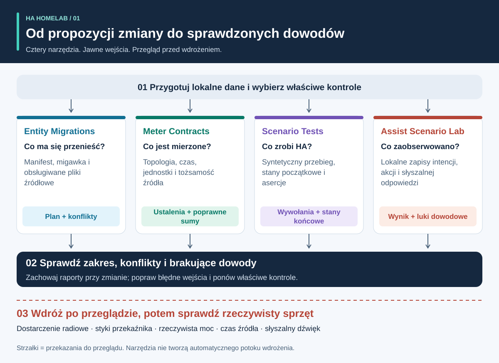
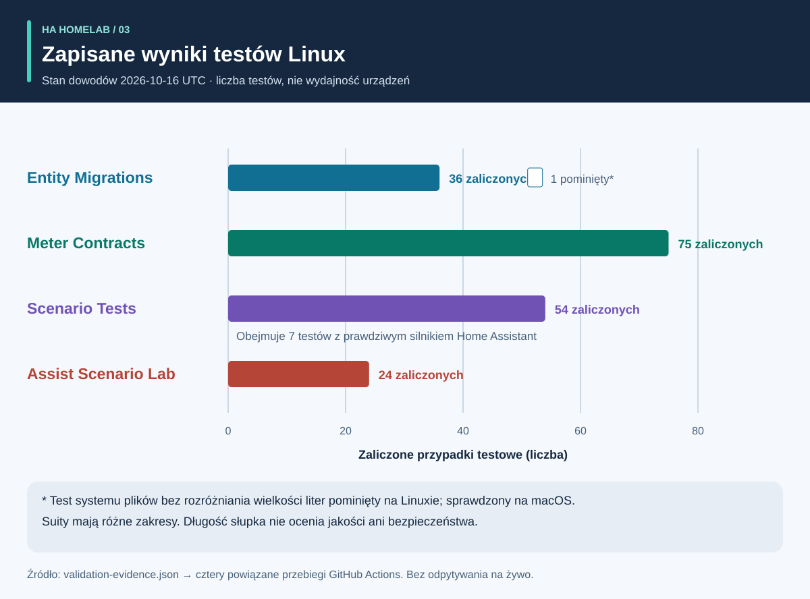
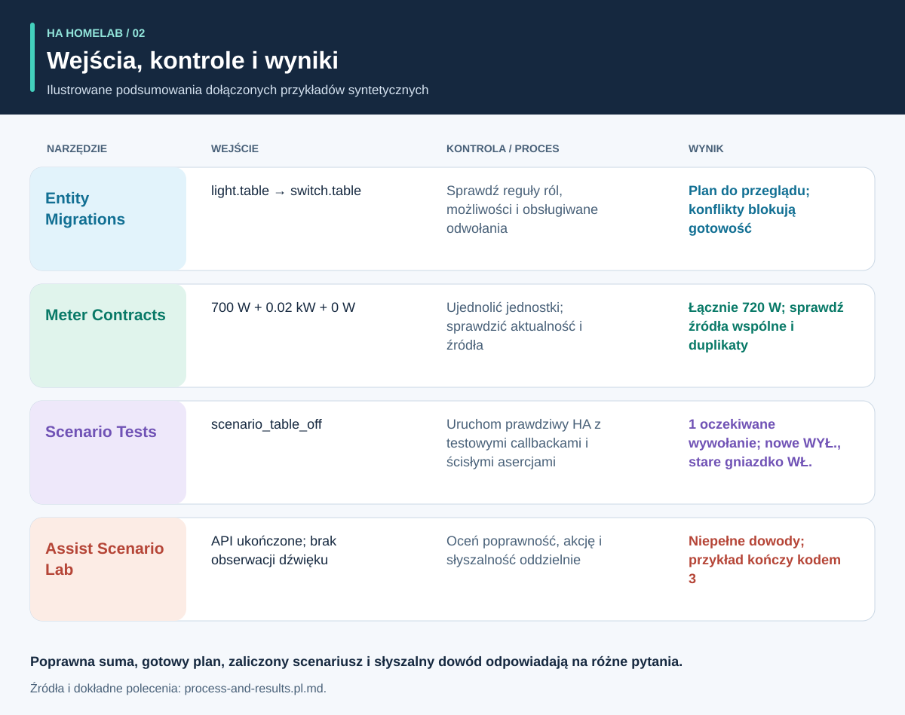

# Najpierw dowody, potem automatyzacja

<!-- language-navigation:start -->
<p dir="ltr">
<a href="README.md" lang="en" dir="ltr">English</a> · <a href="README.ar.md" lang="ar" dir="rtl">العربية</a> · <a href="README.bn.md" lang="bn" dir="ltr">বাংলা</a> · <a href="README.cs.md" lang="cs" dir="ltr">Čeština</a> · <a href="README.de.md" lang="de" dir="ltr">Deutsch</a> · <a href="README.es.md" lang="es" dir="ltr">Español</a> · <a href="README.fa.md" lang="fa" dir="rtl">فارسی</a> · <a href="README.fr.md" lang="fr" dir="ltr">Français</a><br>
<a href="README.he.md" lang="he" dir="rtl">עברית</a> · <a href="README.hi.md" lang="hi" dir="ltr">हिन्दी</a> · <a href="README.id.md" lang="id" dir="ltr">Bahasa Indonesia</a> · <a href="README.it.md" lang="it" dir="ltr">Italiano</a> · <a href="README.ja.md" lang="ja" dir="ltr">日本語</a> · <a href="README.ko.md" lang="ko" dir="ltr">한국어</a> · <a href="README.nl.md" lang="nl" dir="ltr">Nederlands</a> · <a href="README.pl.md" lang="pl" dir="ltr">Polski</a><br>
<a href="README.pt.md" lang="pt" dir="ltr">Português</a> · <a href="README.ru.md" lang="ru" dir="ltr">Русский</a> · <a href="README.th.md" lang="th" dir="ltr">ไทย</a> · <a href="README.tr.md" lang="tr" dir="ltr">Türkçe</a> · <a href="README.uk.md" lang="uk" dir="ltr">Українська</a> · <a href="README.vi.md" lang="vi" dir="ltr">Tiếng Việt</a> · <a href="README.zh-Hans.md" lang="zh-Hans" dir="ltr">简体中文</a> · <a href="README.zh-Hant.md" lang="zh-Hant" dir="ltr">繁體中文</a>
</p>
<!-- language-navigation:end -->

<!-- community-beta-releases:start -->
<p dir="ltr">
<a href="https://github.com/ha-homelab/ha-entity-migrations/releases/tag/v0.1.1b1">Entity Migrations · 0.1.1b1</a> ·
<a href="https://github.com/ha-homelab/ha-meter-contracts/releases/tag/v0.1.1b1">Meter Contracts · 0.1.1b1</a> ·
<a href="https://github.com/ha-homelab/ha-scenario-tests/releases/tag/v0.1.1b1">Scenario Tests · 0.1.1b1</a> ·
<a href="https://github.com/ha-homelab/assist-scenario-lab/releases/tag/v0.1.1b1">Assist Scenario Lab · 0.1.1b1</a>
</p>
<!-- community-beta-releases:end -->

Te tłumaczenia dokumentacji nie rozszerzają obsługi języków CLI ani funkcji głosowych; sprawdź języki obsługiwane przez każdy projekt.

Cztery małe narzędzia pomagają projektowi społeczności Home Assistant odpowiedzieć na cztery różne pytania: **czym ma stać się rola urządzenia, co obejmuje pomiar, co faktycznie robi silnik automatyzacji i jakie dowody wspierają wynik głosowy?** Pierwsze wydania pracują na plikach lokalnych i syntetycznych danych testowych. Nie wdrażają konfiguracji domowych i nie certyfikują fizycznych urządzeń.



[Przewodnik wizualny: proces, wyjścia i wyniki](process-and-results.pl.md) · [Diagram zmian stanu](role-transfer.pl.svg) · [Wykres dowodów testowych](validation.pl.svg)

## Cztery projekty

- [HA Entity Migrations](https://github.com/ha-homelab/ha-entity-migrations) tworzy plan migracji offline. Jawne zasady ról i sprzętu, możliwości i odciski plików zapobiegają cichej zmianie przypisania automatyzacji światła do gniazdka o zmienionym przeznaczeniu podczas zwykłego przemianowania. Gotowy plan dotyczy tylko dostarczonego, obsługiwanego zakresu konfiguracji.
- [HA Meter Contracts](https://github.com/ha-homelab/ha-meter-contracts) sprawdza fizyczny zakres pomiaru, pochodzenie źródeł, jednostki, aktualność próbek i zasady sumowania. Zmiana nazwy miernika listwy nie czyni go indywidualnym miernikiem pompy. Duplikatów jednego przekładnika prądowego nie wolno dodawać jako osobnych obciążeń.
- [HA Scenario Tests](https://github.com/ha-homelab/ha-scenario-tests) wykonuje ograniczony scenariusz syntetyczny w rzeczywistym silniku automatyzacji i skryptów Home Assistant. Sprawdza kolejność wywołań, zabronione wywołania i końcowe stany syntetyczne. Obecne środowisko jest przypięte do HA 2026.10.1 i Python 3.14.2–3.14.x; użyj środowiska oddzielnego od pozostałych narzędzi.
- [Assist Scenario Lab](https://github.com/ha-homelab/assist-scenario-lab) ocenia lokalne dowody głosowe. Rozdziela poprawność polecenia, zakończenie API i słyszalne wyjście. Wszystkie dołączone czasy są syntetyczne, a dostarczone obserwacje nie są niezależnie weryfikowane.

Projekty mają własne instrukcje instalacji, dokumentację angielską/rosyjską oraz komunikaty CLI po angielsku, rosyjsku, niemiecku i hiszpańsku. Kieruj się wersjonowanymi kontraktami, nie zakładając jednakowego znaczenia wszystkich kodów wyjścia. Strzałki oznaczają **przekazania do przeglądu**, nie gotowe automatyczne integracje. Nie ma centralnego demona ani uniwersalnego polecenia wdrażania.

Hostowane wiki: [Entity Migrations](https://github.com/ha-homelab/ha-entity-migrations/wiki) · [Meter Contracts](https://github.com/ha-homelab/ha-meter-contracts/wiki) · [Scenario Tests](https://github.com/ha-homelab/ha-scenario-tests/wiki) · [Assist Scenario Lab](https://github.com/ha-homelab/assist-scenario-lab/wiki) · [ZAC93 + ESP32](https://github.com/ha-homelab/zac93-esp32/wiki)

<a id="validation-evidence--2026-10-16-utc"></a>

## Dowody walidacji — 2026-10-16 UTC

To kontrole oprogramowania dla określonych wersji z użyciem danych syntetycznych, nie certyfikacja sprzętu ani benchmark domu.



Słupki pokazują liczby, a nie pokrycie czy ranking jakości. Datowane dane źródłowe znajdują się w [validation-evidence.json](validation-evidence.json).

- **Entity Migrations:** lokalnie przeszło 37 testów i 9 podtestów, w tym regresje aliasów źródeł. [Uruchomienie Linux na main](https://github.com/ha-homelab/ha-entity-migrations/actions/runs/38843701264) zakończyło 36 testów i pominęło przypadek systemu plików nierozróżniającego wielkości liter, który sprawdzono lokalnie.
- **Meter Contracts:** [75 testów przeszło w CI Linux](https://github.com/ha-homelab/ha-meter-contracts/actions/runs/38843671896), obejmując konflikty pochodzenia, dopuszczanie plików źródłowych i semantykę pomiarów.
- **Assist Scenario Lab:** [24 testy przeszły w CI Linux](https://github.com/ha-homelab/assist-scenario-lab/actions/runs/38843304306). Walidują dostarczone dowody i przykłady syntetyczne; nie deklaruje się fizycznego porównania głosu.
- **Scenario Tests:** [54 testy przeszły bez pominięć w CI Linux](https://github.com/ha-homelab/ha-scenario-tests/actions/runs/38843681199) na CPython 3.14.8 z rzeczywistym Home Assistant 2026.10.0, w tym siedem przypadków wykonawczych, z których jeden sprawdza scenariusz transferu roli. Cała suita zakończyła się w 21.42 sekundy.

Linux jest sprawdzonym środowiskiem uruchomieniowym. [Udokumentowany błąd natywnego zamykania w macOS](https://github.com/ha-homelab/ha-scenario-tests/blob/main/docs/validation.md) pozostaje ograniczeniem; oczekiwany JSON przed awarią procesu nadal oznacza nieudane uruchomienie. Zapis z 16 października nie deklaruje wykonania w Dockerze ani fizycznego odbioru urządzeń.

Aktualizacja z 19 października 2026: [CI w systemie Linux](https://github.com/ha-homelab/ha-scenario-tests/actions/runs/39264346721) pomyślnie wykonało również podstawowy test uruchomienia spakowanego środowiska w Dockerze. Nie potwierdza to fizycznego odbioru urządzeń.

## Proces i ilustrowane wyniki



[Przewodnik wizualny](process-and-results.pl.md) pomaga interpretować wyniki, śledzić stany urządzenia zastępczego i poprzedniego sprzętu oraz rozróżniać dowody programowe od odbioru fizycznego. Ilustracje podsumowują dołączone przykłady syntetyczne; nie są zrzutami surowych raportów.

<a id="a-concrete-migration-to-test-workflow"></a>

## Konkretny proces od migracji do testu

1. W `ha-entity-migrations`, po instalacji repozytorium, uruchom dołączony przykład zmiany domeny:

   ```sh
   ha-entity-migrations --lang en plan --manifest examples/domain-change/manifest.json --snapshot examples/domain-change/snapshot.json --root examples/domain-change
   ```

   Przejrzyj propozycje `light.table` → `switch.table` oraz `light.turn_off` → `switch.turn_off`. Traktuj odciski i obsługiwane odwołania jako granicę zakresu. Zablokowany plan wymaga zbadania; nie zastępuj brakujących dowodów możliwości bezwarunkowym wyszukiwaniem i zamianą.

2. Przełóż sprawdzone zachowanie na test syntetyczny. [role-transfer.scenario.json](role-transfer.scenario.json) to ręcznie napisany przykład towarzyszący, **nie automatyczny eksport** planu migracji. Wysyła syntetyczne zdarzenie „wyłącz stół”, oczekuje jednego wywołania roli zastępczej i zabrania wyłączania poprzedniego sprzętu. Sprawdza też, że poprzedni sprzęt pozostaje włączony. Z katalogu tego przewodnika, z wykonawcą scenariuszy w osobnym środowisku:

   ```sh
   ha-scenario validate role-transfer.scenario.json
   ha-scenario run role-transfer.scenario.json
   ```

   Przykład jest identyczny bajtowo z [fixture transferu roli](https://github.com/ha-homelab/ha-scenario-tests/blob/0ea7e5a5d24dc89ebe896b1a2387396b3fce18f4/tests/fixtures/role_transfer.json) sprawdzonym w [udanym uruchomieniu Linux](https://github.com/ha-homelab/ha-scenario-tests/actions/runs/38843681199). Jego SHA-256 to `bb8544517eeb4895b80b049cf9e242d04635e7785bd198c1d57a7cf3f5fc8ab4`. Wcześniejszy błąd zamykania macOS pozostaje udokumentowany i nie jest liczony jako udany przebieg.

   Scenariusz używa prawdziwego silnika HA z funkcjami zwrotnymi elementów wykonawczych w pamięci. Pozytywny wynik dowodzi zachowania silnika dla dostarczonej sekwencji syntetycznej, nie transmisji radiowej, zwarcia styków czy zasilania urządzenia. Jedno zdarzenie nie obejmuje całej konfiguracji domu.

3. Przed wdrożeniem dodaj odpowiednie sekwencje błędów: nieobecność przerwaną niedostępnością czujnika, ręczne utrzymanie stanu, przeładowanie automatyzacji, podwójne wyzwalacze i odtworzony stan. Przykłady obejmują obecność, ręczne utrzymanie, stare dane i uzgadnianie po przeładowaniu. Zegar mierzy rzeczywiście upływający czas, więc krótki fixture nie weryfikuje produkcyjnego interwału dwudziestu minut. HA dokumentuje, że oczekiwania `for` nie przetrwają restartu/przeładowania; w razie potrzeby wybierz i przetestuj jawne uzgadnianie lub utrwalone terminy. [Dokumentacja wyzwalaczy HA](https://www.home-assistant.io/docs/automation/trigger/)

4. Dowody pomiarowe oceniaj niezależnie. Z repozytorium mierników:

   ```sh
   ha-meter-contracts check examples/valid-three-meters.json --at 2026-01-01T12:00:05Z --json
   ha-meter-contracts check examples/kmc-shared-meter.json --at 2026-01-01T12:00:05Z --json
   ha-meter-contracts check examples/duplicate-emporia.json --at 2026-01-01T12:00:05Z --json
   ```

   Poprawny przykład przechodzi. Dwa pozostałe celowo kończą kodem 1: odpowiednio z powodu przypisania pomiaru całej listwy do pojedynczego gniazdka oraz duplikatów jednego źródła. W skryptach traktuj je jako oczekiwane błędy. Nie podawaj watów całej listwy do progu ochronnego skalibrowanego pierwotnie tylko dla pompy. Kalibracja napięcia nie jest kalibracją prądu ani mocy. Brakujące lub stare dowody pozostają niedostępne, nie stają się zerem. [Semantyka czujników i statystyk HA](https://developers.home-assistant.io/docs/core/entity/sensor/#long-term-statistics)

5. Jeśli głos jest wyzwalaczem lub informacją zwrotną, oceń dowody oddzielnie w repozytorium głosowym:

   ```sh
   assist-lab evaluate examples/synthetic-pass.json
   assist-lab evaluate examples/synthetic-incomplete.json
   ```

   Niepełny przykład celowo kończy kodem 3, ponieważ zakończenie API nie wystarcza do wykazania słyszalności. Rzeczywisty benchmark wymaga zgody na nagrywanie, zadeklarowanego zegara i metody, porównywalnych warunków oraz niezależnej obserwacji akcji i słyszalnej odpowiedzi. Nie publikuj domowych nagrań, transkrypcji ani eksportowanych tokenów. Pierwszy blok audio serwera nie jest pierwszym dźwiękiem u słuchacza. [Potoki HA Assist](https://developers.home-assistant.io/docs/voice/pipelines/)

6. Zachowuj każdy raport przy przeglądanej zmianie. Wdrażaj przez ustaloną procedurę przeglądu i wdrożenia instalacji, a następnie wykonuj odbiór właściwy dla urządzenia. Fizyczne włączanie/wyłączanie, polaryzacja wskaźnika, zachowanie po restarcie, czas źródła i kalibracja każdej wielkości wymagają prawdziwych obserwacji. Cztery narzędzia nie wykonują ani nie zastępują tego kroku.

## Czego kontrole nie dowodzą

Skonfigurowany stan, przyjęte wywołanie usługi, obserwowany pobór i przepływ wody to oddzielne dowody. Miernik sumaryczny trzech obciążeń nie ustala, które pobierało moc. Syntetyczny stan „wyłączony” nie dowodzi rozwarcia styków przekaźnika. Ani narzędzie pomiarowe, ani test scenariusza nie jest sterownikiem bezpieczeństwa dla wody, grzałek, dostępu lub innych obciążeń o istotnych skutkach.

Narzędzia nie wymuszają wzajemnie swoich wyników. Przyszła integracja może używać stabilnego JSON, ale musi jawnie określać akceptowane poziomy ostrzeżeń, zgodność wersji i znaczenie „pełnych dowodów”. Nie sprowadzaj `ready`, `available`, `passed` i `audible` do jednej wymiennej wartości logicznej.

## Plan rozwoju: czternaście pomysłów z rzetelnym stanem gotowości

Pierwsze cztery poniższe rezultaty programowe są dostępne jako wstępne narzędzia offline. Wszystkie wymienione dalsze prace pozostają propozycjami; nazwa repozytorium lub diagram nie oznacza uruchomionego sprzętu.

1. **Migracje ról — wstępne narzędzie gotowe.** Rozszerzaj formaty odwołań tylko z testami przejścia tam i z powrotem oraz konfliktów; utrzymuj jawną granicę nieobsługiwanych danych.
2. **Kontrakty mierników — wstępne narzędzie gotowe.** Wypróbuj prywatne rzeczywiste obserwacje ze znacznikami czasu; niezależnie zmierz prąd i moc przed deklaracją kalibracji. Przypisanie do gniazdka nadal wymaga dowodów dla tego gniazdka.
3. **Testy scenariuszy automatyzacji — wstępne narzędzie gotowe.** Dodaj przejrzane zasady oraz przypadki restartu i terminów; w razie potrzeby osobno sprawdzaj czas trwania produkcyjnego.
4. **Dowody głosowe — wstępne narzędzie gotowe; benchmark fizyczny oczekuje.** Wybierz satelity, metodę obserwacji i zgodę na nagrania przed zbieraniem porównywalnych sesji. Jeszcze bez rankingu sprzętu.
5. **Koordynacja jakości powietrza — czeka na weryfikację czujników i wykonawców.** Sprawdź, czy urządzenie mierzy CO₂ czy cząstki, jego wiek/dokładność i wpływ wentylacji lub filtracji. Potwierdź warunki zewnętrzne przed ustaleniem polityki wentylacji.
6. **Dowody radaru/obecności — czekają na uruchomienie sprzętu.** Zweryfikuj płytkę LD2450, zasilanie, obudowę, protokół i zasięg. Cele nie są tożsamościami ludzi, a wiek odbioru nie jest zmierzonym opóźnieniem czujnika. CSI pozostaje eksperymentalne.
7. **Obserwowalność wody/pompy — czeka na niezależne dowody.** Rozróżniaj zgodę na zasilenie pompy, pobór energii, przepływ i poziom wody. Miernik całej listwy nie dostarczy brakującego sygnału ochronnego samej pompy. Unikaj automatycznych ponowień krytycznych poleceń bez obserwowanego stanu i przeglądu konkretnej instalacji.
8. **Telemetria BLE — czeka na zgodne proxy i testy zasięgu.** Zweryfikuj prawdziwe czujniki, zakres temperatur, baterie i rozmieszczenie. ESP8266 nie są proxy BLE; RSSI nie jest tożsamością ani uprawnieniem do odblokowania. [Proxy Bluetooth ESPHome](https://esphome.io/components/bluetooth_proxy/)
9. **Wyjaśnienia na podstawie obecności i urządzenia domowe — czekają na sprawdzenie możliwości.** Wyjaśniaj, która obserwacja utrzymała światło; używaj prawdziwych zdarzeń pralki/suszarki, jeśli są wspierane. Nie wnioskuj o cyklu tylko ze wspólnego miernika ani nie wymyślaj pewności statystycznej z niepowiązanych flag czujników.
10. **Mostek Z-Wave — czeka na dostawę, montaż i odbiór radiowy.** [Poradnik ZAC93 + ESP32](https://github.com/ha-homelab/zac93-esp32) to osobna ścieżka sprzętowa. Zweryfikuj połączenia, częstotliwość regionu, transport szeregowy i dodanie do Z-Wave JS na rzeczywistej płytce. Obsługa Long Range przez kontroler nie zmienia starszego czujnika w urządzenie Long Range. [Poradnik Z-Wave JS](https://zwave-js.github.io/zwave-js/#/getting-started/index)
11. **Odbiór gniazdek ESPHome — czeka na indywidualne testy sprzętu.** Zapisuj dowody dla przycisku, przekaźnika, wskaźnika i restartu każdej rewizji, wraz z osobną kalibracją napięcia/prądu/mocy. Udane wgranie firmware nie kończy odbioru. Bez masowych, nienadzorowanych cykli zasilania podłączonych urządzeń.
12. **Porównanie prognoz — czeka na zgromadzone dane.** Archiwizuj wydane prognozy i późniejsze wartości rzeczywiste, zachowuj czas wydania i oceniaj horyzonty bez wycieku przyszłych danych. Potrzeba upływu czasu obserwacji, nie deklaracji oszczędności z przykładu syntetycznego.
13. **Ograniczone sterowanie gości — czeka na przegląd uprawnień backendu.** Zweryfikuj tożsamość i autoryzację serwera. Ukrycie kontrolek panelu nie ogranicza dostępu. Nie osłabiaj uwierzytelniania, by uprościć panel.
14. **Planowanie odraczalnych obciążeń — czeka na zmierzone ograniczenia i możliwości.** Integruj sprawdzone planery po walidacji mierników, informacji zwrotnej i prognoz. Potwierdź, które obciążenia da się odroczyć lub modulować, ich terminy i ręczne nadpisania. Zacznij od przejrzanych zaleceń, bez spekulacyjnych oszczędności ani gwarancji bezpieczeństwa. [EMHASS](https://emhass.readthedocs.io/en/latest/emhass.html) · [evcc](https://docs.evcc.io/en/)

## Współtworzenie i odtwarzanie poradnika

Ten przegląd, scenariusz syntetyczny i diagram to oryginalne materiały na licencji MIT; zobacz [LICENSE](LICENSE). Odtwórz wszystkie lokalizowane SVG poleceniem `python3 render_architecture.py`. Nie zawierają zewnętrznych obrazów, skryptów, identyfikatorów domowych ani rzeczywistych pomiarów domu. [Przewodnik wizualny](process-and-results.pl.md#reproduce-or-translate-the-illustrations) wyjaśnia dane źródłowe i kontrole regeneracji. Publiczne fixture powinny pozostać syntetyczne, a prywatne eksporty poza Git. Przy zmianach stosuj zasady bezpieczeństwa i współtworzenia właściwego repozytorium.
