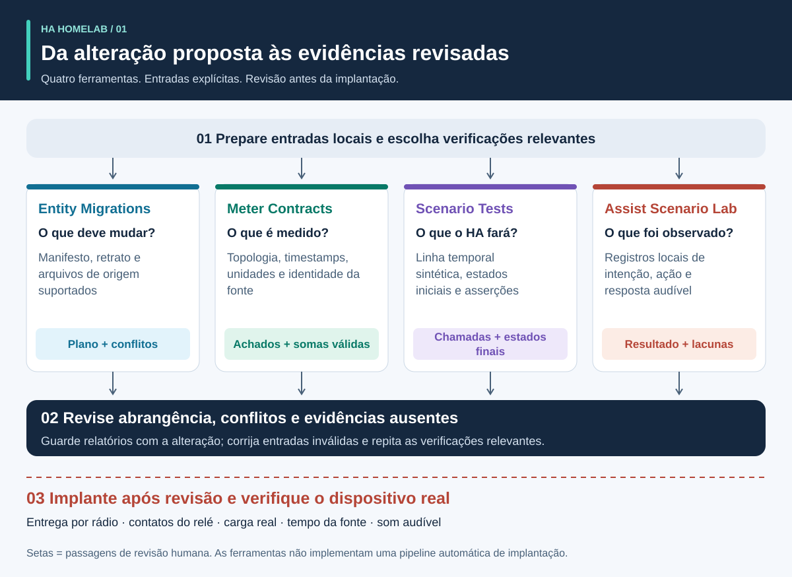
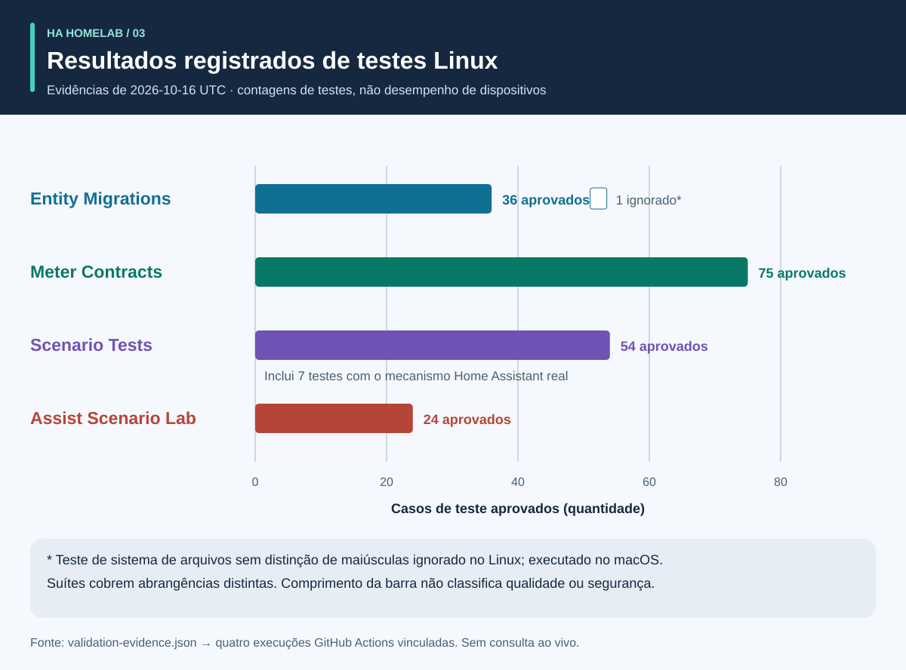
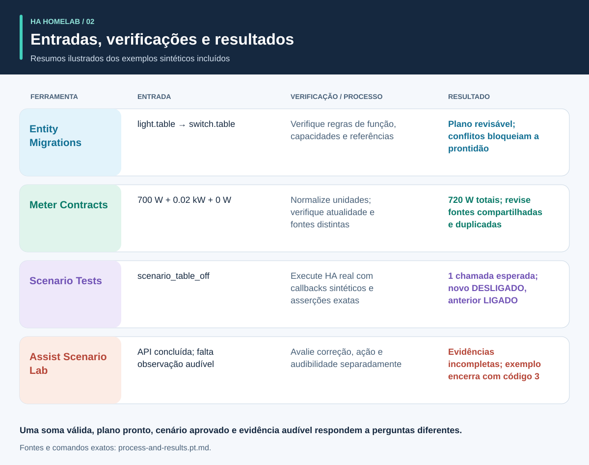

# Evidências antes da automação

<!-- language-navigation:start -->
<p dir="ltr">
<a href="README.md" lang="en" dir="ltr">English</a> · <a href="README.ar.md" lang="ar" dir="rtl">العربية</a> · <a href="README.bn.md" lang="bn" dir="ltr">বাংলা</a> · <a href="README.cs.md" lang="cs" dir="ltr">Čeština</a> · <a href="README.de.md" lang="de" dir="ltr">Deutsch</a> · <a href="README.es.md" lang="es" dir="ltr">Español</a> · <a href="README.fa.md" lang="fa" dir="rtl">فارسی</a> · <a href="README.fr.md" lang="fr" dir="ltr">Français</a><br>
<a href="README.he.md" lang="he" dir="rtl">עברית</a> · <a href="README.hi.md" lang="hi" dir="ltr">हिन्दी</a> · <a href="README.id.md" lang="id" dir="ltr">Bahasa Indonesia</a> · <a href="README.it.md" lang="it" dir="ltr">Italiano</a> · <a href="README.ja.md" lang="ja" dir="ltr">日本語</a> · <a href="README.ko.md" lang="ko" dir="ltr">한국어</a> · <a href="README.nl.md" lang="nl" dir="ltr">Nederlands</a> · <a href="README.pl.md" lang="pl" dir="ltr">Polski</a><br>
<a href="README.pt.md" lang="pt" dir="ltr">Português</a> · <a href="README.ru.md" lang="ru" dir="ltr">Русский</a> · <a href="README.th.md" lang="th" dir="ltr">ไทย</a> · <a href="README.tr.md" lang="tr" dir="ltr">Türkçe</a> · <a href="README.uk.md" lang="uk" dir="ltr">Українська</a> · <a href="README.vi.md" lang="vi" dir="ltr">Tiếng Việt</a> · <a href="README.zh-Hans.md" lang="zh-Hans" dir="ltr">简体中文</a> · <a href="README.zh-Hant.md" lang="zh-Hant" dir="ltr">繁體中文</a>
</p>
<!-- language-navigation:end -->

Estas traduções da documentação não ampliam o suporte a idiomas da CLI ou das funções de voz; confira os idiomas suportados por cada projeto.

Quatro pequenas ferramentas ajudam um projeto da comunidade Home Assistant a responder a quatro perguntas diferentes: **em que deve se transformar a função de um dispositivo, o que uma medição abrange, o que o mecanismo de automação realmente faz e que evidências sustentam um resultado de voz?** As primeiras versões trabalham com arquivos locais e dados de teste sintéticos. Não implantam configurações domésticas nem certificam dispositivos físicos.



[Guia visual: processo, saídas e resultados](process-and-results.pt.md) · [Diagrama de mudança de estado](role-transfer.pt.svg) · [Gráfico de evidências de teste](validation.pt.svg)

## Os quatro projetos

- [HA Entity Migrations](https://github.com/ha-homelab/ha-entity-migrations) produz um plano de migração offline. Políticas explícitas de função/hardware, capacidades e impressões digitais de arquivos impedem que uma simples renomeação atribua silenciosamente uma automação de iluminação a uma tomada reaproveitada. Um plano pronto vale apenas para a abrangência de configuração fornecida e suportada.
- [HA Meter Contracts](https://github.com/ha-homelab/ha-meter-contracts) verifica abrangência física da medição, procedência das fontes, unidades, atualidade das amostras e regras de soma. Renomear um medidor de régua de tomadas não o transforma em medidor individual de bomba. Representações duplicadas de um mesmo transformador de corrente não podem ser somadas como cargas separadas.
- [HA Scenario Tests](https://github.com/ha-homelab/ha-scenario-tests) executa um cenário sintético restrito no mecanismo real de automação e scripts do Home Assistant. Verifica chamadas ordenadas, chamadas proibidas e estados sintéticos finais. O ambiente de execução atual está fixado em HA 2026.10.1 e Python 3.14.2–3.14.x; use um ambiente separado das outras ferramentas.
- [Assist Scenario Lab](https://github.com/ha-homelab/assist-scenario-lab) avalia evidências de voz locais. Separa a correção do comando, a conclusão da API e a saída audível. Todos os tempos incluídos são sintéticos, e as observações fornecidas não são verificadas de forma independente.

Os projetos têm guias próprios de instalação, documentação em inglês/russo e mensagens CLI em inglês, russo, alemão e espanhol. Siga os contratos versionados em vez de supor que todos os códigos de saída tenham o mesmo significado. As setas são **passagens de revisão**, não integrações automáticas implementadas. Não existe daemon central nem comando universal de implantação.

Wikis hospedadas: [Entity Migrations](https://github.com/ha-homelab/ha-entity-migrations/wiki) · [Meter Contracts](https://github.com/ha-homelab/ha-meter-contracts/wiki) · [Scenario Tests](https://github.com/ha-homelab/ha-scenario-tests/wiki) · [Assist Scenario Lab](https://github.com/ha-homelab/assist-scenario-lab/wiki) · [ZAC93 + ESP32](https://github.com/ha-homelab/zac93-esp32/wiki)

<a id="validation-evidence--2026-10-16-utc"></a>

## Evidências de validação — 2026-10-16 UTC

São verificações de software específicas de versão com dados sintéticos, não certificação de hardware nem benchmark doméstico.



As barras mostram contagens, não cobertura ou classificação de qualidade. Os registros de origem datados estão em [validation-evidence.json](validation-evidence.json).

- **Entity Migrations:** 37 testes e 9 subtestes passaram localmente, incluindo regressões de aliases de fontes. A [execução Linux em main](https://github.com/ha-homelab/ha-entity-migrations/actions/runs/38843701264) passou em 36 testes e ignorou o caso de sistema de arquivos sem distinção entre maiúsculas e minúsculas, exercitado localmente.
- **Meter Contracts:** [75 testes passaram na CI Linux](https://github.com/ha-homelab/ha-meter-contracts/actions/runs/38843671896), incluindo conflitos de procedência, admissão de arquivos de origem e semântica de medição.
- **Assist Scenario Lab:** [24 testes passaram na CI Linux](https://github.com/ha-homelab/assist-scenario-lab/actions/runs/38843304306). Validam evidências fornecidas e exemplos sintéticos; não se afirma uma comparação física de voz.
- **Scenario Tests:** [54 testes passaram sem casos ignorados na CI Linux](https://github.com/ha-homelab/ha-scenario-tests/actions/runs/38843681199) em CPython 3.14.8 com Home Assistant 2026.10.0 real, incluindo sete casos de execução, um dos quais testa o cenário complementar de transferência de função. A suíte completa terminou em 21.42 segundos.

Linux é o ambiente de execução testado. A [falha documentada no encerramento nativo em macOS](https://github.com/ha-homelab/ha-scenario-tests/blob/main/docs/validation.md) continua sendo uma limitação; um resultado JSON esperado antes de o processo falhar ainda corresponde a uma execução malsucedida. O registro de 16 de outubro não afirma execução em Docker nem aceitação de dispositivos físicos.

Atualização de 19 de outubro de 2026: a [CI Linux](https://github.com/ha-homelab/ha-scenario-tests/actions/runs/39264346721) também passou em um teste básico de execução do ambiente empacotado em Docker. Isso não comprova a aceitação de dispositivos físicos.

## Processo e resultados ilustrados



Siga o [guia visual](process-and-results.pt.md) para interpretar cada saída, acompanhar estados do dispositivo substituto e do hardware retirado da função e distinguir evidências de software de aceitação física. Os resultados ilustrados resumem exemplos sintéticos incluídos; não são capturas de relatórios brutos.

<a id="a-concrete-migration-to-test-workflow"></a>

## Um fluxo concreto da migração ao teste

1. Em `ha-entity-migrations`, execute o exemplo incluído de mudança de domínio após instalar esse repositório:

   ```sh
   ha-entity-migrations --lang en plan --manifest examples/domain-change/manifest.json --snapshot examples/domain-change/snapshot.json --root examples/domain-change
   ```

   Revise as alterações propostas `light.table` → `switch.table` e `light.turn_off` → `switch.turn_off`. Trate impressões digitais e referências suportadas como limites de abrangência. Um plano bloqueado precisa de investigação; não substitua evidências ausentes de capacidade por localizar e substituir sem condições.

2. Traduza o comportamento revisado em um teste sintético. [role-transfer.scenario.json](role-transfer.scenario.json) é um exemplo complementar escrito à mão, **não uma exportação automática** do plano de migração. Envia um evento sintético “mesa desligada”, espera uma chamada para a função substituta e proíbe desligar o hardware anterior. Também verifica que o hardware anterior permanece ligado. No diretório deste guia, com o executor de cenários instalado em ambiente próprio:

   ```sh
   ha-scenario validate role-transfer.scenario.json
   ha-scenario run role-transfer.scenario.json
   ```

   Este exemplo é idêntico byte a byte ao [fixture de transferência de função](https://github.com/ha-homelab/ha-scenario-tests/blob/0ea7e5a5d24dc89ebe896b1a2387396b3fce18f4/tests/fixtures/role_transfer.json) testado na [execução Linux bem-sucedida](https://github.com/ha-homelab/ha-scenario-tests/actions/runs/38843681199). Seu SHA-256 é `bb8544517eeb4895b80b049cf9e242d04635e7785bd198c1d57a7cf3f5fc8ab4`. A falha anterior no encerramento em macOS continua documentada e não é contada como execução aprovada.

   O cenário usa o mecanismo HA real com callbacks de atuadores em memória. Um resultado aprovado comprova o comportamento do mecanismo para aquela sequência sintética, não entrega por rádio, fechamento de contatos ou alimentação de um aparelho. Um evento não cobre toda uma configuração doméstica.

3. Adicione sequências relevantes de falha antes da implantação: ausência interrompida por indisponibilidade do sensor, manutenção manual de estado, recarga da automação, gatilhos duplicados e estado restaurado. Os exemplos do executor cobrem presença, manutenção manual, entradas desatualizadas e reconciliação após recarga. Seu relógio usa tempo real decorrido: um fixture curto não valida um intervalo de vinte minutos em produção. O HA documenta que esperas `for` não sobrevivem a reinício/recarga; escolha e teste reconciliação explícita ou prazos persistidos quando necessário. [Documentação de gatilhos HA](https://www.home-assistant.io/docs/automation/trigger/)

4. Revise as evidências de medição de forma independente. No repositório de medidores:

   ```sh
   ha-meter-contracts check examples/valid-three-meters.json --at 2026-01-01T12:00:05Z --json
   ha-meter-contracts check examples/kmc-shared-meter.json --at 2026-01-01T12:00:05Z --json
   ha-meter-contracts check examples/duplicate-emporia.json --at 2026-01-01T12:00:05Z --json
   ```

   O exemplo válido é aprovado. Os outros dois encerram intencionalmente com código 1: respectivamente, tentativa de atribuir a uma tomada a medição da régua inteira e representações duplicadas de uma fonte. Trate-os como falhas esperadas em scripts de exemplo. Não use watts da régua inteira em um limite de proteção originalmente calibrado apenas para uma bomba. Calibração de tensão não é calibração de corrente ou potência. Evidências ausentes ou desatualizadas continuam indisponíveis, não viram zero. [Semântica HA de sensores e estatísticas](https://developers.home-assistant.io/docs/core/entity/sensor/#long-term-statistics)

5. Se a voz for um gatilho ou caminho de retorno, avalie as evidências separadamente no repositório de voz:

   ```sh
   assist-lab evaluate examples/synthetic-pass.json
   assist-lab evaluate examples/synthetic-incomplete.json
   ```

   O exemplo incompleto encerra intencionalmente com código 3 porque a conclusão da API não é evidência suficiente de audibilidade. Um benchmark real exige consentimento para gravar, relógio e método declarados, condições comparáveis e observação independente da ação e da resposta audível. Não publique gravações domésticas, transcrições ou tokens exportados. O primeiro bloco de áudio de um servidor não é o primeiro som ouvido. [Pipelines HA Assist](https://developers.home-assistant.io/docs/voice/pipelines/)

6. Guarde cada relatório junto à alteração revisada. Aplique pelo procedimento de revisão/implantação estabelecido para a instalação e depois realize a aceitação específica do dispositivo. Ligar e desligar fisicamente, polaridade do indicador, comportamento no reinício, tempo da fonte e calibração por grandeza exigem observações reais. Estas quatro ferramentas não executam nem substituem essa etapa.

## O que as verificações não comprovam

Estado configurado, chamada de serviço aceita, consumo observado e fluxo de água são evidências separadas. Um medidor total de três cargas não identifica qual consumiu a potência. Um estado sintético “desligado” não comprova que os contatos do relé abriram. Nem a ferramenta de medição nem um teste de cenário é controlador de segurança para água, aquecedores, acesso ou outras cargas de impacto relevante.

As ferramentas não impõem os resultados umas das outras. Uma futura integração pode consumir seu JSON estável, mas precisa definir explicitamente níveis de aviso aceitos, compatibilidade de versões e o significado de “evidências completas”. Não reduza `ready`, `available`, `passed` e `audible` a um único booleano intercambiável.

## Roadmap: quatorze ideias com prontidão realista

As quatro primeiras entregas de código abaixo estão disponíveis como ferramentas offline iniciais. Todo o trabalho posterior citado continua sendo proposto; um nome de repositório ou diagrama não significa que o hardware foi comissionado.

1. **Migrações de função — ferramenta inicial implementada.** Amplie os formatos de referência suportados somente com testes de ida e volta e de conflitos; mantenha o limite explícito para entradas não suportadas.
2. **Contratos de medidores — ferramenta inicial implementada.** Experimente observações reais privadas com timestamp; meça corrente/potência independentemente antes de afirmar sua calibração. Atribuição por tomada ainda exige evidências por tomada.
3. **Testes de cenários de automação — ferramenta inicial implementada.** Adicione políticas revisadas e casos de reinício/prazo; teste separadamente durações de produção quando necessário.
4. **Evidências de voz — ferramenta inicial implementada; benchmark físico pendente.** Selecione satélites, método de observação e consentimento de gravação antes de coletar sessões comparáveis. Ainda não há classificação de hardware.
5. **Coordenação da qualidade do ar — verificação de sensores/atuadores pendente.** Confira se o dispositivo mede CO₂ ou partículas, sua idade/precisão e o que ventilação ou filtragem podem afetar. Confirme condições externas antes de definir uma política de ventilação.
6. **Evidências de radar/presença — comissionamento de hardware pendente.** Verifique placa LD2450, alimentação, invólucro, protocolo e cobertura. Alvos não são identidades humanas, e a idade da recepção não é latência medida do sensor. CSI continua experimental.
7. **Observabilidade de água/bomba — evidências independentes pendentes.** Distinga permissão para alimentar uma bomba, consumo elétrico, fluxo e nível de água. Um medidor agregado de régua não fornece um sinal de proteção ausente exclusivo da bomba. Evite repetição automática de comandos críticos sem estado observado e revisão específica da instalação.
8. **Telemetria BLE — proxies compatíveis e testes de cobertura pendentes.** Valide sensores reais, faixa de temperatura, baterias e posicionamento. Dispositivos ESP8266 não são proxies BLE; RSSI não é identidade nem credencial de destravamento. [Proxy Bluetooth ESPHome](https://esphome.io/components/bluetooth_proxy/)
9. **Explicações baseadas em presença e eletrodomésticos — verificação de capacidades pendente.** Explique qual observação manteve uma luz acesa; use eventos reais de lavadora/secadora se suportados. Não deduza um ciclo apenas de um medidor compartilhado nem invente confiança estatística a partir de flags de sensores não relacionados.
10. **Ponte Z-Wave — entrega/montagem e aceitação de rádio pendentes.** O [guia ZAC93 + ESP32](https://github.com/ha-homelab/zac93-esp32) é um caminho de hardware separado. Verifique ligação, frequência regional, transporte serial e inclusão Z-Wave JS na placa real. O suporte Long Range do controlador não transforma um sensor antigo em dispositivo Long Range. [Guia Z-Wave JS](https://zwave-js.github.io/zwave-js/#/getting-started/index)
11. **Aceitação de tomadas ESPHome — testes individuais de hardware pendentes.** Registre evidências de botão, relé, indicador e reinício para cada revisão, além de calibrações separadas de tensão/corrente/potência. Gravação de firmware bem-sucedida não conclui a aceitação. Não faça ciclos de alimentação em massa sem supervisão nos aparelhos conectados.
12. **Benchmark de previsões — dados acumulados pendentes.** Arquive previsões emitidas e valores reais posteriores, mantenha o instante de emissão e avalie horizontes sem vazamento de informação futura. Isso exige tempo de observação decorrido, não uma alegação de economia de energia baseada em exemplo sintético.
13. **Controles de convidados limitados — revisão de permissões de backend pendente.** Verifique identidade e autorização no servidor. Apenas ocultar controles no painel não limita acesso. Não enfraqueça a autenticação para simplificar um painel.
14. **Agendamento de cargas adiáveis — restrições e capacidades medidas pendentes.** Integre ferramentas estabelecidas de agendamento após validar medidores, retorno de estado e previsões. Confirme quais cargas podem ser adiadas ou moduladas, seus prazos e substituições manuais. Comece com recomendações revisadas, sem economias especulativas ou garantias de segurança. [EMHASS](https://emhass.readthedocs.io/en/latest/emhass.html) · [evcc](https://docs.evcc.io/en/)

## Contribuição e reprodução deste guia

Esta visão geral, o cenário sintético e o diagrama são material original sob licença MIT; veja [LICENSE](LICENSE). Recrie todos os SVGs localizados com `python3 render_architecture.py`. Não contêm imagens externas, scripts, identificadores domésticos ou dados domésticos medidos. O [guia visual](process-and-results.pt.md#reproduce-or-translate-the-illustrations) explica os registros de origem e verificações de regeneração. Mantenha os fixtures públicos sintéticos e as exportações privadas fora do Git. Para alterações, siga as orientações de segurança e contribuição de cada repositório.
