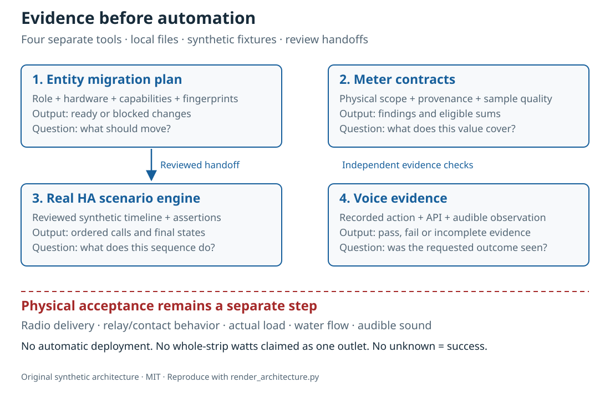

# Сначала подтверждение, затем автоматизация

[English](README.md)

Четыре небольших инструмента отвечают на разные вопросы проекта Home Assistant: **куда переносится роль устройства, что охватывает измерение, что действительно делает движок автоматизаций и чем подтверждён результат голосовой команды?** Первые версии работают с локальными файлами и синтетическими примерами. Они не разворачивают домашние конфигурации и не подтверждают исправность физических устройств.



## Четыре проекта

- [HA Entity Migrations](https://github.com/ha-homelab/ha-entity-migrations) составляет план миграции без подключения к HA. Явная связь роли и оборудования, требования к возможностям и отпечатки файлов помогают не перенести автоматику света на розетку, которую теперь используют для насоса. Готовность плана относится только к переданным данным и поддерживаемой области конфигурации.
- [HA Meter Contracts](https://github.com/ha-homelab/ha-meter-contracts) проверяет физическую область измерения, происхождение потока, единицы, свежесть данных и правила суммирования. Переименование общего измерителя удлинителя не превращает его в измеритель насоса. Два представления одного трансформатора тока нельзя складывать как две нагрузки.
- [HA Scenario Tests](https://github.com/ha-homelab/ha-scenario-tests) выполняет ограниченные синтетические сценарии в настоящем движке автоматизаций и скриптов Home Assistant. Проверяет порядок вызовов, запрещённые вызовы и итоговые синтетические состояния. Первая версия использует HA 2026.10.0 и Python 3.14.2–3.14.x; ей нужно отдельное окружение.
- [Assist Scenario Lab](https://github.com/ha-homelab/assist-scenario-lab) анализирует локальные свидетельства выполнения голосовой команды. Правильное действие, завершение API и слышимый ответ проверяются отдельно. Все комплектные задержки синтетические; переданные наблюдения не считаются независимо подтверждёнными.

У проектов есть собственные инструкции установки, документация EN/RU и сообщения CLI на EN/RU/DE/ES. Коды завершения различаются: используйте контракт конкретной версии. Стрелки на схеме обозначают **передачу результатов на проверку**, а не готовую автоматическую интеграцию. Общего демона или команды автоматического внедрения нет.

Опубликованные wiki: [Entity Migrations](https://github.com/ha-homelab/ha-entity-migrations/wiki) · [Meter Contracts](https://github.com/ha-homelab/ha-meter-contracts/wiki) · [Scenario Tests](https://github.com/ha-homelab/ha-scenario-tests/wiki) · [Assist Scenario Lab](https://github.com/ha-homelab/assist-scenario-lab/wiki) · [ZAC93 + ESP32](https://github.com/ha-homelab/zac93-esp32/wiki)

## Подтверждения проверки — 2026-10-16 UTC

Это проверки конкретных версий программ на синтетических данных, а не сертификация оборудования или измерения работы дома.

- **Entity Migrations:** локально прошли 37 тестов и 9 subtests, включая регрессии псевдонимов файлов. [Linux-прогон main](https://github.com/ha-homelab/ha-entity-migrations/actions/runs/38843701264): 36 тестов прошли, один тест файловой системы без учёта регистра пропущен; он проверен локально.
- **Meter Contracts:** [75 тестов прошли в Linux CI](https://github.com/ha-homelab/ha-meter-contracts/actions/runs/38843671896), включая конфликты происхождения потоков, проверку файлов и семантику измерений.
- **Assist Scenario Lab:** [24 теста прошли в Linux CI](https://github.com/ha-homelab/assist-scenario-lab/actions/runs/38843304306). Проверены переданные свидетельства и синтетические примеры; физическое сравнение голосовых устройств не заявляется.
- **Scenario Tests:** [54 теста прошли без пропусков в Linux CI](https://github.com/ha-homelab/ha-scenario-tests/actions/runs/38843681199) на CPython 3.14.8 с настоящим Home Assistant 2026.10.0, включая семь runtime-сценариев, один из которых проверяет перенос роли. Полный набор завершился за 21,42 секунды.

Проверенное окружение runner — Linux. [Документированное аварийное завершение на macOS](https://github.com/ha-homelab/ha-scenario-tests/blob/main/docs/validation.ru.md) остаётся ограничением: ожидаемый JSON перед падением процесса не превращает запуск в успешный. Запуск в Docker и физическая приёмка устройств не заявляются.

## От плана миграции к исполняемому тесту

1. После установки `ha-entity-migrations` запустите пример смены домена из каталога этого репозитория:

   ```sh
   ha-entity-migrations --lang ru plan --manifest examples/domain-change/manifest.json --snapshot examples/domain-change/snapshot.json --root examples/domain-change
   ```

   Проверьте предложенные изменения `light.table` → `switch.table` и `light.turn_off` → `switch.turn_off`. Отпечатки и поддерживаемые ссылки задают границы проверки. Если план заблокирован, сначала разберите причину; механическая замена текста не подтверждает возможности оборудования.

2. Переведите проверенное поведение в синтетический сценарий. [role-transfer.scenario.json](role-transfer.scenario.json) написан вручную как сопутствующий пример: **это не автоматический экспорт плана**. Синтетическое событие «выключить стол» должно вызвать ровно одно выключение новой роли и ни одного выключения прежнего оборудования. Дополнительно проверяется, что прежнее оборудование осталось включённым. Из каталога этого руководства, используя отдельное окружение с runner:

   ```sh
   ha-scenario validate role-transfer.scenario.json
   ha-scenario run role-transfer.scenario.json
   ```

   Этот пример побайтно совпадает с [role-transfer fixture](https://github.com/ha-homelab/ha-scenario-tests/blob/0ea7e5a5d24dc89ebe896b1a2387396b3fce18f4/tests/fixtures/role_transfer.json), проверенным в [успешном Linux-прогоне](https://github.com/ha-homelab/ha-scenario-tests/actions/runs/38843681199). Его SHA-256: `bb8544517eeb4895b80b049cf9e242d04635e7785bd198c1d57a7cf3f5fc8ab4`. Первоначальное аварийное завершение на macOS остаётся документированным ограничением и не считается успешным запуском.

   Выполняется настоящий движок HA, но обработчики исполнительных устройств работают в памяти. Успех подтверждает поведение движка для данной последовательности, а не доставку радиокоманды, замыкание контактов или питание прибора. Один сценарий не охватывает всю конфигурацию дома.

3. До внедрения добавьте нужные сбои: недоступность датчика во время отсчёта отсутствия, ручную блокировку, перезагрузку автоматизаций, повторные события и восстановленное состояние. Примеры runner охватывают присутствие, ручную блокировку, устаревший вход и согласование после reload. Часы используют реальное прошедшее время: короткий тест не проверяет двадцатиминутный рабочий интервал. HA предупреждает, что ожидание `for` не переживает restart/reload; при необходимости отдельно спроектируйте и проверьте согласование состояния или сохраняемый срок. [Документация триггеров HA](https://www.home-assistant.io/docs/automation/trigger/)

4. Отдельно проверьте измерения из каталога meter-проекта:

   ```sh
   ha-meter-contracts check examples/valid-three-meters.json --at 2026-01-01T12:00:05Z --json --lang ru
   ha-meter-contracts check examples/kmc-shared-meter.json --at 2026-01-01T12:00:05Z --json --lang ru
   ha-meter-contracts check examples/duplicate-emporia.json --at 2026-01-01T12:00:05Z --json --lang ru
   ```

   Первый пример успешный. Два следующих намеренно завершаются кодом 1: присвоение общей мощности одному выходу и двойной учёт одного источника. В сценариях запуска явно ожидайте эти ошибки. Нельзя подставлять общие ватты удлинителя в защитный порог, откалиброванный по отдельному насосу. Калибровка напряжения не является калибровкой тока или мощности. Отсутствующие и старые данные остаются недоступными, а не нулевыми. [Семантика сенсоров и статистики HA](https://developers.home-assistant.io/docs/core/entity/sensor/#long-term-statistics)

5. Если голос запускает действие или сообщает результат, отдельно проверьте свидетельства в voice-проекте:

   ```sh
   assist-lab evaluate examples/synthetic-pass.json --lang ru
   assist-lab evaluate examples/synthetic-incomplete.json --lang ru
   ```

   Неполный пример намеренно завершается кодом 3: завершённого API недостаточно для доказательства слышимого ответа. Настоящее сравнение требует согласия на запись, объявленного метода и часов, одинаковых условий и независимого наблюдения действия и звука. Не публикуйте домашние записи, расшифровки и экспортированные токены. Первый аудиофрагмент на сервере не равен первому звуку у слушателя. [HA Assist pipelines](https://developers.home-assistant.io/docs/voice/pipelines/)

6. Сохраните отчёты рядом с проверяемым изменением. Внедряйте его через принятый процесс ревью и развёртывания, затем проведите испытания конкретного устройства. Реальное включение, полярность индикатора, поведение после перезапуска, исходное время измерения и калибровка каждой величины требуют физических наблюдений. Эти инструменты не выполняют и не заменяют этот этап.

## Чего проверки не доказывают

Состояние в конфигурации, принятый сервисный вызов, потребляемая мощность и поток воды — разные свидетельства. По общему измерителю трёх нагрузок нельзя определить, какая из них потребляет. Синтетическое состояние «выключено» не доказывает размыкание реле. Ни meter-tool, ни тест сценария не является контроллером безопасности воды, нагревателей, доступа или других ответственных нагрузок.

Инструменты не принуждают друг друга соблюдать результаты. Будущий адаптер может читать стабильный JSON, но должен явно определить допустимые предупреждения, совместимость версий и полноту доказательств. `ready`, `available`, `passed` и `audible` нельзя свести к одному взаимозаменяемому флагу.

## План: четырнадцать идей и фактическая готовность

Первые четыре пункта реализованы как начальные инструменты локальной проверки. Остальные — предложения: название репозитория или схема не означает, что оборудование уже введено в эксплуатацию.

1. **Миграция ролей — начальная версия готова.** Поддержку новых ссылок добавлять с тестами конфликтов и преобразования в обе стороны; неподдерживаемый ввод оставлять явно заблокированным.
2. **Контракты измерений — начальная версия готова.** Следующий этап — приватные реальные данные с исходным временем. Ток и мощность проверять отдельно; отдельному выходу нужны собственные измерения.
3. **Тесты автоматизаций — начальная версия готова.** Добавлять проверенные правила и сценарии restart/deadline; длительность рабочего таймера испытывать отдельно.
4. **Голосовые свидетельства — инструмент готов, физическое сравнение ожидается.** До записи выбрать спутники, метод наблюдения и получить согласие. Рейтинга оборудования пока нет.
5. **Качество воздуха — ожидается проверка сенсоров и исполнительных устройств.** Различать CO₂ и частицы, возраст/точность показаний и возможности вентиляции/фильтрации. Учитывать наружный воздух.
6. **Радар и присутствие — ожидается ввод оборудования.** Проверить плату LD2450, питание, корпус, протокол и покрытие. Цель радара не является личностью, возраст приёма не равен задержке измерения. CSI остаётся экспериментом.
7. **Вода и насос — ожидаются независимые свидетельства.** Различать разрешение питания, ток, поток и уровень воды. Общая мощность удлинителя не заменяет защитный сигнал отдельного насоса. Автоматические повторы ответственных команд требуют наблюдаемого состояния и проверки на месте.
8. **BLE-телеметрия — ожидаются совместимые proxy и тесты покрытия.** Проверить сенсоры, температурный диапазон, батарейки и расположение. ESP8266 не является BLE-proxy; RSSI не подтверждает личность и не разрешает открытие замка. [ESPHome Bluetooth proxy](https://esphome.io/components/bluetooth_proxy/)
9. **Объяснение присутствия и бытовые приборы — ожидается проверка возможностей.** Показывать, какое наблюдение удержало свет. Использовать реальные события стиральной/сушильной машины, если они доступны; не угадывать цикл по общей мощности и не придумывать статистическую достоверность из флагов датчиков.
10. **Мост Z-Wave — ожидаются доставка, сборка и радиопроверка.** [Руководство ZAC93 + ESP32](https://github.com/ha-homelab/zac93-esp32) — отдельное аппаратное направление. Проверить разводку, региональную частоту, serial-транспорт и включение в Z-Wave JS на настоящей плате. Поддержка Long Range контроллером не делает старый сенсор устройством Long Range. [Руководство Z-Wave JS](https://zwave-js.github.io/zwave-js/#/getting-started/index)
11. **Приёмка розеток ESPHome — ожидаются индивидуальные испытания.** Для каждой ревизии записать кнопку, реле, индикатор, рестарт и отдельную калибровку напряжения/тока/мощности. Успешная прошивка не завершает приёмку. Не перезапускать массово питание подключённых приборов без наблюдения.
12. **Оценка прогнозов — ожидается накопление данных.** Архивировать выданный прогноз и последующий факт, хранить время выпуска, оценивать горизонты без знания будущего. Нужны реальные наблюдения во времени; синтетический пример не подтверждает экономию.
13. **Гостевые панели — ожидается проверка прав на сервере.** Проверять личность и серверную авторизацию. Скрытая кнопка не ограничивает доступ. Не ослаблять аутентификацию ради удобства панели.
14. **Планирование отложенных нагрузок — ожидаются измеренные ограничения и возможности.** Подключать существующие планировщики после проверки измерителей, обратной связи и прогнозов. Подтвердить допустимую отсрочку/регулировку, сроки и ручное управление. Начать с проверяемых рекомендаций, без выдуманной экономии и гарантий безопасности. [EMHASS](https://emhass.readthedocs.io/en/latest/emhass.html) · [evcc](https://docs.evcc.io/en/)

## Участие и воспроизводимость

Текст, синтетический сценарий и схема — оригинальные материалы под MIT, см. [LICENSE](LICENSE). SVG воспроизводится командой `python3 render_architecture.py`. В нём нет внешних изображений, скриптов, домашних идентификаторов или измерений. Публичные примеры должны оставаться синтетическими; приватные экспорты храните вне Git. Для изменений используйте правила безопасности и участия соответствующего проекта.
