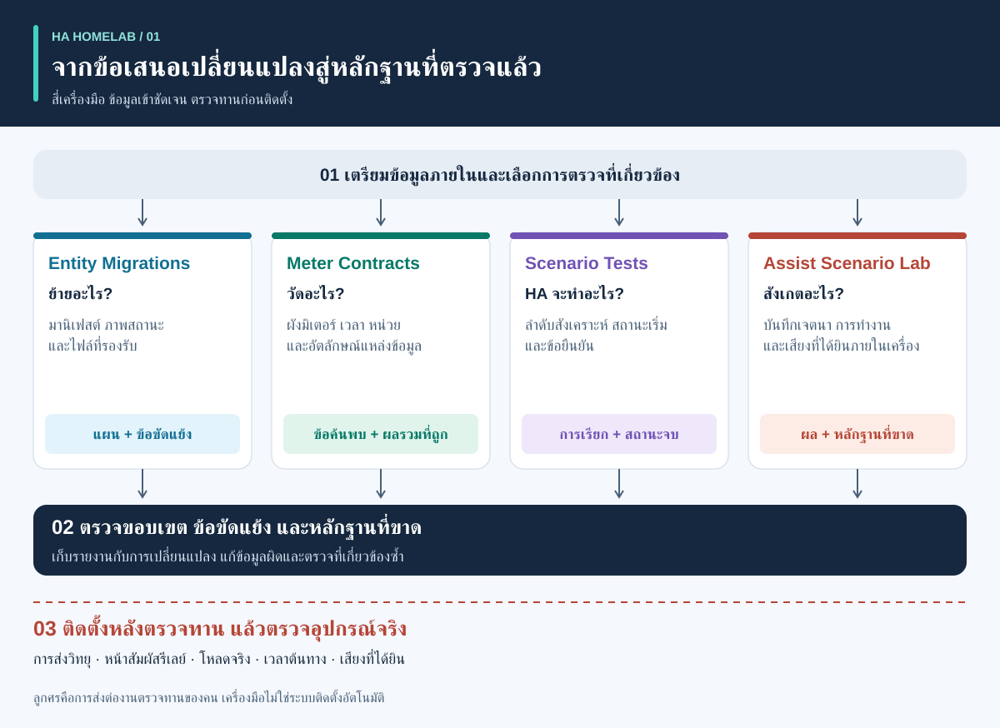
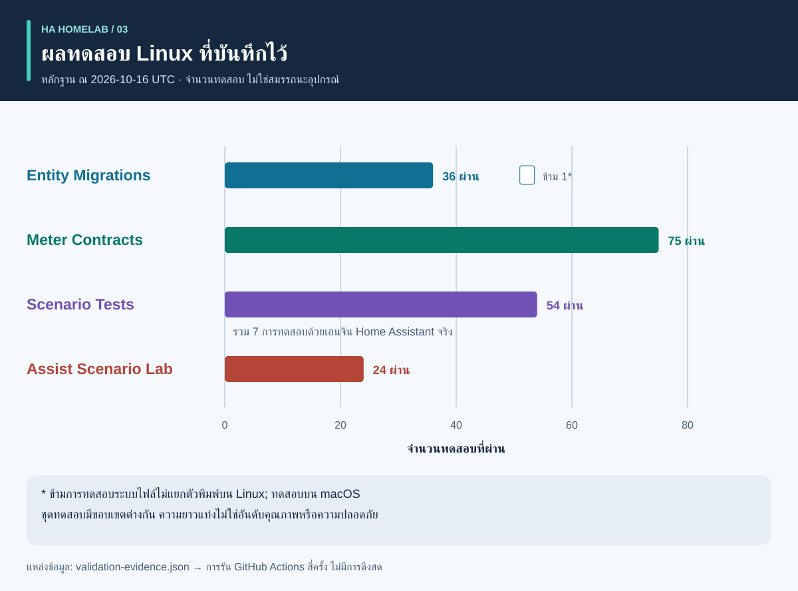
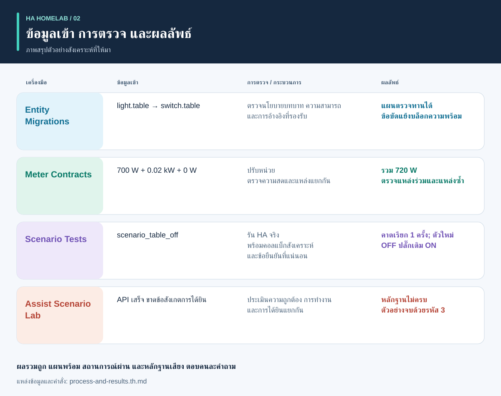

# ตรวจหลักฐานก่อนทำงานอัตโนมัติ

<!-- language-navigation:start -->
<p dir="ltr">
<a href="README.md" lang="en" dir="ltr">English</a> · <a href="README.ar.md" lang="ar" dir="rtl">العربية</a> · <a href="README.bn.md" lang="bn" dir="ltr">বাংলা</a> · <a href="README.cs.md" lang="cs" dir="ltr">Čeština</a> · <a href="README.de.md" lang="de" dir="ltr">Deutsch</a> · <a href="README.es.md" lang="es" dir="ltr">Español</a> · <a href="README.fa.md" lang="fa" dir="rtl">فارسی</a> · <a href="README.fr.md" lang="fr" dir="ltr">Français</a><br>
<a href="README.he.md" lang="he" dir="rtl">עברית</a> · <a href="README.hi.md" lang="hi" dir="ltr">हिन्दी</a> · <a href="README.id.md" lang="id" dir="ltr">Bahasa Indonesia</a> · <a href="README.it.md" lang="it" dir="ltr">Italiano</a> · <a href="README.ja.md" lang="ja" dir="ltr">日本語</a> · <a href="README.ko.md" lang="ko" dir="ltr">한국어</a> · <a href="README.nl.md" lang="nl" dir="ltr">Nederlands</a> · <a href="README.pl.md" lang="pl" dir="ltr">Polski</a><br>
<a href="README.pt.md" lang="pt" dir="ltr">Português</a> · <a href="README.ru.md" lang="ru" dir="ltr">Русский</a> · <a href="README.th.md" lang="th" dir="ltr">ไทย</a> · <a href="README.tr.md" lang="tr" dir="ltr">Türkçe</a> · <a href="README.uk.md" lang="uk" dir="ltr">Українська</a> · <a href="README.vi.md" lang="vi" dir="ltr">Tiếng Việt</a> · <a href="README.zh-Hans.md" lang="zh-Hans" dir="ltr">简体中文</a> · <a href="README.zh-Hant.md" lang="zh-Hant" dir="ltr">繁體中文</a>
</p>
<!-- language-navigation:end -->

การแปลเอกสารนี้ไม่ได้เพิ่มภาษาที่ CLI หรือระบบเสียงรองรับ โปรดตรวจภาษาที่แต่ละโครงการรองรับ

เครื่องมือขนาดเล็กสี่ตัวช่วยโครงการชุมชน Home Assistant ตอบคำถามต่างกันสี่ข้อ: **บทบาทอุปกรณ์ควรเปลี่ยนไปอย่างไร การวัดครอบคลุมอะไร เอนจินอัตโนมัติทำอะไรจริง และหลักฐานใดสนับสนุนผลลัพธ์เสียง?** รุ่นแรกทำงานกับไฟล์ภายในเครื่องและข้อมูลทดสอบสังเคราะห์ ไม่ได้ติดตั้งการตั้งค่าบ้านหรือรับรองอุปกรณ์จริง



[คู่มือภาพ: กระบวนการ ผลส่งออก และผลลัพธ์](process-and-results.th.md) · [แผนภาพการเปลี่ยนสถานะ](role-transfer.th.svg) · [กราฟหลักฐานทดสอบ](validation.th.svg)

## สี่โครงการ

- [HA Entity Migrations](https://github.com/ha-homelab/ha-entity-migrations) สร้างแผนย้ายแบบออฟไลน์ นโยบายบทบาท/ฮาร์ดแวร์ที่ชัดเจน ความสามารถ และลายนิ้วมือไฟล์ ป้องกันไม่ให้การเปลี่ยนชื่อทั่วไปย้ายระบบอัตโนมัติแสงสว่างไปยังปลั๊กที่เปลี่ยนหน้าที่โดยไม่รู้ตัว แผนที่พร้อมใช้ครอบคลุมเฉพาะการตั้งค่าที่ให้มาและอยู่ในขอบเขตที่รองรับ

- [HA Meter Contracts](https://github.com/ha-homelab/ha-meter-contracts) ตรวจขอบเขตการวัดทางกายภาพ ที่มาของข้อมูล หน่วย ความสดของตัวอย่าง และกฎการบวก การเปลี่ยนชื่อมิเตอร์ปลั๊กพ่วงไม่ได้ทำให้เป็นมิเตอร์ปั๊มเฉพาะตัว ตัวแทนข้อมูลซ้ำของหม้อแปลงกระแสตัวเดียวกันไม่สามารถนำมาบวกเป็นโหลดแยกกันได้

- [HA Scenario Tests](https://github.com/ha-homelab/ha-scenario-tests) รันสถานการณ์สังเคราะห์ที่จำกัดขอบเขตในเอนจินระบบอัตโนมัติ/สคริปต์ Home Assistant จริง ตรวจลำดับการเรียก การเรียกที่ห้าม และสถานะสังเคราะห์สุดท้าย สภาพแวดล้อมรันปัจจุบันตรึงที่ HA 2026.10.1 และ Python 3.14.2–3.14.x ให้ใช้สภาพแวดล้อมแยกจากเครื่องมืออื่น

- [Assist Scenario Lab](https://github.com/ha-homelab/assist-scenario-lab) ประเมินหลักฐานเสียงภายในเครื่อง แยกความถูกต้องของคำสั่ง การเสร็จสิ้น API และเสียงที่ได้ยิน เวลาที่รวมมาทั้งหมดเป็นค่าสังเคราะห์ และข้อสังเกตที่ให้มาไม่ได้รับการตรวจสอบโดยอิสระ

แต่ละโครงการมีคู่มือติดตั้งและข้อความ CLI ภาษาอังกฤษ รัสเซีย เยอรมัน และสเปน ให้ยึดข้อกำหนดตามรุ่นแทนการสมมติว่ารหัสออกทุกตัวมีความหมายเหมือนกัน ลูกศรในภาพคือ**การส่งต่องานตรวจทาน** ไม่ใช่การเชื่อมต่ออัตโนมัติที่พัฒนาเสร็จแล้ว ไม่มีดีมอนกลางหรือคำสั่งติดตั้งสากล

วิกิที่เปิดไว้: [Entity Migrations](https://github.com/ha-homelab/ha-entity-migrations/wiki) · [Meter Contracts](https://github.com/ha-homelab/ha-meter-contracts/wiki) · [Scenario Tests](https://github.com/ha-homelab/ha-scenario-tests/wiki) · [Assist Scenario Lab](https://github.com/ha-homelab/assist-scenario-lab/wiki) · [ZAC93 + ESP32](https://github.com/ha-homelab/zac93-esp32/wiki)

<a id="validation-evidence--2026-10-16-utc"></a>

## หลักฐานการตรวจสอบ — 2026-10-16 UTC

นี่คือการตรวจซอฟต์แวร์เฉพาะรุ่นด้วยข้อมูลสังเคราะห์ ไม่ใช่การรับรองฮาร์ดแวร์หรือเบนช์มาร์กของบ้าน



แท่งแสดงจำนวน ไม่ใช่ความครอบคลุมหรืออันดับคุณภาพ บันทึกต้นทางพร้อมวันที่อยู่ใน [validation-evidence.json](validation-evidence.json)

- **Entity Migrations:** ทดสอบ 37 รายการและทดสอบย่อย 9 รายการผ่านภายในเครื่อง รวมการทดสอบถดถอยของชื่อแทนแหล่งข้อมูล [การรัน Linux บน main](https://github.com/ha-homelab/ha-entity-migrations/actions/runs/38843701264) ผ่าน 36 รายการและข้ามกรณีระบบไฟล์ไม่แยกตัวพิมพ์เล็กใหญ่ ซึ่งทดสอบภายในเครื่องแล้ว
- **Meter Contracts:** [ทดสอบผ่าน 75 รายการใน Linux CI](https://github.com/ha-homelab/ha-meter-contracts/actions/runs/38843671896) รวมความขัดแย้งของที่มา การยอมรับไฟล์ต้นทาง และความหมายของการวัด
- **Assist Scenario Lab:** [ทดสอบผ่าน 24 รายการใน Linux CI](https://github.com/ha-homelab/assist-scenario-lab/actions/runs/38843304306) ตรวจหลักฐานที่ให้มาและตัวอย่างสังเคราะห์ ไม่ได้อ้างว่าเปรียบเทียบเสียงจากอุปกรณ์จริง
- **Scenario Tests:** [ผ่าน 54 รายการโดยไม่ข้ามใน Linux CI](https://github.com/ha-homelab/ha-scenario-tests/actions/runs/38843681199) บน CPython 3.14.8 กับ Home Assistant 2026.10.0 จริง รวมกรณีรันเจ็ดกรณี โดยหนึ่งกรณีทดสอบสถานการณ์เสริมการย้ายบทบาท ชุดทดสอบทั้งหมดเสร็จใน 21.42 วินาที

Linux คือสภาพแวดล้อมรันที่ทดสอบแล้ว [ข้อผิดพลาดการล้างงานก่อนจบบน macOS แบบเนทีฟที่บันทึกไว้](https://github.com/ha-homelab/ha-scenario-tests/blob/main/docs/validation.md)ยังเป็นข้อจำกัด แม้ได้ JSON ที่คาดหวังก่อนโพรเซสล้ม การรันนั้นก็ยังล้มเหลว บันทึกวันที่ 16 ตุลาคมไม่ได้อ้างผลรัน Docker หรือการตรวจรับอุปกรณ์จริง

อัปเดตวันที่ 19 ตุลาคม 2026: [Linux CI](https://github.com/ha-homelab/ha-scenario-tests/actions/runs/39264346721) ผ่านการทดสอบการทำงานเบื้องต้นของสภาพแวดล้อมรันที่บรรจุใน Docker แล้วด้วย ผลนี้ไม่ได้ยืนยันการตรวจรับอุปกรณ์จริง

## กระบวนการและผลลัพธ์พร้อมภาพ



อ่าน[คู่มือภาพ](process-and-results.th.md)เพื่อตีความผลส่งออก ติดตามสถานะอุปกรณ์ใหม่และอุปกรณ์เดิม และแยกหลักฐานซอฟต์แวร์จากการตรวจรับจริง ภาพผลลัพธ์สรุปตัวอย่างสังเคราะห์ที่ให้มา ไม่ใช่ภาพหน้าจอรายงานดิบ

<a id="a-concrete-migration-to-test-workflow"></a>

## ขั้นตอนจริงจากการย้ายไปสู่การทดสอบ

1. ใน `ha-entity-migrations` ให้รันตัวอย่างเปลี่ยนโดเมนที่รวมมา หลังติดตั้งที่เก็บนั้นแล้ว:

   ```sh
   ha-entity-migrations --lang en plan --manifest examples/domain-change/manifest.json --snapshot examples/domain-change/snapshot.json --root examples/domain-change
   ```

   ตรวจการเปลี่ยน `light.table` → `switch.table` และ `light.turn_off` → `switch.turn_off` ที่เสนอ ใช้ลายนิ้วมือและการอ้างอิงที่รองรับเป็นขอบเขต แผนที่ถูกบล็อกต้องตรวจหาสาเหตุ อย่าแทนหลักฐานความสามารถที่ขาดด้วยการค้นหาและแทนที่แบบไร้เงื่อนไข

2. แปลงพฤติกรรมที่ตรวจทานแล้วเป็นการทดสอบสังเคราะห์ [role-transfer.scenario.json](role-transfer.scenario.json) เป็นไฟล์เสริมที่เขียนด้วยมือ **ไม่ใช่ผลส่งออกอัตโนมัติ** จากแผนย้าย ไฟล์นี้ส่งเหตุการณ์ “table off” สังเคราะห์ คาดให้เรียกบทบาทใหม่หนึ่งครั้ง และห้ามปิดฮาร์ดแวร์เดิม ทั้งยังตรวจว่าฮาร์ดแวร์เดิมยังเปิดอยู่ จากไดเรกทอรีคู่มือนี้ โดยติดตั้งตัวรันสถานการณ์ในสภาพแวดล้อมแยก:

   ```sh
   ha-scenario validate role-transfer.scenario.json
   ha-scenario run role-transfer.scenario.json
   ```

   ไฟล์เสริมนี้เหมือนกันทุกไบต์กับ[ข้อมูลทดสอบย้ายบทบาท](https://github.com/ha-homelab/ha-scenario-tests/blob/0ea7e5a5d24dc89ebe896b1a2387396b3fce18f4/tests/fixtures/role_transfer.json)ที่ทดสอบในการ[รัน Linux ที่สำเร็จ](https://github.com/ha-homelab/ha-scenario-tests/actions/runs/38843681199) ค่า SHA-256 คือ `bb8544517eeb4895b80b049cf9e242d04635e7785bd198c1d57a7cf3f5fc8ab4` ข้อผิดพลาดการล้างงานบน macOS ก่อนหน้ายังคงมีบันทึกและไม่นับเป็นการรันผ่าน

   สถานการณ์ใช้เอนจิน HA จริงกับคอลแบ็กตัวกระทำในหน่วยความจำ ผลผ่านพิสูจน์พฤติกรรมเอนจินของลำดับสังเคราะห์ที่ให้มา ไม่ใช่การส่งวิทยุ การปิดหน้าสัมผัส หรือไฟฟ้าที่ถึงเครื่องใช้ เหตุการณ์เดียวไม่ครอบคลุมการตั้งค่าทั้งบ้าน

3. เพิ่มลำดับความล้มเหลวที่เกี่ยวข้องก่อนติดตั้ง: การรอไม่พบคนถูกขัดด้วยเซนเซอร์ใช้ไม่ได้ การคงสถานะด้วยมือ การโหลดระบบอัตโนมัติใหม่ ทริกเกอร์ซ้ำ และสถานะที่คืนกลับ ตัวอย่างที่ให้มาครอบคลุมการมีคนอยู่ การคงด้วยมือ ข้อมูลเก่า และการปรับสถานะหลังโหลดใหม่ เนื่องจากใช้เวลาที่ผ่านจริง ข้อมูลทดสอบสั้นจึงไม่ตรวจช่วงยี่สิบนาทีในระบบใช้งานจริง เอกสาร HA ระบุว่าการรอ `for` ไม่คงอยู่หลังเริ่มระบบหรือโหลดใหม่ ให้เลือกและทดสอบการปรับสถานะอย่างชัดเจนหรือเก็บเส้นตายแบบถาวรตามจำเป็น [เอกสารทริกเกอร์ HA](https://www.home-assistant.io/docs/automation/trigger/)

4. ตรวจหลักฐานมิเตอร์อย่างอิสระ จากที่เก็บมิเตอร์:

   ```sh
   ha-meter-contracts check examples/valid-three-meters.json --at 2026-01-01T12:00:05Z --json
   ha-meter-contracts check examples/kmc-shared-meter.json --at 2026-01-01T12:00:05Z --json
   ha-meter-contracts check examples/duplicate-emporia.json --at 2026-01-01T12:00:05Z --json
   ```

   ตัวอย่างที่ถูกต้องจะสำเร็จ อีกสองตัวอย่างจงใจจบด้วยรหัส 1: การพยายามระบุค่ารายปลั๊กจากมิเตอร์ทั้งปลั๊กพ่วง และตัวแทนซ้ำของแหล่งเดียว ตามลำดับ เมื่อเขียนสคริปต์ตัวอย่างให้ถือเป็นความล้มเหลวที่คาดไว้ อย่าใช้วัตต์ของทั้งปลั๊กพ่วงกับเกณฑ์ป้องกันที่สอบเทียบสำหรับปั๊มเพียงตัวเดียว การสอบเทียบแรงดันไม่ใช่การสอบเทียบกระแสหรือกำลัง หลักฐานที่ขาดหรือเก่ายังต้องเป็นใช้ไม่ได้ ไม่ใช่ศูนย์ [ความหมายเซนเซอร์และสถิติ HA](https://developers.home-assistant.io/docs/core/entity/sensor/#long-term-statistics)

5. หากเสียงเป็นทริกเกอร์หรือช่องทางตอบกลับ ให้ประเมินหลักฐานแยกในที่เก็บเสียง:

   ```sh
   assist-lab evaluate examples/synthetic-pass.json
   assist-lab evaluate examples/synthetic-incomplete.json
   ```

   ตัวอย่างไม่ครบจงใจจบด้วยรหัส 3 เพราะ API เสร็จไม่เพียงพอจะยืนยันว่าได้ยิน เบนช์มาร์กจริงต้องมีความยินยอมบันทึกเสียง ระบุนาฬิกาและวิธี เงื่อนไขที่เทียบกันได้ และการสังเกตการทำงานกับเสียงตอบโดยอิสระ อย่าเผยแพร่เสียงในบ้าน บทถอดเสียง หรือโทเคนที่ส่งออก ชิ้นเสียงแรกจากเซิร์ฟเวอร์ไม่ใช่เสียงแรกที่ผู้ฟังได้ยิน [ไปป์ไลน์ HA Assist](https://developers.home-assistant.io/docs/voice/pipelines/)

6. เก็บรายงานแต่ละฉบับไว้กับการเปลี่ยนแปลงที่ตรวจทานแล้ว ใช้ขั้นตอนตรวจทานและติดตั้งที่สถานที่นั้นกำหนด จากนั้นตรวจรับเฉพาะอุปกรณ์ การเปิดปิดจริง ขั้วไฟแสดงสถานะ พฤติกรรมเริ่มใหม่ เวลาต้นทาง และการสอบเทียบแยกตามปริมาณต้องใช้การสังเกตจริง เครื่องมือทั้งสี่ไม่ได้ทำหรือทดแทนขั้นตอนนี้

## สิ่งที่การตรวจไม่ได้พิสูจน์

สถานะที่ตั้งไว้ การเรียกบริการที่รับแล้ว กำลังไฟที่สังเกต และการไหลของน้ำเป็นคนละหลักฐาน มิเตอร์รวมสามโหลดระบุไม่ได้ว่าโหลดใดใช้ไฟ สถานะ “off” สังเคราะห์ไม่พิสูจน์ว่าหน้าสัมผัสรีเลย์เปิด เครื่องมือมิเตอร์และการทดสอบสถานการณ์ไม่ใช่ตัวควบคุมความปลอดภัยสำหรับน้ำ เครื่องทำความร้อน การเข้าถึง หรือโหลดอื่นที่มีผลสำคัญ

เครื่องมือเหล่านี้ไม่ได้บังคับผลลัพธ์ของกันและกัน การเชื่อมต่อในอนาคตอาจใช้ JSON ที่เสถียรได้ แต่ต้องกำหนดระดับคำเตือนที่ยอมรับ ความเข้ากันได้ของรุ่น และความหมายของ “หลักฐานครบ” ให้ชัดเจน อย่าลด `ready`, `available`, `passed` และ `audible` ให้เป็นบูลีนเดียวที่ใช้แทนกันได้

## แผนงาน: สิบสี่แนวคิดและความพร้อมตามจริง

ผลงานโค้ดสี่รายการแรกด้านล่างมีให้ใช้เป็นเครื่องมือออฟไลน์ระยะแรก งานต่อยอดที่ระบุทั้งหมดเป็นข้อเสนอ ชื่อที่เก็บหรือภาพไม่หมายความว่าฮาร์ดแวร์ผ่านการเริ่มใช้งานจริงแล้ว

1. **ย้ายบทบาท — มีเครื่องมือเริ่มต้นแล้ว** เพิ่มรูปแบบอ้างอิงที่รองรับเฉพาะเมื่อมีการทดสอบไปกลับและความขัดแย้ง คงขอบเขตข้อมูลเข้าที่ไม่รองรับอย่างชัดเจน

2. **ข้อกำหนดมิเตอร์ — มีเครื่องมือเริ่มต้นแล้ว** ทดลองกับข้อสังเกตจริงแบบส่วนตัวที่มีเวลา วัดกระแสและกำลังอย่างอิสระก่อนอ้างการสอบเทียบ การระบุรายปลั๊กยังต้องมีหลักฐานรายปลั๊ก

3. **ทดสอบสถานการณ์อัตโนมัติ — มีเครื่องมือเริ่มต้นแล้ว** เพิ่มนโยบายที่ตรวจทานและกรณีเริ่มใหม่/เส้นตาย ทดสอบระยะเวลาใช้งานจริงแยกเมื่อจำเป็น

4. **หลักฐานเสียง — มีเครื่องมือเริ่มต้นแล้ว แต่รอเบนช์มาร์กจริง** เลือกอุปกรณ์ปลายทาง วิธีสังเกต และความยินยอมบันทึกก่อนเก็บเซสชันที่เปรียบเทียบกันได้ ยังไม่มีอันดับฮาร์ดแวร์

5. **ประสานคุณภาพอากาศ — รอตรวจเซนเซอร์และตัวกระทำ** ตรวจว่าอุปกรณ์วัด CO₂ หรืออนุภาค อายุและความแม่นยำ รวมถึงสิ่งที่การระบายหรือกรองอากาศมีผล ยืนยันสภาพภายนอกก่อนกำหนดนโยบายระบายอากาศ

6. **หลักฐานเรดาร์/การมีคนอยู่ — รอเริ่มใช้งานฮาร์ดแวร์** ตรวจบอร์ด LD2450 แหล่งจ่าย กล่อง โปรโตคอล และพื้นที่ครอบคลุม เป้าหมายที่ตรวจพบไม่ใช่อัตลักษณ์บุคคล และอายุข้อมูลรับไม่ใช่ความหน่วงเซนเซอร์ที่วัดแล้ว CSI ยังเป็นการทดลอง

7. **สังเกตน้ำและปั๊ม — รอหลักฐานอิสระ** แยกการอนุญาตจ่ายไฟปั๊ม การใช้ไฟ การไหลน้ำ และระดับน้ำ มิเตอร์รวมปลั๊กพ่วงแทนสัญญาณป้องกันเฉพาะปั๊มที่ขาดไม่ได้ หลีกเลี่ยงนโยบายลองคำสั่งสำคัญซ้ำอัตโนมัติหากไม่มีสถานะที่สังเกตและการตรวจทานเฉพาะสถานที่

8. **ข้อมูลวัด BLE — รอพร็อกซีที่เข้ากันได้และทดสอบพื้นที่** ตรวจเซนเซอร์จริง ช่วงอุณหภูมิ แบตเตอรี่ และตำแหน่ง ESP8266 ไม่ใช่พร็อกซี BLE; RSSI ไม่ใช่อัตลักษณ์หรือข้อมูลรับรองปลดล็อก [พร็อกซี Bluetooth ของ ESPHome](https://esphome.io/components/bluetooth_proxy/)

9. **คำอธิบายตามการมีคนอยู่และเครื่องใช้ — รอยืนยันความสามารถ** อธิบายว่าข้อสังเกตใดทำให้ไฟยังเปิด ใช้เหตุการณ์เครื่องซัก/อบจริงหากรองรับ อย่าอนุมานรอบเครื่องใช้จากมิเตอร์ร่วมเพียงอย่างเดียวหรือสร้างค่าความเชื่อมั่นทางสถิติจากธงเซนเซอร์ที่ไม่เกี่ยวข้อง

10. **บริดจ์ Z-Wave — รอส่งมอบ ประกอบ และตรวจรับวิทยุ** [คู่มือ ZAC93 + ESP32](https://github.com/ha-homelab/zac93-esp32) เป็นงานฮาร์ดแวร์แยก ตรวจสาย ความถี่ภูมิภาค การส่งซีเรียล และการเพิ่มเข้าระบบ Z-Wave JS กับบอร์ดจริง การรองรับ Long Range ของตัวควบคุมไม่ได้เปลี่ยนเซนเซอร์เก่าเป็น Long Range [คู่มือ Z-Wave JS](https://zwave-js.github.io/zwave-js/#/getting-started/index)

11. **ตรวจรับปลั๊ก ESPHome — รอทดสอบฮาร์ดแวร์รายตัว** บันทึกหลักฐานปุ่ม รีเลย์ ไฟแสดงสถานะ และการเริ่มใหม่ของแต่ละรุ่น พร้อมสอบเทียบแรงดัน/กระแส/กำลังแยกกัน แฟลชสำเร็จไม่ใช่ตรวจรับเสร็จ ห้ามตัดต่อไฟเครื่องใช้ที่ต่ออยู่จำนวนมากโดยไม่มีผู้ดูแล

12. **ประเมินพยากรณ์ — รอสะสมข้อมูล** เก็บพยากรณ์ที่ออกและค่าจริงภายหลัง รักษาเวลาที่ออก และให้คะแนนแต่ละระยะโดยไม่ใช้ข้อมูลอนาคตรั่วเข้ามา ต้องใช้ช่วงเวลาสังเกตจริง ไม่ใช่อ้างประหยัดพลังงานจากตัวอย่างสังเคราะห์

13. **การควบคุมแขกแบบจำกัด — รอตรวจสิทธิ์หลังบ้าน** ตรวจอัตลักษณ์และการอนุญาตฝั่งเซิร์ฟเวอร์ ซ่อนปุ่มแดชบอร์ดอย่างเดียวไม่จำกัดการเข้าถึง อย่าลดความเข้มงวดการยืนยันตัวตนเพื่อทำแผงให้ง่าย

14. **จัดเวลาโหลดที่เลื่อนได้ — รอข้อจำกัดที่วัดและความสามารถ** เชื่อมเครื่องมือจัดเวลาที่มีอยู่หลังตรวจมิเตอร์ สถานะตอบกลับ และพยากรณ์ ยืนยันว่าโหลดใดเลื่อนหรือปรับได้จริง เส้นตายและการสั่งทับด้วยมือ เริ่มจากคำแนะนำที่ตรวจทานแล้ว โดยไม่อ้างการประหยัดที่คาดเดาหรือรับประกันความปลอดภัย [EMHASS](https://emhass.readthedocs.io/en/latest/emhass.html) · [evcc](https://docs.evcc.io/en/)

## ร่วมพัฒนาและทำคู่มือนี้ซ้ำ

ภาพรวม สถานการณ์สังเคราะห์ และภาพประกอบนี้เป็นผลงานต้นฉบับภายใต้ MIT ดู [LICENSE](LICENSE) สร้าง SVG ทุกภาษาซ้ำด้วย `python3 render_architecture.py` ไม่มีภาพภายนอก สคริปต์ ตัวระบุบ้าน หรือข้อมูลวัดของบ้าน [คู่มือภาพ](process-and-results.th.md#reproduce-or-translate-the-illustrations)อธิบายบันทึกต้นทางและการตรวจเมื่อสร้างซ้ำ รักษาข้อมูลทดสอบสาธารณะให้เป็นสังเคราะห์ และข้อมูลส่งออกส่วนตัวให้อยู่นอก Git ใช้แนวทางความปลอดภัยและการร่วมพัฒนาของแต่ละที่เก็บเมื่อเปลี่ยนแปลง

