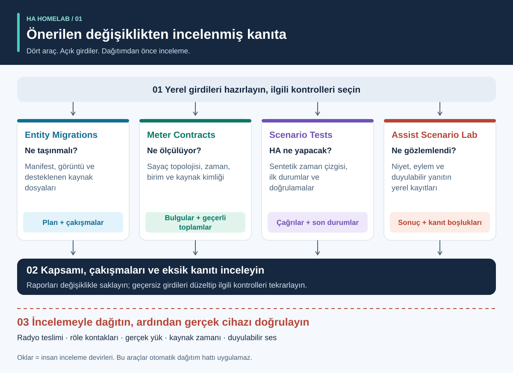
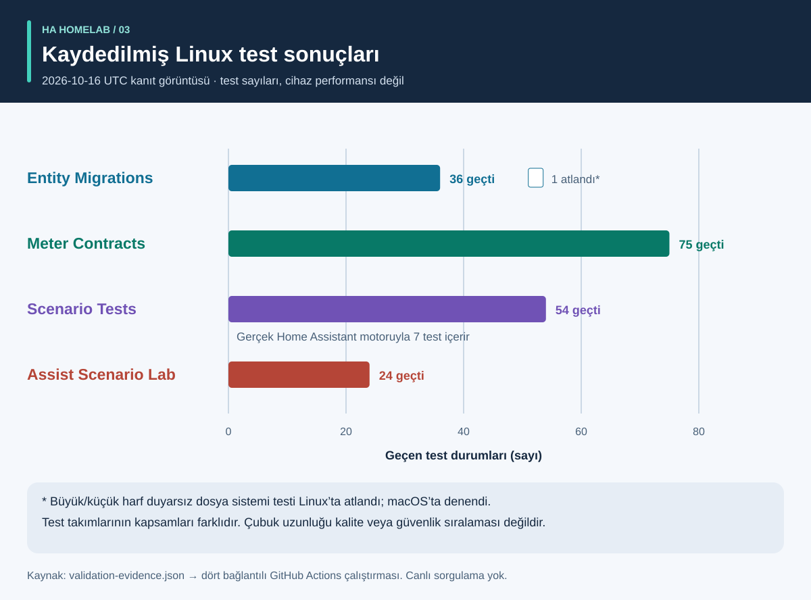
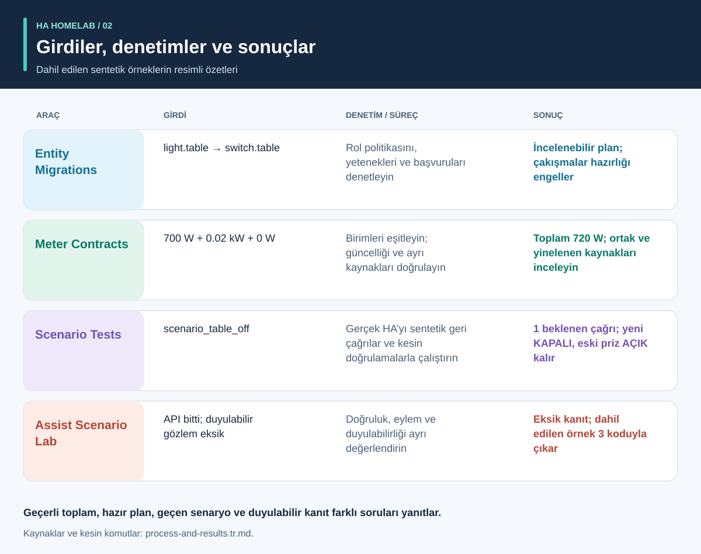

# Otomasyondan önce kanıt

<!-- language-navigation:start -->
<p dir="ltr">
<a href="README.md" lang="en" dir="ltr">English</a> · <a href="README.ar.md" lang="ar" dir="rtl">العربية</a> · <a href="README.bn.md" lang="bn" dir="ltr">বাংলা</a> · <a href="README.cs.md" lang="cs" dir="ltr">Čeština</a> · <a href="README.de.md" lang="de" dir="ltr">Deutsch</a> · <a href="README.es.md" lang="es" dir="ltr">Español</a> · <a href="README.fa.md" lang="fa" dir="rtl">فارسی</a> · <a href="README.fr.md" lang="fr" dir="ltr">Français</a><br>
<a href="README.he.md" lang="he" dir="rtl">עברית</a> · <a href="README.hi.md" lang="hi" dir="ltr">हिन्दी</a> · <a href="README.id.md" lang="id" dir="ltr">Bahasa Indonesia</a> · <a href="README.it.md" lang="it" dir="ltr">Italiano</a> · <a href="README.ja.md" lang="ja" dir="ltr">日本語</a> · <a href="README.ko.md" lang="ko" dir="ltr">한국어</a> · <a href="README.nl.md" lang="nl" dir="ltr">Nederlands</a> · <a href="README.pl.md" lang="pl" dir="ltr">Polski</a><br>
<a href="README.pt.md" lang="pt" dir="ltr">Português</a> · <a href="README.ru.md" lang="ru" dir="ltr">Русский</a> · <a href="README.th.md" lang="th" dir="ltr">ไทย</a> · <a href="README.tr.md" lang="tr" dir="ltr">Türkçe</a> · <a href="README.uk.md" lang="uk" dir="ltr">Українська</a> · <a href="README.vi.md" lang="vi" dir="ltr">Tiếng Việt</a> · <a href="README.zh-Hans.md" lang="zh-Hans" dir="ltr">简体中文</a> · <a href="README.zh-Hant.md" lang="zh-Hant" dir="ltr">繁體中文</a>
</p>
<!-- language-navigation:end -->

<!-- community-beta-releases:start -->
<p dir="ltr">
<a href="https://github.com/ha-homelab/ha-entity-migrations/releases/tag/v0.1.1b1">Entity Migrations · 0.1.1b1</a> ·
<a href="https://github.com/ha-homelab/ha-meter-contracts/releases/tag/v0.1.1b1">Meter Contracts · 0.1.1b1</a> ·
<a href="https://github.com/ha-homelab/ha-scenario-tests/releases/tag/v0.1.1b1">Scenario Tests · 0.1.1b1</a> ·
<a href="https://github.com/ha-homelab/assist-scenario-lab/releases/tag/v0.1.1b1">Assist Scenario Lab · 0.1.1b1</a>
</p>
<!-- community-beta-releases:end -->

Bu belge çevirileri CLI veya konuşma dili desteğini genişletmez; her projenin desteklediği dilleri kontrol edin.

Dört küçük araç, bir Home Assistant topluluk projesinin dört ayrı soruyu yanıtlamasına yardımcı olur: **bir cihazın rolü neye dönüşmeli, bir ölçüm neyi kapsar, otomasyon motoru gerçekte ne yapar ve sesli bir sonucu hangi kanıt destekler?** İlk sürümler yerel dosyalar ve sentetik test verileriyle çalışır. Ev yapılandırmasını dağıtmaz veya fiziksel cihazları sertifikalandırmazlar.



[Görsel anlatım: süreç, çıktılar ve sonuçlar](process-and-results.tr.md) · [Durum değişikliği diyagramı](role-transfer.tr.svg) · [Test kanıtı grafiği](validation.tr.svg)

## Dört proje

- [HA Entity Migrations](https://github.com/ha-homelab/ha-entity-migrations) çevrimdışı bir geçiş planı oluşturur. Açık rol/donanım politikaları, yetenekler ve dosya parmak izleri, sıradan bir ad değişikliğinin aydınlatma otomasyonunu sessizce başka amaçla kullanılan bir prize atamasını önler. Hazır plan yalnızca sağlanan, desteklenen yapılandırma kapsamına uygulanır.
- [HA Meter Contracts](https://github.com/ha-homelab/ha-meter-contracts) fiziksel ölçüm kapsamını, kaynak kökenini, birimleri, örnek güncelliğini ve toplama kurallarını denetler. Bir çoklu priz sayacı yeniden adlandırılarak tek pompa sayacı olamaz. Bir akım trafosunun yinelenen gösterimleri ayrı yükler olarak toplanamaz.
- [HA Scenario Tests](https://github.com/ha-homelab/ha-scenario-tests) gerçek Home Assistant otomasyon/betik motorunda kısıtlı bir sentetik senaryo çalıştırır. Sıralı çağrıları, yasak çağrıları ve son sentetik durumları denetler. Güncel çalışma ortamı HA 2026.10.1 ve Python 3.14.2–3.14.x sürümlerine sabitlenmiştir; diğer araçlardan ayrı bir ortam kullanın.
- [Assist Scenario Lab](https://github.com/ha-homelab/assist-scenario-lab) yerel sesli kanıtları değerlendirir. Komut doğruluğunu, API tamamlanmasını ve duyulabilir çıktıyı ayırır. Dahil edilen tüm süreler sentetiktir ve sağlanan gözlemler bağımsız olarak doğrulanmaz.

Projelerin kendi kurulum kılavuzları, İngilizce/Rusça belgeleri ve İngilizce/Rusça/Almanca/İspanyolca CLI mesajları vardır. Tüm çıkış kodlarının aynı anlama geldiğini varsaymak yerine sürümlenmiş sözleşmeleri izleyin. Diyagram okları **inceleme devirleridir**, uygulanmış otomatik entegrasyonlar değildir. Merkezi bir daemon veya evrensel dağıtım komutu yoktur.

Barındırılan wikiler: [Entity Migrations](https://github.com/ha-homelab/ha-entity-migrations/wiki) · [Meter Contracts](https://github.com/ha-homelab/ha-meter-contracts/wiki) · [Scenario Tests](https://github.com/ha-homelab/ha-scenario-tests/wiki) · [Assist Scenario Lab](https://github.com/ha-homelab/assist-scenario-lab/wiki) · [ZAC93 + ESP32](https://github.com/ha-homelab/zac93-esp32/wiki)

<a id="validation-evidence--2026-10-16-utc"></a>

## Doğrulama kanıtı — 2026-10-16 UTC

Bunlar sentetik veriler kullanan sürüme özgü yazılım denetimleridir; donanım sertifikası veya ev karşılaştırması değildir.



Çubuklar sayıları gösterir; kapsamı veya kalite sıralamasını değil. Tarihli kaynak kayıtları [validation-evidence.json](validation-evidence.json) içindedir.

- **Entity Migrations:** kaynak takma adı regresyonları dahil yerelde 37 test ve 9 alt test geçti. [Main üzerindeki Linux çalıştırması](https://github.com/ha-homelab/ha-entity-migrations/actions/runs/38843701264) 36 testi geçti ve yerelde denenen büyük/küçük harf duyarsız dosya sistemi durumunu atladı.
- **Meter Contracts:** köken çakışmaları, kaynak dosya kabulü ve ölçüm anlamı dahil [Linux CI'da 75 test geçti](https://github.com/ha-homelab/ha-meter-contracts/actions/runs/38843671896).
- **Assist Scenario Lab:** [Linux CI'da 24 test geçti](https://github.com/ha-homelab/assist-scenario-lab/actions/runs/38843304306). Sağlanan kanıtı ve sentetik örnekleri doğrularlar; fiziksel ses karşılaştırması iddia edilmez.
- **Scenario Tests:** gerçek Home Assistant 2026.10.0 ve CPython 3.14.8 üzerinde [Linux CI'da atlama olmadan 54 test geçti](https://github.com/ha-homelab/ha-scenario-tests/actions/runs/38843681199). Yedi çalışma zamanı durumu vardır; biri rol devri eşlikçi örneğini test eder. Tam takım 21.42 saniyede tamamlandı.

Test edilen çalıştırıcı ortamı Linux'tur. [Belgelenmiş yerel macOS kapanış hatası](https://github.com/ha-homelab/ha-scenario-tests/blob/main/docs/validation.md) bir sınırlama olarak sürer; işlem çökmeden önce beklenen JSON sonucunun alınması yine de başarısız çalıştırmadır. 16 Ekim kaydı, Docker'da çalıştırma veya fiziksel cihaz kabulü iddiasında bulunmaz.

19 Ekim 2026 güncellemesi: [Linux CI](https://github.com/ha-homelab/ha-scenario-tests/actions/runs/39264346721), paketlenmiş çalışma ortamının Docker'daki temel çalıştırma testini de geçti. Bu, fiziksel cihaz kabulünü kanıtlamaz.

## Süreç ve resimli sonuçlar



Her çıktıyı yorumlamak, yedek cihaz ile eski donanımın durumlarını izlemek ve yazılım kanıtını fiziksel kabulden ayırmak için [görsel anlatımı](process-and-results.tr.md) izleyin. Resimli sonuçlar dahil edilen sentetik örnekleri özetler; ham rapor ekran görüntüleri değildir.

<a id="a-concrete-migration-to-test-workflow"></a>

## Geçişten teste somut bir iş akışı

1. `ha-entity-migrations` deposunu kurduktan sonra dahil edilen alan değişikliği örneğini çalıştırın:

   ```sh
   ha-entity-migrations --lang en plan --manifest examples/domain-change/manifest.json --snapshot examples/domain-change/snapshot.json --root examples/domain-change
   ```

   Önerilen `light.table` → `switch.table` ve `light.turn_off` → `switch.turn_off` değişikliklerini inceleyin. Parmak izlerini ve desteklenen başvuruları kapsam sınırı olarak değerlendirin. Engellenen plan araştırılmalıdır; eksik yetenek kanıtını koşulsuz bul-değiştir işlemiyle değiştirmeyin.

2. İncelenen davranışı sentetik bir teste dönüştürün. [role-transfer.scenario.json](role-transfer.scenario.json), elle yazılmış bir eşlikçidir; geçiş planının **otomatik dışa aktarımı değildir**. Sentetik bir “masa kapalı” olayı gönderir, yedek role bir çağrı bekler ve eski donanımın kapatılmasını yasaklar. Eski donanımın açık kaldığını da doğrular. Bu kılavuzun dizininden, senaryo çalıştırıcısı kendi ortamına kuruluyken:

   ```sh
   ha-scenario validate role-transfer.scenario.json
   ha-scenario run role-transfer.scenario.json
   ```

   Bu eşlikçi, [rol devri test verisiyle](https://github.com/ha-homelab/ha-scenario-tests/blob/0ea7e5a5d24dc89ebe896b1a2387396b3fce18f4/tests/fixtures/role_transfer.json) bayt bayt aynıdır; bu veri [başarılı Linux çalıştırmasında](https://github.com/ha-homelab/ha-scenario-tests/actions/runs/38843681199) test edilmiştir. SHA-256 değeri `bb8544517eeb4895b80b049cf9e242d04635e7785bd198c1d57a7cf3f5fc8ab4` şeklindedir. Önceki macOS kapanış hatası belgelenmiş durumdadır ve geçen bir çalıştırma olarak sayılmaz.

   Senaryo, bellek içi eyleyici geri çağrılarıyla gerçek HA motorunu kullanır. Başarılı sonuç, sağlanan sentetik dizinin motor davranışını kanıtlar; radyo teslimini, kontak kapanmasını veya cihazdaki gücü değil. Tek olay, bütün bir ev yapılandırmasını kapsamaz.

3. Dağıtımdan önce ilgili hata dizilerini ekleyin: sensörün kullanılamamasıyla kesilen yokluk, elle durum tutma, otomasyonun yeniden yüklenmesi, yinelenen tetikleyiciler ve geri yüklenen durum. Çalıştırıcının örnekleri varlık, elle tutma, eski girdi ve yeniden yükleme uzlaştırmasını kapsar. Gerçek geçen zamanı kullandığından kısa bir test, üretimdeki yirmi dakikalık aralığı doğrulamaz. HA, `for` beklemelerinin yeniden başlatma/yükleme sonrasında korunmadığını belgeler; gerektiğinde açık uzlaştırma veya kalıcı son tarihler seçip test edin. [HA tetikleyici belgeleri](https://www.home-assistant.io/docs/automation/trigger/)

4. Sayaç kanıtını bağımsız inceleyin. Sayaç deposundan:

   ```sh
   ha-meter-contracts check examples/valid-three-meters.json --at 2026-01-01T12:00:05Z --json
   ha-meter-contracts check examples/kmc-shared-meter.json --at 2026-01-01T12:00:05Z --json
   ha-meter-contracts check examples/duplicate-emporia.json --at 2026-01-01T12:00:05Z --json
   ```

   Geçerli örnek başarılı olur. Son ikisi bilerek 1 koduyla çıkar: sırasıyla tüm çoklu priz ölçümünü tek prize atama girişimi ve aynı kaynağın yinelenen gösterimleri. Örnekleri betikleştirirken bunları beklenen hatalar olarak ele alın. Yalnızca pompa için kalibre edilmiş koruma eşiğine çoklu prizin toplam watt değerini vermeyin. Gerilim kalibrasyonu akım veya güç kalibrasyonu değildir. Eksik ya da eski kanıt kullanılamaz kalır, sıfır olmaz. [HA sensör/istatistik anlamları](https://developers.home-assistant.io/docs/core/entity/sensor/#long-term-statistics)

5. Ses bir tetikleyici veya geri bildirim yoluysa kanıtı ses deposunda ayrı değerlendirin:

   ```sh
   assist-lab evaluate examples/synthetic-pass.json
   assist-lab evaluate examples/synthetic-incomplete.json
   ```

   Eksik örnek bilerek 3 koduyla çıkar; API tamamlanması duyulabilirlik için yeterli kanıt değildir. Gerçek bir karşılaştırma; kayıt onayı, açıklanmış saat/yöntem, karşılaştırılabilir koşullar ve eylem ile duyulabilir yanıtın bağımsız gözlemini gerektirir. Ev kayıtlarını, dökümleri veya dışa aktarılan belirteçleri yayımlamayın. Sunucunun ilk ses parçası, dinleyicideki ilk ses değildir. [HA Assist hatları](https://developers.home-assistant.io/docs/voice/pipelines/)

6. Her raporu incelenen değişiklikle saklayın. Kurulumun yerleşik inceleme/dağıtım sürecinden uygulayın, ardından cihaza özgü kabulü yapın. Fiziksel açma/kapama, gösterge kutuplaması, yeniden başlatma davranışı, kaynak zamanı ve nicelik başına kalibrasyon gerçek gözlemler gerektirir. Bu dört araç o adımı ne yapar ne de onun yerini alır.

## Denetimlerin kanıtlamadığı noktalar

Yapılandırılmış durum, kabul edilen hizmet çağrısı, gözlenen güç çekişi ve su akışı ayrı kanıtlardır. Üç yük için toplam sayaç hangi yükün güç çektiğini belirleyemez. Sentetik “kapalı” durumu röle kontaklarının açıldığını kanıtlamaz. Sayaç aracı da senaryo testi de su, ısıtıcı, erişim veya sonuçları önemli olan başka yükler için güvenlik denetleyicisi değildir.

Araçlar birbirlerinin sonuçlarını zorunlu kılmaz. Gelecekteki entegrasyon kararlı JSON çıktılarını kullanabilir; ancak kabul edilen uyarı düzeylerini, sürüm uyumluluğunu ve “tam kanıtın” anlamını açıkça tanımlamalıdır. `ready`, `available`, `passed` ve `audible` değerlerini birbirinin yerine geçen tek bir boole değere indirgemeyin.

## Yol haritası: hazırlık durumu açık on dört fikir

Aşağıdaki ilk dört kod çıktısı başlangıç niteliğindeki çevrimdışı araçlar olarak mevcuttur. Adı geçen devam işleri öneri durumundadır; bir depo adı veya diyagram donanımın devreye alındığı anlamına gelmez.

1. **Rol geçişleri — ilk araç uygulandı.** Desteklenen başvuru biçimlerini yalnızca gidiş-dönüş ve çakışma testleriyle genişletin; desteklenmeyen girdi sınırını açık tutun.
2. **Sayaç sözleşmeleri — ilk araç uygulandı.** Özel gerçek zaman damgalı gözlemleri deneyin; kalibrasyon iddia etmeden önce akım/gücü bağımsız ölçün. Priz bazında atıf hâlâ priz bazında kanıt gerektirir.
3. **Otomasyon senaryosu testleri — ilk araç uygulandı.** İncelenmiş politikalar ve yeniden başlatma/son tarih durumları ekleyin; gerektiğinde üretim süresindeki zamanlamayı ayrıca test edin.
4. **Sesli kanıt — ilk araç uygulandı; fiziksel karşılaştırma bekliyor.** Karşılaştırılabilir oturumlar toplamadan önce uyduları, gözlem yöntemini ve kayıt onayını belirleyin. Henüz donanım sıralaması yoktur.
5. **Hava kalitesi koordinasyonu — sensör/eyleyici doğrulaması bekliyor.** Cihazın CO₂ mi parçacık mı ölçtüğünü, yaşını/doğruluğunu ve havalandırma ya da filtrasyonun neyi etkileyebileceğini kontrol edin. Havalandırma politikası öncesinde dış koşulları doğrulayın.
6. **Radar/varlık kanıtı — donanımın devreye alınmasını bekliyor.** LD2450 kartını, güç kaynağını, kasayı, protokolü ve kapsama alanını doğrulayın. Hedefler insan kimlikleri değildir; alım yaşı ölçülmüş sensör gecikmesi değildir. CSI deneysel kalır.
7. **Su/pompa gözlemlenebilirliği — bağımsız kanıt bekliyor.** Pompayı besleme iznini, elektrik çekişini, su akışını ve seviyesini ayırın. Toplam çoklu priz sayacı eksik pompa koruma sinyalini sağlayamaz. Gözlenen durum ve kuruluma özgü inceleme olmadan kritik komutlarda otomatik yeniden deneme politikalarından kaçının.
8. **BLE telemetrisi — uyumlu vekiller ve kapsama testleri bekliyor.** Gerçek sensörleri, sıcaklık aralığını, pilleri ve yerleşimi doğrulayın. ESP8266 cihazları BLE vekili değildir; RSSI kimlik veya kilit açma yetkisi değildir. [ESPHome Bluetooth vekili](https://esphome.io/components/bluetooth_proxy/)
9. **Varlığa dayalı açıklamalar ve ev aletleri — yetenek doğrulaması bekliyor.** Işığı hangi gözlemin açık tuttuğunu açıklayın; destekleniyorsa gerçek çamaşır/kurutma makinesi olaylarını kullanın. Sadece ortak sayaçtan cihaz döngüsü çıkarmayın veya ilgisiz sensör bayraklarından istatistiksel güven uydurmayın.
10. **Z-Wave köprüsü — teslimat/montaj ve radyo kabulü bekliyor.** [ZAC93 + ESP32 kılavuzu](https://github.com/ha-homelab/zac93-esp32) ayrı bir donanım yoludur. Kablolamayı, bölgesel frekansı, seri taşımayı ve Z-Wave JS dahil etmeyi gerçek kartla doğrulayın. Denetleyicinin Long Range desteği eski sensörü Long Range cihazına dönüştürmez. [Z-Wave JS kılavuzu](https://zwave-js.github.io/zwave-js/#/getting-started/index)
11. **ESPHome priz kabulü — bireysel donanım testleri bekliyor.** Her revizyon için düğme, röle, gösterge ve yeniden başlatma kanıtını, ayrıca ayrı gerilim/akım/güç kalibrasyonunu kaydedin. Başarılı yazılım yükleme tamamlanmış kabul değildir. Bağlı cihazlarda gözetimsiz toplu güç döngüsü uygulamayın.
12. **Tahmin karşılaştırması — birikmiş veri bekliyor.** Yayımlanmış tahminleri ve sonraki gerçekleri arşivleyin, yayım zamanını saklayın ve ufukları gelecek veri sızıntısı olmadan değerlendirin. Bu, sentetik örnekten enerji tasarrufu iddiası değil, geçmiş gözlem süresi gerektirir.
13. **Sınırlı misafir kontrolleri — arka uç izin incelemesi bekliyor.** Kimliği ve sunucu tarafı yetkilendirmeyi doğrulayın. Gizli pano kontrolleri tek başına erişimi sınırlamaz. Paneli basitleştirmek için kimlik doğrulamayı zayıflatmayın.
14. **Ertelenebilir yük planlama — ölçülmüş kısıtlar ve yetenekler bekliyor.** Sayaçları, durum geri bildirimini ve tahminleri doğruladıktan sonra yerleşik planlama araçlarını entegre edin. Hangi yüklerin gerçekten ertelenebileceğini veya modüle edilebileceğini, son tarihlerini ve elle geçersiz kılmaları doğrulayın. Spekülatif tasarruf veya güvenlik garantisi olmadan, incelenmiş önerilerle başlayın. [EMHASS](https://emhass.readthedocs.io/en/latest/emhass.html) · [evcc](https://docs.evcc.io/en/)

## Katkıda bulunma ve bu kılavuzu yeniden üretme

Bu genel bakış, sentetik senaryo ve diyagram özgün MIT lisanslı malzemedir; [LICENSE](LICENSE) dosyasına bakın. Tüm yerelleştirilmiş SVG'leri `python3 render_architecture.py` ile yeniden oluşturun. Haricî görsel, betik, ev tanımlayıcısı veya ölçülmüş ev verisi içermezler. [Görsel anlatım](process-and-results.tr.md#reproduce-or-translate-the-illustrations) kaynak kayıtlarını ve yeniden üretim denetimlerini açıklar. Herkese açık test verilerini sentetik, özel dışa aktarımları Git dışında tutun. Değişikliklerde her deponun güvenlik ve katkı rehberini kullanın.
