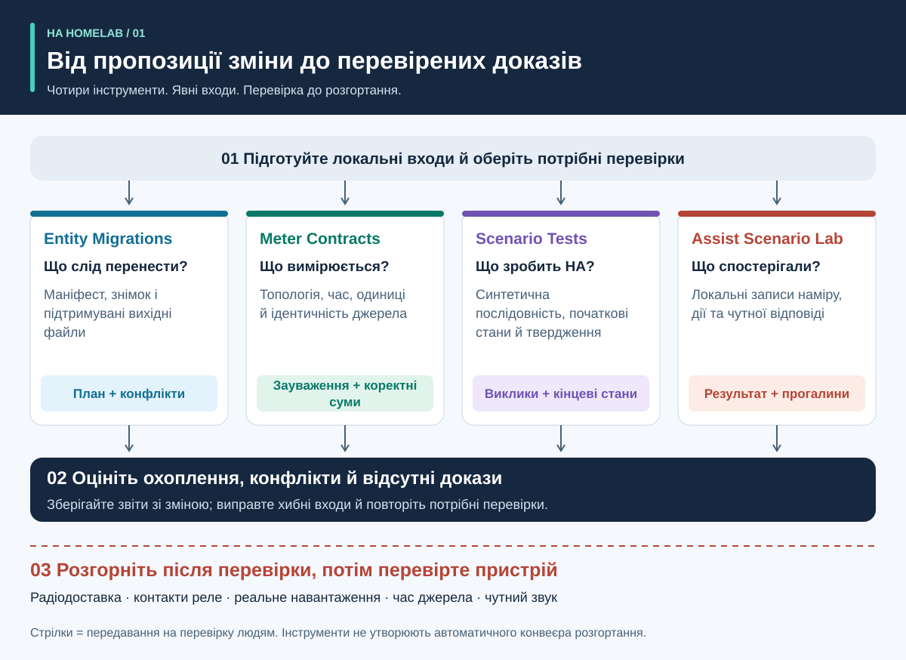
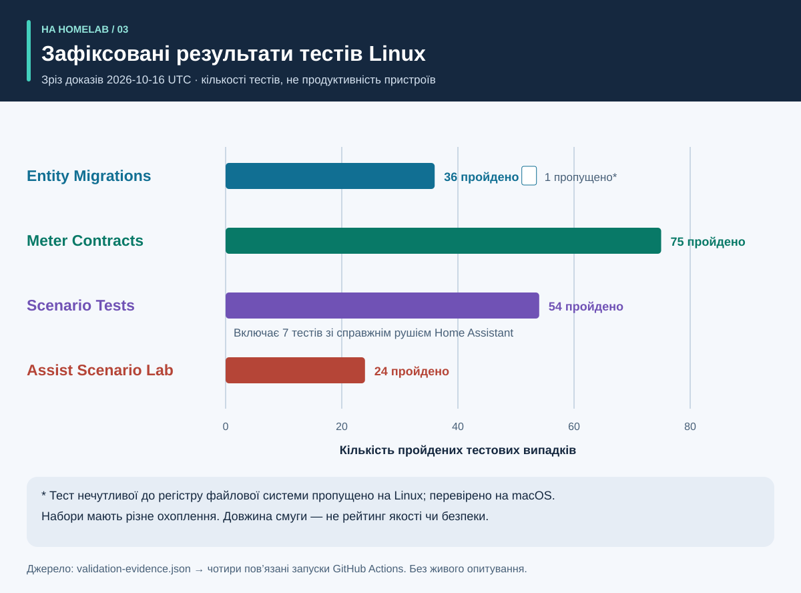
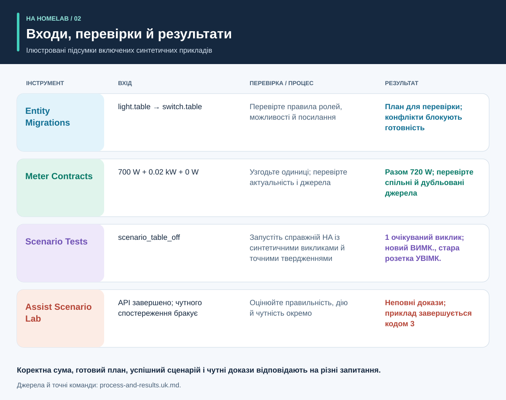

# Спочатку докази, потім автоматизація

<!-- language-navigation:start -->
<p dir="ltr">
<a href="README.md" lang="en" dir="ltr">English</a> · <a href="README.ar.md" lang="ar" dir="rtl">العربية</a> · <a href="README.bn.md" lang="bn" dir="ltr">বাংলা</a> · <a href="README.cs.md" lang="cs" dir="ltr">Čeština</a> · <a href="README.de.md" lang="de" dir="ltr">Deutsch</a> · <a href="README.es.md" lang="es" dir="ltr">Español</a> · <a href="README.fa.md" lang="fa" dir="rtl">فارسی</a> · <a href="README.fr.md" lang="fr" dir="ltr">Français</a><br>
<a href="README.he.md" lang="he" dir="rtl">עברית</a> · <a href="README.hi.md" lang="hi" dir="ltr">हिन्दी</a> · <a href="README.id.md" lang="id" dir="ltr">Bahasa Indonesia</a> · <a href="README.it.md" lang="it" dir="ltr">Italiano</a> · <a href="README.ja.md" lang="ja" dir="ltr">日本語</a> · <a href="README.ko.md" lang="ko" dir="ltr">한국어</a> · <a href="README.nl.md" lang="nl" dir="ltr">Nederlands</a> · <a href="README.pl.md" lang="pl" dir="ltr">Polski</a><br>
<a href="README.pt.md" lang="pt" dir="ltr">Português</a> · <a href="README.ru.md" lang="ru" dir="ltr">Русский</a> · <a href="README.th.md" lang="th" dir="ltr">ไทย</a> · <a href="README.tr.md" lang="tr" dir="ltr">Türkçe</a> · <a href="README.uk.md" lang="uk" dir="ltr">Українська</a> · <a href="README.vi.md" lang="vi" dir="ltr">Tiếng Việt</a> · <a href="README.zh-Hans.md" lang="zh-Hans" dir="ltr">简体中文</a> · <a href="README.zh-Hant.md" lang="zh-Hant" dir="ltr">繁體中文</a>
</p>
<!-- language-navigation:end -->

Ці переклади документації не розширюють мовну підтримку CLI чи голосових функцій; перевіряйте підтримувані мови кожного проєкту.

Чотири невеликі інструменти допомагають проєкту спільноти Home Assistant відповісти на чотири різні запитання: **якою має стати роль пристрою, що охоплює вимірювання, що насправді робить рушій автоматизації та які докази підтверджують голосовий результат?** Перші випуски працюють із локальними файлами й синтетичними тестовими даними. Вони не розгортають домашню конфігурацію та не сертифікують фізичні пристрої.



[Наочний посібник: процес, виходи й результати](process-and-results.uk.md) · [Діаграма змін стану](role-transfer.uk.svg) · [Діаграма доказів тестування](validation.uk.svg)

## Чотири проєкти

- [HA Entity Migrations](https://github.com/ha-homelab/ha-entity-migrations) створює автономний план міграції. Явні правила ролей і обладнання, можливості й відбитки файлів не дають звичайному перейменуванню непомітно призначити автоматизацію освітлення розетці з новим призначенням. Готовий план застосовний лише до наданого підтримуваного охоплення конфігурації.
- [HA Meter Contracts](https://github.com/ha-homelab/ha-meter-contracts) перевіряє фізичне охоплення вимірювання, походження джерел, одиниці, актуальність відліків і правила додавання. Перейменування лічильника подовжувача не робить його окремим лічильником насоса. Дубльовані представлення одного трансформатора струму не можна додавати як окремі навантаження.
- [HA Scenario Tests](https://github.com/ha-homelab/ha-scenario-tests) виконує обмежений синтетичний сценарій у справжньому рушії автоматизацій і скриптів Home Assistant. Перевіряє порядок викликів, заборонені виклики та кінцеві синтетичні стани. Поточне середовище виконання зафіксоване на HA 2026.10.1 і Python 3.14.2–3.14.x; використовуйте середовище окремо від інших інструментів.
- [Assist Scenario Lab](https://github.com/ha-homelab/assist-scenario-lab) оцінює локальні голосові докази. Відокремлює правильність команди, завершення API та чутний вихід. Усі включені часові дані синтетичні, а надані спостереження незалежно не перевіряються.

Проєкти мають власні інструкції встановлення, англійську/російську документацію й повідомлення CLI англійською, російською, німецькою та іспанською. Дотримуйтеся версійних контрактів, не вважаючи всі коди завершення однаковими за значенням. Стрілки діаграм — це **передавання на перевірку**, а не реалізовані автоматичні інтеграції. Центрального демона чи універсальної команди розгортання немає.

Розміщені вікі: [Entity Migrations](https://github.com/ha-homelab/ha-entity-migrations/wiki) · [Meter Contracts](https://github.com/ha-homelab/ha-meter-contracts/wiki) · [Scenario Tests](https://github.com/ha-homelab/ha-scenario-tests/wiki) · [Assist Scenario Lab](https://github.com/ha-homelab/assist-scenario-lab/wiki) · [ZAC93 + ESP32](https://github.com/ha-homelab/zac93-esp32/wiki)

<a id="validation-evidence--2026-10-16-utc"></a>

## Докази валідації — 2026-10-16 UTC

Це програмні перевірки конкретних версій із синтетичними даними, а не сертифікація обладнання чи порівняльне тестування домівки.



Смуги показують кількості, а не покриття чи рейтинг якості. Датовані вихідні записи містяться у [validation-evidence.json](validation-evidence.json).

- **Entity Migrations:** локально пройшли 37 тестів і 9 підтестів, включно з регресіями псевдонімів джерел. [Запуск Linux на main](https://github.com/ha-homelab/ha-entity-migrations/actions/runs/38843701264) пройшов 36 тестів і пропустив випадок файлової системи, нечутливої до регістру, який перевірили локально.
- **Meter Contracts:** [75 тестів пройшли в Linux CI](https://github.com/ha-homelab/ha-meter-contracts/actions/runs/38843671896), охоплюючи конфлікти походження, допуск вихідних файлів і семантику вимірювань.
- **Assist Scenario Lab:** [24 тести пройшли в Linux CI](https://github.com/ha-homelab/assist-scenario-lab/actions/runs/38843304306). Вони перевіряють надані докази й синтетичні приклади; фізичного порівняння голосу не заявлено.
- **Scenario Tests:** [54 тести пройшли без пропусків у Linux CI](https://github.com/ha-homelab/ha-scenario-tests/actions/runs/38843681199) на CPython 3.14.8 зі справжнім Home Assistant 2026.10.0, включно із сімома випадками виконання, один з яких перевіряє супровідний сценарій перенесення ролі. Повний набір завершився за 21.42 секунди.

Linux — перевірене середовище запуску. [Задокументована помилка нативного завершення на macOS](https://github.com/ha-homelab/ha-scenario-tests/blob/main/docs/validation.md) залишається обмеженням; очікуваний JSON перед аварією процесу все одно означає невдалий запуск. Запис від 16 жовтня не заявляє виконання в Docker чи фізичного приймання пристроїв.

Оновлення від 19 жовтня 2026 року: [Linux CI](https://github.com/ha-homelab/ha-scenario-tests/actions/runs/39264346721) також успішно виконав базову перевірку запуску упакованого середовища в Docker. Це не підтверджує фізичного приймання пристроїв.

## Процес та ілюстровані результати



[Наочний посібник](process-and-results.uk.md) допомагає витлумачити кожен вихід, простежити стани замінника та попереднього обладнання й відрізнити програмні докази від фізичного приймання. Ілюстрації підсумовують включені синтетичні приклади; це не знімки необроблених звітів.

<a id="a-concrete-migration-to-test-workflow"></a>

## Конкретний процес від міграції до тесту

1. У `ha-entity-migrations` після встановлення репозиторію запустіть включений приклад зміни домену:

   ```sh
   ha-entity-migrations --lang en plan --manifest examples/domain-change/manifest.json --snapshot examples/domain-change/snapshot.json --root examples/domain-change
   ```

   Перегляньте запропоновані зміни `light.table` → `switch.table` і `light.turn_off` → `switch.turn_off`. Відбитки й підтримувані посилання визначають межу охоплення. Заблокований план потребує розслідування; не замінюйте відсутні докази можливостей безумовним пошуком і заміною.

2. Перетворіть перевірену поведінку на синтетичний тест. [role-transfer.scenario.json](role-transfer.scenario.json) — написаний вручну супровідний приклад, **не автоматичний експорт** плану міграції. Він надсилає синтетичну подію «вимкнути стіл», очікує один виклик замінника ролі та забороняє вимикати попереднє обладнання. Також перевіряє, що попереднє обладнання залишається ввімкненим. Із каталогу цього посібника, з виконавцем сценаріїв у власному середовищі:

   ```sh
   ha-scenario validate role-transfer.scenario.json
   ha-scenario run role-transfer.scenario.json
   ```

   Приклад побайтово ідентичний [тестовим даним перенесення ролі](https://github.com/ha-homelab/ha-scenario-tests/blob/0ea7e5a5d24dc89ebe896b1a2387396b3fce18f4/tests/fixtures/role_transfer.json), перевіреним в [успішному запуску Linux](https://github.com/ha-homelab/ha-scenario-tests/actions/runs/38843681199). Його SHA-256 — `bb8544517eeb4895b80b049cf9e242d04635e7785bd198c1d57a7cf3f5fc8ab4`. Попередня помилка завершення на macOS залишається задокументованою та не рахується як успішний запуск.

   Сценарій використовує справжній рушій HA зі зворотними викликами виконавчих пристроїв у пам’яті. Успішний результат доводить поведінку рушія для наданої синтетичної послідовності, а не радіодоставку, замикання контактів чи живлення приладу. Одна подія не охоплює всю домашню конфігурацію.

3. Перед розгортанням додайте відповідні послідовності відмов: відсутність, перервану недоступністю датчика, ручне утримання стану, перезавантаження автоматизації, дубльовані тригери й відновлений стан. Приклади виконавця охоплюють присутність, ручне утримання, застарілі входи та узгодження після перезавантаження. Його годинник відлічує реальний час, тому короткий приклад не перевіряє виробничий двадцятихвилинний інтервал. HA документує, що очікування `for` не переживають перезапуск/перезавантаження; за потреби оберіть і перевірте явне узгодження чи збережені строки. [Документація тригерів HA](https://www.home-assistant.io/docs/automation/trigger/)

4. Докази вимірювань перевіряйте незалежно. Із репозиторію вимірювального інструмента:

   ```sh
   ha-meter-contracts check examples/valid-three-meters.json --at 2026-01-01T12:00:05Z --json
   ha-meter-contracts check examples/kmc-shared-meter.json --at 2026-01-01T12:00:05Z --json
   ha-meter-contracts check examples/duplicate-emporia.json --at 2026-01-01T12:00:05Z --json
   ```

   Коректний приклад проходить. Два останні навмисно завершуються кодом 1: відповідно через спробу приписати окремій розетці вимірювання всього подовжувача та дубльовані представлення одного джерела. У скриптах прикладів це очікувані помилки. Не підставляйте вати всього подовжувача в захисний поріг, спочатку відкалібрований лише для насоса. Калібрування напруги не є калібруванням струму чи потужності. Відсутні або застарілі докази залишаються недоступними, а не нульовими. [Семантика датчиків і статистики HA](https://developers.home-assistant.io/docs/core/entity/sensor/#long-term-statistics)

5. Якщо голос є тригером чи зворотним зв’язком, оцініть докази окремо в голосовому репозиторії:

   ```sh
   assist-lab evaluate examples/synthetic-pass.json
   assist-lab evaluate examples/synthetic-incomplete.json
   ```

   Неповний приклад навмисно завершується кодом 3, оскільки завершення API недостатньо для доказу чутності. Справжній бенчмарк потребує згоди на запис, визначених годинника й методу, порівнюваних умов і незалежного спостереження дії та чутної відповіді. Не публікуйте домашні записи, транскрипти чи експортовані токени. Перший аудіоблок сервера — не перший звук у слухача. [Конвеєри HA Assist](https://developers.home-assistant.io/docs/voice/pipelines/)

6. Зберігайте кожен звіт разом із перевіреною зміною. Застосовуйте її через усталений процес перевірки й розгортання конкретної інсталяції, потім виконуйте приймання пристрою. Фізичне ввімкнення/вимкнення, полярність індикатора, поведінка після перезапуску, час джерела та калібрування кожної величини потребують реальних спостережень. Чотири інструменти не виконують і не замінюють цей етап.

## Чого перевірки не доводять

Налаштований стан, прийнятий виклик сервісу, спостережуване споживання та потік води — окремі докази. Загальний лічильник трьох навантажень не визначить, яке споживало потужність. Синтетичний стан «вимкнено» не доводить розмикання контактів реле. Ані вимірювальний інструмент, ані тест сценарію не є контролером безпеки для води, нагрівачів, доступу чи інших навантажень зі значними наслідками.

Інструменти не забезпечують виконання результатів один одного. Майбутня інтеграція може використовувати їхній стабільний JSON, але мусить явно визначити прийнятні рівні попереджень, сумісність версій і значення «повних доказів». Не зводьте `ready`, `available`, `passed` і `audible` до одного взаємозамінного булевого значення.

## План розвитку: чотирнадцять ідей із чесною оцінкою готовності

Перші чотири програмні результати нижче доступні як початкові автономні інструменти. Усі названі наступні роботи залишаються пропозиціями; назва репозиторію чи діаграма не означає, що обладнання введене в експлуатацію.

1. **Міграції ролей — початковий інструмент реалізовано.** Розширюйте формати підтримуваних посилань лише з тестами зворотного перетворення та конфліктів; зберігайте явну межу непідтримуваних входів.
2. **Контракти лічильників — початковий інструмент реалізовано.** Випробуйте приватні реальні спостереження з часовими мітками; незалежно виміряйте струм і потужність перед твердженнями про їх калібрування. Атрибуція за розеткою все ще потребує доказів для кожної розетки.
3. **Тестування сценаріїв автоматизації — початковий інструмент реалізовано.** Додайте перевірені правила та випадки перезапусків і строків; за потреби окремо перевіряйте час на виробничій тривалості.
4. **Голосові докази — початковий інструмент реалізовано; фізичний бенчмарк попереду.** Оберіть супутники, метод спостереження та згоду на запис до збирання порівнюваних сеансів. Рейтингу обладнання ще немає.
5. **Координація якості повітря — очікує перевірки датчиків і виконавчих пристроїв.** Перевірте, чи вимірює пристрій CO₂ або частинки, його вік/точність і на що впливають вентиляція чи фільтрація. Підтвердьте зовнішні умови перед правилами вентиляції.
6. **Докази радара й присутності — очікують введення обладнання в експлуатацію.** Перевірте плату LD2450, живлення, корпус, протокол і покриття. Цілі не є особами людей, а давність приймання не є виміряною затримкою датчика. CSI залишається експериментальним.
7. **Спостережуваність води й насоса — очікує незалежних доказів.** Розрізняйте дозвіл живити насос, електричне споживання, потік і рівень води. Загальний лічильник подовжувача не дає відсутнього захисного сигналу лише для насоса. Уникайте автоматичних повторів критичних команд без спостережуваного стану та перевірки конкретної інсталяції.
8. **Телеметрія BLE — очікує сумісних проксі й тестів покриття.** Перевірте фактичні датчики, діапазон температур, батареї та розміщення. Пристрої ESP8266 не є BLE-проксі; RSSI — не ідентичність і не дозвіл на відмикання. [Bluetooth-проксі ESPHome](https://esphome.io/components/bluetooth_proxy/)
9. **Пояснення за присутністю та побутові прилади — очікують перевірки можливостей.** Пояснюйте, яке спостереження залишило світло ввімкненим; використовуйте фактичні події пральної/сушильної машини, якщо підтримуються. Не визначайте цикл лише за спільним лічильником і не вигадуйте статистичну впевненість із непов’язаних прапорців датчиків.
10. **Міст Z-Wave — очікує доставки, складання й радіоприймання.** [Посібник ZAC93 + ESP32](https://github.com/ha-homelab/zac93-esp32) — окремий апаратний напрям. Перевірте з’єднання, регіональну частоту, послідовний транспорт і додавання до Z-Wave JS на фактичній платі. Підтримка Long Range контролером не перетворює старий датчик на пристрій Long Range. [Посібник Z-Wave JS](https://zwave-js.github.io/zwave-js/#/getting-started/index)
11. **Приймання розеток ESPHome — очікує індивідуальних апаратних тестів.** Записуйте докази роботи кнопки, реле, індикатора й перезапуску для кожної ревізії, а також окремі калібрування напруги/струму/потужності. Успішне прошивання не завершує приймання. Жодних масових циклів живлення підключених приладів без нагляду.
12. **Порівняння прогнозів — очікує накопичених даних.** Архівуйте видані прогнози й пізніші фактичні значення, зберігайте час видачі та оцінюйте горизонти без витоку майбутніх даних. Це потребує часу спостережень, а не заяв про економію енергії із синтетичного прикладу.
13. **Обмежене гостьове керування — очікує перевірки дозволів бекенду.** Перевірте ідентичність і серверну авторизацію. Саме приховування елементів панелі не обмежує доступ. Не послаблюйте автентифікацію для спрощення панелі.
14. **Планування відкладних навантажень — очікує виміряних обмежень і можливостей.** Інтегруйте усталені планувальники після перевірки лічильників, зворотного зв’язку стану й прогнозів. Підтвердьте, які навантаження справді можна відкласти чи модулювати, їхні строки й ручні перевизначення. Починайте з перевірених рекомендацій без спекулятивної економії чи гарантій безпеки. [EMHASS](https://emhass.readthedocs.io/en/latest/emhass.html) · [evcc](https://docs.evcc.io/en/)

## Участь і відтворення посібника

Цей огляд, синтетичний сценарій і діаграма — оригінальні матеріали з ліцензією MIT; дивіться [LICENSE](LICENSE). Відтворіть усі локалізовані SVG командою `python3 render_architecture.py`. Вони не містять зовнішніх зображень, скриптів, домашніх ідентифікаторів чи виміряних домашніх даних. [Наочний посібник](process-and-results.uk.md#reproduce-or-translate-the-illustrations) пояснює вихідні записи та перевірки повторного генерування. Публічні тестові дані мають лишатися синтетичними, приватні експорти — поза Git. Для змін дотримуйтеся правил безпеки й участі кожного репозиторію.
