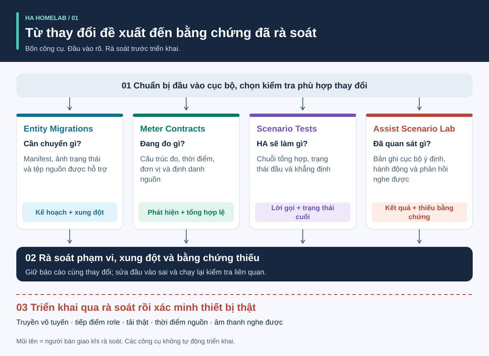
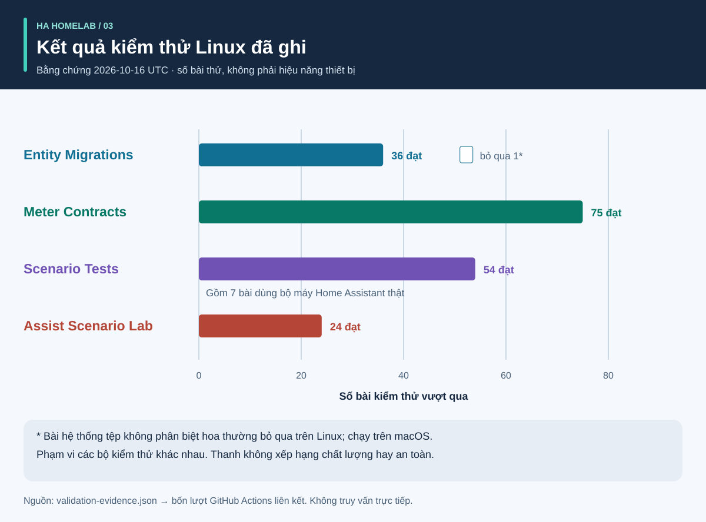
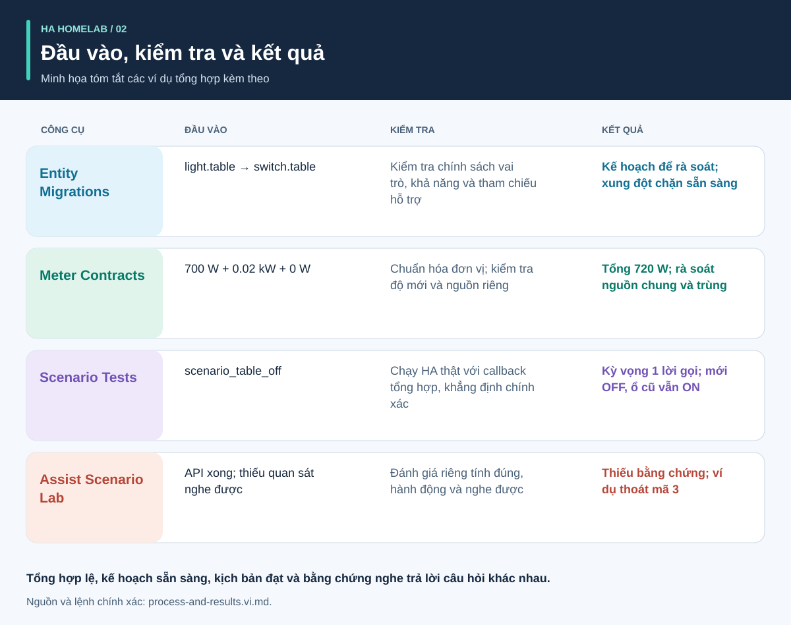

# Bằng chứng trước tự động hóa

<!-- language-navigation:start -->
<p dir="ltr">
<a href="README.md" lang="en" dir="ltr">English</a> · <a href="README.ar.md" lang="ar" dir="rtl">العربية</a> · <a href="README.bn.md" lang="bn" dir="ltr">বাংলা</a> · <a href="README.cs.md" lang="cs" dir="ltr">Čeština</a> · <a href="README.de.md" lang="de" dir="ltr">Deutsch</a> · <a href="README.es.md" lang="es" dir="ltr">Español</a> · <a href="README.fa.md" lang="fa" dir="rtl">فارسی</a> · <a href="README.fr.md" lang="fr" dir="ltr">Français</a><br>
<a href="README.he.md" lang="he" dir="rtl">עברית</a> · <a href="README.hi.md" lang="hi" dir="ltr">हिन्दी</a> · <a href="README.id.md" lang="id" dir="ltr">Bahasa Indonesia</a> · <a href="README.it.md" lang="it" dir="ltr">Italiano</a> · <a href="README.ja.md" lang="ja" dir="ltr">日本語</a> · <a href="README.ko.md" lang="ko" dir="ltr">한국어</a> · <a href="README.nl.md" lang="nl" dir="ltr">Nederlands</a> · <a href="README.pl.md" lang="pl" dir="ltr">Polski</a><br>
<a href="README.pt.md" lang="pt" dir="ltr">Português</a> · <a href="README.ru.md" lang="ru" dir="ltr">Русский</a> · <a href="README.th.md" lang="th" dir="ltr">ไทย</a> · <a href="README.tr.md" lang="tr" dir="ltr">Türkçe</a> · <a href="README.uk.md" lang="uk" dir="ltr">Українська</a> · <a href="README.vi.md" lang="vi" dir="ltr">Tiếng Việt</a> · <a href="README.zh-Hans.md" lang="zh-Hans" dir="ltr">简体中文</a> · <a href="README.zh-Hant.md" lang="zh-Hant" dir="ltr">繁體中文</a>
</p>
<!-- language-navigation:end -->

Bản dịch tài liệu này không mở rộng ngôn ngữ CLI hay giọng nói được hỗ trợ; hãy kiểm tra ngôn ngữ của từng dự án.

Bốn công cụ nhỏ giúp dự án cộng đồng Home Assistant trả lời bốn câu hỏi khác nhau: **vai trò thiết bị nên chuyển thành gì, phép đo bao quát gì, bộ máy tự động hóa thực sự làm gì và bằng chứng nào hỗ trợ kết quả giọng nói?** Các bản đầu tiên dùng tệp cục bộ và dữ liệu kiểm thử tổng hợp. Chúng không triển khai cấu hình gia đình hay chứng nhận thiết bị thật.



[Hướng dẫn hình ảnh: quy trình, đầu ra và kết quả](process-and-results.vi.md) · [Sơ đồ đổi trạng thái](role-transfer.vi.svg) · [Biểu đồ bằng chứng kiểm thử](validation.vi.svg)

## Bốn dự án

- [HA Entity Migrations](https://github.com/ha-homelab/ha-entity-migrations) tạo kế hoạch di chuyển ngoại tuyến. Chính sách vai trò/phần cứng, khả năng và dấu vân tay tệp rõ ràng ngăn việc đổi tên thông thường âm thầm gán tự động hóa chiếu sáng cho ổ điện đã đổi công dụng. Kế hoạch sẵn sàng chỉ áp dụng cho phạm vi cấu hình đã cung cấp và được hỗ trợ.

- [HA Meter Contracts](https://github.com/ha-homelab/ha-meter-contracts) kiểm tra phạm vi đo vật lý, xuất xứ nguồn, đơn vị, độ mới mẫu và quy tắc cộng. Đổi tên bộ đo của cả dải ổ điện không biến nó thành bộ đo riêng cho bơm. Không được cộng các biểu diễn trùng của một biến dòng thành những tải riêng.

- [HA Scenario Tests](https://github.com/ha-homelab/ha-scenario-tests) chạy kịch bản tổng hợp giới hạn trong bộ máy tự động hóa/kịch bản Home Assistant thật. Nó kiểm tra thứ tự lời gọi, lời gọi bị cấm và trạng thái tổng hợp cuối. Môi trường chạy đầu tiên được cố định ở HA 2026.10.0 và Python 3.14.2–3.14.x; hãy dùng môi trường riêng với các công cụ khác.

- [Assist Scenario Lab](https://github.com/ha-homelab/assist-scenario-lab) đánh giá bằng chứng giọng nói cục bộ. Nó tách tính đúng của lệnh, hoàn tất API và đầu ra nghe được. Mọi số liệu thời gian kèm theo đều là tổng hợp, và quan sát được cung cấp không được xác minh độc lập.

Các dự án có hướng dẫn cài đặt riêng và thông báo CLI bằng tiếng Anh/Nga/Đức/Tây Ban Nha. Theo hợp đồng có phiên bản thay vì giả định mọi mã thoát cùng nghĩa. Mũi tên trong sơ đồ là **bàn giao khi rà soát**, không phải tích hợp tự động đã triển khai. Không có tiến trình trung tâm hay lệnh triển khai chung.

Wiki lưu trữ: [Entity Migrations](https://github.com/ha-homelab/ha-entity-migrations/wiki) · [Meter Contracts](https://github.com/ha-homelab/ha-meter-contracts/wiki) · [Scenario Tests](https://github.com/ha-homelab/ha-scenario-tests/wiki) · [Assist Scenario Lab](https://github.com/ha-homelab/assist-scenario-lab/wiki) · [ZAC93 + ESP32](https://github.com/ha-homelab/zac93-esp32/wiki)

<a id="validation-evidence--2026-10-16-utc"></a>

## Bằng chứng xác minh — 2026-10-16 UTC

Đây là kiểm tra phần mềm cho phiên bản cụ thể bằng dữ liệu tổng hợp, không phải chứng nhận phần cứng hay đo chuẩn gia đình.



Thanh thể hiện số lượng, không phải độ bao phủ hay thứ hạng chất lượng. Bản ghi nguồn có ngày nằm trong [validation-evidence.json](validation-evidence.json).

- **Entity Migrations:** 37 bài và 9 bài con vượt qua cục bộ, gồm hồi quy bí danh nguồn. [Lượt Linux trên main](https://github.com/ha-homelab/ha-entity-migrations/actions/runs/38843701264) vượt qua 36 bài và bỏ qua trường hợp hệ thống tệp không phân biệt hoa thường, vốn đã được chạy cục bộ.
- **Meter Contracts:** [75 bài vượt qua trên CI Linux](https://github.com/ha-homelab/ha-meter-contracts/actions/runs/38843671896), gồm xung đột nguồn gốc, chấp nhận tệp nguồn và ngữ nghĩa phép đo.
- **Assist Scenario Lab:** [24 bài vượt qua trên CI Linux](https://github.com/ha-homelab/assist-scenario-lab/actions/runs/38843304306). Chúng xác minh bằng chứng được cấp và ví dụ tổng hợp; không khẳng định so sánh giọng nói từ thiết bị thật.
- **Scenario Tests:** [54 bài vượt qua, không bỏ qua, trên CI Linux](https://github.com/ha-homelab/ha-scenario-tests/actions/runs/38843681199), chạy CPython 3.14.8 với Home Assistant 2026.10.0 thật, gồm bảy trường hợp runtime, trong đó một bài kiểm tra kịch bản phụ chuyển vai trò. Toàn bộ bộ kiểm thử hoàn tất trong 21.42 giây.

Linux là môi trường chạy đã kiểm thử. [Lỗi dọn dẹp cuối trên macOS gốc được ghi nhận](https://github.com/ha-homelab/ha-scenario-tests/blob/main/docs/validation.md) vẫn là giới hạn; JSON đúng trước khi tiến trình sập vẫn là lượt thất bại. Không khẳng định đã chạy Docker hay nghiệm thu thiết bị thật.

## Quy trình và kết quả minh họa



Theo [hướng dẫn hình ảnh](process-and-results.vi.md) để diễn giải đầu ra, theo dõi trạng thái thiết bị thay thế và thiết bị cũ, đồng thời phân biệt bằng chứng phần mềm với nghiệm thu phần cứng. Kết quả minh họa tóm tắt ví dụ tổng hợp kèm theo, không phải ảnh chụp báo cáo thô.

<a id="a-concrete-migration-to-test-workflow"></a>

## Quy trình cụ thể từ di chuyển tới kiểm thử

1. Trong `ha-entity-migrations`, chạy ví dụ đổi miền kèm theo sau khi cài kho đó:

   ```sh
   ha-entity-migrations --lang en plan --manifest examples/domain-change/manifest.json --snapshot examples/domain-change/snapshot.json --root examples/domain-change
   ```

   Rà soát các thay đổi đề xuất `light.table` → `switch.table` và `light.turn_off` → `switch.turn_off`. Coi dấu vân tay và tham chiếu được hỗ trợ là ranh giới phạm vi. Kế hoạch bị chặn cần điều tra; đừng thay bằng chứng khả năng còn thiếu bằng tìm-và-thay-thế vô điều kiện.

2. Chuyển hành vi đã rà soát thành kiểm thử tổng hợp. [role-transfer.scenario.json](role-transfer.scenario.json) là tệp phụ viết tay, **không phải bản xuất tự động** của kế hoạch di chuyển. Nó gửi sự kiện “table off” tổng hợp, mong đợi một lời gọi tới vai trò thay thế và cấm tắt phần cứng cũ. Nó còn khẳng định phần cứng cũ vẫn bật. Từ thư mục hướng dẫn này, sau khi cài trình chạy kịch bản trong môi trường riêng:

   ```sh
   ha-scenario validate role-transfer.scenario.json
   ha-scenario run role-transfer.scenario.json
   ```

   Tệp phụ này giống từng byte với [dữ liệu kiểm thử chuyển vai trò](https://github.com/ha-homelab/ha-scenario-tests/blob/0ea7e5a5d24dc89ebe896b1a2387396b3fce18f4/tests/fixtures/role_transfer.json) đã kiểm tra trong [lượt Linux thành công](https://github.com/ha-homelab/ha-scenario-tests/actions/runs/38843681199). SHA-256 là `bb8544517eeb4895b80b049cf9e242d04635e7785bd198c1d57a7cf3f5fc8ab4`. Lỗi dọn dẹp cuối macOS trước đó vẫn được ghi lại và không tính là lượt vượt qua.

   Kịch bản dùng bộ máy HA thật với callback bộ chấp hành trong bộ nhớ. Kết quả vượt qua chứng minh hành vi bộ máy cho chuỗi tổng hợp đã cấp, không phải truyền vô tuyến, đóng tiếp điểm hay cấp điện tới thiết bị. Một sự kiện không bao quát toàn bộ cấu hình gia đình.

3. Thêm chuỗi lỗi liên quan trước khi triển khai: chờ vắng người bị ngắt do cảm biến không khả dụng, giữ thủ công, tải lại tự động hóa, kích hoạt trùng và trạng thái được khôi phục. Ví dụ kèm theo bao quát hiện diện, giữ thủ công, đầu vào cũ và đối soát khi tải lại. Vì dùng đồng hồ thời gian thực đã trôi, dữ liệu thử ngắn không xác minh khoảng hai mươi phút trong vận hành. HA ghi rõ thời gian chờ `for` không tồn tại qua khởi động/tải lại; chọn và kiểm thử đối soát rõ ràng hoặc thời hạn được lưu bền khi cần. [Tài liệu bộ kích hoạt HA](https://www.home-assistant.io/docs/automation/trigger/)

4. Rà soát bằng chứng đo độc lập. Từ kho bộ đo:

   ```sh
   ha-meter-contracts check examples/valid-three-meters.json --at 2026-01-01T12:00:05Z --json
   ha-meter-contracts check examples/kmc-shared-meter.json --at 2026-01-01T12:00:05Z --json
   ha-meter-contracts check examples/duplicate-emporia.json --at 2026-01-01T12:00:05Z --json
   ```

   Ví dụ hợp lệ thành công. Hai ví dụ sau cố ý thoát với mã 1: lần lượt là cố gán giá trị toàn dải ổ điện cho một ổ và biểu diễn trùng của một nguồn. Khi viết kịch bản ví dụ, coi đây là lỗi được mong đợi. Không đưa watt của toàn dải vào ngưỡng bảo vệ vốn hiệu chuẩn riêng cho bơm. Hiệu chuẩn điện áp không phải hiệu chuẩn dòng điện hay công suất. Bằng chứng thiếu hoặc cũ vẫn không khả dụng, không biến thành số không. [Ngữ nghĩa cảm biến/thống kê HA](https://developers.home-assistant.io/docs/core/entity/sensor/#long-term-statistics)

5. Nếu giọng nói là bộ kích hoạt hoặc kênh phản hồi, đánh giá bằng chứng riêng trong kho giọng nói:

   ```sh
   assist-lab evaluate examples/synthetic-pass.json
   assist-lab evaluate examples/synthetic-incomplete.json
   ```

   Ví dụ thiếu cố ý thoát với mã 3 vì API hoàn tất chưa đủ chứng minh khả năng nghe. Đo chuẩn thật cần đồng ý ghi âm, đồng hồ/phương pháp công bố rõ, điều kiện so sánh được và quan sát độc lập hành động cùng phản hồi nghe được. Không công bố bản ghi gia đình, bản chép lời hay token đã xuất. Đoạn âm thanh đầu tiên trên máy chủ không phải âm thanh đầu tiên tới người nghe. [Pipeline HA Assist](https://developers.home-assistant.io/docs/voice/pipelines/)

6. Giữ từng báo cáo với thay đổi đã rà soát. Áp dụng theo quy trình rà soát/triển khai của địa điểm, rồi nghiệm thu riêng từng thiết bị. Bật/tắt vật lý, cực tính đèn báo, hành vi khởi động lại, thời gian nguồn và hiệu chuẩn từng đại lượng cần quan sát thật. Bốn công cụ không thực hiện hoặc thay thế bước đó.

## Điều kiểm tra không chứng minh

Trạng thái cấu hình, lời gọi dịch vụ được nhận, điện tiêu thụ quan sát được và dòng nước là những bằng chứng riêng. Bộ đo tổng ba tải không xác định tải nào đã dùng điện. Trạng thái “off” tổng hợp không chứng minh tiếp điểm rơle đã mở. Công cụ đo và kiểm thử kịch bản đều không phải bộ điều khiển an toàn cho nước, máy sưởi, truy cập hoặc tải có hệ quả quan trọng khác.

Các công cụ không cưỡng chế kết quả của nhau. Tích hợp tương lai có thể dùng JSON ổn định nhưng phải xác định rõ mức cảnh báo chấp nhận, tương thích phiên bản và nghĩa của “bằng chứng đầy đủ”. Không gộp `ready`, `available`, `passed` và `audible` thành một giá trị boolean hoán đổi được.

## Lộ trình: mười bốn ý tưởng với mức sẵn sàng trung thực

Bốn sản phẩm mã đầu dưới đây đã có dưới dạng công cụ ngoại tuyến ban đầu. Mọi công việc tiếp nối được nêu vẫn là đề xuất; tên kho hay sơ đồ không có nghĩa phần cứng đã được đưa vào vận hành và nghiệm thu.

1. **Di chuyển vai trò — đã triển khai công cụ ban đầu.** Chỉ mở rộng định dạng tham chiếu với kiểm thử chuyển đổi hai chiều và xung đột; giữ ranh giới đầu vào không hỗ trợ rõ ràng.

2. **Hợp đồng đo — đã triển khai công cụ ban đầu.** Thử nghiệm quan sát thật có dấu thời gian một cách riêng tư; đo dòng/công suất độc lập trước khi khẳng định hiệu chuẩn. Gán theo ổ vẫn cần bằng chứng theo ổ.

3. **Kiểm thử kịch bản tự động hóa — đã triển khai công cụ ban đầu.** Thêm chính sách đã rà soát và trường hợp khởi động/thời hạn; kiểm thử riêng thời lượng vận hành khi cần.

4. **Bằng chứng giọng nói — đã triển khai công cụ ban đầu; đo chuẩn phần cứng đang chờ.** Chọn thiết bị vệ tinh, phương pháp quan sát và sự đồng ý ghi âm trước khi thu phiên so sánh được. Chưa có xếp hạng phần cứng.

5. **Điều phối chất lượng không khí — chờ xác minh cảm biến/bộ chấp hành.** Kiểm tra thiết bị đo CO₂ hay hạt bụi, tuổi/độ chính xác và những gì thông gió hoặc lọc có thể tác động. Xác nhận điều kiện ngoài trời trước chính sách thông gió.

6. **Bằng chứng radar/hiện diện — chờ đưa phần cứng vào vận hành.** Xác minh bo LD2450, nguồn, vỏ, giao thức và phạm vi phủ. Mục tiêu không phải danh tính người, và tuổi dữ liệu nhận không phải độ trễ cảm biến đã đo. CSI vẫn thử nghiệm.

7. **Quan sát nước/bơm — chờ bằng chứng độc lập.** Phân biệt quyền cấp điện bơm, tiêu thụ điện, dòng nước và mực nước. Bộ đo tổng dải ổ không thể bù tín hiệu bảo vệ riêng cho bơm còn thiếu. Tránh tự thử lại lệnh quan trọng khi chưa có trạng thái quan sát và rà soát riêng địa điểm.

8. **Đo xa BLE — chờ proxy tương thích và kiểm thử phủ sóng.** Xác minh cảm biến thật, dải nhiệt độ, pin và vị trí. Thiết bị ESP8266 không phải proxy BLE; RSSI không phải danh tính hay thông tin xác thực mở khóa. [Proxy Bluetooth ESPHome](https://esphome.io/components/bluetooth_proxy/)

9. **Giải thích theo hiện diện và thiết bị gia dụng — chờ xác minh khả năng.** Giải thích quan sát nào giữ đèn bật; dùng sự kiện máy giặt/sấy thật nếu được hỗ trợ. Không suy chu kỳ máy chỉ từ bộ đo chung hoặc tạo độ tin cậy thống kê từ cờ cảm biến không liên quan.

10. **Cầu nối Z-Wave — chờ giao hàng/lắp ráp và nghiệm thu vô tuyến.** [Hướng dẫn ZAC93 + ESP32](https://github.com/ha-homelab/zac93-esp32) là nhánh phần cứng riêng. Kiểm tra dây, tần số vùng, truyền nối tiếp và gia nhập Z-Wave JS trên bo thật. Bộ điều khiển hỗ trợ Long Range không biến cảm biến cũ thành thiết bị Long Range. [Hướng dẫn Z-Wave JS](https://zwave-js.github.io/zwave-js/#/getting-started/index)

11. **Nghiệm thu ổ cắm ESPHome — chờ kiểm thử phần cứng từng thiết bị.** Ghi bằng chứng nút, rơle, đèn báo, khởi động cho từng phiên bản, cùng hiệu chuẩn điện áp/dòng/công suất riêng. Nạp firmware thành công chưa phải nghiệm thu hoàn tất. Không đóng cắt nguồn hàng loạt thiết bị gia dụng đang nối khi không giám sát.

12. **Đo chuẩn dự báo — chờ tích lũy dữ liệu.** Lưu dự báo đã phát và thực tế về sau, giữ thời điểm phát và chấm các khoảng dự báo không rò rỉ thông tin tương lai. Việc này cần thời gian quan sát đã trôi, không phải khẳng định tiết kiệm năng lượng từ ví dụ tổng hợp.

13. **Điều khiển khách có giới hạn — chờ rà soát quyền backend.** Xác minh danh tính và phân quyền phía máy chủ. Chỉ ẩn điều khiển trên bảng không giới hạn truy cập. Không làm yếu xác thực để đơn giản hóa giao diện.

14. **Lập lịch tải có thể hoãn — chờ ràng buộc đo được và khả năng.** Tích hợp công cụ lập lịch đã có sau khi xác minh bộ đo, phản hồi trạng thái và dự báo. Xác nhận tải nào thật sự hoãn hoặc điều chỉnh được, thời hạn và ghi đè thủ công. Bắt đầu bằng khuyến nghị đã rà soát, không hứa tiết kiệm suy đoán hay an toàn. [EMHASS](https://emhass.readthedocs.io/en/latest/emhass.html) · [evcc](https://docs.evcc.io/en/)

## Đóng góp và tái lập hướng dẫn

Tổng quan, kịch bản tổng hợp và sơ đồ này là tài liệu nguyên bản theo MIT; xem [LICENSE](LICENSE). Tạo lại mọi SVG bản địa hóa bằng `python3 render_architecture.py`. Chúng không chứa ảnh ngoài, mã script, định danh gia đình hay dữ liệu đo trong nhà. [Hướng dẫn hình ảnh](process-and-results.vi.md#reproduce-or-translate-the-illustrations) giải thích bản ghi nguồn và kiểm tra khi tạo lại. Giữ dữ liệu thử công khai ở dạng tổng hợp và bản xuất riêng tư ngoài Git. Theo hướng dẫn bảo mật và đóng góp của từng kho khi thay đổi.

