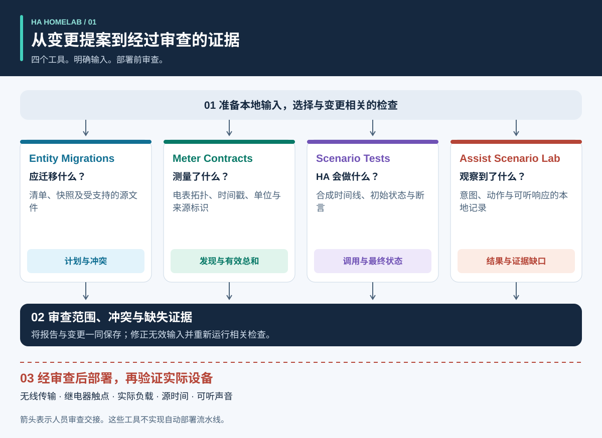
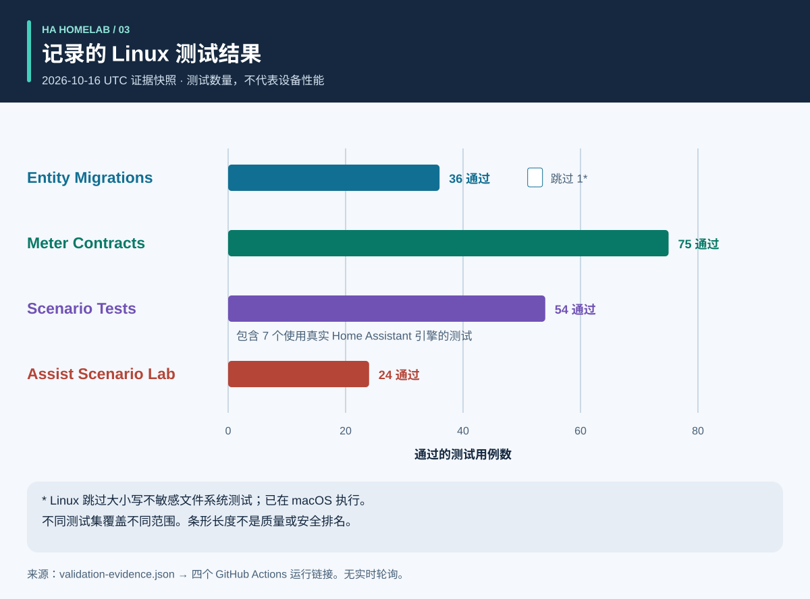
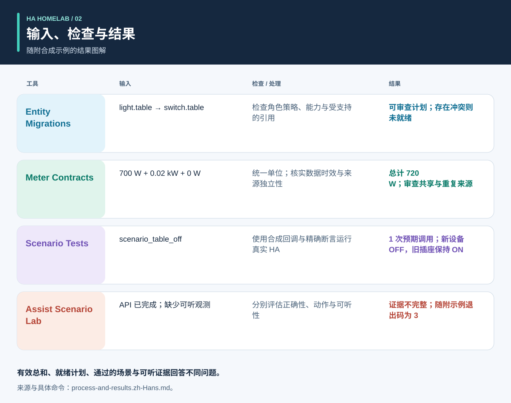

# 先有证据，再做自动化

<!-- language-navigation:start -->
<p dir="ltr">
<a href="README.md" lang="en" dir="ltr">English</a> · <a href="README.ar.md" lang="ar" dir="rtl">العربية</a> · <a href="README.bn.md" lang="bn" dir="ltr">বাংলা</a> · <a href="README.cs.md" lang="cs" dir="ltr">Čeština</a> · <a href="README.de.md" lang="de" dir="ltr">Deutsch</a> · <a href="README.es.md" lang="es" dir="ltr">Español</a> · <a href="README.fa.md" lang="fa" dir="rtl">فارسی</a> · <a href="README.fr.md" lang="fr" dir="ltr">Français</a><br>
<a href="README.he.md" lang="he" dir="rtl">עברית</a> · <a href="README.hi.md" lang="hi" dir="ltr">हिन्दी</a> · <a href="README.id.md" lang="id" dir="ltr">Bahasa Indonesia</a> · <a href="README.it.md" lang="it" dir="ltr">Italiano</a> · <a href="README.ja.md" lang="ja" dir="ltr">日本語</a> · <a href="README.ko.md" lang="ko" dir="ltr">한국어</a> · <a href="README.nl.md" lang="nl" dir="ltr">Nederlands</a> · <a href="README.pl.md" lang="pl" dir="ltr">Polski</a><br>
<a href="README.pt.md" lang="pt" dir="ltr">Português</a> · <a href="README.ru.md" lang="ru" dir="ltr">Русский</a> · <a href="README.th.md" lang="th" dir="ltr">ไทย</a> · <a href="README.tr.md" lang="tr" dir="ltr">Türkçe</a> · <a href="README.uk.md" lang="uk" dir="ltr">Українська</a> · <a href="README.vi.md" lang="vi" dir="ltr">Tiếng Việt</a> · <a href="README.zh-Hans.md" lang="zh-Hans" dir="ltr">简体中文</a> · <a href="README.zh-Hant.md" lang="zh-Hant" dir="ltr">繁體中文</a>
</p>
<!-- language-navigation:end -->

这些文档翻译不会扩展 CLI 或语音所支持的语言；请查看各项目的语言支持说明。

四个小工具帮助 Home Assistant 社区项目回答四类问题：**设备角色应如何迁移、测量覆盖什么范围、自动化引擎实际做了什么、语音结果有哪些证据支持？** 初版使用本地文件和合成测试数据。它们不会部署家庭配置，也不认证实物设备。



[图解：流程、输出与结果](process-and-results.zh-Hans.md) · [状态变化图](role-transfer.zh-Hans.svg) · [测试证据图表](validation.zh-Hans.svg)

## 四个项目

- [HA Entity Migrations](https://github.com/ha-homelab/ha-entity-migrations) 生成离线迁移计划。明确的角色/硬件策略、能力要求和文件指纹，可避免一次普通重命名将照明自动化悄然分配给改作他用的电源插座。就绪计划仅适用于提供的、受支持的配置范围。
- [HA Meter Contracts](https://github.com/ha-homelab/ha-meter-contracts) 检查实物测量范围、数据来源、单位、样本时效和可加性规则。重命名无法把插排总表变成单个水泵的电表。同一个电流互感器的重复表示不能作为独立负载相加。
- [HA Scenario Tests](https://github.com/ha-homelab/ha-scenario-tests) 在真实 Home Assistant 自动化/脚本引擎中执行受限的合成场景。它检查调用顺序、禁止调用和最终合成状态。当前运行环境固定为 HA 2026.10.1 和 Python 3.14.2–3.14.x；请与其他工具使用不同的环境。
- [Assist Scenario Lab](https://github.com/ha-homelab/assist-scenario-lab) 评估本地语音证据。它区分命令正确性、API 完成情况和可听见的输出。所有随附的时间数据均为合成数据，传入的观测没有经过独立验证。

各项目有自己的安装指南，以及英语/俄语/德语/西班牙语 CLI 消息。请遵循对应版本的契约，不要假设所有退出码含义相同。图中的箭头是**审查交接**，不是已经实现的自动集成。不存在中央守护进程或通用部署命令。

已发布的 wiki：[Entity Migrations](https://github.com/ha-homelab/ha-entity-migrations/wiki) · [Meter Contracts](https://github.com/ha-homelab/ha-meter-contracts/wiki) · [Scenario Tests](https://github.com/ha-homelab/ha-scenario-tests/wiki) · [Assist Scenario Lab](https://github.com/ha-homelab/assist-scenario-lab/wiki) · [ZAC93 + ESP32](https://github.com/ha-homelab/zac93-esp32/wiki)

<a id="validation-evidence--2026-10-16-utc"></a>
## 验证证据 — 2026-10-16 UTC

这些是使用合成数据对特定软件版本进行的检查，并非硬件认证或家庭运行基准测试。



条形表示数量，不表示覆盖率或质量排名。带日期的源记录见 [validation-evidence.json](validation-evidence.json)。

- **Entity Migrations：** 本地通过 37 个测试及 9 个子测试，包括源文件别名回归测试。[main 分支的 Linux 运行](https://github.com/ha-homelab/ha-entity-migrations/actions/runs/38843701264) 通过 36 个测试，并跳过了大小写不敏感文件系统的用例；该用例已在本地执行。
- **Meter Contracts：** [Linux CI 通过 75 个测试](https://github.com/ha-homelab/ha-meter-contracts/actions/runs/38843671896)，涵盖来源冲突、源文件准入和测量语义。
- **Assist Scenario Lab：** [Linux CI 通过 24 个测试](https://github.com/ha-homelab/assist-scenario-lab/actions/runs/38843304306)。这些检查验证传入的证据与合成示例，不构成实物语音设备比较。
- **Scenario Tests：** 在 CPython 3.14.8 和真实 Home Assistant 2026.10.0 上，[Linux CI 通过 54 个测试，无跳过项](https://github.com/ha-homelab/ha-scenario-tests/actions/runs/38843681199)。其中包括七个运行时用例，一个验证配套的角色迁移示例。完整测试集耗时 21.42 秒。

经测试的运行平台是 Linux。[已记录的原生 macOS 清理阶段故障](https://github.com/ha-homelab/ha-scenario-tests/blob/main/docs/validation.md) 仍是限制；进程崩溃前输出了预期 JSON，仍然属于运行失败。10月16日的记录不声称已在 Docker 中执行或完成实物设备验收。

2026年10月19日更新：[Linux CI](https://github.com/ha-homelab/ha-scenario-tests/actions/runs/39264346721) 也已通过打包运行环境的 Docker 基本运行测试。这不代表已完成实物设备验收。

## 流程与结果图解



参阅[图解指南](process-and-results.zh-Hans.md)，理解各项输出、追踪替代设备与旧设备的状态，并区分软件证据与实物验收。图示结果概括随附的合成示例，不是原始报告截图。

<a id="a-concrete-migration-to-test-workflow"></a>
## 从迁移到测试的具体流程

1. 安装 `ha-entity-migrations` 仓库的工具后，在其中运行随附的域变更示例：

   ```sh
   ha-entity-migrations --lang en plan --manifest examples/domain-change/manifest.json --snapshot examples/domain-change/snapshot.json --root examples/domain-change
   ```

   审查提议的 `light.table` → `switch.table` 和 `light.turn_off` → `switch.turn_off` 变更。文件指纹和受支持的引用界定适用范围。计划受阻时需要调查；不要用无条件查找替换来代替缺失的能力证据。

2. 将审查后的行为转换为合成测试。[role-transfer.scenario.json](role-transfer.scenario.json) 是手工编写的配套示例，**并非迁移计划的自动导出**。它发送合成的“关闭桌灯”事件，预期只调用一次替代角色，并禁止关闭已退出该角色的旧硬件。它还断言旧硬件保持开启。请在本指南目录中执行，场景运行器需安装在独立环境内：

   ```sh
   ha-scenario validate role-transfer.scenario.json
   ha-scenario run role-transfer.scenario.json
   ```

   此配套示例与[成功的 Linux 运行](https://github.com/ha-homelab/ha-scenario-tests/actions/runs/38843681199)所测试的[角色迁移测试数据](https://github.com/ha-homelab/ha-scenario-tests/blob/0ea7e5a5d24dc89ebe896b1a2387396b3fce18f4/tests/fixtures/role_transfer.json)逐字节相同。其 SHA-256 为 `bb8544517eeb4895b80b049cf9e242d04635e7785bd198c1d57a7cf3f5fc8ab4`。先前的 macOS 清理阶段故障仍有记录，不计作通过。

   场景使用真实 HA 引擎，但执行器回调在内存中运行。通过测试证明的是所提供合成序列中的引擎行为，而非无线传输、触点闭合或电器实际通电。单个事件不能覆盖整个家庭配置。

3. 部署前补充相关故障序列：无人状态被传感器不可用打断、手动保持、自动化重载、重复触发和状态恢复。运行器自带示例涵盖有人状态、手动保持、过期输入和重载后的状态协调。它使用实际流逝的时间，因此短测试不能验证生产环境中二十分钟的间隔。HA 文档说明，`for` 等待不会在重启/重载后保留；需要时应设计并测试明确的状态协调或持久化截止时间。[HA 触发器文档](https://www.home-assistant.io/docs/automation/trigger/)

4. 独立审查计量证据。在计量工具仓库中执行：

   ```sh
   ha-meter-contracts check examples/valid-three-meters.json --at 2026-01-01T12:00:05Z --json
   ha-meter-contracts check examples/kmc-shared-meter.json --at 2026-01-01T12:00:05Z --json
   ha-meter-contracts check examples/duplicate-emporia.json --at 2026-01-01T12:00:05Z --json
   ```

   有效示例会成功。后两个示例有意以状态码 1 退出：分别代表试图把整条插排的计量归于单个插座，以及重复表示同一个来源。编写示例脚本时应把这些视为预期失败。不要将插排总功率送入原本针对水泵单独校准的保护阈值。电压校准不等于电流或功率校准。缺失或过期证据应保持不可用，而不是变成零。[HA 传感器与统计语义](https://developers.home-assistant.io/docs/core/entity/sensor/#long-term-statistics)

5. 如果语音用作触发或反馈，请在语音工具仓库中独立评估证据：

   ```sh
   assist-lab evaluate examples/synthetic-pass.json
   assist-lab evaluate examples/synthetic-incomplete.json
   ```

   不完整示例有意以状态码 3 退出，因为 API 完成不足以证明声音可听见。真实基准测试需要录音同意、明确的时钟/方法、可比条件，以及对动作与可听响应的独立观测。不要发布家庭录音、转写文本或导出的令牌。服务器产生第一个音频块的时间，不等于听者听到第一个声音的时间。[HA Assist 流水线](https://developers.home-assistant.io/docs/voice/pipelines/)

6. 将每份报告与已审查的变更保存在一起。通过现场既定的审查/部署流程应用变更，再对具体设备进行验收。实际开关、指示灯极性、重启行为、源时间与逐项测量校准都需要真实观测。这四个工具既不执行也不替代该步骤。

## 这些检查不能证明什么

配置状态、服务调用被接受、观察到功耗与存在水流，是不同的证据。三个负载的总表无法识别哪个负载消耗了电力。合成的“关闭”状态不能证明继电器触点已经断开。计量工具和场景测试都不是用于水系统、加热器、门禁或其他重要负载的安全控制器。

这些工具不会强制执行彼此的结果。未来集成可以读取其稳定 JSON，但必须明确允许的警告级别、版本兼容性和“完整证据”的含义。不要把 `ready`、`available`、`passed` 和 `audible` 简化为同一个可互换的布尔值。

## 路线图：十四个想法，明确就绪程度

以下前四项已有初版离线工具。所有列出的后续工作仍是提案；存在仓库名称或示意图不表示硬件已完成调试。

1. **角色迁移 — 已实现初版工具。** 扩展支持的引用格式时，应有往返测试和冲突测试，并保留明确的不支持输入边界。
2. **计量契约 — 已实现初版工具。** 私下试采带真实时间戳的观测；声称完成校准前，应独立测量电流/功率。归因到单个插座仍需该插座的独立证据。
3. **自动化场景测试 — 已实现初版工具。** 添加经过审查的策略及重启/截止时间用例；需要时单独测试生产环境长度的计时。
4. **语音证据 — 已实现初版工具，实物基准测试待完成。** 采集可比较的会话前，先选定语音终端、观测方法并取得录音同意。目前没有硬件排名。
5. **空气质量协调 — 传感器/执行器验证待完成。** 确认设备测量的是 CO₂ 还是颗粒物、设备年限/精度，以及通风或过滤可影响哪些因素。制定通风策略前先确认室外条件。
6. **雷达/有人检测证据 — 硬件调试待完成。** 核实 LD2450 板卡、电源、外壳、协议与覆盖范围。目标不等于人的身份，接收后的数据年龄也不等于测得的传感器延迟。CSI 仍属实验性方案。
7. **水系统/水泵可观测性 — 独立证据待补充。** 区分允许水泵通电、耗电、水流和水位。插排总表无法补上缺失的水泵专属保护信号。对于重要命令，如果没有观察到的状态和现场专项审查，不应自动重试。
8. **BLE 遥测 — 兼容代理与覆盖测试待完成。** 验证实际传感器、温度范围、电池与摆放位置。ESP8266 设备不是 BLE 代理；RSSI 既不是身份，也不是解锁凭据。[ESPHome Bluetooth proxy](https://esphome.io/components/bluetooth_proxy/)
9. **基于有人状态的解释与家电 — 能力验证待完成。** 说明哪项观测让灯保持开启；设备支持时使用真实的洗衣机/烘干机事件。不要仅凭共用电表推断家电周期，也不要用无关的传感器标志虚构统计置信度。
10. **Z-Wave 桥接 — 等待交付/组装与无线验收。** [ZAC93 + ESP32 指南](https://github.com/ha-homelab/zac93-esp32) 是独立的硬件方向。应对实际板卡验证接线、区域频率、串行传输和 Z-Wave JS 入网。控制器支持 Long Range，不会让旧传感器变成 Long Range 设备。[Z-Wave JS 指南](https://zwave-js.github.io/zwave-js/#/getting-started/index)
11. **ESPHome 插座验收 — 逐台硬件测试待完成。** 对每个版本记录按钮、继电器、指示灯和重启证据，并分别校准电压/电流/功率。刷写成功不等于验收完成。不要对连接的电器进行无人值守的大规模电源循环。
12. **预测基准测试 — 等待数据积累。** 归档已发布的预测及后续实际值，保留发布时间，评估不同预测跨度时避免使用未来信息。这需要实际观测时间，不能根据合成示例宣称节能。
13. **限定范围的访客控制 — 后端权限审查待完成。** 验证身份和服务器端授权。仅隐藏仪表盘控件无法限制访问。不要为简化面板而削弱身份验证。
14. **可延迟负载调度 — 测量约束与能力待确认。** 验证计量、状态反馈和预测后，再集成成熟的调度工具。确认哪些负载确实能延迟或调节、各自截止时间及手动覆盖方式。从经审查的建议开始，不作推测性的节能或安全保证。[EMHASS](https://emhass.readthedocs.io/en/latest/emhass.html) · [evcc](https://docs.evcc.io/en/)

## 贡献与复现本指南

本概览、合成场景和图解是以 MIT 许可发布的原创材料，见 [LICENSE](LICENSE)。使用 `python3 render_architecture.py` 重新生成所有语言的 SVG。其中没有外部图片、脚本、家庭标识符或实测家庭数据。[图解指南](process-and-results.zh-Hans.md#reproduce-or-translate-the-illustrations) 说明源记录和重新生成检查。公开测试数据应保持合成性质，私有导出不得放入 Git。变更时请遵循各仓库的安全与贡献指南。
