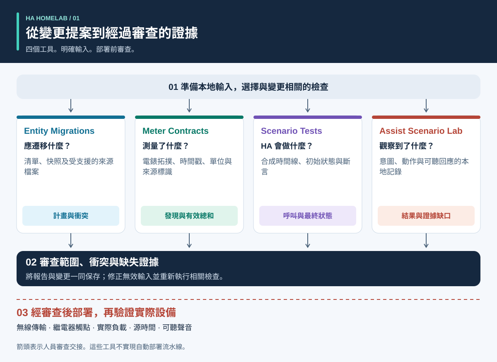
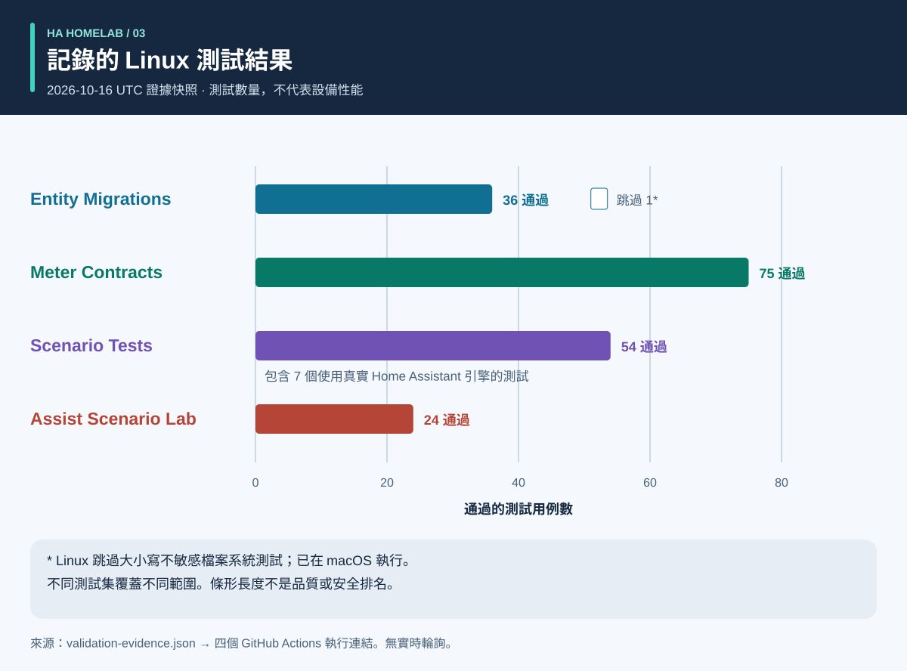
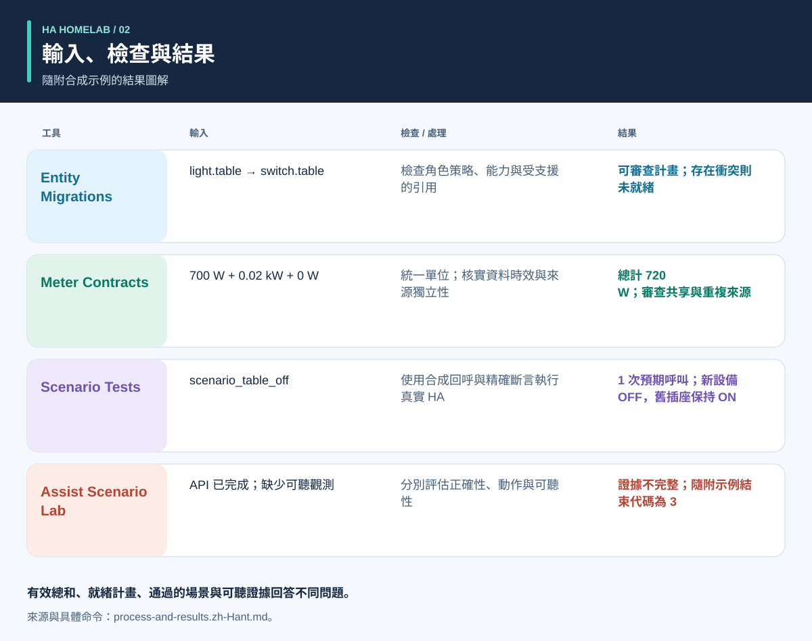

# 先有證據，再做自動化

<!-- language-navigation:start -->
<p dir="ltr">
<a href="README.md" lang="en" dir="ltr">English</a> · <a href="README.ar.md" lang="ar" dir="rtl">العربية</a> · <a href="README.bn.md" lang="bn" dir="ltr">বাংলা</a> · <a href="README.cs.md" lang="cs" dir="ltr">Čeština</a> · <a href="README.de.md" lang="de" dir="ltr">Deutsch</a> · <a href="README.es.md" lang="es" dir="ltr">Español</a> · <a href="README.fa.md" lang="fa" dir="rtl">فارسی</a> · <a href="README.fr.md" lang="fr" dir="ltr">Français</a><br>
<a href="README.he.md" lang="he" dir="rtl">עברית</a> · <a href="README.hi.md" lang="hi" dir="ltr">हिन्दी</a> · <a href="README.id.md" lang="id" dir="ltr">Bahasa Indonesia</a> · <a href="README.it.md" lang="it" dir="ltr">Italiano</a> · <a href="README.ja.md" lang="ja" dir="ltr">日本語</a> · <a href="README.ko.md" lang="ko" dir="ltr">한국어</a> · <a href="README.nl.md" lang="nl" dir="ltr">Nederlands</a> · <a href="README.pl.md" lang="pl" dir="ltr">Polski</a><br>
<a href="README.pt.md" lang="pt" dir="ltr">Português</a> · <a href="README.ru.md" lang="ru" dir="ltr">Русский</a> · <a href="README.th.md" lang="th" dir="ltr">ไทย</a> · <a href="README.tr.md" lang="tr" dir="ltr">Türkçe</a> · <a href="README.uk.md" lang="uk" dir="ltr">Українська</a> · <a href="README.vi.md" lang="vi" dir="ltr">Tiếng Việt</a> · <a href="README.zh-Hans.md" lang="zh-Hans" dir="ltr">简体中文</a> · <a href="README.zh-Hant.md" lang="zh-Hant" dir="ltr">繁體中文</a>
</p>
<!-- language-navigation:end -->

<!-- community-beta-releases:start -->
<p dir="ltr">
<a href="https://github.com/ha-homelab/ha-entity-migrations/releases/tag/v0.1.1b1">Entity Migrations · 0.1.1b1</a> ·
<a href="https://github.com/ha-homelab/ha-meter-contracts/releases/tag/v0.1.1b1">Meter Contracts · 0.1.1b1</a> ·
<a href="https://github.com/ha-homelab/ha-scenario-tests/releases/tag/v0.1.1b1">Scenario Tests · 0.1.1b1</a> ·
<a href="https://github.com/ha-homelab/assist-scenario-lab/releases/tag/v0.1.1b1">Assist Scenario Lab · 0.1.1b1</a>
</p>
<!-- community-beta-releases:end -->

這些文件翻譯不會擴展 CLI 或語音所支援的語言；請查看各專案的語言支援說明。

四個小工具幫助 Home Assistant 社區專案回答四類問題：**設備角色應如何遷移、測量覆蓋什麼範圍、自動化引擎實際做了什麼、語音結果有哪些證據佐證？** 初版使用本地檔案和合成測試資料。它們不會部署家庭設定，也不認證實物設備。



[圖解：流程、輸出與結果](process-and-results.zh-Hant.md) · [狀態變化圖](role-transfer.zh-Hant.svg) · [測試證據圖表](validation.zh-Hant.svg)

## 四個專案

- [HA Entity Migrations](https://github.com/ha-homelab/ha-entity-migrations) 生成離線遷移計畫。明確的角色/硬體策略、能力要求和檔案指紋，可避免一次普通重新命名將照明自動化悄然分配給改作他用的電源插座。就緒計畫僅適用於提供的、受支援的設定範圍。
- [HA Meter Contracts](https://github.com/ha-homelab/ha-meter-contracts) 檢查實物測量範圍、資料來源、單位、樣本時效和可加性規則。重新命名無法把插排總表變成單個水泵的電錶。同一個電流互感器的重複表示不能作為獨立負載相加。
- [HA Scenario Tests](https://github.com/ha-homelab/ha-scenario-tests) 在真實 Home Assistant 自動化/指令碼引擎中執行受限的合成場景。它檢查呼叫順序、禁止呼叫和最終合成狀態。目前的執行環境固定為 HA 2026.10.1 和 Python 3.14.2–3.14.x；請與其他工具使用不同的環境。
- [Assist Scenario Lab](https://github.com/ha-homelab/assist-scenario-lab) 評估本地語音證據。它區分命令正確性、API 完成情況和可聽見的輸出。所有隨附的時間資料均為合成資料，傳入的觀測沒有經過獨立驗證。

各專案有自己的安裝指南，以及英語/俄語/德語/西班牙語 CLI 訊息。請遵循對應版本的契約，不要假設所有結束代碼含義相同。圖中的箭頭是**審查交接**，不是已經實現的自動整合。不存在中央守護程序或通用部署命令。

已發佈的 wiki：[Entity Migrations](https://github.com/ha-homelab/ha-entity-migrations/wiki) · [Meter Contracts](https://github.com/ha-homelab/ha-meter-contracts/wiki) · [Scenario Tests](https://github.com/ha-homelab/ha-scenario-tests/wiki) · [Assist Scenario Lab](https://github.com/ha-homelab/assist-scenario-lab/wiki) · [ZAC93 + ESP32](https://github.com/ha-homelab/zac93-esp32/wiki)

<a id="validation-evidence--2026-10-16-utc"></a>
## 驗證證據 — 2026-10-16 UTC

這些是使用合成資料對特定軟體版本進行的檢查，並非硬體認證或家庭執行基準測試。



條形表示數量，不表示覆蓋率或品質排名。帶日期的源記錄見 [validation-evidence.json](validation-evidence.json)。

- **Entity Migrations：** 本地通過 37 個測試及 9 個子測試，包括來源檔案別名迴歸測試。[main 分支的 Linux 執行](https://github.com/ha-homelab/ha-entity-migrations/actions/runs/38843701264) 通過 36 個測試，並跳過了大小寫不敏感檔案系統的用例；該用例已在本地執行。
- **Meter Contracts：** [Linux CI 通過 75 個測試](https://github.com/ha-homelab/ha-meter-contracts/actions/runs/38843671896)，涵蓋來源衝突、來源檔案准入和測量語義。
- **Assist Scenario Lab：** [Linux CI 通過 24 個測試](https://github.com/ha-homelab/assist-scenario-lab/actions/runs/38843304306)。這些檢查驗證傳入的證據與合成示例，不構成實物語音設備比較。
- **Scenario Tests：** 在 CPython 3.14.8 和真實 Home Assistant 2026.10.0 上，[Linux CI 通過 54 個測試，無跳過項](https://github.com/ha-homelab/ha-scenario-tests/actions/runs/38843681199)。其中包括七個執行時用例，一個驗證配套的角色遷移示例。完整測試集耗時 21.42 秒。

經測試的執行平臺是 Linux。[已記錄的原生 macOS 清理階段故障](https://github.com/ha-homelab/ha-scenario-tests/blob/main/docs/validation.md) 仍是限制；程序崩潰前輸出了預期 JSON，仍然屬於執行失敗。10月16日的記錄不聲稱已在 Docker 中執行或完成實物設備驗收。

2026年10月19日更新：[Linux CI](https://github.com/ha-homelab/ha-scenario-tests/actions/runs/39264346721) 也已通過封裝執行環境的 Docker 基本運作測試。這不代表已完成實物設備驗收。

## 流程與結果圖解



參閱[圖解指南](process-and-results.zh-Hant.md)，理解各項輸出、追蹤替代設備與舊設備的狀態，並區分軟體證據與實物驗收。圖示結果概括隨附的合成示例，不是原始報告截圖。

<a id="a-concrete-migration-to-test-workflow"></a>
## 從遷移到測試的具體流程

1. 安裝 `ha-entity-migrations` 儲存庫的工具後，在其中執行隨附的域變更示例：

   ```sh
   ha-entity-migrations --lang en plan --manifest examples/domain-change/manifest.json --snapshot examples/domain-change/snapshot.json --root examples/domain-change
   ```

   審查提議的 `light.table` → `switch.table` 和 `light.turn_off` → `switch.turn_off` 變更。檔案指紋和受支援的引用界定適用範圍。計畫受阻時需要調查；不要用無條件查找替換來代替缺失的能力證據。

2. 將審查後的行為轉換為合成測試。[role-transfer.scenario.json](role-transfer.scenario.json) 是手工編寫的配套示例，**並非遷移計畫的自動匯出**。它發送合成的“關閉桌燈”事件，預期只呼叫一次替代角色，並禁止關閉已卸下該角色的舊硬體。它還斷言舊硬體保持開啟。請在本指南目錄中執行，場景執行器需安裝在獨立環境內：

   ```sh
   ha-scenario validate role-transfer.scenario.json
   ha-scenario run role-transfer.scenario.json
   ```

   此配套示例與[成功的 Linux 執行](https://github.com/ha-homelab/ha-scenario-tests/actions/runs/38843681199)所測試的[角色遷移測試資料](https://github.com/ha-homelab/ha-scenario-tests/blob/0ea7e5a5d24dc89ebe896b1a2387396b3fce18f4/tests/fixtures/role_transfer.json)逐位元組相同。其 SHA-256 為 `bb8544517eeb4895b80b049cf9e242d04635e7785bd198c1d57a7cf3f5fc8ab4`。先前的 macOS 清理階段故障仍有記錄，不計作通過。

   場景使用真實 HA 引擎，但執行器回呼在記憶體中執行。通過測試證明的是所提供合成序列中的引擎行為，而非無線傳輸、觸點閉合或電器實際通電。單個事件不能覆蓋整個家庭設定。

3. 部署前補充相關故障序列：無人狀態被感測器不可用打斷、手動保持、自動化重新載入、重複觸發和狀態復原。執行器自帶示例涵蓋有人狀態、手動保持、過期輸入和重新載入後的狀態協調。它使用實際流逝的時間，因此短測試不能驗證生產環境中二十分鐘的間隔。HA 文件說明，`for` 等待不會在重新啟動/重新載入後保留；需要時應設計並測試明確的狀態協調或持久化截止時間。[HA 觸發器文件](https://www.home-assistant.io/docs/automation/trigger/)

4. 獨立審查計量證據。在計量工具儲存庫中執行：

   ```sh
   ha-meter-contracts check examples/valid-three-meters.json --at 2026-01-01T12:00:05Z --json
   ha-meter-contracts check examples/kmc-shared-meter.json --at 2026-01-01T12:00:05Z --json
   ha-meter-contracts check examples/duplicate-emporia.json --at 2026-01-01T12:00:05Z --json
   ```

   有效示例會成功。後兩個示例有意以狀態碼 1 結束執行：分別代表試圖把整條插排的計量歸於單個插座，以及重複表示同一個來源。編寫示例指令碼時應把這些視為預期失敗。不要將插排總功率送入原本針對水泵單獨校準的保護閾值。電壓校準不等於電流或功率校準。缺失或過期證據應保持不可用，而不是變成零。[HA 感測器與統計語義](https://developers.home-assistant.io/docs/core/entity/sensor/#long-term-statistics)

5. 如果語音用作觸發或回饋，請在語音工具儲存庫中獨立評估證據：

   ```sh
   assist-lab evaluate examples/synthetic-pass.json
   assist-lab evaluate examples/synthetic-incomplete.json
   ```

   不完整示例有意以狀態碼 3 結束執行，因為 API 完成不足以證明聲音可聽見。真實基準測試需要錄音同意、明確的時鐘/方法、可比條件，以及對動作與可聽回應的獨立觀測。不要發佈家庭錄音、轉寫文本或匯出的權杖。伺服器產生第一個音訊塊的時間，不等於聽者聽到第一個聲音的時間。[HA Assist 流水線](https://developers.home-assistant.io/docs/voice/pipelines/)

6. 將每份報告與已審查的變更保存在一起。通過現場既定的審查/部署流程應用變更，再對具體設備進行驗收。實際開關、指示燈極性、重新啟動行為、源時間與逐項測量校準都需要真實觀測。這四個工具既不執行也不替代該步驟。

## 這些檢查不能證明什麼

設定狀態、服務呼叫被接受、觀察到功耗與存在水流，是不同的證據。三個負載的總表無法識別哪個負載消耗了電力。合成的“關閉”狀態不能證明繼電器觸點已經斷開。計量工具和場景測試都不是用於水系統、加熱器、門禁或其他重要負載的安全控制器。

這些工具不會強制執行彼此的結果。未來整合可以讀取其穩定 JSON，但必須明確允許的警告級別、版本兼容性和“完整證據”的含義。不要把 `ready`、`available`、`passed` 和 `audible` 簡化為同一個可互換的布林值。

## 路線圖：十四個想法，明確就緒程度

以下前四項已有初版離線工具。所有列出的後續工作仍是提案；存在儲存庫名稱或示意圖不表示硬體已完成建置與實機驗證。

1. **角色遷移 — 已實現初版工具。** 擴展支援的引用格式時，應有往返測試和衝突測試，並保留明確的不支援輸入範圍。
2. **計量契約 — 已實現初版工具。** 私下試採帶真實時間戳的觀測；聲稱完成校準前，應獨立測量電流/功率。歸因到單個插座仍需該插座的獨立證據。
3. **自動化場景測試 — 已實現初版工具。** 添加經過審查的策略及重新啟動/截止時間用例；需要時單獨測試生產環境長度的計時。
4. **語音證據 — 已實現初版工具，實物基準測試待完成。** 採集可比較的會話前，先選定語音終端、觀測方法並取得錄音同意。目前沒有硬體排名。
5. **空氣品質協調 — 感測器/執行器驗證待完成。** 確認設備測量的是 CO₂ 還是顆粒物、設備年限/精度，以及通風或過濾可影響哪些因素。制定通風策略前先確認室外條件。
6. **雷達/有人檢測證據 — 硬體建置與實機驗證待完成。** 核實 LD2450 板卡、電源、外殼、協議與覆蓋範圍。目標不等於人的身份，接收後的資料年齡也不等於測得的感測器延遲。CSI 仍屬實驗性方案。
7. **水系統/水泵可觀測性 — 獨立證據待補充。** 區分允許水泵通電、耗電、水流和水位。插排總表無法補上缺失的水泵專屬保護信號。對於重要命令，如果沒有觀察到的狀態和現場專項審查，不應自動重試。
8. **BLE 遙測 — 兼容代理與覆蓋測試待完成。** 驗證實際感測器、溫度範圍、電池與擺放位置。ESP8266 設備不是 BLE 代理；RSSI 既不是身份，也不是解鎖憑據。[ESPHome Bluetooth proxy](https://esphome.io/components/bluetooth_proxy/)
9. **基於有人狀態的解釋與家電 — 能力驗證待完成。** 說明哪項觀測讓燈保持開啟；設備支援時使用真實的洗衣機/烘乾機事件。不要僅憑共用電錶推斷家電週期，也不要用無關的感測器標誌虛構統計置信度。
10. **Z-Wave 橋接 — 等待交付/組裝與無線驗收。** [ZAC93 + ESP32 指南](https://github.com/ha-homelab/zac93-esp32) 是獨立的硬體方向。應對實際板卡驗證接線、區域頻率、串行傳輸和 Z-Wave JS 入網。控制器支援 Long Range，不會讓舊感測器變成 Long Range 設備。[Z-Wave JS 指南](https://zwave-js.github.io/zwave-js/#/getting-started/index)
11. **ESPHome 插座驗收 — 逐臺硬體測試待完成。** 對每個版本記錄按鈕、繼電器、指示燈和重新啟動證據，並分別校準電壓/電流/功率。刷寫成功不等於驗收完成。不要對連接的電器進行無人值守的大規模電源循環。
12. **預測基準測試 — 等待資料積累。** 歸檔已發佈的預測及後續實際值，保留發布時間，評估不同預測跨度時避免使用未來資訊。這需要實際觀測時間，不能根據合成示例宣稱節能。
13. **限定範圍的訪客控制 — 後端權限審查待完成。** 驗證身份和伺服器端授權。僅隱藏儀表板控件無法限制存取。不要為簡化面板而削弱身份驗證。
14. **可延遲負載調度 — 測量約束與能力待確認。** 驗證計量、狀態回饋和預測後，再整合成熟的調度工具。確認哪些負載確實能延遲或調節、各自截止時間及手動覆蓋方式。從經審查的建議開始，不作推測性的節能或安全保證。[EMHASS](https://emhass.readthedocs.io/en/latest/emhass.html) · [evcc](https://docs.evcc.io/en/)

## 貢獻與復現本指南

本概覽、合成場景和圖解是以 MIT 許可發佈的原創材料，見 [LICENSE](LICENSE)。使用 `python3 render_architecture.py` 重新生成所有語言的 SVG。其中沒有外部圖片、指令碼、家庭標識符或實測家庭資料。[圖解指南](process-and-results.zh-Hant.md#reproduce-or-translate-the-illustrations) 說明源記錄和重新生成檢查。公開測試資料應保持合成性質，私有匯出不得放入 Git。變更時請遵循各儲存庫的安全與貢獻指南。
