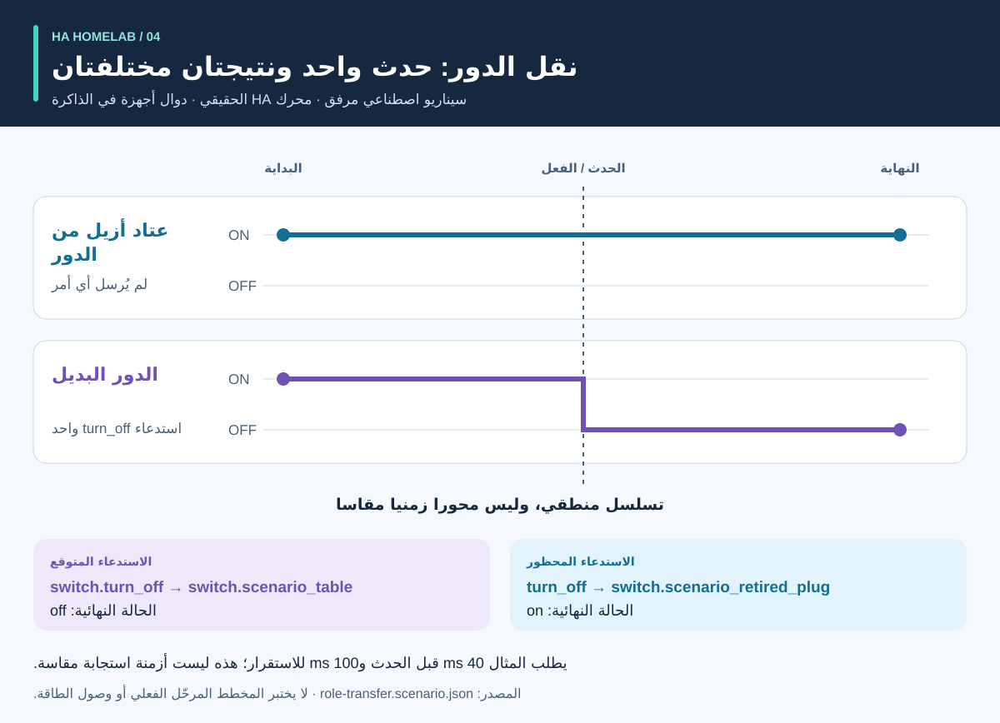

<div dir="rtl">

# العملية والنتائج: إرشادات مرئية

<!-- language-navigation:start -->
<p dir="ltr">
<a href="process-and-results.md" lang="en" dir="ltr">English</a> · <a href="process-and-results.ar.md" lang="ar" dir="rtl">العربية</a> · <a href="process-and-results.bn.md" lang="bn" dir="ltr">বাংলা</a> · <a href="process-and-results.cs.md" lang="cs" dir="ltr">Čeština</a> · <a href="process-and-results.de.md" lang="de" dir="ltr">Deutsch</a> · <a href="process-and-results.es.md" lang="es" dir="ltr">Español</a> · <a href="process-and-results.fa.md" lang="fa" dir="rtl">فارسی</a> · <a href="process-and-results.fr.md" lang="fr" dir="ltr">Français</a><br>
<a href="process-and-results.he.md" lang="he" dir="rtl">עברית</a> · <a href="process-and-results.hi.md" lang="hi" dir="ltr">हिन्दी</a> · <a href="process-and-results.id.md" lang="id" dir="ltr">Bahasa Indonesia</a> · <a href="process-and-results.it.md" lang="it" dir="ltr">Italiano</a> · <a href="process-and-results.ja.md" lang="ja" dir="ltr">日本語</a> · <a href="process-and-results.ko.md" lang="ko" dir="ltr">한국어</a> · <a href="process-and-results.nl.md" lang="nl" dir="ltr">Nederlands</a> · <a href="process-and-results.pl.md" lang="pl" dir="ltr">Polski</a><br>
<a href="process-and-results.pt.md" lang="pt" dir="ltr">Português</a> · <a href="process-and-results.ru.md" lang="ru" dir="ltr">Русский</a> · <a href="process-and-results.th.md" lang="th" dir="ltr">ไทย</a> · <a href="process-and-results.tr.md" lang="tr" dir="ltr">Türkçe</a> · <a href="process-and-results.uk.md" lang="uk" dir="ltr">Українська</a> · <a href="process-and-results.vi.md" lang="vi" dir="ltr">Tiếng Việt</a> · <a href="process-and-results.zh-Hans.md" lang="zh-Hans" dir="ltr">简体中文</a> · <a href="process-and-results.zh-Hant.md" lang="zh-Hant" dir="ltr">繁體中文</a>
</p>
<!-- language-navigation:end -->

[نظرة عامة على المشاريع](README.ar.md)

النتيجة المفيدة تجيب على سؤال محدد وتحافظ على الأدلة وراء الإجابة. تعمل الأدوات الأربع بشكل مستقل: يختار المراجع عمليات التحقق ذات الصلة ويحمل نتائجها إلى التغيير. تصف الأسهم أدناه عملية المراجعة هذه، وليس المسار التلقائي الذي تم تنفيذه.


## 1. تحديد التغيير وجمع المدخلات

لاستبدال الجهاز، ميز **الدور** عن **العتاد المادي**. قد ينتقل دور المصباح إلى مخرج كهربائي آخر بينما يبدأ المخرج القديم في تشغيل شيء آخر. قم بتسجيل المراجع التي تتبع الدور، والمراجع التي تتبع الأجهزة، والمراجع التي يجب إيقافها. قم بتوفير ملف وصف الترحيل ولقطة الكيانات والملفات المصدر المدعومة إلى Entity Migrations.

بالنسبة للقياس، قم بتوفير النطاق المادي لكل جهاز قياس وهوية المصدر والوحدات والطابع الزمني. بالنسبة للأتمتة، قم بوصف الحالة الأولية الاصطناعية وتسلسل الأحداث والتوقعات الصريحة. بالنسبة للصوت، قدم ملاحظات عن النية والعمل والاستجابة المسموعة. تقبل الأدوات مدخلات مختلفة؛ لا يتطلب سير العمل هذا تصديرًا مشتركًا لمنزل فعلي.

## 2. قراءة المخرجات وحدودها


هذه ملخصات توضيحية للأمثلة المجمعة، **وليست لقطات شاشة للتقارير الأولية**:

- **الترحيل:** يقترح مثال تغيير المجال `light.table` → `switch.table` وتغيير الخدمة المقابلة. قم بمراجعة كل تعديل مقترح وبصمة ملفه وأي تعارض يمنع التنفيذ. الخطة لا تطبق نفسها.

- **القياس:** يحتوي المثال الصالح ذو العدادات الثلاثة على مصادر مستقلة وحديثة البيانات بالقيم `700 W` و`0.02 kW` و`0 W`. تطبيع القيمة الثانية يعطي `700 + 20 + 0 = 720 W`. وهذه النتيجة مدعومة بثلاثة عدادات؛ لا يوفر عداد المشترك الكهربائي الواحد هذه الملاحظات الثلاثة لكل مخرج. تكشف الأمثلة ذات النطاق المشترك والمصادر المكررة عن عمد الافتراضات غير الصحيحة.

- **الأتمتة:** يتوقع مثال اختبار نقل الدور استدعاءً واحدًا للكيان البديل، ويشترط عدم إجراء أي استدعاء للعتاد الذي أزيل من هذا الدور. كل من قائمة الاستدعاءات والحالات النهائية مهمان: يمكن أن تؤدي الحالة النهائية المطابقة وحدها إلى إخفاء أمر إضافي غير مقصود.

- **الصوت:** المثال غير الكامل يفتقر إلى أدلة مسموعة كافية. ويتم الخروج بالرمز `3`، حتى لو انتهت مرحلة API. وهذا يعني أن هناك حاجة إلى مزيد من الأدلة، وليس أن المستمع سمع الصمت بالتأكيد.

المصادر: [مثال الترحيل](https://github.com/ha-homelab/ha-entity-migrations/tree/main/examples/domain-change)، [مدخلات العدادات الثلاثة](https://github.com/ha-homelab/ha-meter-contracts/blob/main/examples/valid-three-meters.json)، [إدخال الصوت](https://github.com/ha-homelab/assist-scenario-lab/blob/main/examples/synthetic-incomplete.json). توجد أوامر التثبيت والتنفيذ الدقيقة في [الدليل العملي في النظرة العامة](README.ar.md#a-concrete-migration-to-test-workflow).

## 3. فحص التغيير مع مرور الوقت



في [role-transfer.scenario.json](role-transfer.scenario.json)، يبدأ كلا المفتاحين الاصطناعيين بالحالة `on`. يؤدي الحدث `scenario_table_off` إلى استدعاء `switch.turn_off` لـ `switch.scenario_table`. والنتيجة المتوقعة هي `off` للاستبدال و`on` لـ `switch.scenario_retired_plug`. إيقاف تشغيل المفتاح الذي أزيل من الدور محظور بشكل صريح.

يستخدم الرسم البياني **المراحل المنطقية**، وليس مقياسًا زمنيًا مُقاسًا. يطلب المثال انتظار 40 مللي ثانية قبل الحدث و100 مللي ثانية لاستقرار الحالة. هذه عبارة عن مدخلات اختبار، وليست قياسا لزمن استجابة المرحّل أو ضمان اكتمال الحدث خلال 40 مللي ثانية. تم اجتياز اختبار وقت التشغيل الفعلي HA لهذا المثال في [تم تسجيل تشغيل Linux](https://github.com/ha-homelab/ha-scenario-tests/actions/runs/38843681199). لا تزال دوال رد النداء الخاصة بالأجهزة تعمل في الذاكرة.

## 4. فهم ما تم اختباره


يقرأ المخطط [validation-evidence.json](validation-evidence.json). يرتبط كل سجل بتشغيل GitHub Actions الأصلي. إنها لقطة مؤرخة، وليست شارة CI حية. طول الشريط هو عدد الاختبارات التي تم اجتيازها؛ إنها **ليست نسبة التغطية أو الموثوقية أو السرعة أو تصنيف المشاريع**. تختلف نطاقات مجموعات الاختبار.

يحتوي Entity Migrations على تخطي Linux واحد لسلوك نظام الملفات غير الحساس لحالة الأحرف، والذي تم التحقق منه محليًا على macOS. يتضمن Scenario Tests سبع حالات تشغيل HA فعلية في إجمالي 54. يظل فشل الإنهاء الأصلي الموثق على macOS قيدًا منفصلاً؛ اجتياز اختبارات Linux لا يزيله.

## 5. قرر ما إذا كنت تريد المتابعة أم لا

احتفظ بالمدخلات التي تمت مراجعتها وإصدارات الأدوات والتقارير والنتائج التي لم تُحل بعد مع التغيير. قم بحل المراجع غير المدعومة ومصادر العدادات المتضاربة والتأكيدات الفاشلة والملاحظات المفقودة قبل تفسير النتيجة على أنها كافية للاستخدام المقصود. استخدم الحالة الموثقة لكل أداة وعقد رمز الخروج.

ويظل النشر واختبارات القبول الميدانية منفصلين. تحقق من الجهاز الفعلي، ووصول الإشارة اللاسلكية، وسلوك المرحّل، والحمل المتصل، والطابع الزمني للمصدر، والإخراج المسموع حسب الاقتضاء. يؤكد نجاح الاختبار الاصطناعي سلوك البرنامج الذي تم اختباره، وليس توصيل الطاقة الناجح أو التكوين المنزلي الكامل.

<a id="reproduce-or-translate-the-illustrations"></a>

## إعادة إنتاج أو ترجمة الرسوم التوضيحية

شغّل من هذا المجلد:

<div dir="ltr">

```sh
python3 render_architecture.py
python3 -m unittest discover -s . -p 'test_*.py'
```

</div>

يُنتج المولد أربعة ملفات SVG لكل لغة مدرجة في [سجل اللغات](../languages.json) المشتركة. فهو يحتاج فقط إلى مكتبة Python القياسية، ولا يضم موارد بعيدة ويتضمن عنوانًا ووصفًا يدعمان أدوات إمكانية الوصول في كل صورة. يحدد اللون نفسه الأداة عبر الرسوم التوضيحية؛ تحدد الملصقات أيضًا كل سلسلة. للحصول على لقطة أدلة جديدة، قم بتحديث سجلات المصدر والتفسيرات المصاحبة معًا، مع الاحتفاظ بروابط عمليات التشغيل المسجلة. جميع الرسوم التوضيحية أصلية ومغطاة بـ [MIT](LICENSE).

</div>
