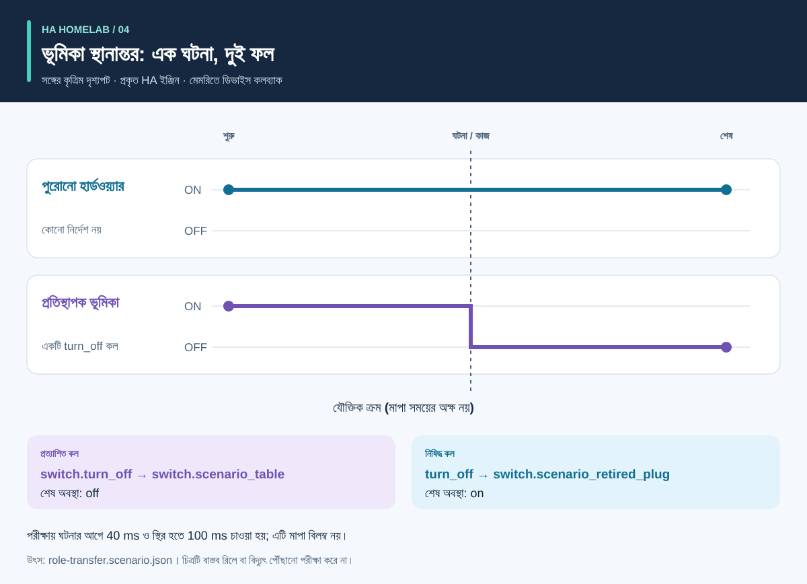

# প্রক্রিয়া ও ফলাফল: সচিত্র নির্দেশিকা

<!-- language-navigation:start -->
<p dir="ltr">
<a href="process-and-results.md" lang="en" dir="ltr">English</a> · <a href="process-and-results.ar.md" lang="ar" dir="rtl">العربية</a> · <a href="process-and-results.bn.md" lang="bn" dir="ltr">বাংলা</a> · <a href="process-and-results.cs.md" lang="cs" dir="ltr">Čeština</a> · <a href="process-and-results.de.md" lang="de" dir="ltr">Deutsch</a> · <a href="process-and-results.es.md" lang="es" dir="ltr">Español</a> · <a href="process-and-results.fa.md" lang="fa" dir="rtl">فارسی</a> · <a href="process-and-results.fr.md" lang="fr" dir="ltr">Français</a><br>
<a href="process-and-results.he.md" lang="he" dir="rtl">עברית</a> · <a href="process-and-results.hi.md" lang="hi" dir="ltr">हिन्दी</a> · <a href="process-and-results.id.md" lang="id" dir="ltr">Bahasa Indonesia</a> · <a href="process-and-results.it.md" lang="it" dir="ltr">Italiano</a> · <a href="process-and-results.ja.md" lang="ja" dir="ltr">日本語</a> · <a href="process-and-results.ko.md" lang="ko" dir="ltr">한국어</a> · <a href="process-and-results.nl.md" lang="nl" dir="ltr">Nederlands</a> · <a href="process-and-results.pl.md" lang="pl" dir="ltr">Polski</a><br>
<a href="process-and-results.pt.md" lang="pt" dir="ltr">Português</a> · <a href="process-and-results.ru.md" lang="ru" dir="ltr">Русский</a> · <a href="process-and-results.th.md" lang="th" dir="ltr">ไทย</a> · <a href="process-and-results.tr.md" lang="tr" dir="ltr">Türkçe</a> · <a href="process-and-results.uk.md" lang="uk" dir="ltr">Українська</a> · <a href="process-and-results.vi.md" lang="vi" dir="ltr">Tiếng Việt</a> · <a href="process-and-results.zh-Hans.md" lang="zh-Hans" dir="ltr">简体中文</a> · <a href="process-and-results.zh-Hant.md" lang="zh-Hant" dir="ltr">繁體中文</a>
</p>
<!-- language-navigation:end -->

[প্রকল্প পরিচিতি](README.bn.md)

কার্যকর ফল একটি নির্দিষ্ট প্রশ্নের উত্তর দেয় এবং সেই উত্তরের প্রমাণ রাখে। চারটি সরঞ্জাম স্বাধীনভাবে চলে: পর্যালোচক প্রাসঙ্গিক পরীক্ষা বেছে তার ফল পরিবর্তনের সঙ্গে রাখেন। নিচের তীর সেই পর্যালোচনা বোঝায়, বাস্তবায়িত স্বয়ংক্রিয় পাইপলাইন নয়।


## 1. পরিবর্তন নির্ধারণ ও ইনপুট সংগ্রহ

ডিভাইস বদলালে **ভূমিকা** ও **বাস্তব হার্ডওয়্যার** আলাদা করুন। আলোর ভূমিকা অন্য সকেটে যেতে পারে, আর আগের সকেট অন্য কিছুকে বিদ্যুৎ দিতে পারে। কোন রেফারেন্স ভূমিকা অনুসরণ করবে, কোনটি হার্ডওয়্যার অনুসরণ করবে এবং কোনটি বাদ যাবে লিখুন। স্থানান্তরের ম্যানিফেস্ট, এনটিটির বর্তমান চিত্র ও সমর্থিত উৎস ফাইল Entity Migrations-কে দিন।

পরিমাপের জন্য প্রতি মিটারের বাস্তব পরিসর, উৎসের পরিচয়, একক ও সময় দিন। অটোমেশনের জন্য কৃত্রিম প্রাথমিক অবস্থা, ঘটনার ক্রম ও স্পষ্ট প্রত্যাশা বর্ণনা করুন। ভয়েসের জন্য উদ্দেশ্য, কাজ ও শ্রবণযোগ্য উত্তরের পর্যবেক্ষণ দিন। সরঞ্জামগুলো ভিন্ন ইনপুট নেয়; এই প্রবাহে চালু বাড়ির যৌথ তথ্য রপ্তানি দরকার নেই।

## 2. আউটপুট ও তার সীমা পড়ুন


এগুলো সঙ্গে থাকা উদাহরণের ব্যাখ্যামূলক সারাংশ, **কাঁচা রিপোর্টের স্ক্রিনশট নয়**:

- **স্থানান্তর:** ডোমেইন পরিবর্তনের উদাহরণ `light.table` → `switch.table` এবং সংশ্লিষ্ট সার্ভিস বদলের প্রস্তাব দেয়। প্রতিটি সম্পাদনা, ফাইলের ছাপ ও বাধাদানকারী বিরোধ পর্যালোচনা করুন। পরিকল্পনা নিজে প্রয়োগ হয় না।
- **পরিমাপ:** বৈধ তিন-মিটারের উদাহরণে পৃথক সতেজ উৎসে `700 W`, `0.02 kW` ও `0 W` মান আছে। দ্বিতীয়টির একক স্বাভাবিক করলে `700 + 20 + 0 = 720 W` হয়। তিন মিটার এই ফল সমর্থন করে; একটি মাল্টিপ্লাগ মিটার তিন সকেটের পৃথক পর্যবেক্ষণ দেয় না। যৌথ পরিসর ও পুনরাবৃত্ত উৎসের উদাহরণ ইচ্ছাকৃতভাবে ভুল অনুমান প্রকাশ করে।
- **অটোমেশন:** ভূমিকা স্থানান্তরের পরীক্ষায় প্রতিস্থাপক এনটিটিতে একটি কল এবং পুরোনো হার্ডওয়্যারে কোনো কল না থাকা প্রত্যাশিত। কলের তালিকা ও চূড়ান্ত অবস্থা দুটোই জরুরি; শুধু শেষ অবস্থা মিললে অনাকাঙ্ক্ষিত অতিরিক্ত নির্দেশ আড়ালে থাকতে পারে।
- **ভয়েস:** অসম্পূর্ণ উদাহরণে যথেষ্ট শ্রবণযোগ্য প্রমাণ নেই। API ধাপ শেষ হলেও এটি `3` কোডে শেষ হয়। এর অর্থ আরও প্রমাণ দরকার; শ্রোতা নিশ্চিতভাবে নীরবতা শুনেছেন এমন নয়।

উৎস: [স্থানান্তরের উদাহরণ](https://github.com/ha-homelab/ha-entity-migrations/tree/main/examples/domain-change), [তিন মিটারের ইনপুট](https://github.com/ha-homelab/ha-meter-contracts/blob/main/examples/valid-three-meters.json), [ভয়েস ইনপুট](https://github.com/ha-homelab/assist-scenario-lab/blob/main/examples/synthetic-incomplete.json)। সঠিক স্থাপন ও চালনার নির্দেশ [পরিচিতির কর্মপ্রবাহে](README.bn.md#a-concrete-migration-to-test-workflow) আছে।

## 3. পরিবর্তনের ক্রম পরীক্ষা করুন



[role-transfer.scenario.json](role-transfer.scenario.json)-এ দুই কৃত্রিম সুইচ `on` অবস্থায় শুরু হয়। `scenario_table_off` ঘটনা `switch.scenario_table`-এর জন্য `switch.turn_off` ঘটায়। প্রত্যাশিত ফল প্রতিস্থাপকের জন্য `off` এবং `switch.scenario_retired_plug`-এর জন্য `on`। পুরোনো সুইচ বন্ধ করা স্পষ্টভাবে নিষিদ্ধ।

চিত্রে **যৌক্তিক ধাপ** আছে, মাপা সময়ের স্কেল নয়। পরীক্ষার তথ্য ঘটনার আগে 40 ms ও স্থির হওয়ার জন্য 100 ms অপেক্ষা চায়। এগুলো পরীক্ষার ইনপুট; পর্যবেক্ষিত রিলে বিলম্ব বা 40 ms-এ ঘটনা শেষ হওয়ার নিশ্চয়তা নয়। এই তথ্যের প্রকৃত HA রানটাইম পরীক্ষা [নথিভুক্ত Linux চালনায়](https://github.com/ha-homelab/ha-scenario-tests/actions/runs/38843681199) পাস করেছে। ডিভাইস কলব্যাক এখনো মেমরিতেই চলে।

## 4. কী পরীক্ষা হয়েছে বুঝুন


চিত্র [validation-evidence.json](validation-evidence.json) পড়ে। প্রতি রেকর্ডে মূল GitHub Actions চালনার লিংক আছে। এটি তারিখসহ বর্তমান চিত্র, সরাসরি CI ব্যাজ নয়। বারের দৈর্ঘ্য পাস পরীক্ষার সংখ্যা; **কভারেজের শতাংশ, নির্ভরযোগ্যতা, গতি বা প্রকল্পের ক্রম নয়**। পরীক্ষাসমষ্টির পরিসর ভিন্ন।

Entity Migrations-এ বড়-ছোট অক্ষর আলাদা না করা ফাইল সিস্টেমের আচরণের একটি Linux পরীক্ষা বাদ গেছে; সেটি স্থানীয় macOS-এ যাচাই হয়েছে। Scenario Tests-এর মোট 54টির মধ্যে প্রকৃত HA রানটাইমের সাতটি আছে। নথিভুক্ত নেটিভ macOS সমাপনী ব্যর্থতা আলাদা সীমাবদ্ধতা; Linux-এ পাস করা তা দূর করে না।

## 5. এগোনোর সিদ্ধান্ত নিন

পর্যালোচিত ইনপুট, সরঞ্জামের সংস্করণ, রিপোর্ট ও অসমাধিত বিষয় পরিবর্তনের সঙ্গে রাখুন। ফল উদ্দেশ্যের জন্য যথেষ্ট ভাবার আগে অসমর্থিত রেফারেন্স, মিটারের বিরোধপূর্ণ উৎস, ব্যর্থ যাচাই ও অনুপস্থিত পর্যবেক্ষণ সমাধান করুন। প্রতিটি সরঞ্জামের নথিভুক্ত অবস্থা ও প্রস্থান কোডের নিয়ম মানুন।

স্থাপন ও বাস্তব গ্রহণযোগ্যতা যাচাই আলাদা। প্রযোজ্য ক্ষেত্রে প্রকৃত ডিভাইস, রেডিও পৌঁছানো, রিলের আচরণ, সংযুক্ত লোড, উৎসের সময় ও শ্রবণযোগ্য আউটপুট যাচাই করুন। কৃত্রিম পরীক্ষায় পাস করা পরীক্ষিত সফ্টওয়্যারের আচরণ নিশ্চিত করে; বিদ্যুৎ পৌঁছানো বা পুরো বাড়ির সম্পূর্ণ কনফিগারেশন নয়।

<a id="reproduce-or-translate-the-illustrations"></a>

## চিত্র পুনরুৎপাদন বা অনুবাদ

এই ডিরেক্টরি থেকে চালান:

```sh
python3 render_architecture.py
python3 -m unittest discover -s . -p 'test_*.py'
```

জেনারেটর যৌথ [ভাষা তালিকার](../languages.json) প্রতি ভাষায় চারটি SVG তৈরি করে। শুধু Python-এর স্ট্যান্ডার্ড লাইব্রেরি লাগে, দূরবর্তী উপকরণ এমবেড করে না এবং প্রতিটি ছবিতে সহায়ক প্রযুক্তির উপযোগী শিরোনাম ও বিবরণ থাকে। সব চিত্রে একই রং একই সরঞ্জাম বোঝায়; লেবেলও প্রতিটি সিরিজ চিহ্নিত করে। নতুন প্রমাণের চিত্র তৈরি করলে নথিভুক্ত চালনার লিংক রেখে মূল রেকর্ড ও ব্যাখ্যা একসঙ্গে বদলান। সব চিত্র মৌলিক এবং [MIT](LICENSE) লাইসেন্সের অধীন।

