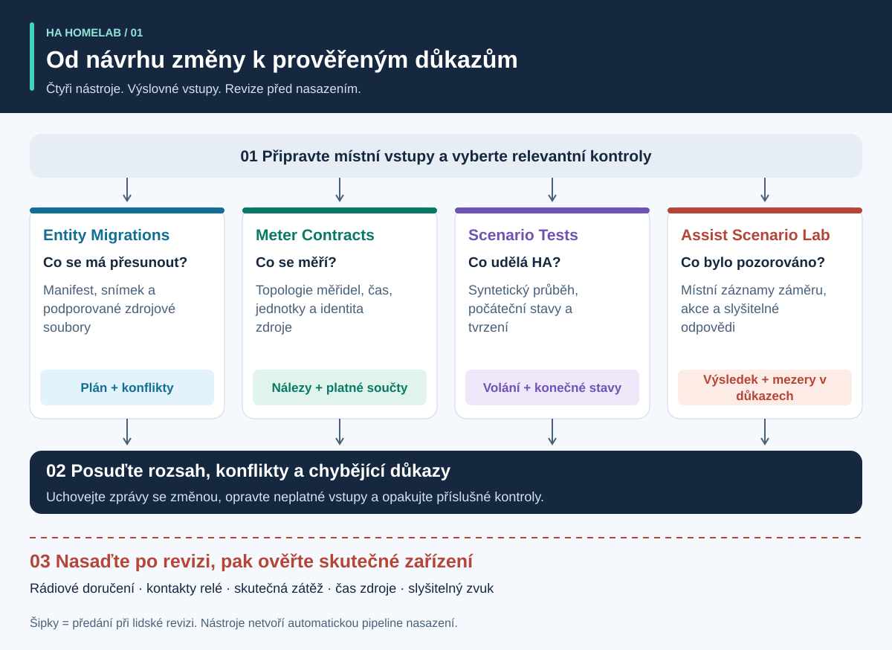
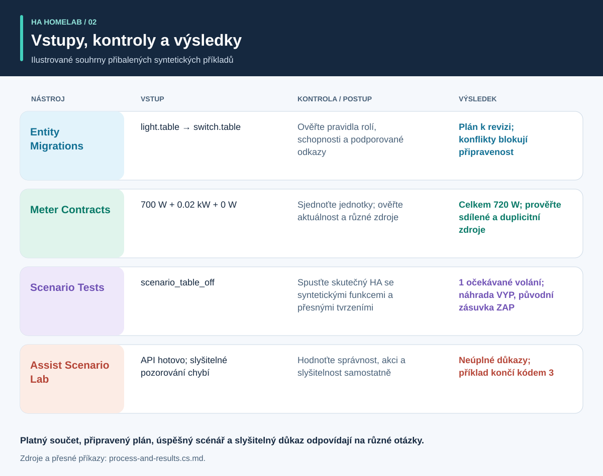
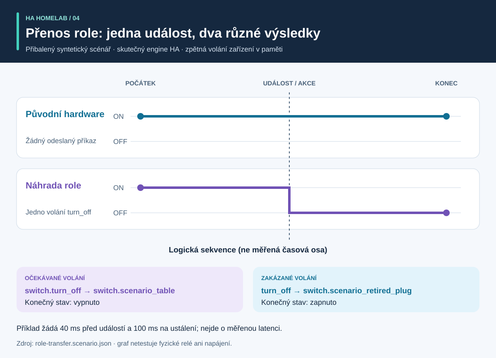
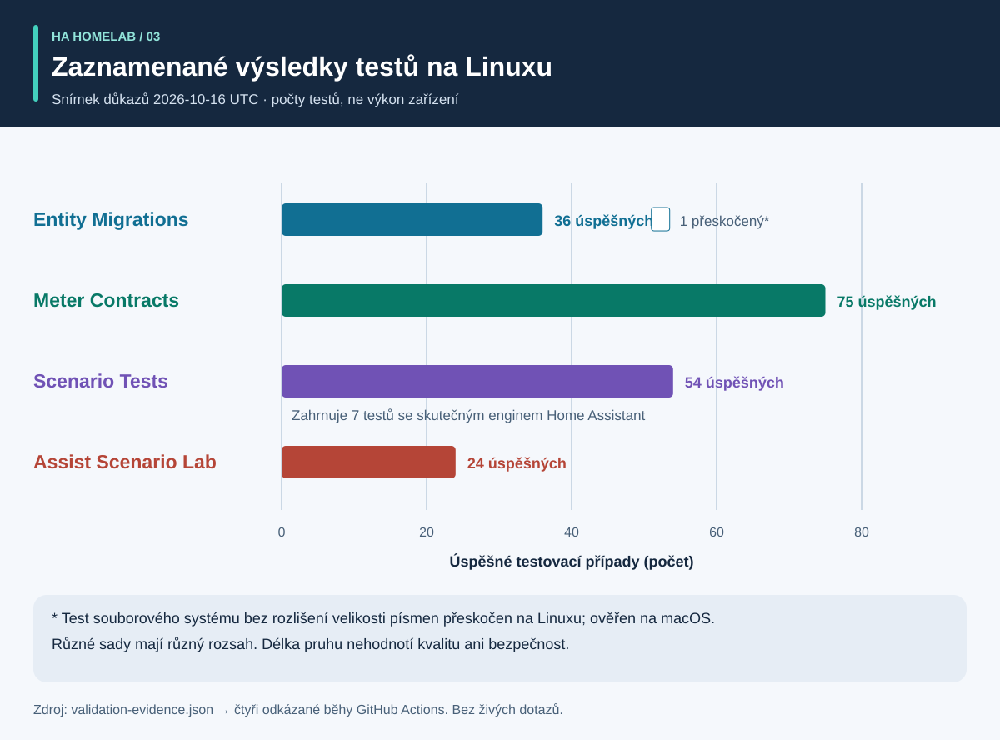

# Postup a výsledky: vizuální průvodce

<!-- language-navigation:start -->
<p dir="ltr">
<a href="process-and-results.md" lang="en" dir="ltr">English</a> · <a href="process-and-results.ar.md" lang="ar" dir="rtl">العربية</a> · <a href="process-and-results.bn.md" lang="bn" dir="ltr">বাংলা</a> · <a href="process-and-results.cs.md" lang="cs" dir="ltr">Čeština</a> · <a href="process-and-results.de.md" lang="de" dir="ltr">Deutsch</a> · <a href="process-and-results.es.md" lang="es" dir="ltr">Español</a> · <a href="process-and-results.fa.md" lang="fa" dir="rtl">فارسی</a> · <a href="process-and-results.fr.md" lang="fr" dir="ltr">Français</a><br>
<a href="process-and-results.he.md" lang="he" dir="rtl">עברית</a> · <a href="process-and-results.hi.md" lang="hi" dir="ltr">हिन्दी</a> · <a href="process-and-results.id.md" lang="id" dir="ltr">Bahasa Indonesia</a> · <a href="process-and-results.it.md" lang="it" dir="ltr">Italiano</a> · <a href="process-and-results.ja.md" lang="ja" dir="ltr">日本語</a> · <a href="process-and-results.ko.md" lang="ko" dir="ltr">한국어</a> · <a href="process-and-results.nl.md" lang="nl" dir="ltr">Nederlands</a> · <a href="process-and-results.pl.md" lang="pl" dir="ltr">Polski</a><br>
<a href="process-and-results.pt.md" lang="pt" dir="ltr">Português</a> · <a href="process-and-results.ru.md" lang="ru" dir="ltr">Русский</a> · <a href="process-and-results.th.md" lang="th" dir="ltr">ไทย</a> · <a href="process-and-results.tr.md" lang="tr" dir="ltr">Türkçe</a> · <a href="process-and-results.uk.md" lang="uk" dir="ltr">Українська</a> · <a href="process-and-results.vi.md" lang="vi" dir="ltr">Tiếng Việt</a> · <a href="process-and-results.zh-Hans.md" lang="zh-Hans" dir="ltr">简体中文</a> · <a href="process-and-results.zh-Hant.md" lang="zh-Hant" dir="ltr">繁體中文</a>
</p>
<!-- language-navigation:end -->

[Přehled projektů](README.cs.md)

Užitečný výsledek odpovídá na konkrétní otázku a zachovává důkazy, které odpověď podporují. Čtyři nástroje pracují nezávisle: recenzent vybere relevantní kontroly a přenese jejich výsledky do změny. Šipky níže popisují tento postup revize, nikoli implementovanou automatickou pipeline.



## 1. Definujte změnu a shromážděte vstupy

Při výměně zařízení rozlišujte **roli** od **fyzického hardwaru**. Role lampy se může přesunout na jinou zásuvku, zatímco původní začne napájet něco jiného. Zaznamenejte, které odkazy následují roli, které hardware a které se mají vyřadit. Dodejte Entity Migrations migrační manifest, snímek entit a podporované zdrojové soubory.

Pro měření dodejte fyzický rozsah, identitu zdroje, jednotky a časové razítko každého měřidla. Pro automatizaci popište syntetický výchozí stav, sled událostí a výslovná očekávání. Pro hlas dodejte pozorování záměru, akce a slyšitelné odpovědi. Nástroje přijímají různé vstupy; tento postup nevyžaduje společný export ze živé domácnosti.

## 2. Přečtěte výstup a jeho omezení



Jde o vysvětlující souhrny přibalených příkladů, **nikoli snímky nezpracovaných zpráv**:

- **Migrace:** příklad změny domény navrhuje `light.table` → `switch.table` a odpovídající změnu služby. Zkontrolujte každou navrženou úpravu, její otisk i případný blokující konflikt. Plán se sám neaplikuje.
- **Měření:** platný příklad tří měřidel má odlišné aktuální zdroje s hodnotami `700 W`, `0.02 kW` a `0 W`. Normalizací druhé hodnoty získáme `700 + 20 + 0 = 720 W`. Výsledek podporují tři měřidla; jediné měřidlo přívodu neposkytuje tato tři pozorování jednotlivých zásuvek. Příklady sdíleného rozsahu a duplicitních zdrojů úmyslně odhalují neplatné předpoklady.
- **Automatizace:** příklad přenosu role očekává jedno volání náhradní entity a žádné volání původního hardwaru. Záleží na seznamu volání i konečných stavech: samotný shodný konečný stav by mohl skrýt nechtěný příkaz navíc.
- **Hlas:** neúplný příklad nemá dost důkazů slyšitelnosti. Končí kódem `3`, i když fáze API skončila. Znamená to potřebu dalších důkazů, nikoli jistotu, že posluchač slyšel ticho.

Zdroje: [migrační příklad](https://github.com/ha-homelab/ha-entity-migrations/tree/main/examples/domain-change), [vstup tří měřidel](https://github.com/ha-homelab/ha-meter-contracts/blob/main/examples/valid-three-meters.json), [hlasový vstup](https://github.com/ha-homelab/assist-scenario-lab/blob/main/examples/synthetic-incomplete.json). Přesné instalační a spouštěcí příkazy jsou v [postupu v přehledu](README.cs.md#a-concrete-migration-to-test-workflow).

## 3. Prozkoumejte změnu v čase



V [role-transfer.scenario.json](role-transfer.scenario.json) začínají oba syntetické spínače stavem `on`. Událost `scenario_table_off` vyvolá `switch.turn_off` pro `switch.scenario_table`. Očekávaný výsledek je `off` pro náhradu a `on` pro `switch.scenario_retired_plug`. Vypnutí původního spínače je výslovně zakázáno.

Graf používá **logické fáze**, nikoli změřenou časovou stupnici. Příklad žádá 40 ms čekání před událostí a 100 ms na ustálení. Jde o vstupy testu, ne pozorovanou latenci relé nebo záruku dokončení události do 40 ms. Test tohoto příkladu ve skutečném běhovém prostředí HA prošel v [zaznamenaném linuxovém běhu](https://github.com/ha-homelab/ha-scenario-tests/actions/runs/38843681199). Zpětná volání zařízení stále běží v paměti.

## 4. Pochopte, co bylo testováno



Graf čte [validation-evidence.json](validation-evidence.json). Každý záznam odkazuje na původní běh GitHub Actions. Jde o datovaný snímek, ne živý odznak CI. Délka pruhu představuje počet úspěšných testů; **není to procento pokrytí, spolehlivost, rychlost ani pořadí projektů**. Rozsahy sad se liší.

Entity Migrations přeskočí na Linuxu jeden případ souborového systému nerozlišujícího velikost písmen, ověřený místně na macOS. Scenario Tests zahrnuje sedm případů se skutečným HA do celkových 54. Zdokumentovaná chyba nativního ukončení na macOS zůstává samostatným omezením; úspěšné linuxové testy ji neodstraňují.

## 5. Rozhodněte, zda pokračovat

U změny uchovejte revidované vstupy, verze nástrojů, zprávy a otevřené nálezy. Vyřešte nepodporované odkazy, konfliktní zdroje měření, neúspěšná tvrzení a chybějící pozorování, než výsledek považujete za dostatečný pro zamýšlené použití. Použijte zdokumentovaný kontrakt stavů a návratových kódů každého nástroje.

Nasazení a fyzická přejímka zůstávají oddělené. Podle potřeby ověřte skutečné zařízení, rádiové doručení, chování relé, připojenou zátěž, časové razítko zdroje a slyšitelný výstup. Úspěšný syntetický test potvrzuje testované softwarové chování, nikoli úspěšné napájení nebo úplnou konfiguraci domácnosti.

<a id="reproduce-or-translate-the-illustrations"></a>

## Reprodukce nebo překlad ilustrací

Spusťte z tohoto adresáře:

```sh
python3 render_architecture.py
python3 -m unittest discover -s . -p 'test_*.py'
```

Generátor vytváří čtyři SVG pro každý jazyk uvedený ve sdíleném [registru jazyků](../languages.json). Potřebuje jen standardní knihovnu Pythonu, nevkládá vzdálené zdroje a do každého obrázku přidává přístupný název a popis. Stejná barva označuje nástroj napříč ilustracemi; každou řadu také označují popisky. U nového snímku důkazů aktualizujte zdrojové záznamy i vysvětlení společně a zachovejte odkazy na zaznamenané běhy. Všechny ilustrace jsou původní a podléhají licenci [MIT](LICENSE).
