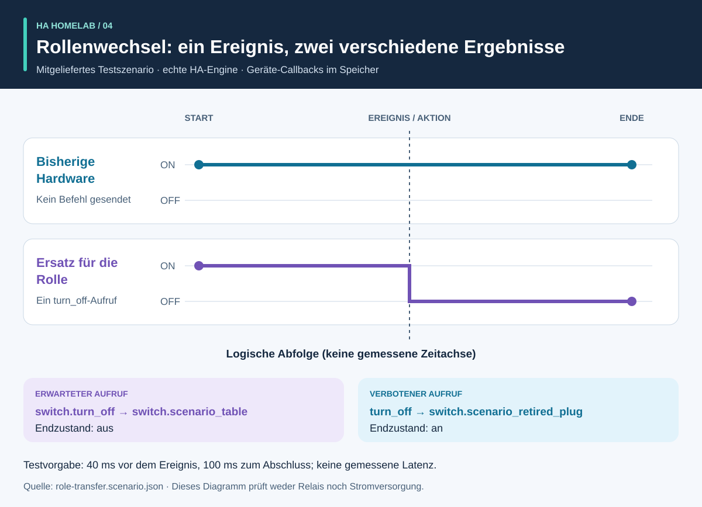

# Ablauf und Ergebnisse: ein visueller Rundgang

<!-- language-navigation:start -->
<p dir="ltr">
<a href="process-and-results.md" lang="en" dir="ltr">English</a> · <a href="process-and-results.ar.md" lang="ar" dir="rtl">العربية</a> · <a href="process-and-results.bn.md" lang="bn" dir="ltr">বাংলা</a> · <a href="process-and-results.cs.md" lang="cs" dir="ltr">Čeština</a> · <a href="process-and-results.de.md" lang="de" dir="ltr">Deutsch</a> · <a href="process-and-results.es.md" lang="es" dir="ltr">Español</a> · <a href="process-and-results.fa.md" lang="fa" dir="rtl">فارسی</a> · <a href="process-and-results.fr.md" lang="fr" dir="ltr">Français</a><br>
<a href="process-and-results.he.md" lang="he" dir="rtl">עברית</a> · <a href="process-and-results.hi.md" lang="hi" dir="ltr">हिन्दी</a> · <a href="process-and-results.id.md" lang="id" dir="ltr">Bahasa Indonesia</a> · <a href="process-and-results.it.md" lang="it" dir="ltr">Italiano</a> · <a href="process-and-results.ja.md" lang="ja" dir="ltr">日本語</a> · <a href="process-and-results.ko.md" lang="ko" dir="ltr">한국어</a> · <a href="process-and-results.nl.md" lang="nl" dir="ltr">Nederlands</a> · <a href="process-and-results.pl.md" lang="pl" dir="ltr">Polski</a><br>
<a href="process-and-results.pt.md" lang="pt" dir="ltr">Português</a> · <a href="process-and-results.ru.md" lang="ru" dir="ltr">Русский</a> · <a href="process-and-results.th.md" lang="th" dir="ltr">ไทย</a> · <a href="process-and-results.tr.md" lang="tr" dir="ltr">Türkçe</a> · <a href="process-and-results.uk.md" lang="uk" dir="ltr">Українська</a> · <a href="process-and-results.vi.md" lang="vi" dir="ltr">Tiếng Việt</a> · <a href="process-and-results.zh-Hans.md" lang="zh-Hans" dir="ltr">简体中文</a> · <a href="process-and-results.zh-Hant.md" lang="zh-Hant" dir="ltr">繁體中文</a>
</p>
<!-- language-navigation:end -->

[Projektübersicht](README.de.md)

Ein nützliches Ergebnis beantwortet eine konkrete Frage und bewahrt die Nachweise, auf denen die Antwort beruht. Die vier Werkzeuge arbeiten unabhängig: Eine prüfende Person wählt die relevanten Prüfungen und übernimmt ihre Ergebnisse in eine Änderung. Die folgenden Pfeile beschreiben diesen Review-Ablauf, keine implementierte automatische Pipeline.


## 1. Änderung festlegen und Eingaben sammeln

Unterscheide bei einem Gerätetausch die **Rolle** von der **physischen Hardware**. Die Rolle einer Lampe kann zu einer anderen Steckdose wechseln, während die bisherige Steckdose etwas anderes versorgt. Halte fest, welche Verweise der Rolle folgen, welche der Hardware folgen und welche entfallen sollen. Übergib Entity Migrations das Migrationsmanifest, die Momentaufnahme der Entitäten und die unterstützten Quelldateien.

Für Messungen werden der physische Messumfang jedes Zählers, die Quellenkennung, Einheiten und Zeitstempel benötigt. Für Automation beschreibst du einen synthetischen Ausgangszustand, eine Ereignisfolge und ausdrückliche Erwartungen. Für Sprache stellst du Beobachtungen zu Absicht, Aktion und hörbarer Antwort bereit. Die Werkzeuge akzeptieren unterschiedliche Eingaben; dieser Ablauf benötigt keinen gemeinsamen Export aus einem laufenden Haushalt.

## 2. Ausgabe und Grenzen lesen


Dies sind erklärende Zusammenfassungen mitgelieferter Beispiele, **keine Screenshots unbearbeiteter Berichte**:

- **Migration:** Das Beispiel zum Domänenwechsel schlägt `light.table` → `switch.table` und die entsprechende Dienständerung vor. Prüfe jede vorgeschlagene Änderung, ihren Fingerprint und alle blockierenden Konflikte. Der Plan wendet sich nicht selbst an.
- **Messung:** Das gültige Beispiel mit drei Zählern hat getrennte, aktuelle Quellen mit den Werten `700 W`, `0.02 kW` und `0 W`. Nach Umrechnung des zweiten Werts ergibt sich `700 + 20 + 0 = 720 W`. Dieses Ergebnis stützt sich auf drei Zähler; ein einzelner Leisten-Gesamtzähler liefert diese drei Beobachtungen je Steckdose nicht. Beispiele mit gemeinsamem Messumfang und doppelten Quellen zeigen absichtlich ungültige Annahmen auf.
- **Automation:** Das Rollenwechsel-Testbeispiel erwartet einen Aufruf für die Ersatzentität und keinen Aufruf für die bisher verwendete Hardware. Sowohl die Aufrufliste als auch die Endzustände sind wichtig: Ein passender Endzustand allein könnte einen unbeabsichtigten zusätzlichen Befehl verbergen.
- **Sprache:** Dem unvollständigen Beispiel fehlen ausreichende Hörnachweise. Es endet mit Code `3`, auch wenn ein API-Schritt abgeschlossen ist. Das bedeutet, dass weitere Nachweise nötig sind, nicht dass beim Zuhörer sicher Stille herrschte.

Quellen: [Migrationsbeispiel](https://github.com/ha-homelab/ha-entity-migrations/tree/main/examples/domain-change), [Eingabe mit drei Zählern](https://github.com/ha-homelab/ha-meter-contracts/blob/main/examples/valid-three-meters.json), [Spracheingabe](https://github.com/ha-homelab/assist-scenario-lab/blob/main/examples/synthetic-incomplete.json). Die genauen Installations- und Ausführungsbefehle stehen im [Ablauf der Übersicht](README.de.md#ein-konkreter-ablauf-von-der-migration-zum-test).

## 3. Zustandsfolge untersuchen



In [role-transfer.scenario.json](role-transfer.scenario.json) starten beide synthetischen Schalter mit `on`. Das Ereignis `scenario_table_off` löst `switch.turn_off` für `switch.scenario_table` aus. Erwartet werden `off` für den Ersatz und `on` für `switch.scenario_retired_plug`. Das Ausschalten des bisherigen Schalters ist ausdrücklich verboten.

Das Diagramm verwendet **logische Schritte**, keine gemessene Zeitskala. Die Testdaten geben 40 ms Wartezeit vor dem Ereignis und 100 ms zum Abschluss vor. Dies sind Testeingaben, keine beobachtete Relaislatenz und keine Garantie, dass ein Ereignis innerhalb von 40 ms abgeschlossen wird. Der Test dieses Beispiels in der echten HA-Laufzeitumgebung bestand im [dokumentierten Linux-Lauf](https://github.com/ha-homelab/ha-scenario-tests/actions/runs/38843681199). Die Geräte-Callbacks laufen weiterhin im Speicher.

## 4. Verstehen, was getestet wurde


Das Diagramm liest [validation-evidence.json](validation-evidence.json). Jeder Datensatz verlinkt den ursprünglichen GitHub-Actions-Lauf. Es handelt sich um einen datierten Stand, kein Live-CI-Badge. Die Balkenlänge zählt bestandene Tests; sie ist **weder Abdeckungsprozentsatz noch Zuverlässigkeit, Geschwindigkeit oder Projektrangliste**. Die Testsuiten haben unterschiedliche Geltungsbereiche.

Entity Migrations überspringt unter Linux einen Test für Dateisysteme ohne Unterscheidung von Groß- und Kleinschreibung; er wurde lokal unter macOS geprüft. Scenario Tests enthält in seinen insgesamt 54 Tests sieben Laufzeitfälle mit echtem HA. Der dokumentierte Fehler beim nativen Beenden unter macOS bleibt eine separate Einschränkung; bestandene Linux-Tests beseitigen ihn nicht.

## 5. Entscheiden, ob es weitergehen kann

Bewahre die geprüften Eingaben, Werkzeugversionen, Berichte und offenen Befunde zusammen mit der Änderung auf. Kläre nicht unterstützte Verweise, widersprüchliche Messquellen, fehlgeschlagene Prüfbedingungen und fehlende Beobachtungen, bevor du das Ergebnis für den vorgesehenen Einsatz als ausreichend wertest. Nutze den dokumentierten Status- und Exit-Code-Vertrag jedes Werkzeugs.

Bereitstellung und physische Abnahme bleiben getrennt. Prüfe je nach Anwendungsfall das tatsächliche Gerät, die Funkübertragung, das Relaisverhalten, die angeschlossene Last, den Quellenzeitstempel und die hörbare Ausgabe. Ein bestandener synthetischer Test bestätigt das geprüfte Softwareverhalten, nicht die erfolgreiche Stromversorgung oder eine vollständige Haushaltskonfiguration.

## Illustrationen reproduzieren oder übersetzen

Führe in diesem Verzeichnis Folgendes aus:

```sh
python3 render_architecture.py
python3 -m unittest discover -s . -p 'test_*.py'
```

Der Generator erzeugt vier SVGs je Sprache im gemeinsamen [Sprachverzeichnis](../languages.json). Er benötigt nur die Python-Standardbibliothek, bindet keine entfernten Ressourcen ein und versieht jedes Bild mit einem barrierefreien Titel und einer Beschreibung. Dieselbe Farbe kennzeichnet ein Werkzeug über alle Illustrationen hinweg; Beschriftungen benennen außerdem jede Datenreihe. Aktualisiere bei einem neuen Nachweisstand die Quelldaten und die zugehörigen Erklärungen gemeinsam und behalte die Links zu den dokumentierten Läufen bei. Alle Illustrationen sind eigene Werke und stehen unter [MIT](LICENSE).
