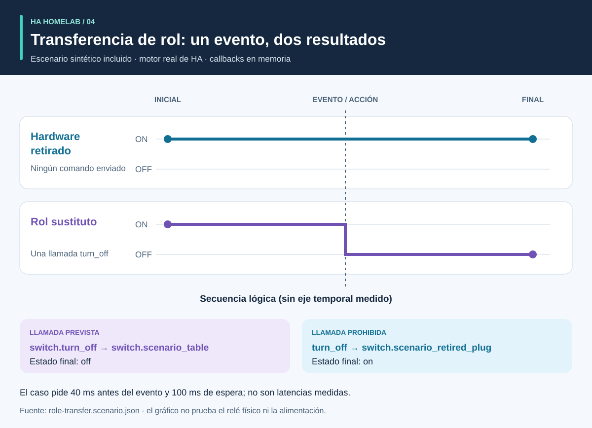

# Proceso y resultados: un recorrido visual

<!-- language-navigation:start -->
<p dir="ltr">
<a href="process-and-results.md" lang="en" dir="ltr">English</a> · <a href="process-and-results.ar.md" lang="ar" dir="rtl">العربية</a> · <a href="process-and-results.bn.md" lang="bn" dir="ltr">বাংলা</a> · <a href="process-and-results.cs.md" lang="cs" dir="ltr">Čeština</a> · <a href="process-and-results.de.md" lang="de" dir="ltr">Deutsch</a> · <a href="process-and-results.es.md" lang="es" dir="ltr">Español</a> · <a href="process-and-results.fa.md" lang="fa" dir="rtl">فارسی</a> · <a href="process-and-results.fr.md" lang="fr" dir="ltr">Français</a><br>
<a href="process-and-results.he.md" lang="he" dir="rtl">עברית</a> · <a href="process-and-results.hi.md" lang="hi" dir="ltr">हिन्दी</a> · <a href="process-and-results.id.md" lang="id" dir="ltr">Bahasa Indonesia</a> · <a href="process-and-results.it.md" lang="it" dir="ltr">Italiano</a> · <a href="process-and-results.ja.md" lang="ja" dir="ltr">日本語</a> · <a href="process-and-results.ko.md" lang="ko" dir="ltr">한국어</a> · <a href="process-and-results.nl.md" lang="nl" dir="ltr">Nederlands</a> · <a href="process-and-results.pl.md" lang="pl" dir="ltr">Polski</a><br>
<a href="process-and-results.pt.md" lang="pt" dir="ltr">Português</a> · <a href="process-and-results.ru.md" lang="ru" dir="ltr">Русский</a> · <a href="process-and-results.th.md" lang="th" dir="ltr">ไทย</a> · <a href="process-and-results.tr.md" lang="tr" dir="ltr">Türkçe</a> · <a href="process-and-results.uk.md" lang="uk" dir="ltr">Українська</a> · <a href="process-and-results.vi.md" lang="vi" dir="ltr">Tiếng Việt</a> · <a href="process-and-results.zh-Hans.md" lang="zh-Hans" dir="ltr">简体中文</a> · <a href="process-and-results.zh-Hant.md" lang="zh-Hant" dir="ltr">繁體中文</a>
</p>
<!-- language-navigation:end -->

[Descripción de los proyectos](README.es.md)

Un resultado útil responde a una pregunta concreta y conserva las evidencias que sustentan la respuesta. Las cuatro herramientas trabajan de forma independiente: una persona revisora elige las comprobaciones pertinentes e incorpora sus resultados a un cambio. Las flechas siguientes describen ese proceso de revisión, no una canalización automática implementada.


## 1. Define el cambio y reúne las entradas

Al sustituir un dispositivo, distingue su **rol** del **hardware físico**. El rol de una lámpara puede pasar a otro enchufe mientras el enchufe antiguo empieza a alimentar otra cosa. Registra qué referencias siguen al rol, cuáles siguen al hardware y cuáles deben retirarse. Proporciona a Entity Migrations el manifiesto de migración, la instantánea de entidades y los archivos de origen compatibles.

Para las mediciones, proporciona el alcance físico de cada medidor, la identidad de la fuente, las unidades y la marca temporal. Para la automatización, describe un estado inicial sintético, una secuencia de eventos y expectativas explícitas. Para la voz, proporciona observaciones de la intención, la acción y la respuesta audible. Las herramientas aceptan entradas diferentes; este proceso no requiere una exportación compartida de un hogar en funcionamiento.

## 2. Lee la salida y sus límites


Son resúmenes explicativos de los ejemplos incluidos, **no capturas de informes sin procesar**:

- **Migración:** el ejemplo de cambio de dominio propone `light.table` → `switch.table` y el cambio de servicio correspondiente. Revisa cada modificación propuesta, su huella y cualquier conflicto bloqueante. El plan no se aplica por sí solo.
- **Medición:** el ejemplo válido de tres medidores tiene fuentes distintas y vigentes con valores `700 W`, `0.02 kW` y `0 W`. Al normalizar el segundo valor se obtiene `700 + 20 + 0 = 720 W`. Ese resultado se apoya en tres medidores; un único medidor de regleta no aporta esas tres observaciones por enchufe. Los ejemplos de alcance compartido y fuente duplicada revelan deliberadamente supuestos inválidos.
- **Automatización:** el caso de transferencia de rol espera una llamada a la entidad sustituta y ninguna al hardware retirado. Importan tanto la lista de llamadas como los estados finales: un estado final coincidente podría ocultar un comando adicional no deseado.
- **Voz:** el ejemplo incompleto carece de evidencias audibles suficientes. Sale con código `3`, aunque haya terminado una etapa de la API. Esto significa que se necesitan más evidencias, no que el oyente haya escuchado necesariamente silencio.

Fuentes: [ejemplo de migración](https://github.com/ha-homelab/ha-entity-migrations/tree/main/examples/domain-change), [entrada de tres medidores](https://github.com/ha-homelab/ha-meter-contracts/blob/main/examples/valid-three-meters.json), [entrada de voz](https://github.com/ha-homelab/assist-scenario-lab/blob/main/examples/synthetic-incomplete.json). Los comandos exactos de instalación y ejecución se encuentran en el [proceso de la descripción general](README.es.md#a-concrete-migration-to-test-workflow).

## 3. Examina la evolución del cambio



En [role-transfer.scenario.json](role-transfer.scenario.json), ambos interruptores sintéticos empiezan en `on`. El evento `scenario_table_off` provoca `switch.turn_off` para `switch.scenario_table`. El resultado esperado es `off` para el sustituto y `on` para `switch.scenario_retired_plug`. Apagar el interruptor retirado está prohibido explícitamente.

El gráfico usa **etapas lógicas**, no una escala temporal medida. El caso solicita una espera de 40 ms antes del evento y 100 ms para estabilizarse. Son entradas de prueba, no latencias observadas del relé ni una garantía de que el evento termine en 40 ms. La prueba de ejecución real de HA para este caso se superó en la [ejecución Linux registrada](https://github.com/ha-homelab/ha-scenario-tests/actions/runs/38843681199). Los callbacks de dispositivos siguen ejecutándose en memoria.

## 4. Entiende qué se ha probado


El gráfico lee [validation-evidence.json](validation-evidence.json). Cada registro enlaza su ejecución original de GitHub Actions. Es una instantánea fechada, no una insignia de CI en directo. La longitud de la barra cuenta pruebas superadas; **no es un porcentaje de cobertura, fiabilidad, velocidad ni una clasificación de los proyectos**. Las suites tienen alcances diferentes.

Entity Migrations omite una prueba en Linux del comportamiento de sistemas de archivos que no distinguen mayúsculas de minúsculas, comprobada localmente en macOS. Scenario Tests incluye siete casos de ejecución real de HA en su total de 54. El fallo documentado de finalización nativa en macOS sigue siendo una limitación independiente; superar las pruebas Linux no lo elimina.

## 5. Decide si continuar

Conserva las entradas revisadas, las versiones de las herramientas, los informes y los hallazgos pendientes junto al cambio. Resuelve las referencias no compatibles, las fuentes de medición en conflicto, las aserciones fallidas y las observaciones ausentes antes de interpretar el resultado como suficiente para el uso previsto. Utiliza el contrato documentado de estados y códigos de salida de cada herramienta.

El despliegue y la aceptación física siguen siendo pasos separados. Verifica el dispositivo real, la entrega por radio, el comportamiento del relé, la carga conectada, la marca temporal de la fuente y la salida audible según corresponda. Superar una prueba sintética confirma el comportamiento de software probado, no el suministro efectivo de energía ni toda la configuración de un hogar.

<a id="reproduce-or-translate-the-illustrations"></a>
## Reproduce o traduce las ilustraciones

Ejecuta desde este directorio:

```sh
python3 render_architecture.py
python3 -m unittest discover -s . -p 'test_*.py'
```

El generador produce cuatro SVG por cada idioma compatible. Solo necesita la biblioteca estándar de Python, no incorpora recursos remotos e incluye un título y una descripción accesibles en cada imagen. El mismo color identifica una herramienta en todas las ilustraciones; las etiquetas también identifican cada serie. Para una nueva instantánea de evidencias, actualiza conjuntamente los registros de origen y las explicaciones, conservando los enlaces a las ejecuciones registradas. Todas las ilustraciones son originales y están cubiertas por la licencia [MIT](LICENSE).
