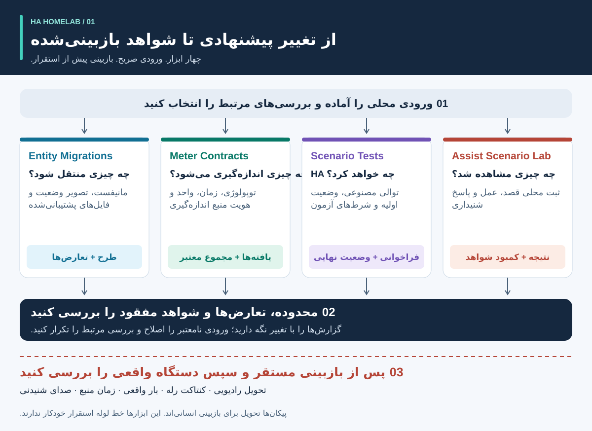
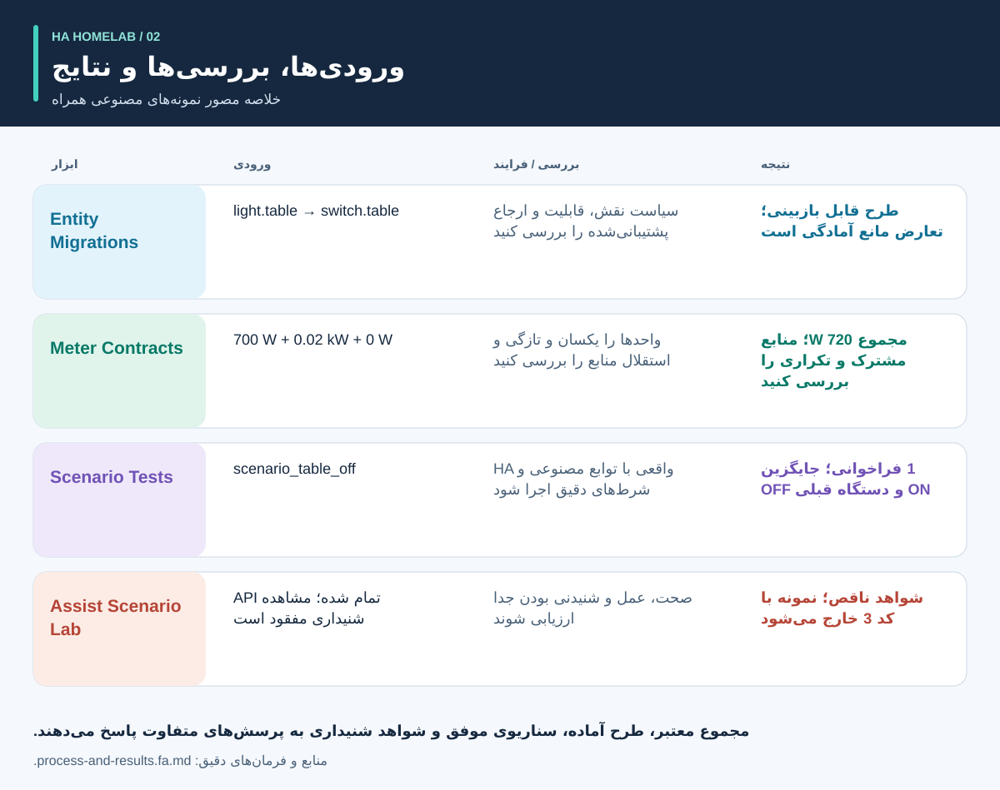
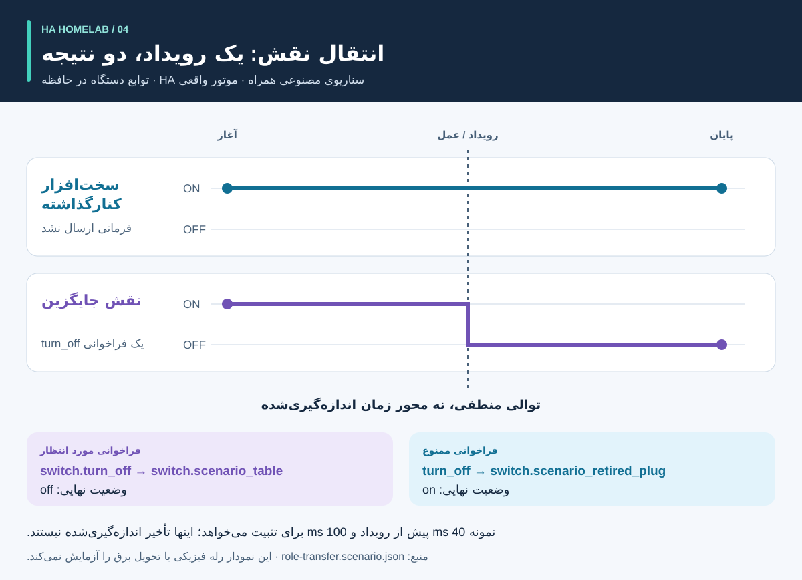
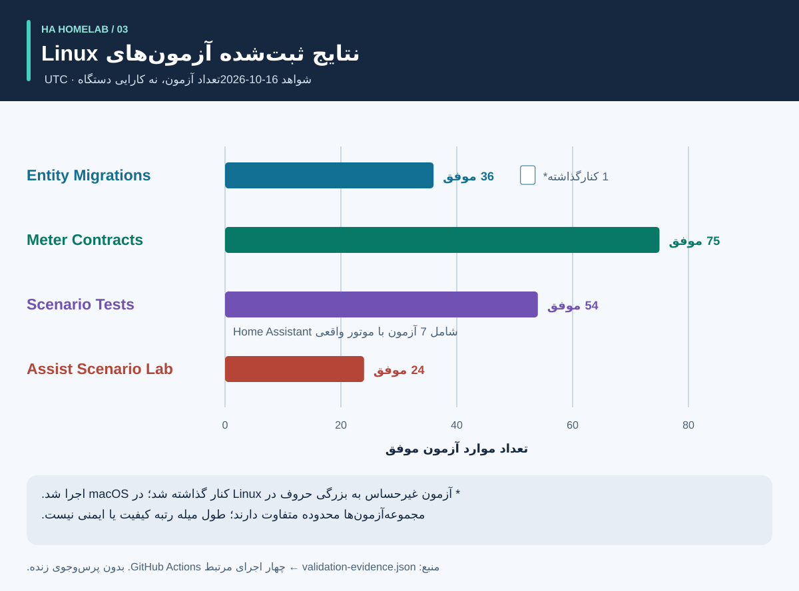

<div dir="rtl">

# فرایند و نتایج: راهنمای تصویری

<!-- language-navigation:start -->
<p dir="ltr">
<a href="process-and-results.md" lang="en" dir="ltr">English</a> · <a href="process-and-results.ar.md" lang="ar" dir="rtl">العربية</a> · <a href="process-and-results.bn.md" lang="bn" dir="ltr">বাংলা</a> · <a href="process-and-results.cs.md" lang="cs" dir="ltr">Čeština</a> · <a href="process-and-results.de.md" lang="de" dir="ltr">Deutsch</a> · <a href="process-and-results.es.md" lang="es" dir="ltr">Español</a> · <a href="process-and-results.fa.md" lang="fa" dir="rtl">فارسی</a> · <a href="process-and-results.fr.md" lang="fr" dir="ltr">Français</a><br>
<a href="process-and-results.he.md" lang="he" dir="rtl">עברית</a> · <a href="process-and-results.hi.md" lang="hi" dir="ltr">हिन्दी</a> · <a href="process-and-results.id.md" lang="id" dir="ltr">Bahasa Indonesia</a> · <a href="process-and-results.it.md" lang="it" dir="ltr">Italiano</a> · <a href="process-and-results.ja.md" lang="ja" dir="ltr">日本語</a> · <a href="process-and-results.ko.md" lang="ko" dir="ltr">한국어</a> · <a href="process-and-results.nl.md" lang="nl" dir="ltr">Nederlands</a> · <a href="process-and-results.pl.md" lang="pl" dir="ltr">Polski</a><br>
<a href="process-and-results.pt.md" lang="pt" dir="ltr">Português</a> · <a href="process-and-results.ru.md" lang="ru" dir="ltr">Русский</a> · <a href="process-and-results.th.md" lang="th" dir="ltr">ไทย</a> · <a href="process-and-results.tr.md" lang="tr" dir="ltr">Türkçe</a> · <a href="process-and-results.uk.md" lang="uk" dir="ltr">Українська</a> · <a href="process-and-results.vi.md" lang="vi" dir="ltr">Tiếng Việt</a> · <a href="process-and-results.zh-Hans.md" lang="zh-Hans" dir="ltr">简体中文</a> · <a href="process-and-results.zh-Hant.md" lang="zh-Hant" dir="ltr">繁體中文</a>
</p>
<!-- language-navigation:end -->

[معرفی پروژه‌ها](README.fa.md)

نتیجه مفید به پرسشی مشخص پاسخ می‌دهد و شواهد آن پاسخ را نگه می‌دارد. چهار ابزار مستقل کار می‌کنند: بازبین بررسی‌های مناسب را انتخاب می‌کند و نتایج آنها را همراه تغییر نگه می‌دارد. پیکان‌های زیر این فرایند بازبینی را نشان می‌دهند، نه یک خط لوله خودکار پیاده‌شده.



## 1. تغییر را تعریف و ورودی‌ها را جمع‌آوری کنید

برای تعویض دستگاه، **نقش** را از **سخت‌افزار فیزیکی** جدا کنید. نقش چراغ ممکن است به پریز دیگری منتقل شود، در حالی که پریز قبلی وسیله دیگری را تغذیه می‌کند. مشخص کنید کدام ارجاع‌ها همراه نقش منتقل می‌شوند، کدام همراه سخت‌افزار می‌مانند و کدام باید کنار گذاشته شوند. مانیفست مهاجرت، تصویر وضعیت موجودیت‌ها و فایل‌های منبع پشتیبانی‌شده را به Entity Migrations بدهید.

برای اندازه‌گیری، محدوده فیزیکی هر کنتور، هویت منبع، واحدها و زمان ثبت را ارائه کنید. برای اتوماسیون، وضعیت اولیه مصنوعی، توالی رویدادها و انتظارات صریح را بنویسید. برای صدا، مشاهدات مربوط به قصد، عمل و پاسخ شنیداری را فراهم کنید. ورودی‌های ابزارها متفاوت‌اند؛ این فرایند به یک خروجی مشترک از خانه در حال کار نیاز ندارد.

## 2. خروجی و محدودیت‌های آن را بخوانید



اینها توضیح خلاصه نمونه‌های همراه هستند، **نه تصویر گزارش‌های خام**:

- **مهاجرت:** نمونه تغییر دامنه، `light.table` → `switch.table` و تغییر متناظر سرویس را پیشنهاد می‌کند. هر ویرایش، اثرانگشت فایل و تعارض مسدودکننده را بررسی کنید. طرح خودش اجرا نمی‌شود.
- **اندازه‌گیری:** نمونه معتبر سه کنتور، منابع متمایز و تازه با مقادیر `700 W`، `0.02 kW` و `0 W` دارد. یکسان‌سازی واحد مقدار دوم، `700 + 20 + 0 = 720 W` را می‌دهد. سه کنتور پشتوانه این نتیجه‌اند؛ یک کنتور کل چندراهی این سه مشاهده مستقل برای خروجی‌ها را فراهم نمی‌کند. نمونه‌های محدوده مشترک و منبع تکراری عمداً فرض‌های نادرست را آشکار می‌کنند.
- **اتوماسیون:** نمونه انتقال نقش، یک فراخوانی برای موجودیت جایگزین و هیچ فراخوانی برای سخت‌افزار کنارگذاشته‌شده انتظار دارد. هم فهرست فراخوانی‌ها و هم وضعیت نهایی اهمیت دارند؛ یک وضعیت نهایی درست ممکن است فرمان اضافی ناخواسته را پنهان کند.
- **صدا:** نمونه ناقص، شواهد کافی برای شنیده‌شدن ندارد. حتی اگر مرحله API تمام شده باشد، با کد `3` خارج می‌شود. این یعنی شواهد بیشتری لازم است، نه اینکه شنونده حتماً سکوت شنیده است.

منابع: [نمونه مهاجرت](https://github.com/ha-homelab/ha-entity-migrations/tree/main/examples/domain-change)، [ورودی سه کنتور](https://github.com/ha-homelab/ha-meter-contracts/blob/main/examples/valid-three-meters.json)، [ورودی صدا](https://github.com/ha-homelab/assist-scenario-lab/blob/main/examples/synthetic-incomplete.json). فرمان‌های دقیق نصب و اجرا در [راهنمای عملی](README.fa.md#a-concrete-migration-to-test-workflow) آمده‌اند.

## 3. تغییر را در طول توالی بررسی کنید



در [role-transfer.scenario.json](role-transfer.scenario.json)، هر دو کلید مصنوعی با وضعیت `on` شروع می‌کنند. رویداد `scenario_table_off` باعث `switch.turn_off` برای `switch.scenario_table` می‌شود. نتیجه مورد انتظار برای جایگزین `off` و برای `switch.scenario_retired_plug` برابر `on` است. خاموش کردن کلید قبلی صریحاً ممنوع است.

نمودار **مراحل منطقی** دارد، نه مقیاس زمان اندازه‌گیری‌شده. نمونه، 40 ms انتظار پیش از رویداد و 100 ms برای تثبیت درخواست می‌کند. اینها ورودی آزمون‌اند، نه تأخیر مشاهده‌شده رله یا تضمین تکمیل رویداد در 40 ms. آزمون این نمونه با موتور واقعی HA در [اجرای ثبت‌شده Linux](https://github.com/ha-homelab/ha-scenario-tests/actions/runs/38843681199) موفق بود. توابع callback دستگاه‌ها همچنان در حافظه اجرا می‌شوند.

## 4. بدانید چه چیزی آزموده شده است



نمودار [validation-evidence.json](validation-evidence.json) را می‌خواند. هر رکورد به اجرای اصلی GitHub Actions لینک دارد. این یک تصویر تاریخ‌دار است، نه نشان زنده CI. طول میله تعداد آزمون‌های موفق است؛ **درصد پوشش، قابلیت اطمینان، سرعت یا رتبه‌بندی پروژه‌ها نیست**. محدوده مجموعه‌آزمون‌ها متفاوت است.

Entity Migrations یک آزمون رفتار فایل‌سیستم غیرحساس به بزرگی حروف را در Linux کنار می‌گذارد که محلی در macOS بررسی شده است. Scenario Tests از مجموع 54 آزمون، هفت مورد با موتور واقعی HA دارد. خطای مستند پایان اجرای بومی در macOS همچنان محدودیتی جداگانه است؛ موفقیت Linux آن را رفع نمی‌کند.

## 5. درباره ادامه کار تصمیم بگیرید

ورودی‌های بازبینی‌شده، نسخه ابزارها، گزارش‌ها و یافته‌های حل‌نشده را همراه تغییر نگه دارید. پیش از کافی دانستن نتیجه برای کاربرد مورد نظر، ارجاع‌های پشتیبانی‌نشده، منابع متعارض، شرط‌های آزمون ناموفق و مشاهدات مفقود را برطرف کنید. قرارداد وضعیت و کد خروج مستند هر ابزار را رعایت کنید.

استقرار و پذیرش فیزیکی جدا می‌مانند. دستگاه واقعی، تحویل رادیویی، رفتار رله، بار متصل، زمان منبع و خروجی شنیداری را در صورت ارتباط بررسی کنید. موفقیت مصنوعی، رفتار نرم‌افزاری آزموده‌شده را تأیید می‌کند، نه رسیدن برق به دستگاه یا کامل بودن پیکربندی خانه.

<a id="reproduce-or-translate-the-illustrations"></a>

## تصاویر را بازتولید یا ترجمه کنید

از این پوشه اجرا کنید:

<div dir="ltr">

```sh
python3 render_architecture.py
python3 -m unittest discover -s . -p 'test_*.py'
```

</div>

مولد برای هر زبان در [فهرست مشترک زبان‌ها](../languages.json)، چهار SVG می‌سازد. فقط کتابخانه استاندارد Python لازم است؛ هیچ منبع راه دوری در تصاویر قرار نمی‌گیرد و هر تصویر عنوان و شرحی برای دسترس‌پذیری دارد. رنگ یکسان، یک ابزار را در همه تصاویر مشخص می‌کند؛ برچسب‌ها نیز هر سری را معرفی می‌کنند. برای تصویر جدیدی از شواهد، رکوردهای منبع و توضیحات را با هم به‌روز کنید و لینک اجرای ثبت‌شده را نگه دارید. همه تصاویر اصیل‌اند و تحت مجوز [MIT](LICENSE) قرار دارند.

</div>
