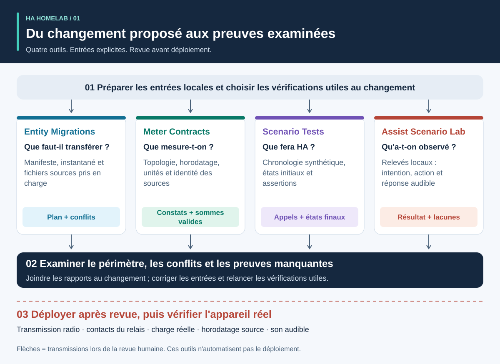
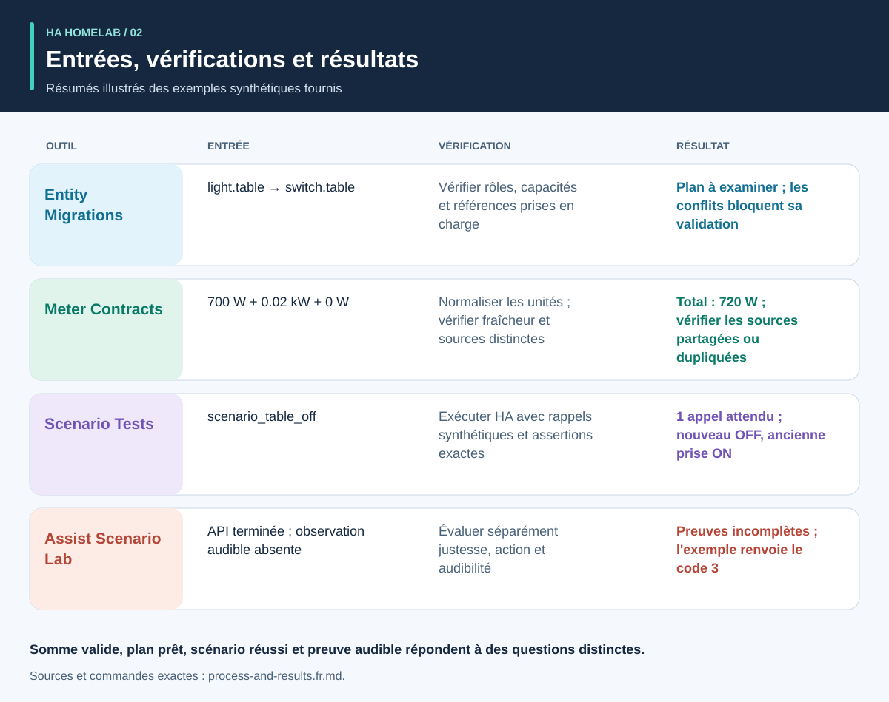
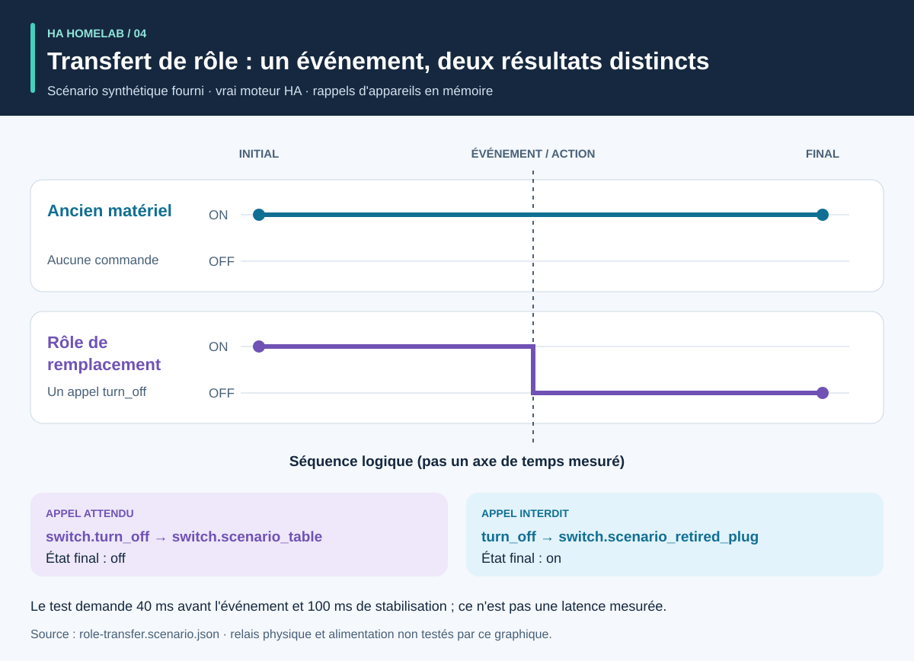
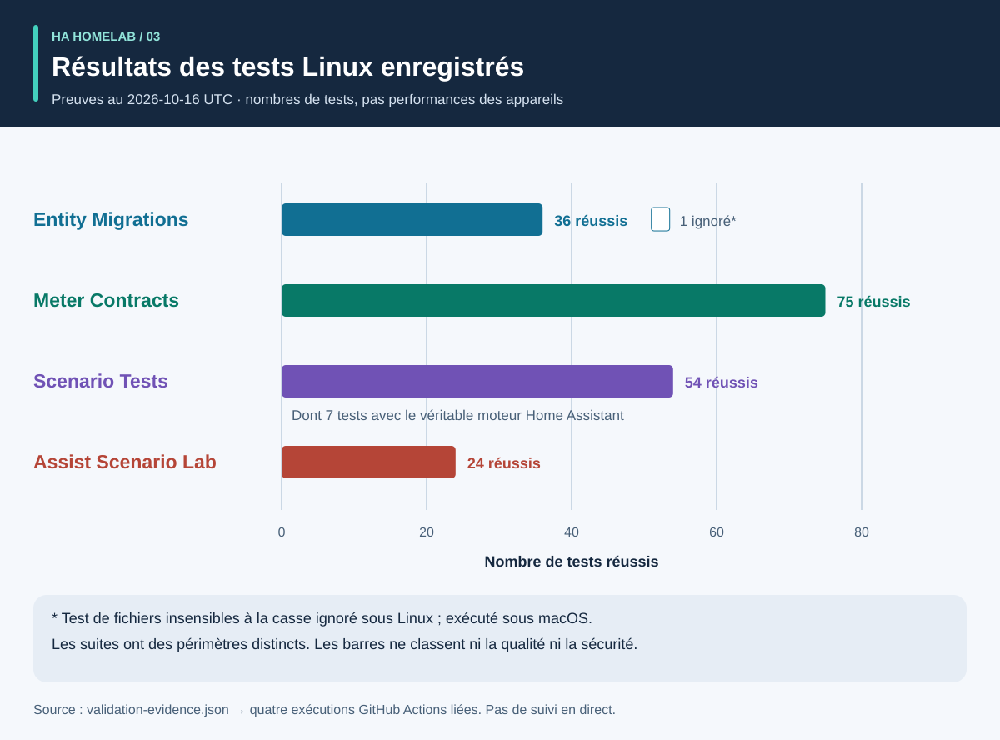

# Processus et résultats : un parcours visuel

<!-- language-navigation:start -->
<p dir="ltr">
<a href="process-and-results.md" lang="en" dir="ltr">English</a> · <a href="process-and-results.ar.md" lang="ar" dir="rtl">العربية</a> · <a href="process-and-results.bn.md" lang="bn" dir="ltr">বাংলা</a> · <a href="process-and-results.cs.md" lang="cs" dir="ltr">Čeština</a> · <a href="process-and-results.de.md" lang="de" dir="ltr">Deutsch</a> · <a href="process-and-results.es.md" lang="es" dir="ltr">Español</a> · <a href="process-and-results.fa.md" lang="fa" dir="rtl">فارسی</a> · <a href="process-and-results.fr.md" lang="fr" dir="ltr">Français</a><br>
<a href="process-and-results.he.md" lang="he" dir="rtl">עברית</a> · <a href="process-and-results.hi.md" lang="hi" dir="ltr">हिन्दी</a> · <a href="process-and-results.id.md" lang="id" dir="ltr">Bahasa Indonesia</a> · <a href="process-and-results.it.md" lang="it" dir="ltr">Italiano</a> · <a href="process-and-results.ja.md" lang="ja" dir="ltr">日本語</a> · <a href="process-and-results.ko.md" lang="ko" dir="ltr">한국어</a> · <a href="process-and-results.nl.md" lang="nl" dir="ltr">Nederlands</a> · <a href="process-and-results.pl.md" lang="pl" dir="ltr">Polski</a><br>
<a href="process-and-results.pt.md" lang="pt" dir="ltr">Português</a> · <a href="process-and-results.ru.md" lang="ru" dir="ltr">Русский</a> · <a href="process-and-results.th.md" lang="th" dir="ltr">ไทย</a> · <a href="process-and-results.tr.md" lang="tr" dir="ltr">Türkçe</a> · <a href="process-and-results.uk.md" lang="uk" dir="ltr">Українська</a> · <a href="process-and-results.vi.md" lang="vi" dir="ltr">Tiếng Việt</a> · <a href="process-and-results.zh-Hans.md" lang="zh-Hans" dir="ltr">简体中文</a> · <a href="process-and-results.zh-Hant.md" lang="zh-Hant" dir="ltr">繁體中文</a>
</p>
<!-- language-navigation:end -->

[Présentation des projets](README.fr.md)

Un résultat utile répond à une question précise et conserve les preuves qui étayent la réponse. Les quatre outils fonctionnent indépendamment : une personne choisit les vérifications pertinentes et joint leurs résultats au changement examiné. Les flèches ci-dessous décrivent cette revue, pas un pipeline automatique implémenté.



## 1. Définir le changement et réunir les entrées

Pour remplacer un appareil, distinguez le **rôle** du **matériel physique**. Le rôle d'une lampe peut passer à une autre prise tandis que l'ancienne commence à alimenter autre chose. Consignez les références qui suivent le rôle, celles qui suivent le matériel et celles qui doivent être retirées. Fournissez le manifeste de migration, l'instantané des entités et les fichiers sources pris en charge à Entity Migrations.

Pour les mesures, fournissez le périmètre physique, l'identité de la source, les unités et l'horodatage de chaque compteur. Pour l'automatisation, décrivez un état initial synthétique, une séquence d'événements et des attentes explicites. Pour la voix, fournissez des observations de l'intention, de l'action et de la réponse audible. Les outils acceptent des entrées différentes ; ce processus n'exige aucun export commun d'un foyer en activité.

## 2. Lire la sortie et ses limites



Il s'agit de résumés explicatifs des exemples fournis, **pas de captures de rapports bruts** :

- **Migration :** l'exemple de changement de domaine propose `light.table` → `switch.table` et le changement de service correspondant. Examinez chaque modification proposée, son empreinte et tout conflit bloquant. Le plan ne s'applique pas lui-même.
- **Mesures :** l'exemple valide à trois compteurs utilise des sources distinctes et récentes, avec les valeurs `700 W`, `0.02 kW` et `0 W`. La normalisation de la deuxième valeur donne `700 + 20 + 0 = 720 W`. Ce résultat repose sur trois compteurs ; un seul compteur de multiprise ne fournit pas ces trois observations par prise. Les exemples de périmètre partagé et de source dupliquée révèlent volontairement des hypothèses invalides.
- **Automatisation :** le jeu de test de transfert de rôle attend un appel à l'entité de remplacement et aucun au matériel retiré de ce rôle. La liste des appels et les états finaux comptent tous les deux : un état final correct pourrait, à lui seul, masquer une commande supplémentaire indésirable.
- **Voix :** l'exemple incomplet ne contient pas assez de preuves audibles. Il se termine avec le code `3`, même si une étape API est achevée. Cela signifie que davantage de preuves sont nécessaires, pas que l'auditeur a forcément entendu du silence.

Sources : [exemple de migration](https://github.com/ha-homelab/ha-entity-migrations/tree/main/examples/domain-change), [entrée à trois compteurs](https://github.com/ha-homelab/ha-meter-contracts/blob/main/examples/valid-three-meters.json), [entrée vocale](https://github.com/ha-homelab/assist-scenario-lab/blob/main/examples/synthetic-incomplete.json). Les commandes exactes d'installation et d'exécution figurent dans le [processus détaillé de l'aperçu](README.fr.md#a-concrete-migration-to-test-workflow).

## 3. Examiner l'évolution du changement



Dans [role-transfer.scenario.json](role-transfer.scenario.json), les deux interrupteurs synthétiques commencent à `on`. L'événement `scenario_table_off` provoque `switch.turn_off` pour `switch.scenario_table`. Le résultat attendu est `off` pour le remplacement et `on` pour `switch.scenario_retired_plug`. L'extinction de l'ancien interrupteur est explicitement interdite.

Le graphique utilise des **étapes logiques**, pas une échelle de temps mesurée. Le jeu de test demande une attente de 40 ms avant l'événement et de 100 ms pour la stabilisation. Ce sont des entrées de test, pas une latence de relais observée ni une garantie d'achèvement de l'événement en 40 ms. Le test de ce scénario dans le véritable moteur HA a réussi dans l'[exécution Linux enregistrée](https://github.com/ha-homelab/ha-scenario-tests/actions/runs/38843681199). Les fonctions de rappel des appareils restent exécutées en mémoire.

## 4. Comprendre ce qui a été testé



Le graphique lit [validation-evidence.json](validation-evidence.json). Chaque enregistrement renvoie à son exécution GitHub Actions d'origine. C'est un instantané daté, pas un badge CI en direct. La longueur d'une barre compte les tests réussis ; elle ne représente **ni un pourcentage de couverture, ni la fiabilité, ni la vitesse, ni un classement des projets**. Les suites ont des périmètres différents.

Entity Migrations ignore sous Linux un cas de système de fichiers insensible à la casse, vérifié localement sous macOS. Scenario Tests inclut sept cas dans le véritable environnement HA dans son total de 54. L'échec documenté du nettoyage final sous macOS natif reste une limite distincte ; des tests Linux réussis ne la suppriment pas.

## 5. Décider de la suite

Conservez avec le changement les entrées examinées, les versions des outils, les rapports et les constats non résolus. Résolvez les références non prises en charge, les sources de mesure en conflit, les assertions en échec et les observations manquantes avant de considérer le résultat suffisant pour l'usage prévu. Utilisez les contrats documentés de statut et de code de sortie de chaque outil.

Le déploiement et la réception physique restent distincts. Vérifiez, selon le cas, l'appareil réel, la transmission radio, le comportement du relais, la charge connectée, l'horodatage de la source et la sortie audible. Une réussite synthétique confirme le comportement logiciel testé, pas une alimentation électrique effective ni une configuration domestique complète.

<a id="reproduce-or-translate-the-illustrations"></a>

## Reproduire ou traduire les illustrations

Exécutez depuis ce répertoire :

```sh
python3 render_architecture.py
python3 -m unittest discover -s . -p 'test_*.py'
```

Le générateur produit quatre SVG par langue disponible. Il ne nécessite que la bibliothèque standard de Python, n'intègre aucune ressource distante et fournit un titre et une description accessibles pour chaque image. Une même couleur identifie un outil dans toutes les illustrations ; les libellés identifient également chaque série. Pour un nouvel instantané de preuves, mettez à jour ensemble les données sources et les explications, en conservant les liens vers les exécutions enregistrées. Toutes les illustrations sont originales et couvertes par la licence [MIT](LICENSE).
