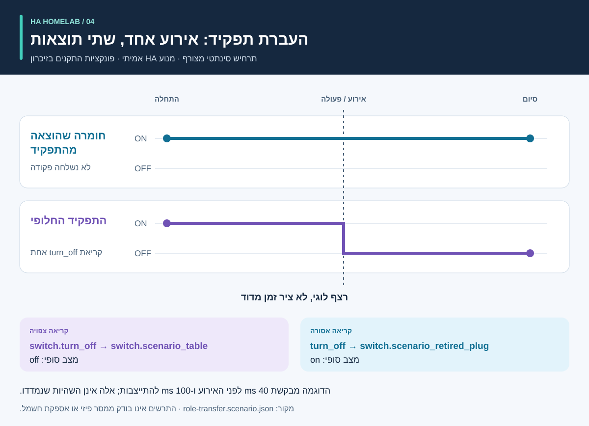

<div dir="rtl">

# תהליך ותוצאות: הדרכה חזותית

<!-- language-navigation:start -->
<p dir="ltr">
<a href="process-and-results.md" lang="en" dir="ltr">English</a> · <a href="process-and-results.ar.md" lang="ar" dir="rtl">العربية</a> · <a href="process-and-results.bn.md" lang="bn" dir="ltr">বাংলা</a> · <a href="process-and-results.cs.md" lang="cs" dir="ltr">Čeština</a> · <a href="process-and-results.de.md" lang="de" dir="ltr">Deutsch</a> · <a href="process-and-results.es.md" lang="es" dir="ltr">Español</a> · <a href="process-and-results.fa.md" lang="fa" dir="rtl">فارسی</a> · <a href="process-and-results.fr.md" lang="fr" dir="ltr">Français</a><br>
<a href="process-and-results.he.md" lang="he" dir="rtl">עברית</a> · <a href="process-and-results.hi.md" lang="hi" dir="ltr">हिन्दी</a> · <a href="process-and-results.id.md" lang="id" dir="ltr">Bahasa Indonesia</a> · <a href="process-and-results.it.md" lang="it" dir="ltr">Italiano</a> · <a href="process-and-results.ja.md" lang="ja" dir="ltr">日本語</a> · <a href="process-and-results.ko.md" lang="ko" dir="ltr">한국어</a> · <a href="process-and-results.nl.md" lang="nl" dir="ltr">Nederlands</a> · <a href="process-and-results.pl.md" lang="pl" dir="ltr">Polski</a><br>
<a href="process-and-results.pt.md" lang="pt" dir="ltr">Português</a> · <a href="process-and-results.ru.md" lang="ru" dir="ltr">Русский</a> · <a href="process-and-results.th.md" lang="th" dir="ltr">ไทย</a> · <a href="process-and-results.tr.md" lang="tr" dir="ltr">Türkçe</a> · <a href="process-and-results.uk.md" lang="uk" dir="ltr">Українська</a> · <a href="process-and-results.vi.md" lang="vi" dir="ltr">Tiếng Việt</a> · <a href="process-and-results.zh-Hans.md" lang="zh-Hans" dir="ltr">简体中文</a> · <a href="process-and-results.zh-Hant.md" lang="zh-Hant" dir="ltr">繁體中文</a>
</p>
<!-- language-navigation:end -->

[סקירת הפרויקטים](README.he.md)

תוצאה מועילה עונה על שאלה מסוימת ושומרת את הראיות שמאחורי התשובה. ארבעת הכלים פועלים בנפרד: הבודק בוחר בדיקות רלוונטיות ומצרף את תוצאותיהן לשינוי. החצים הבאים מתארים את תהליך הבדיקה, ולא צינור אוטומטי שכבר מומש.


## 1. הגדירו את השינוי ואספו את הקלטים

בעת החלפת התקן, הבדילו בין **התפקיד** לבין **החומרה הפיזית**. תפקיד של מנורה יכול לעבור לשקע אחר, בעוד השקע הישן מתחיל להזין דבר אחר. תעדו אילו הפניות עוקבות אחר התפקיד, אילו עוקבות אחר החומרה ואילו יש להוציא משימוש. ספקו ל-Entity Migrations את מניפסט ההסבה, תמונת מצב הישויות וקובצי המקור הנתמכים.

למדידה, ספקו את התחום הפיזי של כל מונה, זהות המקור, היחידות וחותמת הזמן. לאוטומציה, תארו מצב התחלתי סינתטי, רצף אירועים וציפיות מפורשות. לקול, ספקו תצפיות על הכוונה, הפעולה והתגובה שנשמעה. הכלים מקבלים קלטים שונים; התהליך אינו מחייב ייצוא משותף מבית פעיל.

## 2. קראו את הפלט ואת מגבלותיו


אלה סיכומים המסבירים את הדוגמאות המצורפות, **לא צילומי מסך של דוחות גולמיים**:

- **הסבה:** דוגמת שינוי התחום מציעה `light.table` → `switch.table` ואת שינוי השירות המקביל. בחנו כל עריכה מוצעת, את טביעת האצבע שלה וכל סתירה חוסמת. התוכנית אינה מחילה את עצמה.
- **מדידה:** בדוגמה התקינה של שלושה מונים יש מקורות נפרדים ועדכניים, עם ערכים `700 W`, ‏`0.02 kW` ו-`0 W`. המרת יחידות הערך השני נותנת `700 + 20 + 0 = 720 W`. שלושה מונים תומכים בתוצאה זו; מונה מפצל יחיד אינו מספק שלוש תצפיות נפרדות לכל שקע. דוגמאות התחום המשותף והמקור הכפול חושפות בכוונה הנחות שגויות.
- **אוטומציה:** דוגמת העברת התפקיד מצפה לקריאה אחת לישות החלופית ולאף קריאה לחומרה שהוצאה מהתפקיד. גם רשימת הקריאות וגם המצבים הסופיים חשובים: מצב סופי תואם לבדו עלול להסתיר פקודה נוספת שלא נועדה להישלח.
- **קול:** בדוגמה החלקית חסרות ראיות מספיקות לשמיעה. היא יוצאת עם קוד `3`, גם אם שלב API הושלם. פירוש הדבר שנדרשות ראיות נוספות, ולא שהמאזין בוודאות שמע שקט.

מקורות: [דוגמת הסבה](https://github.com/ha-homelab/ha-entity-migrations/tree/main/examples/domain-change), [קלט שלושה מונים](https://github.com/ha-homelab/ha-meter-contracts/blob/main/examples/valid-three-meters.json), [קלט קול](https://github.com/ha-homelab/assist-scenario-lab/blob/main/examples/synthetic-incomplete.json). פקודות ההתקנה וההרצה המדויקות נמצאות ב[הדרכה המעשית](README.he.md#a-concrete-migration-to-test-workflow).

## 3. בחנו את השינוי לאורך הרצף



ב-[role-transfer.scenario.json](role-transfer.scenario.json), שני המתגים הסינתטיים מתחילים במצב `on`. האירוע `scenario_table_off` גורם ל-`switch.turn_off` עבור `switch.scenario_table`. התוצאה הצפויה היא `off` לחלופה ו-`on` עבור `switch.scenario_retired_plug`. כיבוי המתג הקודם אסור במפורש.

התרשים משתמש ב**שלבים לוגיים**, לא בסולם זמן שנמדד. הדוגמה מבקשת המתנה של 40 ms לפני האירוע ו-100 ms להתייצבות. אלה קלטי בדיקה, לא השהיית ממסר שנצפתה או הבטחה להשלמת האירוע בתוך 40 ms. בדיקת הדוגמה עם מנוע HA האמיתי עברה ב[הרצת Linux המתועדת](https://github.com/ha-homelab/ha-scenario-tests/actions/runs/38843681199). פונקציות התגובה של ההתקנים עדיין רצות בזיכרון.

## 4. הבינו מה נבדק


התרשים קורא את [validation-evidence.json](validation-evidence.json). כל רשומה מקשרת להרצת GitHub Actions המקורית שלה. זוהי תמונת מצב מתוארכת, לא חיווי CI חי. אורך העמודה הוא מספר הבדיקות שעברו; הוא **אינו אחוז כיסוי, אמינות, מהירות או דירוג הפרויקטים**. תחומי חבילות הבדיקה שונים.

ב-Entity Migrations יש דילוג אחד ב-Linux לבדיקת מערכת קבצים שאינה רגישה לרישיות, שנבדקה מקומית ב-macOS. ‏Scenario Tests כולל שבעה מקרי ריצה אמיתיים של HA מתוך 54 בדיקות בסך הכול. כשל הסיום המקומי המתועד ב-macOS נשאר מגבלה נפרדת; הצלחה ב-Linux אינה מבטלת אותה.

## 5. החליטו אם להמשיך

שמרו עם השינוי את הקלטים שנבדקו, גרסאות הכלים, הדוחות והממצאים שלא נפתרו. פתרו הפניות לא נתמכות, מקורות מדידה סותרים, תנאי בדיקה שנכשלו ותצפיות חסרות לפני קביעה שהתוצאה מספיקה לשימוש המיועד. פעלו לפי חוזה המצבים וקודי היציאה המתועד של כל כלי.

פריסה וקבלה פיזית נשארות נפרדות. אמתו לפי הצורך את ההתקן בפועל, המסירה ברדיו, התנהגות הממסר, העומס המחובר, חותמת הזמן של המקור והפלט שנשמע. הצלחה סינתטית מאשרת את התנהגות התוכנה שנבדקה, לא אספקת חשמל מוצלחת או תצורת בית מלאה.

<a id="reproduce-or-translate-the-illustrations"></a>

## שחזרו או תרגמו את האיורים

הריצו מתוך תיקייה זו:

<div dir="ltr">

```sh
python3 render_architecture.py
python3 -m unittest discover -s . -p 'test_*.py'
```

</div>

המחולל מפיק ארבעה קובצי SVG לכל שפה שב[רשימת השפות המשותפת](../languages.json). הוא דורש רק את הספרייה הסטנדרטית של Python, אינו מטמיע משאבים מרוחקים וכולל כותרת ותיאור נגישים בכל תמונה. אותו צבע מזהה כלי בכל האיורים; גם התוויות מזהות כל סדרה. לתמונת ראיות חדשה, עדכנו יחד את רשומות המקור וההסברים, תוך שמירת הקישורים להרצות שתועדו. כל האיורים מקוריים ומכוסים ברישיון [MIT](LICENSE).

</div>
