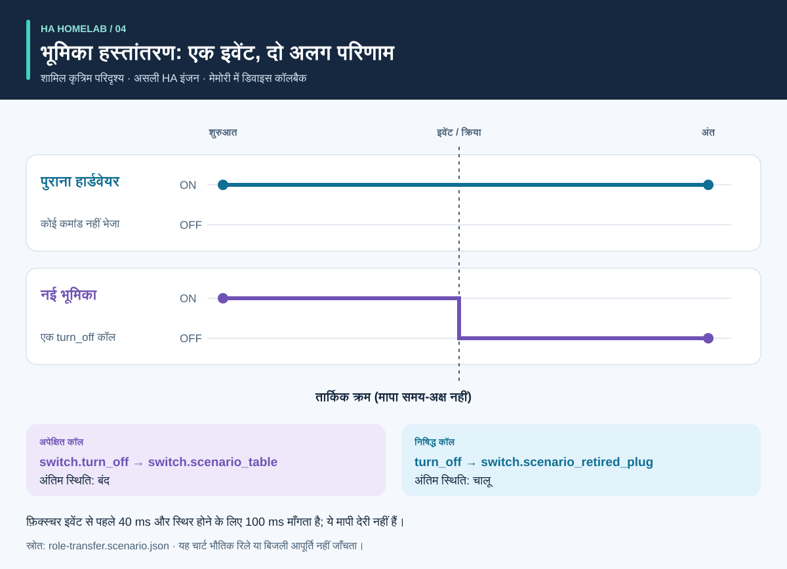

# प्रक्रिया और परिणाम: दृश्य मार्गदर्शिका

<!-- language-navigation:start -->
<p dir="ltr">
<a href="process-and-results.md" lang="en" dir="ltr">English</a> · <a href="process-and-results.ar.md" lang="ar" dir="rtl">العربية</a> · <a href="process-and-results.bn.md" lang="bn" dir="ltr">বাংলা</a> · <a href="process-and-results.cs.md" lang="cs" dir="ltr">Čeština</a> · <a href="process-and-results.de.md" lang="de" dir="ltr">Deutsch</a> · <a href="process-and-results.es.md" lang="es" dir="ltr">Español</a> · <a href="process-and-results.fa.md" lang="fa" dir="rtl">فارسی</a> · <a href="process-and-results.fr.md" lang="fr" dir="ltr">Français</a><br>
<a href="process-and-results.he.md" lang="he" dir="rtl">עברית</a> · <a href="process-and-results.hi.md" lang="hi" dir="ltr">हिन्दी</a> · <a href="process-and-results.id.md" lang="id" dir="ltr">Bahasa Indonesia</a> · <a href="process-and-results.it.md" lang="it" dir="ltr">Italiano</a> · <a href="process-and-results.ja.md" lang="ja" dir="ltr">日本語</a> · <a href="process-and-results.ko.md" lang="ko" dir="ltr">한국어</a> · <a href="process-and-results.nl.md" lang="nl" dir="ltr">Nederlands</a> · <a href="process-and-results.pl.md" lang="pl" dir="ltr">Polski</a><br>
<a href="process-and-results.pt.md" lang="pt" dir="ltr">Português</a> · <a href="process-and-results.ru.md" lang="ru" dir="ltr">Русский</a> · <a href="process-and-results.th.md" lang="th" dir="ltr">ไทย</a> · <a href="process-and-results.tr.md" lang="tr" dir="ltr">Türkçe</a> · <a href="process-and-results.uk.md" lang="uk" dir="ltr">Українська</a> · <a href="process-and-results.vi.md" lang="vi" dir="ltr">Tiếng Việt</a> · <a href="process-and-results.zh-Hans.md" lang="zh-Hans" dir="ltr">简体中文</a> · <a href="process-and-results.zh-Hant.md" lang="zh-Hant" dir="ltr">繁體中文</a>
</p>
<!-- language-navigation:end -->

[परियोजना परिचय](README.hi.md)

उपयोगी परिणाम किसी निश्चित सवाल का जवाब देता है और उत्तर के पीछे का प्रमाण बचाता है। चार उपकरण स्वतंत्र काम करते हैं: समीक्षक संबंधित जाँचें चुनता है और उनके परिणाम बदलाव में लाता है। नीचे के तीर समीक्षा प्रक्रिया बताते हैं, लागू स्वचालित पाइपलाइन नहीं।


## 1. बदलाव तय करें और इनपुट जुटाएँ

डिवाइस बदलते समय **भूमिका** और **भौतिक हार्डवेयर** अलग रखें। लैंप की भूमिका दूसरे सॉकेट में जा सकती है, जबकि पुराना कुछ और चलाने लगे। दर्ज करें कि कौन-से संदर्भ भूमिका के साथ चलते हैं, कौन हार्डवेयर के साथ और कौन हटने चाहिए। Entity Migrations को माइग्रेशन मैनिफ़ेस्ट, एंटिटी स्नैपशॉट और समर्थित स्रोत फ़ाइलें दें।

मापन के लिए हर मीटर का भौतिक दायरा, स्रोत पहचान, इकाइयाँ और टाइमस्टैम्प दें। स्वचालन के लिए कृत्रिम शुरुआती स्थिति, इवेंट क्रम और स्पष्ट अपेक्षाएँ बताएँ। आवाज़ के लिए मंशा, क्रिया और सुनाई देने वाले उत्तर के अवलोकन दें। उपकरण अलग इनपुट लेते हैं; इस कार्यप्रवाह को चालू घर का साझा निर्यात नहीं चाहिए।

## 2. आउटपुट और उसकी सीमाएँ पढ़ें


ये शामिल उदाहरणों के समझाने वाले सार हैं, **कच्ची रिपोर्ट के स्क्रीनशॉट नहीं**:

- **माइग्रेशन:** डोमेन-बदलाव उदाहरण `light.table` → `switch.table` और संबंधित सर्विस बदलाव प्रस्तावित करता है। हर संपादन, फ़िंगरप्रिंट और अवरोधक विरोध देखें। योजना अपने-आप लागू नहीं होती।
- **मापन:** सही तीन-मीटर उदाहरण में अलग, ताज़ा स्रोत हैं जिनके मान `700 W`, `0.02 kW` और `0 W` हैं। दूसरी इकाई बदलने से `700 + 20 + 0 = 720 W` मिलता है। यह परिणाम तीन मीटर से समर्थित है; अकेला पूरी पट्टी का मीटर ये तीन सॉकेट-विशिष्ट अवलोकन नहीं देता। साझा दायरे और दोहरे स्रोत के उदाहरण जानबूझकर गलत धारणाएँ उजागर करते हैं।
- **स्वचालन:** भूमिका-हस्तांतरण फ़िक्स्चर नई एंटिटी के लिए एक कॉल और पुराने हार्डवेयर के लिए कोई कॉल नहीं चाहता। कॉल सूची और अंतिम स्थिति दोनों महत्त्वपूर्ण हैं: केवल सही अंतिम स्थिति अवांछित अतिरिक्त कमांड छिपा सकती है।
- **आवाज़:** अधूरे उदाहरण में सुनाई देने का पर्याप्त प्रमाण नहीं है। API चरण पूरा हो जाने पर भी यह कोड `3` से समाप्त होता है। इसका अर्थ और प्रमाण चाहिए, न कि श्रोता ने निश्चित रूप से चुप्पी सुनी।

स्रोत: [माइग्रेशन उदाहरण](https://github.com/ha-homelab/ha-entity-migrations/tree/main/examples/domain-change), [तीन-मीटर इनपुट](https://github.com/ha-homelab/ha-meter-contracts/blob/main/examples/valid-three-meters.json), [वॉइस इनपुट](https://github.com/ha-homelab/assist-scenario-lab/blob/main/examples/synthetic-incomplete.json)। ठीक स्थापना और निष्पादन कमांड [परिचय के कार्यप्रवाह](README.hi.md#a-concrete-migration-to-test-workflow) में हैं।

## 3. समय के साथ बदलाव देखें



[role-transfer.scenario.json](role-transfer.scenario.json) में दोनों कृत्रिम स्विच `on` से शुरू होते हैं। `scenario_table_off` इवेंट, `switch.scenario_table` के लिए `switch.turn_off` चलाता है। अपेक्षित परिणाम नए के लिए `off` और `switch.scenario_retired_plug` के लिए `on` है। पुराने स्विच को बंद करना स्पष्ट रूप से निषिद्ध है।

चार्ट **तार्किक चरण** दिखाता है, मापा समय-पैमाना नहीं। फ़िक्स्चर इवेंट से पहले 40 ms और स्थिर होने के लिए 100 ms माँगता है। ये परीक्षण इनपुट हैं, देखी हुई रिले देरी या 40 ms में इवेंट पूरा होने की गारंटी नहीं। इस फ़िक्स्चर का असली HA रनटाइम परीक्षण [दर्ज Linux रन](https://github.com/ha-homelab/ha-scenario-tests/actions/runs/38843681199) में पास हुआ। डिवाइस कॉलबैक अभी भी मेमोरी में चलते हैं।

## 4. समझें कि क्या जाँचा गया


चार्ट [validation-evidence.json](validation-evidence.json) पढ़ता है। हर रिकॉर्ड अपने मूल GitHub Actions रन से जुड़ता है। यह दिनांकित स्थिति है, लाइव CI बैज नहीं। बार की लंबाई पास परीक्षणों की संख्या है; **कवरेज प्रतिशत, विश्वसनीयता, गति या परियोजना रैंकिंग नहीं**। परीक्षण समूहों का दायरा अलग है।

Entity Migrations Linux पर अक्षरों के बड़े/छोटे रूप में अंतर न करने वाले फ़ाइलसिस्टम का एक केस छोड़ता है, जिसे macOS पर स्थानीय रूप से जाँचा गया। Scenario Tests के कुल 54 में सात वास्तविक HA रनटाइम केस हैं। macOS पर दस्तावेज़ित मूल शटडाउन विफलता अलग सीमा रहती है; Linux परीक्षण पास होने से वह दूर नहीं होती।

## 5. तय करें कि आगे बढ़ना है या नहीं

समीक्षित इनपुट, उपकरण संस्करण, रिपोर्ट और खुले निष्कर्ष बदलाव के साथ रखें। परिणाम को इच्छित उपयोग के लिए पर्याप्त मानने से पहले असमर्थित संदर्भ, विरोधी मीटर स्रोत, विफल assertions और गायब अवलोकन ठीक करें। हर उपकरण का दस्तावेज़ित स्थिति और एग्ज़िट-कोड अनुबंध इस्तेमाल करें।

परिनियोजन और भौतिक स्वीकृति अलग रहते हैं। ज़रूरत के अनुसार वास्तविक डिवाइस, रेडियो डिलीवरी, रिले व्यवहार, जुड़े लोड, स्रोत टाइमस्टैम्प और सुनाई देने वाले आउटपुट को सत्यापित करें। कृत्रिम परीक्षण पास होना जाँचे गए सॉफ़्टवेयर व्यवहार की पुष्टि है, सफल बिजली आपूर्ति या पूरी घरेलू कॉन्फ़िगरेशन की नहीं।

<a id="reproduce-or-translate-the-illustrations"></a>

## चित्र दोबारा बनाएँ या अनुवाद करें

इस फ़ोल्डर से चलाएँ:

```sh
python3 render_architecture.py
python3 -m unittest discover -s . -p 'test_*.py'
```

जनरेटर साझा [भाषा रजिस्टर](../languages.json) में सूचीबद्ध हर भाषा के चार SVG बनाता है। केवल Python की मानक लाइब्रेरी चाहिए; यह दूरस्थ संसाधन एम्बेड नहीं करता और हर चित्र में सुलभ शीर्षक व विवरण देता है। सभी चित्रों में एक ही रंग उसी उपकरण को दर्शाता है; लेबल भी हर श्रृंखला पहचानते हैं। नए प्रमाण स्नैपशॉट के लिए स्रोत रिकॉर्ड और संबंधित स्पष्टीकरण साथ अपडेट करें, दर्ज रन के लिंक बनाए रखें। सभी चित्र मूल हैं और [MIT](LICENSE) के अंतर्गत हैं।
