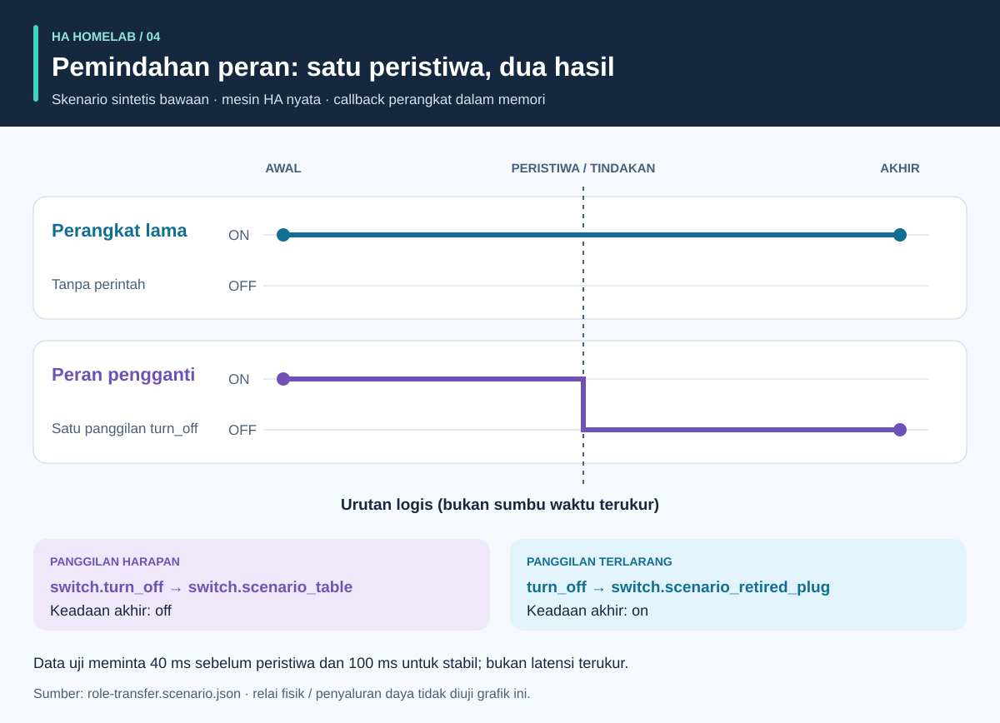

# Proses dan hasil: panduan visual

<!-- language-navigation:start -->
<p dir="ltr">
<a href="process-and-results.md" lang="en" dir="ltr">English</a> · <a href="process-and-results.ar.md" lang="ar" dir="rtl">العربية</a> · <a href="process-and-results.bn.md" lang="bn" dir="ltr">বাংলা</a> · <a href="process-and-results.cs.md" lang="cs" dir="ltr">Čeština</a> · <a href="process-and-results.de.md" lang="de" dir="ltr">Deutsch</a> · <a href="process-and-results.es.md" lang="es" dir="ltr">Español</a> · <a href="process-and-results.fa.md" lang="fa" dir="rtl">فارسی</a> · <a href="process-and-results.fr.md" lang="fr" dir="ltr">Français</a><br>
<a href="process-and-results.he.md" lang="he" dir="rtl">עברית</a> · <a href="process-and-results.hi.md" lang="hi" dir="ltr">हिन्दी</a> · <a href="process-and-results.id.md" lang="id" dir="ltr">Bahasa Indonesia</a> · <a href="process-and-results.it.md" lang="it" dir="ltr">Italiano</a> · <a href="process-and-results.ja.md" lang="ja" dir="ltr">日本語</a> · <a href="process-and-results.ko.md" lang="ko" dir="ltr">한국어</a> · <a href="process-and-results.nl.md" lang="nl" dir="ltr">Nederlands</a> · <a href="process-and-results.pl.md" lang="pl" dir="ltr">Polski</a><br>
<a href="process-and-results.pt.md" lang="pt" dir="ltr">Português</a> · <a href="process-and-results.ru.md" lang="ru" dir="ltr">Русский</a> · <a href="process-and-results.th.md" lang="th" dir="ltr">ไทย</a> · <a href="process-and-results.tr.md" lang="tr" dir="ltr">Türkçe</a> · <a href="process-and-results.uk.md" lang="uk" dir="ltr">Українська</a> · <a href="process-and-results.vi.md" lang="vi" dir="ltr">Tiếng Việt</a> · <a href="process-and-results.zh-Hans.md" lang="zh-Hans" dir="ltr">简体中文</a> · <a href="process-and-results.zh-Hant.md" lang="zh-Hant" dir="ltr">繁體中文</a>
</p>
<!-- language-navigation:end -->

[Ikhtisar proyek](README.id.md)

Hasil yang berguna menjawab pertanyaan tertentu dan mempertahankan bukti di balik jawabannya. Empat alat bekerja independen: peninjau memilih pemeriksaan relevan dan menyertakan hasilnya dalam perubahan. Panah di bawah menggambarkan proses peninjauan itu, bukan pipeline otomatis yang diimplementasikan.


## 1. Definisikan perubahan dan kumpulkan masukan

Untuk penggantian perangkat, bedakan **peran** dari **perangkat keras fisik**. Peran lampu dapat berpindah ke stopkontak lain sementara stopkontak lama memberi daya pada hal berbeda. Catat referensi yang mengikuti peran, mengikuti perangkat keras, dan yang harus dihentikan. Berikan manifes migrasi, potret entitas, dan berkas sumber yang didukung ke Entity Migrations.

Untuk pengukuran, berikan cakupan fisik, identitas sumber, satuan, dan timestamp tiap meter. Untuk otomasi, gambarkan keadaan awal sintetis, urutan peristiwa, dan harapan eksplisit. Untuk suara, berikan pengamatan niat, tindakan, dan respons terdengar. Alat menerima masukan berbeda; alur ini tidak memerlukan ekspor bersama dari rumah aktif.

## 2. Baca keluaran dan batasnya


Ini ringkasan penjelas contoh bawaan, **bukan tangkapan layar laporan mentah**:

- **Migrasi:** contoh perubahan domain mengusulkan `light.table` → `switch.table` dan perubahan layanan terkait. Tinjau setiap usulan edit, sidik berkasnya, dan konflik penghambat. Rencana tidak menerapkan dirinya sendiri.
- **Pengukuran:** contoh tiga meter valid memiliki sumber berbeda dan baru dengan nilai `700 W`, `0.02 kW`, dan `0 W`. Normalisasi nilai kedua menghasilkan `700 + 20 + 0 = 720 W`. Hasil itu didukung tiga meter; satu meter terminal tidak menyediakan tiga pengamatan per stopkontak ini. Contoh cakupan bersama dan sumber ganda sengaja mengungkap asumsi yang salah.
- **Otomasi:** data uji pemindahan peran mengharapkan satu panggilan ke entitas pengganti dan tidak ada ke perangkat lama. Daftar panggilan dan keadaan akhir sama-sama penting: keadaan akhir yang cocok saja dapat menyembunyikan perintah tambahan tidak disengaja.
- **Suara:** contoh tidak lengkap kekurangan bukti keterdengaran. Alat keluar dengan kode `3` meskipun tahap API selesai. Artinya diperlukan bukti tambahan, bukan pendengar pasti mendengar keheningan.

Sumber: [contoh migrasi](https://github.com/ha-homelab/ha-entity-migrations/tree/main/examples/domain-change), [masukan tiga meter](https://github.com/ha-homelab/ha-meter-contracts/blob/main/examples/valid-three-meters.json), [masukan suara](https://github.com/ha-homelab/assist-scenario-lab/blob/main/examples/synthetic-incomplete.json). Perintah pemasangan dan eksekusi persis tersedia dalam [panduan ikhtisar](README.id.md#a-concrete-migration-to-test-workflow).

## 3. Periksa perubahan sepanjang urutan



Dalam [role-transfer.scenario.json](role-transfer.scenario.json), kedua sakelar sintetis dimulai pada `on`. Peristiwa `scenario_table_off` memanggil `switch.turn_off` untuk `switch.scenario_table`. Hasil yang diharapkan ialah `off` untuk pengganti dan `on` untuk `switch.scenario_retired_plug`. Mematikan sakelar lama dilarang secara eksplisit.

Grafik memakai **tahap logis**, bukan skala waktu terukur. Data uji meminta menunggu 40 ms sebelum peristiwa dan 100 ms untuk stabil. Ini masukan pengujian, bukan latensi relai teramati atau jaminan peristiwa selesai dalam 40 ms. Tes runtime HA sebenarnya untuk data ini lulus dalam [eksekusi Linux tercatat](https://github.com/ha-homelab/ha-scenario-tests/actions/runs/38843681199). Callback perangkat tetap berjalan dalam memori.

## 4. Pahami apa yang diuji


Grafik membaca [validation-evidence.json](validation-evidence.json). Tiap catatan menaut ke eksekusi GitHub Actions asal. Ini potret bertanggal, bukan lencana CI langsung. Panjang batang adalah jumlah tes lulus; **bukan persentase cakupan, keandalan, kecepatan, atau peringkat proyek**. Cakupan rangkaian berbeda.

Entity Migrations melewati satu kasus Linux untuk sistem berkas yang tidak membedakan huruf besar-kecil, diperiksa lokal pada macOS. Scenario Tests mencakup tujuh kasus runtime HA sebenarnya dalam total 54. Kegagalan pembersihan native macOS terdokumentasi tetap menjadi batasan terpisah; kelulusan Linux tidak menghapusnya.

## 5. Putuskan apakah akan melanjutkan

Simpan masukan yang ditinjau, versi alat, laporan, dan temuan tertunda bersama perubahan. Selesaikan referensi tak didukung, sumber meter bertentangan, asersi gagal, dan pengamatan hilang sebelum menganggap hasil cukup untuk tujuan penggunaannya. Gunakan kontrak status dan kode keluar terdokumentasi tiap alat.

Penerapan dan penerimaan fisik tetap terpisah. Verifikasi perangkat sebenarnya, pengiriman radio, perilaku relai, beban terhubung, timestamp sumber, dan keluaran terdengar sesuai kebutuhan. Lulus sintetis menegaskan perilaku perangkat lunak yang diuji, bukan keberhasilan penyaluran daya atau konfigurasi rumah lengkap.

<a id="reproduce-or-translate-the-illustrations"></a>

## Mereproduksi atau menerjemahkan ilustrasi

Jalankan dari direktori ini:

```sh
python3 render_architecture.py
python3 -m unittest discover -s . -p 'test_*.py'
```

Generator menghasilkan empat SVG untuk tiap bahasa dalam [registri bahasa](../languages.json) bersama. Hanya pustaka standar Python diperlukan, tanpa aset jarak jauh, dan setiap gambar memiliki judul serta deskripsi aksesibel. Warna yang sama mengidentifikasi alat di semua ilustrasi; label juga mengidentifikasi setiap seri. Untuk potret bukti baru, perbarui catatan sumber dan penjelasan bersama-sama, mempertahankan tautan eksekusi tercatat. Semua ilustrasi asli dan dilisensikan [MIT](LICENSE).

