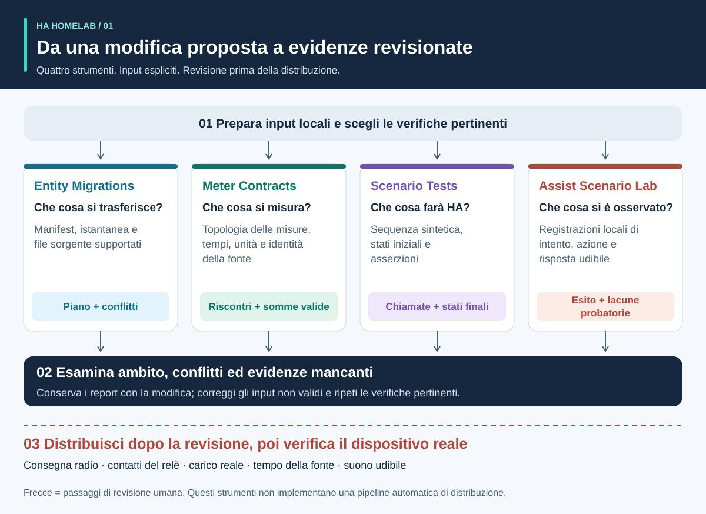
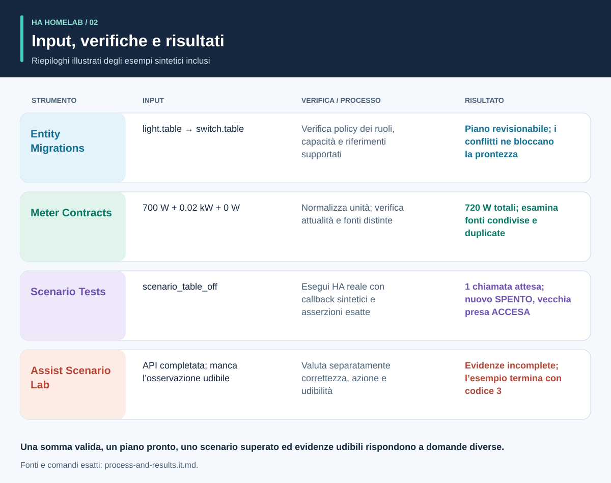
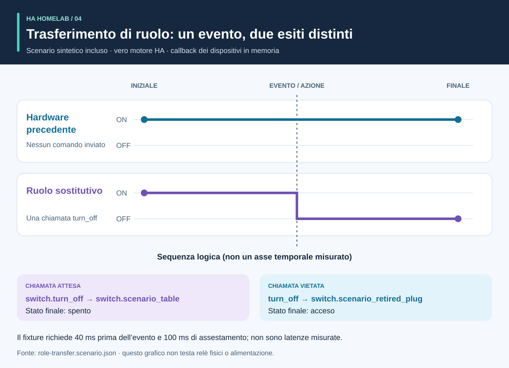
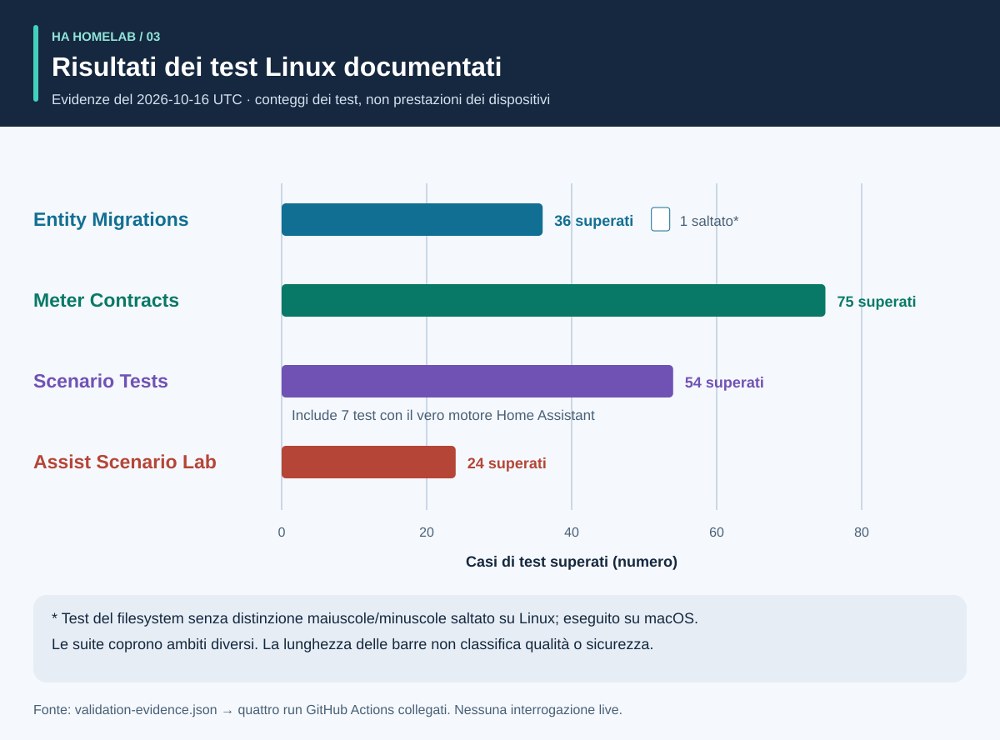

# Processo e risultati: un percorso visuale

<!-- language-navigation:start -->
<p dir="ltr">
<a href="process-and-results.md" lang="en" dir="ltr">English</a> · <a href="process-and-results.ar.md" lang="ar" dir="rtl">العربية</a> · <a href="process-and-results.bn.md" lang="bn" dir="ltr">বাংলা</a> · <a href="process-and-results.cs.md" lang="cs" dir="ltr">Čeština</a> · <a href="process-and-results.de.md" lang="de" dir="ltr">Deutsch</a> · <a href="process-and-results.es.md" lang="es" dir="ltr">Español</a> · <a href="process-and-results.fa.md" lang="fa" dir="rtl">فارسی</a> · <a href="process-and-results.fr.md" lang="fr" dir="ltr">Français</a><br>
<a href="process-and-results.he.md" lang="he" dir="rtl">עברית</a> · <a href="process-and-results.hi.md" lang="hi" dir="ltr">हिन्दी</a> · <a href="process-and-results.id.md" lang="id" dir="ltr">Bahasa Indonesia</a> · <a href="process-and-results.it.md" lang="it" dir="ltr">Italiano</a> · <a href="process-and-results.ja.md" lang="ja" dir="ltr">日本語</a> · <a href="process-and-results.ko.md" lang="ko" dir="ltr">한국어</a> · <a href="process-and-results.nl.md" lang="nl" dir="ltr">Nederlands</a> · <a href="process-and-results.pl.md" lang="pl" dir="ltr">Polski</a><br>
<a href="process-and-results.pt.md" lang="pt" dir="ltr">Português</a> · <a href="process-and-results.ru.md" lang="ru" dir="ltr">Русский</a> · <a href="process-and-results.th.md" lang="th" dir="ltr">ไทย</a> · <a href="process-and-results.tr.md" lang="tr" dir="ltr">Türkçe</a> · <a href="process-and-results.uk.md" lang="uk" dir="ltr">Українська</a> · <a href="process-and-results.vi.md" lang="vi" dir="ltr">Tiếng Việt</a> · <a href="process-and-results.zh-Hans.md" lang="zh-Hans" dir="ltr">简体中文</a> · <a href="process-and-results.zh-Hant.md" lang="zh-Hant" dir="ltr">繁體中文</a>
</p>
<!-- language-navigation:end -->

[Panoramica dei progetti](README.it.md)

Un risultato utile risponde a una domanda precisa e conserva le evidenze che sostengono la risposta. I quattro strumenti lavorano indipendentemente: chi revisiona sceglie i controlli pertinenti e ne porta i risultati nella modifica. Le frecce descrivono tale revisione, non una pipeline automatica implementata.



## 1. Definisci la modifica e raccogli gli input

Per sostituire un dispositivo, distingui il **ruolo** dall'**hardware fisico**. Il ruolo di una lampada può passare a un'altra presa mentre la vecchia inizia ad alimentare altro. Registra quali riferimenti seguono il ruolo, quali l'hardware e quali devono essere ritirati. Fornisci a Entity Migrations manifest di migrazione, istantanea delle entità e file sorgente supportati.

Per le misure, fornisci ambito fisico, identità della fonte, unità e timestamp di ogni misuratore. Per l'automazione, descrivi stato iniziale sintetico, sequenza degli eventi e aspettative esplicite. Per la voce, fornisci osservazioni di intento, azione e risposta udibile. Gli strumenti accettano input diversi; questo flusso non richiede un'esportazione condivisa di un'abitazione operativa.

## 2. Leggi l'output e i suoi limiti



Sono riepiloghi esplicativi degli esempi inclusi, **non schermate di report grezzi**:

- **Migrazione:** l'esempio di cambio dominio propone `light.table` → `switch.table` e il corrispondente cambio di servizio. Esamina ogni modifica, impronta e conflitto bloccante. Il piano non si applica da solo.
- **Misure:** l'esempio valido a tre misuratori ha fonti distinte e attuali con valori `700 W`, `0.02 kW` e `0 W`. Normalizzando il secondo valore si ottiene `700 + 20 + 0 = 720 W`. Il risultato è sostenuto da tre misuratori; un solo misuratore di ciabatta non fornisce queste tre osservazioni individuali. Gli esempi di ambito condiviso e fonti duplicate evidenziano intenzionalmente ipotesi non valide.
- **Automazione:** il fixture di trasferimento del ruolo attende una chiamata all'entità sostitutiva e nessuna al vecchio hardware. Contano sia la lista delle chiamate sia gli stati finali: uno stato finale corretto potrebbe nascondere un comando aggiuntivo indesiderato.
- **Voce:** nell'esempio incompleto mancano evidenze sufficienti di udibilità. Termina con codice `3` anche se una fase API è finita. Servono più evidenze; non significa che l'ascoltatore abbia certamente sentito silenzio.

Fonti: [esempio di migrazione](https://github.com/ha-homelab/ha-entity-migrations/tree/main/examples/domain-change), [input a tre misuratori](https://github.com/ha-homelab/ha-meter-contracts/blob/main/examples/valid-three-meters.json), [input vocale](https://github.com/ha-homelab/assist-scenario-lab/blob/main/examples/synthetic-incomplete.json). I comandi esatti di installazione ed esecuzione si trovano nel [percorso della panoramica](README.it.md#a-concrete-migration-to-test-workflow).

## 3. Esamina la modifica nel tempo



In [role-transfer.scenario.json](role-transfer.scenario.json), entrambi gli interruttori sintetici iniziano in `on`. L'evento `scenario_table_off` provoca `switch.turn_off` per `switch.scenario_table`. Il risultato atteso è `off` per il sostituto e `on` per `switch.scenario_retired_plug`. Spegnere il vecchio interruttore è esplicitamente vietato.

Il grafico usa **fasi logiche**, non una scala temporale misurata. Il fixture richiede 40 ms prima dell'evento e 100 ms per l'assestamento. Sono input di test, non latenza osservata del relè o garanzia di completamento entro 40 ms. Il test di questo fixture nel runtime HA reale è passato nel [run Linux documentato](https://github.com/ha-homelab/ha-scenario-tests/actions/runs/38843681199). I callback dei dispositivi continuano a essere eseguiti in memoria.

## 4. Comprendi ciò che è stato testato



Il grafico legge [validation-evidence.json](validation-evidence.json). Ogni voce collega il run GitHub Actions originale. È un'istantanea datata, non un badge CI live. La lunghezza delle barre conta i test superati: **non misura percentuale di copertura, affidabilità, velocità o posizione in classifica dei progetti**. Le suite hanno ambiti diversi.

Entity Migrations salta su Linux un caso relativo al filesystem senza distinzione maiuscole/minuscole, verificato localmente su macOS. Scenario Tests include sette casi runtime HA reali nel totale di 54. Il problema documentato di chiusura nativa su macOS resta un limite separato; il superamento su Linux non lo elimina.

## 5. Decidi se procedere

Conserva input revisionati, versioni degli strumenti, report e problemi aperti con la modifica. Risolvi riferimenti non supportati, fonti di misura in conflitto, asserzioni fallite e osservazioni mancanti prima di ritenere il risultato sufficiente per l'uso previsto. Usa il contratto documentato di stati e codici di uscita di ogni strumento.

Distribuzione e accettazione fisica restano separate. Verifica dispositivo reale, consegna radio, comportamento del relè, carico collegato, timestamp della fonte e output udibile secondo necessità. Un test sintetico superato conferma il comportamento software testato, non la fornitura di alimentazione o la completezza della configurazione domestica.

<a id="reproduce-or-translate-the-illustrations"></a>

## Riproduci o traduci le illustrazioni

Esegui da questa directory:

```sh
python3 render_architecture.py
python3 -m unittest discover -s . -p 'test_*.py'
```

Il generatore produce quattro SVG per ogni lingua presente nel [registro delle lingue](../languages.json) condiviso. Richiede solo la libreria standard Python, non incorpora risorse remote e include titolo e descrizione accessibili in ogni immagine. Lo stesso colore identifica uno strumento in tutte le illustrazioni; anche le etichette identificano ogni serie. Per una nuova istantanea di evidenze, aggiorna insieme dati sorgente e spiegazioni, conservando i link ai run documentati. Tutte le illustrazioni sono originali e coperte da [MIT](LICENSE).
