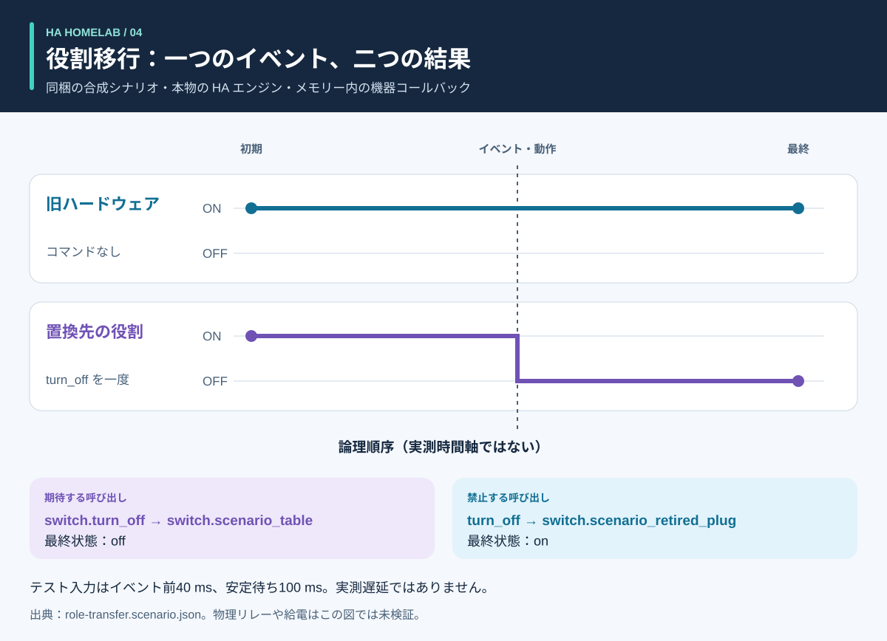

# 処理と結果：図解ガイド

<!-- language-navigation:start -->
<p dir="ltr">
<a href="process-and-results.md" lang="en" dir="ltr">English</a> · <a href="process-and-results.ar.md" lang="ar" dir="rtl">العربية</a> · <a href="process-and-results.bn.md" lang="bn" dir="ltr">বাংলা</a> · <a href="process-and-results.cs.md" lang="cs" dir="ltr">Čeština</a> · <a href="process-and-results.de.md" lang="de" dir="ltr">Deutsch</a> · <a href="process-and-results.es.md" lang="es" dir="ltr">Español</a> · <a href="process-and-results.fa.md" lang="fa" dir="rtl">فارسی</a> · <a href="process-and-results.fr.md" lang="fr" dir="ltr">Français</a><br>
<a href="process-and-results.he.md" lang="he" dir="rtl">עברית</a> · <a href="process-and-results.hi.md" lang="hi" dir="ltr">हिन्दी</a> · <a href="process-and-results.id.md" lang="id" dir="ltr">Bahasa Indonesia</a> · <a href="process-and-results.it.md" lang="it" dir="ltr">Italiano</a> · <a href="process-and-results.ja.md" lang="ja" dir="ltr">日本語</a> · <a href="process-and-results.ko.md" lang="ko" dir="ltr">한국어</a> · <a href="process-and-results.nl.md" lang="nl" dir="ltr">Nederlands</a> · <a href="process-and-results.pl.md" lang="pl" dir="ltr">Polski</a><br>
<a href="process-and-results.pt.md" lang="pt" dir="ltr">Português</a> · <a href="process-and-results.ru.md" lang="ru" dir="ltr">Русский</a> · <a href="process-and-results.th.md" lang="th" dir="ltr">ไทย</a> · <a href="process-and-results.tr.md" lang="tr" dir="ltr">Türkçe</a> · <a href="process-and-results.uk.md" lang="uk" dir="ltr">Українська</a> · <a href="process-and-results.vi.md" lang="vi" dir="ltr">Tiếng Việt</a> · <a href="process-and-results.zh-Hans.md" lang="zh-Hans" dir="ltr">简体中文</a> · <a href="process-and-results.zh-Hant.md" lang="zh-Hant" dir="ltr">繁體中文</a>
</p>
<!-- language-navigation:end -->

[プロジェクト概要](README.ja.md)

有用な結果は、特定の問いに答え、その回答を裏付ける証拠を保持します。四つのツールは独立に動き、レビュー担当者が関連する検査を選んで結果を変更に添えます。以下の矢印はそのレビュー工程であり、実装済みの自動パイプラインではありません。


## 1. 変更を定義し入力を集める

機器の置き換えでは、**役割**と**物理的なハードウェア**を区別します。照明の役割が別のコンセントに移り、元のコンセントが別のものに給電する場合があります。役割に追従する参照、ハードウェアに追従する参照、削除する参照を記録します。移行マニフェスト、エンティティのスナップショット、対応するソースファイルを Entity Migrations に渡してください。

計測には、各メーターの物理的な範囲、出所の識別情報、単位、タイムスタンプを渡します。自動化には、合成の初期状態、イベント列、明示的な期待値を記述します。音声には、意図、動作、聞こえる応答の観測を渡します。各ツールの入力は異なり、この工程に家庭の稼働データの共通エクスポートは不要です。

## 2. 出力とその限界を読む


これらは同梱例を説明する要約であり、**生のレポートのスクリーンショットではありません**。

- **移行：** ドメイン変更例は `light.table` → `switch.table` と対応するサービス変更を提案します。各編集案、指紋、処理を妨げる競合を確認してください。計画は自動適用されません。
- **計測：** 有効な3メーター例には、それぞれ独立した新しい出所があり、値は `700 W`、`0.02 kW`、`0 W` です。二番目を正規化すると `700 + 20 + 0 = 720 W` になります。この結果は三つのメーターに裏付けられています。タップ全体のメーター一つでは、この三つの個別コンセント観測を提供できません。範囲共有と出所重複の例は、誤った仮定を意図的に明らかにします。
- **自動化：** 役割移行テストでは置換先エンティティへの一度の呼び出しと、旧ハードウェアへの呼び出しがないことを期待します。呼び出し一覧と最終状態の両方が重要です。最終状態が一致するだけでは、意図しない余分なコマンドが隠れる可能性があります。
- **音声：** 不完全な例には十分な可聴証拠がありません。API 工程が完了していても、終了コードは `3` です。追加の証拠が必要という意味であり、聞き手に必ず無音だったという意味ではありません。

出典：[移行例](https://github.com/ha-homelab/ha-entity-migrations/tree/main/examples/domain-change)、[3メーター入力](https://github.com/ha-homelab/ha-meter-contracts/blob/main/examples/valid-three-meters.json)、[音声入力](https://github.com/ha-homelab/assist-scenario-lab/blob/main/examples/synthetic-incomplete.json)。正確なインストール・実行コマンドは[概要の手順](README.ja.md#a-concrete-migration-to-test-workflow)にあります。

## 3. 変化の順序を確認する



[role-transfer.scenario.json](role-transfer.scenario.json) では、両方の合成スイッチが `on` で始まります。`scenario_table_off` イベントは `switch.scenario_table` に対して `switch.turn_off` を呼び出します。期待する結果は置換先が `off`、`switch.scenario_retired_plug` が `on` です。旧スイッチのオフ操作は明示的に禁止されています。

グラフは**論理段階**を使い、実測の時間軸ではありません。テスト入力はイベント前に40 ms、安定待ちに100 ms を要求します。これは観測されたリレー遅延でも、40 ms 以内のイベント完了保証でもありません。このデータの本物の HA ランタイムテストは、[記録された Linux 実行](https://github.com/ha-homelab/ha-scenario-tests/actions/runs/38843681199)で成功しました。機器のコールバックは依然としてメモリー内で動きます。

## 4. 何をテストしたか理解する


グラフは [validation-evidence.json](validation-evidence.json) を読み込みます。各記録は元の GitHub Actions 実行へのリンクを持ちます。日付付きスナップショットであり、ライブの CI バッジではありません。棒の長さは成功したテストの件数で、**カバレッジ率、信頼性、速度、プロジェクト順位ではありません**。スイートの対象範囲は異なります。

Entity Migrations では、大文字小文字を区別しないファイルシステムの挙動一件が Linux でスキップされ、ローカルの macOS で確認されています。Scenario Tests の全54件には本物の HA で動く七件が含まれます。文書化されたネイティブ macOS の終了処理失敗は別の制限として残り、Linux テストが成功しても解消しません。

## 5. 先に進むかを判断する

レビュー済みの入力、ツールのバージョン、レポート、未解決の指摘を変更と一緒に保管します。目的に十分な結果と解釈する前に、非対応参照、競合する計測ソース、失敗したアサーション、欠けた観測を解決してください。各ツールに文書化されたステータスと終了コードの契約に従います。

導入と実機受け入れ確認は別工程です。必要に応じて、実際の機器、無線到達、リレーの挙動、接続負荷、出所の時刻、聞こえる出力を確認してください。合成テストの成功はテストしたソフトウェアの挙動を確認するもので、給電の成功や家庭の設定全体を確認するものではありません。

<a id="reproduce-or-translate-the-illustrations"></a>

## 図の再生成と翻訳

このディレクトリから実行します。

```sh
python3 render_architecture.py
python3 -m unittest discover -s . -p 'test_*.py'
```

ジェネレーターは共通の[言語一覧](../languages.json)にある言語ごとに四つの SVG を作成します。Python 標準ライブラリーだけが必要で、外部アセットを埋め込まず、各画像にアクセシブルなタイトルと説明を含めます。同じツールを図全体で同じ色にし、ラベルでも各系列を識別します。証拠のスナップショットを更新するときは、記録された実行へのリンクを残して、元記録と説明を一緒に更新してください。図はすべてオリジナルで、[MIT](LICENSE) ライセンスです。

