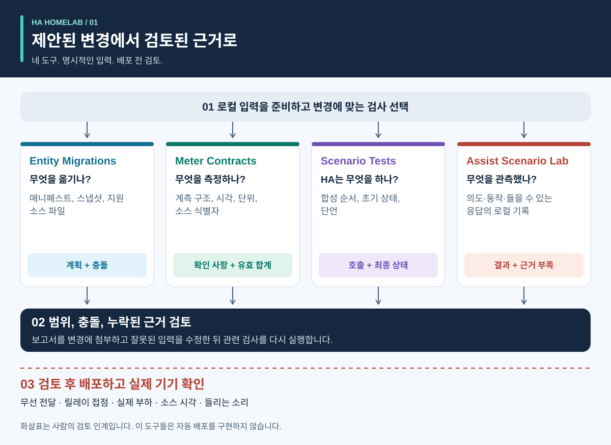
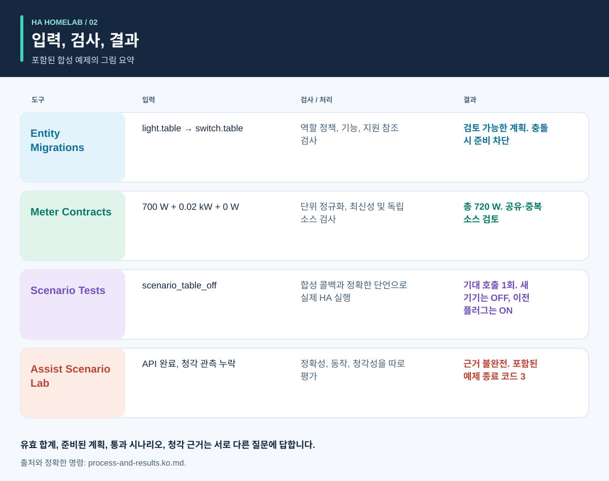
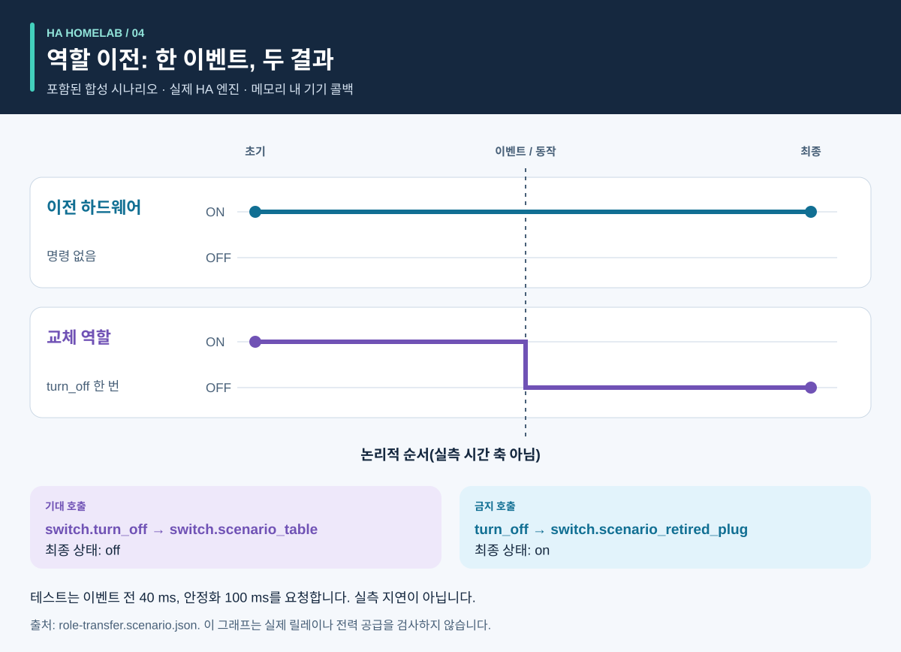
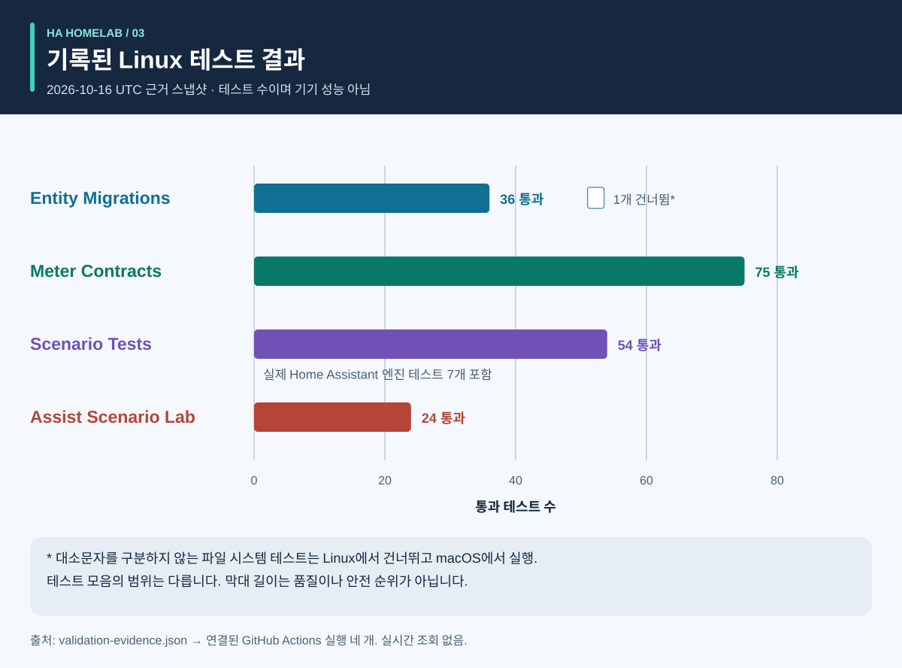

# 과정과 결과: 그림 안내

<!-- language-navigation:start -->
<p dir="ltr">
<a href="process-and-results.md" lang="en" dir="ltr">English</a> · <a href="process-and-results.ar.md" lang="ar" dir="rtl">العربية</a> · <a href="process-and-results.bn.md" lang="bn" dir="ltr">বাংলা</a> · <a href="process-and-results.cs.md" lang="cs" dir="ltr">Čeština</a> · <a href="process-and-results.de.md" lang="de" dir="ltr">Deutsch</a> · <a href="process-and-results.es.md" lang="es" dir="ltr">Español</a> · <a href="process-and-results.fa.md" lang="fa" dir="rtl">فارسی</a> · <a href="process-and-results.fr.md" lang="fr" dir="ltr">Français</a><br>
<a href="process-and-results.he.md" lang="he" dir="rtl">עברית</a> · <a href="process-and-results.hi.md" lang="hi" dir="ltr">हिन्दी</a> · <a href="process-and-results.id.md" lang="id" dir="ltr">Bahasa Indonesia</a> · <a href="process-and-results.it.md" lang="it" dir="ltr">Italiano</a> · <a href="process-and-results.ja.md" lang="ja" dir="ltr">日本語</a> · <a href="process-and-results.ko.md" lang="ko" dir="ltr">한국어</a> · <a href="process-and-results.nl.md" lang="nl" dir="ltr">Nederlands</a> · <a href="process-and-results.pl.md" lang="pl" dir="ltr">Polski</a><br>
<a href="process-and-results.pt.md" lang="pt" dir="ltr">Português</a> · <a href="process-and-results.ru.md" lang="ru" dir="ltr">Русский</a> · <a href="process-and-results.th.md" lang="th" dir="ltr">ไทย</a> · <a href="process-and-results.tr.md" lang="tr" dir="ltr">Türkçe</a> · <a href="process-and-results.uk.md" lang="uk" dir="ltr">Українська</a> · <a href="process-and-results.vi.md" lang="vi" dir="ltr">Tiếng Việt</a> · <a href="process-and-results.zh-Hans.md" lang="zh-Hans" dir="ltr">简体中文</a> · <a href="process-and-results.zh-Hant.md" lang="zh-Hant" dir="ltr">繁體中文</a>
</p>
<!-- language-navigation:end -->

[프로젝트 개요](README.ko.md)

유용한 결과는 구체적인 질문에 답하고 그 답의 근거를 보존합니다. 네 도구는 독립적으로 작동합니다. 검토자가 관련 검사를 선택하고 결과를 변경에 첨부합니다. 아래 화살표는 이 검토 절차를 설명하며 구현된 자동 파이프라인이 아닙니다.



## 1. 변경을 정의하고 입력 수집

기기를 교체할 때 **역할**과 **물리적 하드웨어**를 구분하세요. 램프 역할은 다른 콘센트로 옮겨지고 이전 콘센트는 다른 물건에 전원을 공급할 수 있습니다. 역할을 따라갈 참조, 하드웨어를 따라갈 참조, 제거할 참조를 기록합니다. 마이그레이션 매니페스트, 엔터티 스냅샷, 지원 소스 파일을 Entity Migrations에 제공합니다.

계측에는 각 계측기의 물리적 범위, 소스 식별자, 단위, 시각을 제공합니다. 자동화에는 합성 초기 상태, 이벤트 순서, 명시적 기대값을 설명합니다. 음성에는 의도, 동작, 들을 수 있는 응답의 관측을 제공합니다. 도구마다 입력이 다르며 이 절차에 가정 실시간 데이터의 공통 내보내기는 필요하지 않습니다.

## 2. 출력과 한계 읽기



아래는 포함된 예제의 설명용 요약이며 **원본 보고서 스크린샷이 아닙니다**.

- **마이그레이션:** 도메인 변경 예제는 `light.table` → `switch.table`와 대응하는 서비스 변경을 제안합니다. 모든 제안 수정, 지문, 차단 충돌을 검토하세요. 계획은 스스로 적용되지 않습니다.
- **계측:** 유효한 세 계측기 예제에는 `700 W`, `0.02 kW`, `0 W` 값을 가진 독립적이고 최신인 소스가 있습니다. 두 번째 값을 정규화하면 `700 + 20 + 0 = 720 W`입니다. 세 계측기가 이 결과를 뒷받침하며 멀티탭 계측기 하나는 이 세 콘센트별 관측을 제공하지 않습니다. 공유 범위 및 중복 소스 예제는 잘못된 가정을 의도적으로 드러냅니다.
- **자동화:** 역할 이전 테스트 데이터는 교체 엔터티에 한 번 호출하고 이전 하드웨어에는 호출하지 않을 것을 기대합니다. 호출 목록과 최종 상태 모두 중요합니다. 최종 상태만 맞으면 의도하지 않은 추가 명령을 놓칠 수 있습니다.
- **음성:** 불완전한 예제에는 충분한 청각 근거가 없습니다. API 단계가 끝났더라도 종료 코드는 `3`입니다. 추가 근거가 필요하다는 뜻이지 청취자가 분명히 무음을 들었다는 뜻은 아닙니다.

출처: [마이그레이션 예제](https://github.com/ha-homelab/ha-entity-migrations/tree/main/examples/domain-change), [세 계측기 입력](https://github.com/ha-homelab/ha-meter-contracts/blob/main/examples/valid-three-meters.json), [음성 입력](https://github.com/ha-homelab/assist-scenario-lab/blob/main/examples/synthetic-incomplete.json). 정확한 설치·실행 명령은 [개요 절차](README.ko.md#a-concrete-migration-to-test-workflow)에 있습니다.

## 3. 시간에 따른 변경 검사



[role-transfer.scenario.json](role-transfer.scenario.json)에서 두 합성 스위치는 모두 `on`으로 시작합니다. `scenario_table_off` 이벤트는 `switch.scenario_table`에 `switch.turn_off`를 호출합니다. 기대 결과는 교체 기기의 `off`와 `switch.scenario_retired_plug`의 `on`입니다. 이전 스위치를 끄는 행위는 명시적으로 금지됩니다.

그래프는 측정된 시간 축이 아닌 **논리적 단계**를 사용합니다. 테스트 데이터는 이벤트 전 40 ms 대기와 안정화를 위한 100 ms를 요청합니다. 이는 테스트 입력이며 관측된 릴레이 지연이나 40 ms 내 이벤트 완료 보장이 아닙니다. 이 데이터의 실제 HA 실행 테스트는 [기록된 Linux 실행](https://github.com/ha-homelab/ha-scenario-tests/actions/runs/38843681199)에서 통과했습니다. 기기 콜백은 여전히 메모리에서 실행됩니다.

## 4. 테스트한 내용 이해



그래프는 [validation-evidence.json](validation-evidence.json)을 읽습니다. 각 기록에는 원래 GitHub Actions 실행 링크가 있습니다. 날짜가 있는 스냅샷이지 실시간 CI 배지가 아닙니다. 막대 길이는 통과 테스트 수이며 **커버리지 비율, 신뢰성, 속도, 프로젝트 순위가 아닙니다**. 테스트 모음의 범위는 서로 다릅니다.

Entity Migrations는 Linux에서 대소문자를 구분하지 않는 파일 시스템 동작 한 개를 건너뛰었으며 로컬 macOS에서 확인했습니다. Scenario Tests의 총 54개에는 실제 HA 실행 사례 일곱 개가 포함됩니다. 문서화된 네이티브 macOS 종료 정리 실패는 별도 제한으로 남습니다. Linux 통과로 이 문제가 없어지지는 않습니다.

## 5. 진행 여부 결정

검토된 입력, 도구 버전, 보고서, 미해결 사항을 변경과 함께 보관합니다. 결과가 의도한 용도에 충분하다고 판단하기 전에 미지원 참조, 충돌하는 계측 소스, 실패한 단언, 누락된 관측을 해결하세요. 각 도구에 문서화된 상태 및 종료 코드 계약을 사용합니다.

배포와 실물 인수 검증은 별도입니다. 해당되는 실제 기기, 무선 전달, 릴레이 동작, 연결 부하, 소스 시각, 들을 수 있는 출력을 확인하세요. 합성 테스트 통과는 테스트된 소프트웨어 동작을 확인할 뿐 실제 전력 공급 성공이나 전체 가정 설정을 확인하지 않습니다.

<a id="reproduce-or-translate-the-illustrations"></a>

## 그림 재현 또는 번역

이 디렉터리에서 실행하세요.

```sh
python3 render_architecture.py
python3 -m unittest discover -s . -p 'test_*.py'
```

생성기는 공통 [언어 목록](../languages.json)에 나열된 언어마다 SVG 네 개를 만듭니다. Python 표준 라이브러리만 필요하며 원격 자료를 넣지 않고 모든 이미지에 접근 가능한 제목과 설명을 포함합니다. 그림 전체에서 같은 색이 같은 도구를 나타내며 레이블도 각 계열을 식별합니다. 새 근거 스냅샷을 만들 때는 기록된 실행 링크를 유지하고 원본 기록과 설명을 함께 갱신하세요. 모든 그림은 독자 제작 자료이며 [MIT](LICENSE)가 적용됩니다.

