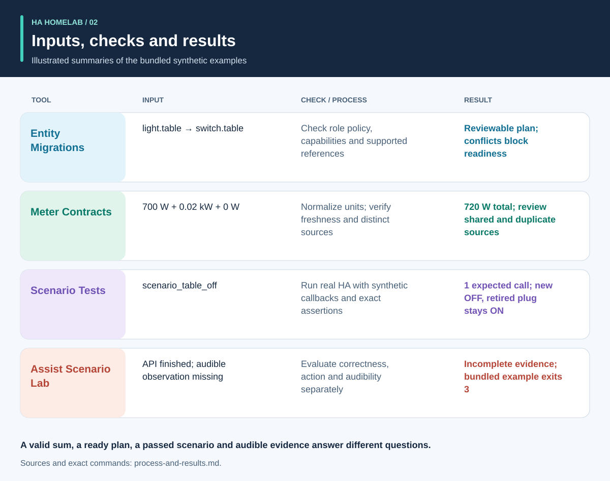
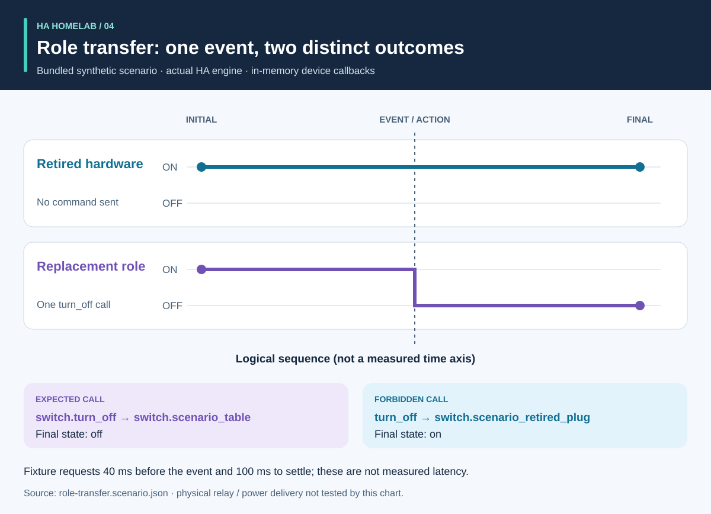
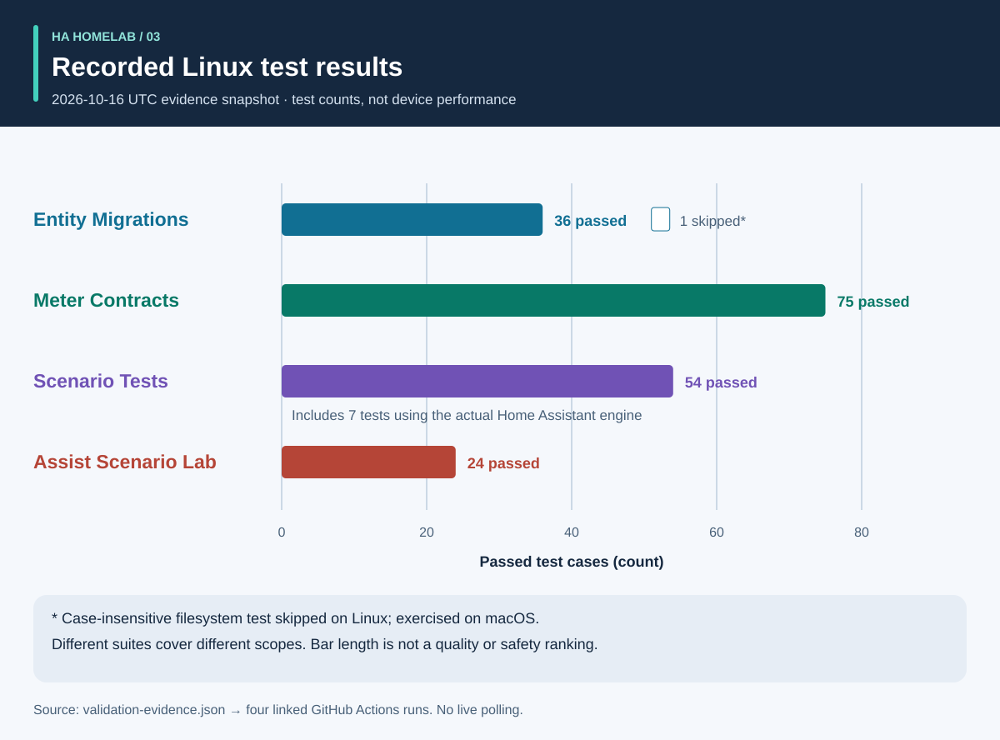

# Process and results: a visual walkthrough

[Русский](process-and-results.ru.md) · [Project overview](README.md)

A useful result answers a specific question and preserves the evidence behind the answer. The four tools work independently: a reviewer chooses the relevant checks and carries their results into a change. The arrows below describe that review process, not an implemented automatic pipeline.


## 1. Define the change and collect the inputs

For a device replacement, distinguish the **role** from the **physical hardware**. A lamp role may move to a different outlet while the old outlet starts powering something else. Record which references follow the role, which follow the hardware, and which should be retired. Supply the migration manifest, entity snapshot and supported source files to Entity Migrations.

For metering, supply each meter's physical scope, source identity, units and timestamp. For automation, describe a synthetic initial state, event sequence and explicit expectations. For voice, provide observations of the intent, action and audible response. The tools accept different inputs; no shared live-household export is required by this workflow.

## 2. Read the output and its limits



These are explanatory summaries of bundled examples, **not screenshots of raw reports**:

- **Migration:** the domain-change example proposes `light.table` → `switch.table` and the corresponding service change. Review every proposed edit, its fingerprint and any blocking conflict. The plan does not apply itself.
- **Metering:** the valid three-meter example has distinct, fresh sources with values `700 W`, `0.02 kW` and `0 W`. Normalizing the second value gives `700 + 20 + 0 = 720 W`. That result is supported by three meters; a single strip meter does not provide these three per-outlet observations. Shared-scope and duplicate-source examples deliberately expose invalid assumptions.
- **Automation:** the role-transfer fixture expects one call to the replacement entity and no call to the retired hardware. Both the call list and final states matter: a matching end state alone could conceal an unintended extra command.
- **Voice:** the incomplete example lacks sufficient audible evidence. It exits with code `3`, even if an API stage has finished. This means more evidence is needed, not that the listener definitely heard silence.

Sources: [migration example](https://github.com/ha-homelab/ha-entity-migrations/tree/main/examples/domain-change), [three-meter input](https://github.com/ha-homelab/ha-meter-contracts/blob/main/examples/valid-three-meters.json), [voice input](https://github.com/ha-homelab/assist-scenario-lab/blob/main/examples/synthetic-incomplete.json). Exact installation and execution commands are in the [overview walkthrough](README.md#a-concrete-migration-to-test-workflow).

## 3. Inspect the change over time



In [role-transfer.scenario.json](role-transfer.scenario.json), both synthetic switches start `on`. The `scenario_table_off` event causes `switch.turn_off` for `switch.scenario_table`. The expected result is `off` for the replacement and `on` for `switch.scenario_retired_plug`. Turning off the retired switch is explicitly forbidden.

The chart uses **logical stages**, not a measured time scale. The fixture requests a 40 ms wait before the event and 100 ms to settle. These are test inputs, not observed relay latency or a guarantee of event completion within 40 ms. The actual HA runtime test of this fixture passed in the [recorded Linux run](https://github.com/ha-homelab/ha-scenario-tests/actions/runs/38843681199). Device callbacks still run in memory.

## 4. Understand what was tested



The chart reads [validation-evidence.json](validation-evidence.json). Each record links to its original GitHub Actions run. It is a dated snapshot, not a live CI badge. The bar length is a count of passed tests; it is **not coverage percentage, reliability, speed or a ranking of the projects**. Suite scopes differ.

Entity Migrations has one Linux skip for case-insensitive filesystem behavior, checked locally on macOS. Scenario Tests includes seven actual-HA runtime cases in its total of 54. The documented native teardown failure on macOS remains a separate limitation; passing Linux tests do not remove it.

## 5. Decide whether to proceed

Keep the reviewed inputs, tool versions, reports and outstanding findings with the change. Resolve unsupported references, conflicting meter sources, failed assertions and missing observations before interpreting the result as sufficient for its intended use. Use each tool's documented status and exit-code contract.

Deployment and physical acceptance remain separate. Verify the actual device, radio delivery, relay behavior, connected load, source timestamp and audible output as applicable. A synthetic pass confirms the tested software behavior, not successful power delivery or a complete household configuration.

## Reproduce or translate the illustrations

Run from this directory:

```sh
python3 render_architecture.py
python3 -m unittest discover -s . -p 'test_*.py'
```

The generator produces four SVGs in English and four in Russian. It needs only Python's standard library, embeds no remote assets and includes an accessible title and description in every image. The same color identifies a tool across illustrations; labels also identify every series. For a new evidence snapshot, update the source records and accompanying explanations together, retaining links to the recorded runs. All illustrations are original and covered by [MIT](LICENSE).
