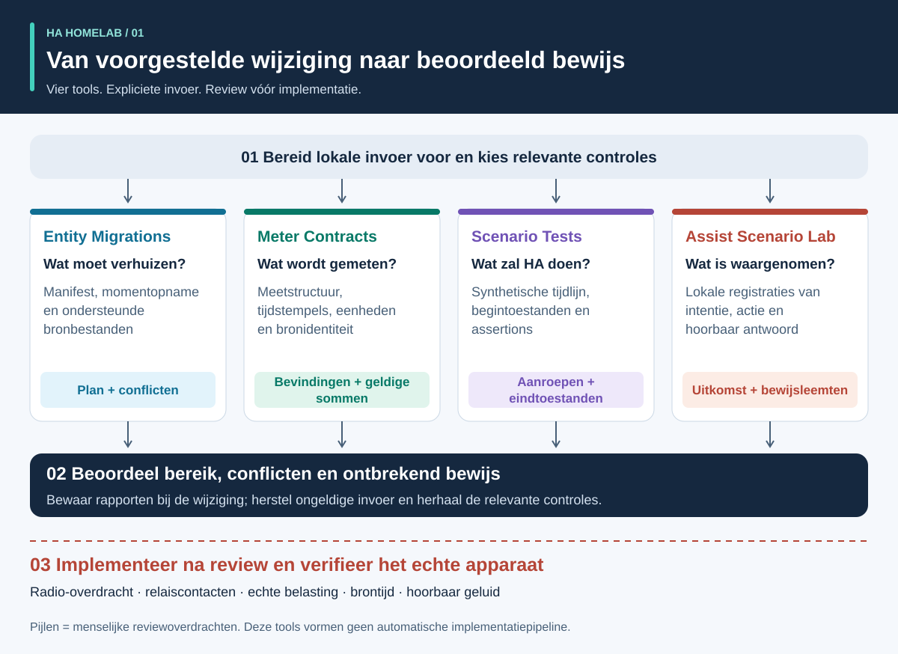
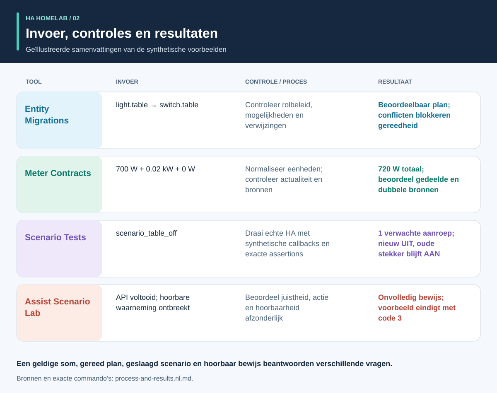
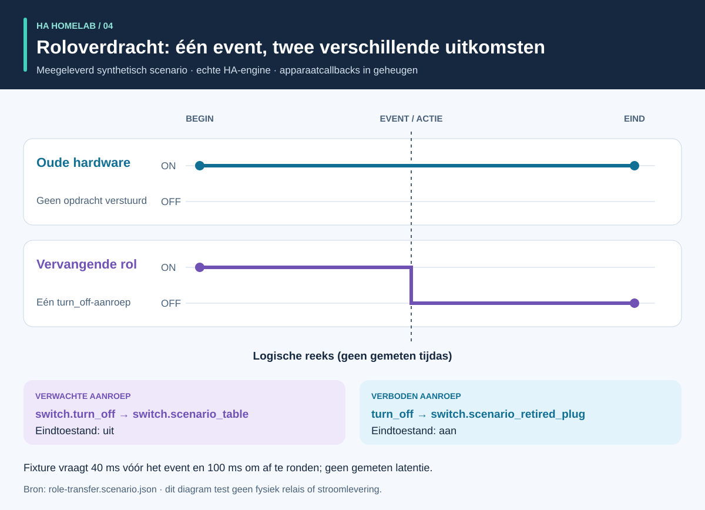
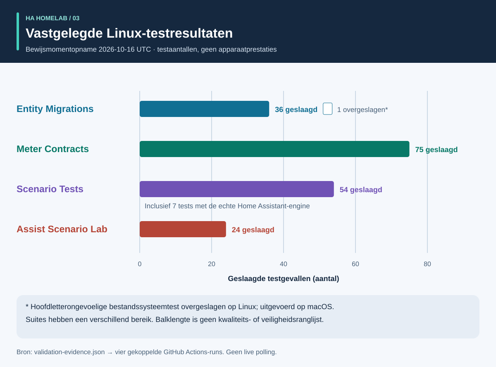

# Proces en resultaten: een visuele rondleiding

<!-- language-navigation:start -->
<p dir="ltr">
<a href="process-and-results.md" lang="en" dir="ltr">English</a> · <a href="process-and-results.ar.md" lang="ar" dir="rtl">العربية</a> · <a href="process-and-results.bn.md" lang="bn" dir="ltr">বাংলা</a> · <a href="process-and-results.cs.md" lang="cs" dir="ltr">Čeština</a> · <a href="process-and-results.de.md" lang="de" dir="ltr">Deutsch</a> · <a href="process-and-results.es.md" lang="es" dir="ltr">Español</a> · <a href="process-and-results.fa.md" lang="fa" dir="rtl">فارسی</a> · <a href="process-and-results.fr.md" lang="fr" dir="ltr">Français</a><br>
<a href="process-and-results.he.md" lang="he" dir="rtl">עברית</a> · <a href="process-and-results.hi.md" lang="hi" dir="ltr">हिन्दी</a> · <a href="process-and-results.id.md" lang="id" dir="ltr">Bahasa Indonesia</a> · <a href="process-and-results.it.md" lang="it" dir="ltr">Italiano</a> · <a href="process-and-results.ja.md" lang="ja" dir="ltr">日本語</a> · <a href="process-and-results.ko.md" lang="ko" dir="ltr">한국어</a> · <a href="process-and-results.nl.md" lang="nl" dir="ltr">Nederlands</a> · <a href="process-and-results.pl.md" lang="pl" dir="ltr">Polski</a><br>
<a href="process-and-results.pt.md" lang="pt" dir="ltr">Português</a> · <a href="process-and-results.ru.md" lang="ru" dir="ltr">Русский</a> · <a href="process-and-results.th.md" lang="th" dir="ltr">ไทย</a> · <a href="process-and-results.tr.md" lang="tr" dir="ltr">Türkçe</a> · <a href="process-and-results.uk.md" lang="uk" dir="ltr">Українська</a> · <a href="process-and-results.vi.md" lang="vi" dir="ltr">Tiếng Việt</a> · <a href="process-and-results.zh-Hans.md" lang="zh-Hans" dir="ltr">简体中文</a> · <a href="process-and-results.zh-Hant.md" lang="zh-Hant" dir="ltr">繁體中文</a>
</p>
<!-- language-navigation:end -->

[Projectoverzicht](README.nl.md)

Een bruikbaar resultaat beantwoordt een specifieke vraag en bewaart het bewijs achter het antwoord. De vier tools werken onafhankelijk: een reviewer kiest relevante controles en neemt de resultaten mee in een wijziging. De pijlen hieronder beschrijven dat reviewproces, geen geïmplementeerde automatische pipeline.



## 1. Definieer de wijziging en verzamel de invoer

Onderscheid bij apparaatvervanging de **rol** van de **fysieke hardware**. Een lamprol kan naar een andere aansluiting verhuizen terwijl de oude iets anders gaat voeden. Leg vast welke verwijzingen de rol volgen, welke de hardware en welke moeten vervallen. Lever het migratiemanifest, de entiteitsmomentopname en ondersteunde bronbestanden aan Entity Migrations.

Lever bij metingen de fysieke omvang, bronidentiteit, eenheden en tijdstempel van elke meter. Beschrijf bij automatisering een synthetische begintoestand, eventreeks en expliciete verwachtingen. Lever bij spraak waarnemingen van intentie, actie en hoorbaar antwoord. De tools accepteren verschillende invoer; dit proces vereist geen gedeelde export uit een operationeel huishouden.

## 2. Lees de uitvoer en beperkingen



Dit zijn verklarende samenvattingen van meegeleverde voorbeelden, **geen screenshots van ruwe rapporten**:

- **Migratie:** het domeinwijzigingsvoorbeeld stelt `light.table` → `switch.table` en de bijbehorende servicewijziging voor. Beoordeel elke voorgestelde wijziging, vingerafdruk en blokkerend conflict. Het plan past zichzelf niet toe.
- **Metingen:** het geldige driemetervoorbeeld bevat verschillende actuele bronnen met waarden `700 W`, `0.02 kW` en `0 W`. Normalisatie van de tweede waarde geeft `700 + 20 + 0 = 720 W`. Drie meters ondersteunen dat resultaat; één stekkerdoosmeter levert deze drie afzonderlijke aansluitingswaarnemingen niet. Voorbeelden met gedeeld bereik en dubbele bronnen laten bewust ongeldige aannames zien.
- **Automatisering:** de roloverdrachtfixture verwacht één aanroep naar de vervangende entiteit en geen naar de oude hardware. Zowel aanroeplijst als eindtoestanden tellen: alleen een juiste eindtoestand kan een onbedoeld extra commando verbergen.
- **Spraak:** het onvolledige voorbeeld mist voldoende hoorbaar bewijs. Het eindigt met code `3`, ook als een API-fase voltooid is. Er is meer bewijs nodig; dit betekent niet dat de luisteraar zeker stilte hoorde.

Bronnen: [migratievoorbeeld](https://github.com/ha-homelab/ha-entity-migrations/tree/main/examples/domain-change), [driemeterinvoer](https://github.com/ha-homelab/ha-meter-contracts/blob/main/examples/valid-three-meters.json), [spraakinvoer](https://github.com/ha-homelab/assist-scenario-lab/blob/main/examples/synthetic-incomplete.json). Exacte installatie- en uitvoercommando's staan in het [overzichtsproces](README.nl.md#a-concrete-migration-to-test-workflow).

## 3. Bekijk de verandering in de tijd



In [role-transfer.scenario.json](role-transfer.scenario.json) beginnen beide synthetische schakelaars op `on`. Het event `scenario_table_off` veroorzaakt `switch.turn_off` voor `switch.scenario_table`. Het verwachte resultaat is `off` voor de vervanger en `on` voor `switch.scenario_retired_plug`. Het uitschakelen van de oude schakelaar is expliciet verboden.

Het diagram gebruikt **logische fasen**, geen gemeten tijdschaal. De fixture vraagt 40 ms wachttijd vóór het event en 100 ms om af te ronden. Dit is testinvoer, geen waargenomen relaislatentie of garantie dat een event binnen 40 ms voltooid is. De echte HA-runtimetest van deze fixture slaagde in de [vastgelegde Linux-run](https://github.com/ha-homelab/ha-scenario-tests/actions/runs/38843681199). Apparaatcallbacks lopen nog steeds in het geheugen.

## 4. Begrijp wat getest is



Het diagram leest [validation-evidence.json](validation-evidence.json). Elke vermelding linkt naar de oorspronkelijke GitHub Actions-run. Het is een gedateerde momentopname, geen live CI-badge. Balklengte is het aantal geslaagde tests, **geen dekkingspercentage, betrouwbaarheid, snelheid of ranglijst van projecten**. Het bereik verschilt per suite.

Entity Migrations slaat onder Linux één test over voor hoofdletterongevoelig bestandssysteemgedrag; die is lokaal op macOS gecontroleerd. Scenario Tests bevat zeven echte HA-runtimegevallen in het totaal van 54. De gedocumenteerde native afsluitfout op macOS blijft een afzonderlijke beperking; geslaagde Linux-tests nemen die niet weg.

## 5. Beslis of je doorgaat

Bewaar de beoordeelde invoer, toolversies, rapporten en openstaande bevindingen bij de wijziging. Los niet-ondersteunde verwijzingen, conflicterende meetbronnen, mislukte assertions en ontbrekende waarnemingen op voordat je het resultaat voldoende acht voor het beoogde gebruik. Volg het gedocumenteerde status- en exitcodecontract van elke tool.

Implementatie en fysieke acceptatie blijven gescheiden. Verifieer waar relevant het echte apparaat, radio-overdracht, relaisgedrag, aangesloten belasting, brontijdstempel en hoorbare uitvoer. Een geslaagde synthetische test bevestigt het geteste softwaregedrag, niet geslaagde stroomlevering of een volledige huishoudelijke configuratie.

<a id="reproduce-or-translate-the-illustrations"></a>

## Illustraties reproduceren of vertalen

Voer vanuit deze map uit:

```sh
python3 render_architecture.py
python3 -m unittest discover -s . -p 'test_*.py'
```

De generator produceert vier SVG's per taal in het gedeelde [taalregister](../languages.json). Hij gebruikt alleen de standaardbibliotheek van Python, sluit geen externe bronnen in en bevat een toegankelijke titel en beschrijving in elke afbeelding. Dezelfde kleur duidt in alle illustraties dezelfde tool aan; labels benoemen ook iedere reeks. Werk voor een nieuwe bewijsmomentopname brongegevens en bijbehorende uitleg samen bij en behoud de links naar vastgelegde runs. Alle illustraties zijn oorspronkelijk werk onder [MIT](LICENSE).
