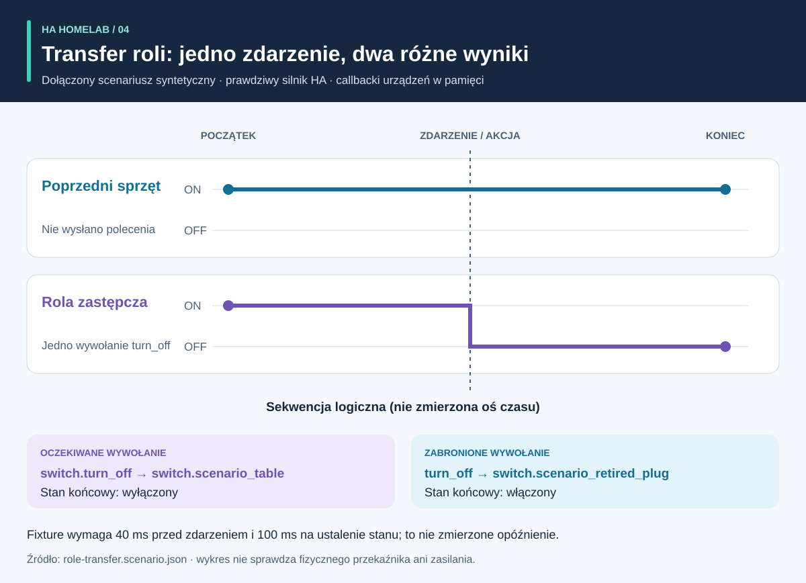

# Proces i wyniki: przewodnik wizualny

<!-- language-navigation:start -->
<p dir="ltr">
<a href="process-and-results.md" lang="en" dir="ltr">English</a> · <a href="process-and-results.ar.md" lang="ar" dir="rtl">العربية</a> · <a href="process-and-results.bn.md" lang="bn" dir="ltr">বাংলা</a> · <a href="process-and-results.cs.md" lang="cs" dir="ltr">Čeština</a> · <a href="process-and-results.de.md" lang="de" dir="ltr">Deutsch</a> · <a href="process-and-results.es.md" lang="es" dir="ltr">Español</a> · <a href="process-and-results.fa.md" lang="fa" dir="rtl">فارسی</a> · <a href="process-and-results.fr.md" lang="fr" dir="ltr">Français</a><br>
<a href="process-and-results.he.md" lang="he" dir="rtl">עברית</a> · <a href="process-and-results.hi.md" lang="hi" dir="ltr">हिन्दी</a> · <a href="process-and-results.id.md" lang="id" dir="ltr">Bahasa Indonesia</a> · <a href="process-and-results.it.md" lang="it" dir="ltr">Italiano</a> · <a href="process-and-results.ja.md" lang="ja" dir="ltr">日本語</a> · <a href="process-and-results.ko.md" lang="ko" dir="ltr">한국어</a> · <a href="process-and-results.nl.md" lang="nl" dir="ltr">Nederlands</a> · <a href="process-and-results.pl.md" lang="pl" dir="ltr">Polski</a><br>
<a href="process-and-results.pt.md" lang="pt" dir="ltr">Português</a> · <a href="process-and-results.ru.md" lang="ru" dir="ltr">Русский</a> · <a href="process-and-results.th.md" lang="th" dir="ltr">ไทย</a> · <a href="process-and-results.tr.md" lang="tr" dir="ltr">Türkçe</a> · <a href="process-and-results.uk.md" lang="uk" dir="ltr">Українська</a> · <a href="process-and-results.vi.md" lang="vi" dir="ltr">Tiếng Việt</a> · <a href="process-and-results.zh-Hans.md" lang="zh-Hans" dir="ltr">简体中文</a> · <a href="process-and-results.zh-Hant.md" lang="zh-Hant" dir="ltr">繁體中文</a>
</p>
<!-- language-navigation:end -->

[Przegląd projektów](README.pl.md)

Przydatny wynik odpowiada na określone pytanie i zachowuje dowody stojące za odpowiedzią. Cztery narzędzia działają niezależnie: recenzent wybiera istotne kontrole i przenosi ich wyniki do zmiany. Poniższe strzałki opisują ten proces przeglądu, nie zaimplementowany automatyczny potok.


## 1. Określ zmianę i zbierz dane wejściowe

Przy wymianie urządzenia odróżniaj **rolę** od **fizycznego sprzętu**. Rola lampy może przejść do innego gniazdka, gdy stare zacznie zasilać coś innego. Zapisz, które odwołania podążają za rolą, które za sprzętem, a które należy usunąć. Dostarcz Entity Migrations manifest migracji, migawkę encji i obsługiwane pliki źródłowe.

Dla pomiarów dostarcz fizyczny zakres, tożsamość źródła, jednostki i znacznik czasu każdego miernika. Dla automatyzacji opisz syntetyczny stan początkowy, sekwencję zdarzeń i jawne oczekiwania. Dla głosu podaj obserwacje intencji, akcji i słyszalnej odpowiedzi. Narzędzia akceptują różne wejścia; ten proces nie wymaga wspólnego eksportu z działającego domu.

## 2. Odczytaj wynik i jego ograniczenia


To objaśniające podsumowania dołączonych przykładów, **nie zrzuty surowych raportów**:

- **Migracja:** przykład zmiany domeny proponuje `light.table` → `switch.table` i odpowiednią zmianę usługi. Przejrzyj każdą edycję, jej odcisk i blokujące konflikty. Plan nie stosuje się sam.
- **Pomiary:** poprawny przykład trzech mierników ma różne aktualne źródła z wartościami `700 W`, `0.02 kW` i `0 W`. Normalizacja drugiej wartości daje `700 + 20 + 0 = 720 W`. Wynik wspierają trzy mierniki; jeden miernik listwy nie daje tych trzech obserwacji gniazdek. Przykłady wspólnego zakresu i duplikatów źródeł celowo ujawniają błędne założenia.
- **Automatyzacja:** fixture transferu roli oczekuje jednego wywołania encji zastępczej i żadnego dla poprzedniego sprzętu. Liczą się lista wywołań i stany końcowe: sam zgodny stan końcowy może ukryć niezamierzone dodatkowe polecenie.
- **Głos:** niepełnemu przykładowi brakuje wystarczającego dowodu słyszalności. Kończy kodem `3`, nawet jeśli etap API się zakończył. Oznacza to potrzebę dodatkowych dowodów, nie pewność, że słuchacz słyszał ciszę.

Źródła: [przykład migracji](https://github.com/ha-homelab/ha-entity-migrations/tree/main/examples/domain-change), [dane trzech mierników](https://github.com/ha-homelab/ha-meter-contracts/blob/main/examples/valid-three-meters.json), [dane głosowe](https://github.com/ha-homelab/assist-scenario-lab/blob/main/examples/synthetic-incomplete.json). Dokładne polecenia instalacji i uruchomienia są w [procesie opisanym w przeglądzie](README.pl.md#a-concrete-migration-to-test-workflow).

## 3. Zbadaj zmianę w czasie



W [role-transfer.scenario.json](role-transfer.scenario.json) oba syntetyczne przełączniki zaczynają jako `on`. Zdarzenie `scenario_table_off` wywołuje `switch.turn_off` dla `switch.scenario_table`. Oczekiwany wynik to `off` dla zamiennika i `on` dla `switch.scenario_retired_plug`. Wyłączenie poprzedniego przełącznika jest jawnie zabronione.

Wykres używa **etapów logicznych**, nie zmierzonej skali czasu. Fixture wymaga czekania 40 ms przed zdarzeniem i 100 ms na ustalenie stanu. To wejścia testu, nie zaobserwowane opóźnienie przekaźnika ani gwarancja ukończenia zdarzenia w 40 ms. Rzeczywisty test wykonawczy HA tego fixture przeszedł w [zapisanym uruchomieniu Linux](https://github.com/ha-homelab/ha-scenario-tests/actions/runs/38843681199). Callbacki urządzeń nadal działają w pamięci.

## 4. Zrozum, co przetestowano


Wykres czyta [validation-evidence.json](validation-evidence.json). Każdy rekord wskazuje oryginalne uruchomienie GitHub Actions. To datowana migawka, nie odznaka CI na żywo. Długość słupka oznacza liczbę zaliczonych testów; **nie jest procentem pokrycia, niezawodnością, szybkością ani rankingiem projektów**. Zakresy suit różnią się.

Entity Migrations pomija na Linuxie jeden przypadek systemu plików nierozróżniającego wielkości liter, sprawdzony lokalnie na macOS. Scenario Tests zawiera siedem przypadków z rzeczywistym HA w łącznej liczbie 54. Udokumentowany błąd natywnego zamykania macOS pozostaje osobnym ograniczeniem; zaliczenie testów Linux go nie usuwa.

## 5. Zdecyduj, czy kontynuować

Zachowaj przy zmianie przejrzane wejścia, wersje narzędzi, raporty i otwarte ustalenia. Rozwiąż nieobsługiwane odwołania, sprzeczne źródła pomiaru, nieudane asercje i brakujące obserwacje przed uznaniem wyniku za wystarczający do planowanego użycia. Stosuj udokumentowany kontrakt stanów i kodów wyjścia każdego narzędzia.

Wdrożenie i odbiór fizyczny pozostają oddzielne. Sprawdź rzeczywiste urządzenie, dostarczenie radiowe, zachowanie przekaźnika, podłączone obciążenie, czas źródła i słyszalne wyjście stosownie do przypadku. Zaliczony test syntetyczny potwierdza testowane zachowanie oprogramowania, nie skuteczne zasilanie czy pełną konfigurację domu.

<a id="reproduce-or-translate-the-illustrations"></a>

## Odtwarzanie i tłumaczenie ilustracji

Uruchom w tym katalogu:

```sh
python3 render_architecture.py
python3 -m unittest discover -s . -p 'test_*.py'
```

Generator tworzy cztery SVG dla każdego języka we wspólnym [rejestrze języków](../languages.json). Wymaga tylko standardowej biblioteki Pythona, nie osadza zdalnych zasobów i dodaje dostępny tytuł i opis do każdego obrazu. Ten sam kolor oznacza dane narzędzie we wszystkich ilustracjach; każdą serię wskazują również etykiety. Dla nowej migawki dowodów aktualizuj razem rekordy źródłowe i wyjaśnienia, zachowując odnośniki do zapisanych uruchomień. Wszystkie ilustracje są oryginalne i objęte [MIT](LICENSE).
