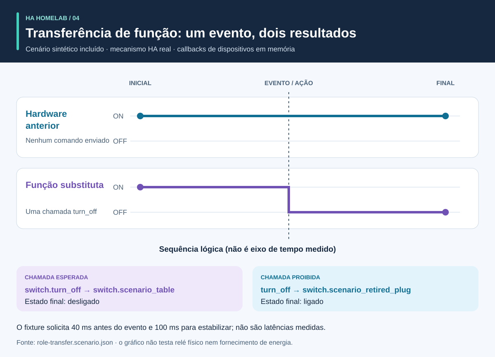

# Processo e resultados: um guia visual

<!-- language-navigation:start -->
<p dir="ltr">
<a href="process-and-results.md" lang="en" dir="ltr">English</a> · <a href="process-and-results.ar.md" lang="ar" dir="rtl">العربية</a> · <a href="process-and-results.bn.md" lang="bn" dir="ltr">বাংলা</a> · <a href="process-and-results.cs.md" lang="cs" dir="ltr">Čeština</a> · <a href="process-and-results.de.md" lang="de" dir="ltr">Deutsch</a> · <a href="process-and-results.es.md" lang="es" dir="ltr">Español</a> · <a href="process-and-results.fa.md" lang="fa" dir="rtl">فارسی</a> · <a href="process-and-results.fr.md" lang="fr" dir="ltr">Français</a><br>
<a href="process-and-results.he.md" lang="he" dir="rtl">עברית</a> · <a href="process-and-results.hi.md" lang="hi" dir="ltr">हिन्दी</a> · <a href="process-and-results.id.md" lang="id" dir="ltr">Bahasa Indonesia</a> · <a href="process-and-results.it.md" lang="it" dir="ltr">Italiano</a> · <a href="process-and-results.ja.md" lang="ja" dir="ltr">日本語</a> · <a href="process-and-results.ko.md" lang="ko" dir="ltr">한국어</a> · <a href="process-and-results.nl.md" lang="nl" dir="ltr">Nederlands</a> · <a href="process-and-results.pl.md" lang="pl" dir="ltr">Polski</a><br>
<a href="process-and-results.pt.md" lang="pt" dir="ltr">Português</a> · <a href="process-and-results.ru.md" lang="ru" dir="ltr">Русский</a> · <a href="process-and-results.th.md" lang="th" dir="ltr">ไทย</a> · <a href="process-and-results.tr.md" lang="tr" dir="ltr">Türkçe</a> · <a href="process-and-results.uk.md" lang="uk" dir="ltr">Українська</a> · <a href="process-and-results.vi.md" lang="vi" dir="ltr">Tiếng Việt</a> · <a href="process-and-results.zh-Hans.md" lang="zh-Hans" dir="ltr">简体中文</a> · <a href="process-and-results.zh-Hant.md" lang="zh-Hant" dir="ltr">繁體中文</a>
</p>
<!-- language-navigation:end -->

[Visão geral dos projetos](README.pt.md)

Um resultado útil responde a uma pergunta específica e preserva as evidências por trás da resposta. As quatro ferramentas trabalham independentemente: quem revisa escolhe as verificações relevantes e leva seus resultados à alteração. As setas abaixo descrevem esse processo de revisão, não uma pipeline automática implementada.


## 1. Defina a alteração e reúna as entradas

Ao substituir um dispositivo, distinga a **função** do **hardware físico**. A função de uma lâmpada pode passar para outra tomada enquanto a anterior começa a alimentar outra coisa. Registre quais referências seguem a função, quais seguem o hardware e quais devem ser retiradas. Forneça ao Entity Migrations o manifesto de migração, o retrato das entidades e os arquivos de origem suportados.

Para medição, forneça a abrangência física, a identidade da fonte, as unidades e o timestamp de cada medidor. Para automação, descreva um estado inicial sintético, sequência de eventos e expectativas explícitas. Para voz, forneça observações da intenção, ação e resposta audível. As ferramentas aceitam entradas diferentes; este fluxo não exige uma exportação compartilhada de uma residência em operação.

## 2. Leia a saída e seus limites


São resumos explicativos de exemplos incluídos, **não capturas de relatórios brutos**:

- **Migração:** o exemplo de mudança de domínio propõe `light.table` → `switch.table` e a mudança de serviço correspondente. Revise cada edição proposta, sua impressão digital e qualquer conflito bloqueante. O plano não se aplica sozinho.
- **Medição:** o exemplo válido com três medidores tem fontes distintas e atuais com valores `700 W`, `0.02 kW` e `0 W`. Normalizar o segundo valor resulta em `700 + 20 + 0 = 720 W`. Esse resultado é sustentado por três medidores; um único medidor de régua não fornece essas três observações por tomada. Exemplos de abrangência compartilhada e fontes duplicadas expõem deliberadamente suposições inválidas.
- **Automação:** o fixture de transferência de função espera uma chamada à entidade substituta e nenhuma ao hardware anterior. Tanto a lista de chamadas quanto os estados finais importam: só um estado final correto pode esconder um comando extra indesejado.
- **Voz:** o exemplo incompleto não tem evidências audíveis suficientes. Encerra com código `3`, mesmo que uma etapa da API tenha terminado. Isso significa que mais evidências são necessárias, não que a pessoa certamente ouviu silêncio.

Fontes: [exemplo de migração](https://github.com/ha-homelab/ha-entity-migrations/tree/main/examples/domain-change), [entrada com três medidores](https://github.com/ha-homelab/ha-meter-contracts/blob/main/examples/valid-three-meters.json), [entrada de voz](https://github.com/ha-homelab/assist-scenario-lab/blob/main/examples/synthetic-incomplete.json). Os comandos exatos de instalação e execução estão no [fluxo da visão geral](README.pt.md#a-concrete-migration-to-test-workflow).

## 3. Inspecione a mudança ao longo do tempo



Em [role-transfer.scenario.json](role-transfer.scenario.json), ambos os interruptores sintéticos começam em `on`. O evento `scenario_table_off` causa `switch.turn_off` para `switch.scenario_table`. O resultado esperado é `off` para o substituto e `on` para `switch.scenario_retired_plug`. Desligar o interruptor anterior é explicitamente proibido.

O gráfico usa **etapas lógicas**, não uma escala de tempo medida. O fixture solicita espera de 40 ms antes do evento e 100 ms para estabilização. São entradas de teste, não latência observada do relé nem garantia de conclusão do evento em 40 ms. O teste deste fixture no ambiente HA real passou na [execução Linux registrada](https://github.com/ha-homelab/ha-scenario-tests/actions/runs/38843681199). Os callbacks dos dispositivos continuam em memória.

## 4. Entenda o que foi testado


O gráfico lê [validation-evidence.json](validation-evidence.json). Cada registro aponta para sua execução GitHub Actions original. É um retrato datado, não um selo de CI ao vivo. O comprimento da barra é a contagem de testes aprovados; **não representa percentual de cobertura, confiabilidade, velocidade ou classificação dos projetos**. As abrangências das suítes diferem.

Entity Migrations ignora no Linux um teste de sistema de arquivos sem distinção entre maiúsculas e minúsculas, verificado localmente no macOS. Scenario Tests inclui sete casos de execução com HA real no total de 54. A falha documentada de encerramento nativo no macOS continua uma limitação separada; testes aprovados no Linux não a removem.

## 5. Decida se deve prosseguir

Mantenha entradas revisadas, versões das ferramentas, relatórios e pendências junto à alteração. Resolva referências não suportadas, fontes de medição conflitantes, asserções falhas e observações ausentes antes de interpretar o resultado como suficiente para o uso pretendido. Use o contrato documentado de estados e códigos de saída de cada ferramenta.

Implantação e aceitação física permanecem separadas. Verifique o dispositivo real, entrega por rádio, comportamento do relé, carga conectada, timestamp da fonte e saída audível conforme aplicável. Um teste sintético aprovado confirma o comportamento de software testado, não o fornecimento bem-sucedido de energia ou uma configuração doméstica completa.

<a id="reproduce-or-translate-the-illustrations"></a>

## Reproduza ou traduza as ilustrações

Execute neste diretório:

```sh
python3 render_architecture.py
python3 -m unittest discover -s . -p 'test_*.py'
```

O gerador produz quatro SVGs por idioma listado no [registro de idiomas](../languages.json) compartilhado. Precisa apenas da biblioteca padrão do Python, não incorpora recursos remotos e inclui título e descrição acessíveis em cada imagem. A mesma cor identifica uma ferramenta nas ilustrações; rótulos também identificam cada série. Para um novo retrato das evidências, atualize juntos os registros de origem e as explicações, preservando links para as execuções registradas. Todas as ilustrações são originais e cobertas por [MIT](LICENSE).
