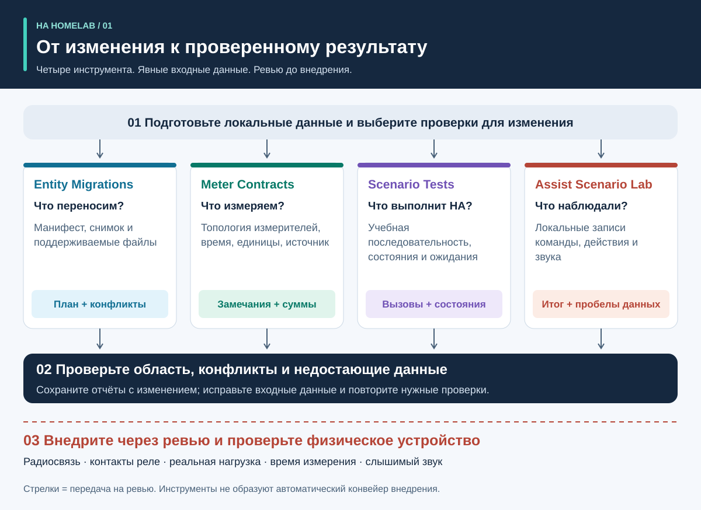
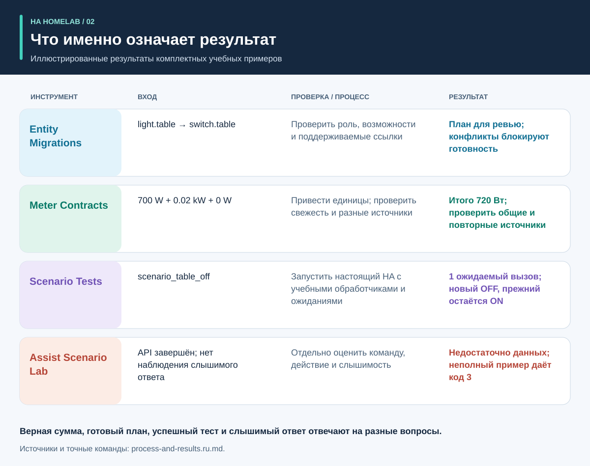
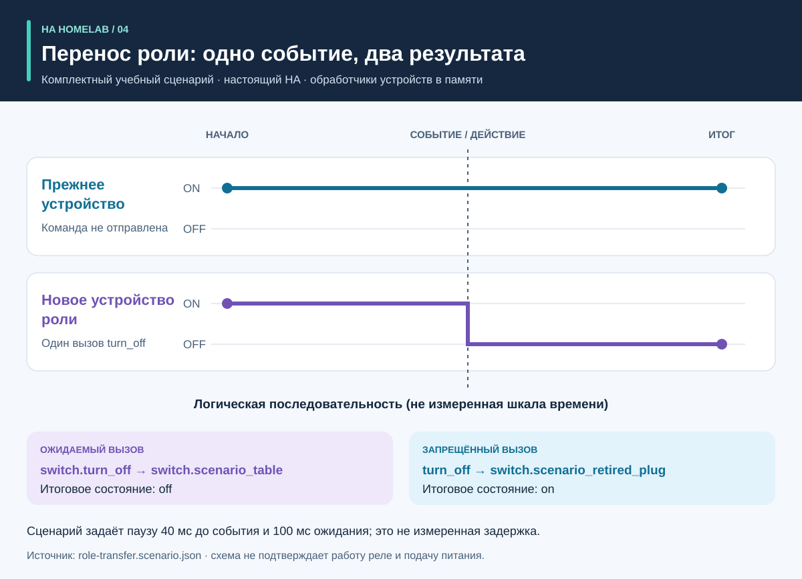
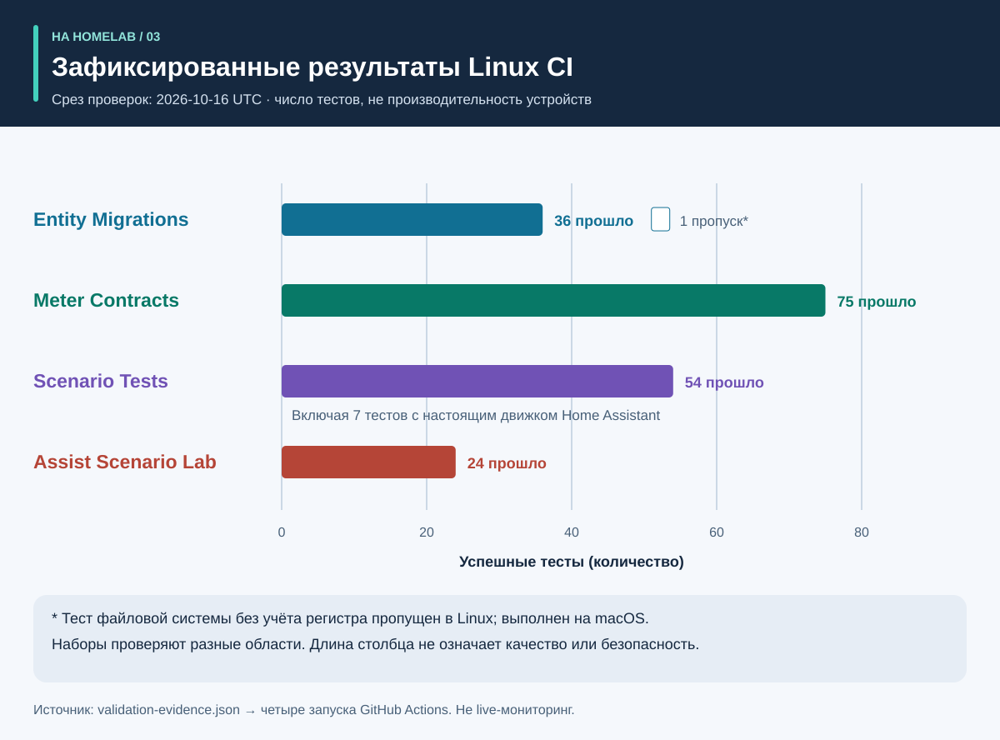

# Процесс и результат: визуальное руководство

<!-- language-navigation:start -->
<p dir="ltr">
<a href="process-and-results.md" lang="en" dir="ltr">English</a> · <a href="process-and-results.ar.md" lang="ar" dir="rtl">العربية</a> · <a href="process-and-results.bn.md" lang="bn" dir="ltr">বাংলা</a> · <a href="process-and-results.cs.md" lang="cs" dir="ltr">Čeština</a> · <a href="process-and-results.de.md" lang="de" dir="ltr">Deutsch</a> · <a href="process-and-results.es.md" lang="es" dir="ltr">Español</a> · <a href="process-and-results.fa.md" lang="fa" dir="rtl">فارسی</a> · <a href="process-and-results.fr.md" lang="fr" dir="ltr">Français</a><br>
<a href="process-and-results.he.md" lang="he" dir="rtl">עברית</a> · <a href="process-and-results.hi.md" lang="hi" dir="ltr">हिन्दी</a> · <a href="process-and-results.id.md" lang="id" dir="ltr">Bahasa Indonesia</a> · <a href="process-and-results.it.md" lang="it" dir="ltr">Italiano</a> · <a href="process-and-results.ja.md" lang="ja" dir="ltr">日本語</a> · <a href="process-and-results.ko.md" lang="ko" dir="ltr">한국어</a> · <a href="process-and-results.nl.md" lang="nl" dir="ltr">Nederlands</a> · <a href="process-and-results.pl.md" lang="pl" dir="ltr">Polski</a><br>
<a href="process-and-results.pt.md" lang="pt" dir="ltr">Português</a> · <a href="process-and-results.ru.md" lang="ru" dir="ltr">Русский</a> · <a href="process-and-results.th.md" lang="th" dir="ltr">ไทย</a> · <a href="process-and-results.tr.md" lang="tr" dir="ltr">Türkçe</a> · <a href="process-and-results.uk.md" lang="uk" dir="ltr">Українська</a> · <a href="process-and-results.vi.md" lang="vi" dir="ltr">Tiếng Việt</a> · <a href="process-and-results.zh-Hans.md" lang="zh-Hans" dir="ltr">简体中文</a> · <a href="process-and-results.zh-Hant.md" lang="zh-Hant" dir="ltr">繁體中文</a>
</p>
<!-- language-navigation:end -->

[Обзор проектов](README.ru.md)

Полезный результат отвечает на конкретный вопрос и сохраняет подтверждающие данные. Четыре инструмента работают независимо: автор изменения выбирает нужные проверки и передаёт результаты на ревью. Стрелки ниже обозначают этот процесс, а не реализованный автоматический конвейер.



## 1. Определить изменение и подготовить данные

При замене устройства разделите **роль** и **физическое оборудование**. Роль лампы может перейти на другую розетку, а прежняя розетка начнёт питать иной прибор. Укажите, какие ссылки следуют за ролью, какие — за оборудованием, а какие больше не нужны. Передайте Entity Migrations манифест, снимок сущностей и поддерживаемые исходные файлы.

Для измерений задайте физическую область каждого измерителя, идентичность источника, единицы и время. Для автоматизации опишите начальное учебное состояние, последовательность событий и явные ожидания. Для голоса подготовьте наблюдения о команде, действии и слышимом ответе. Инструменты принимают разные данные; общий экспорт действующего дома для этого процесса не требуется.

## 2. Прочитать результат и понять его границы



Это поясняющие сводки комплектных примеров, **не скриншоты сырых отчётов**:

- **Миграция:** пример смены домена предлагает `light.table` → `switch.table` и соответствующую замену сервисного вызова. Проверьте каждую правку, отпечаток файла и блокирующие конфликты. План сам себя не применяет.
- **Измерения:** корректный пример использует три разных свежих источника: `700 W`, `0.02 kW` и `0 W`. После приведения единиц получается `700 + 20 + 0 = 720 W`. Результат подтверждён тремя измерителями; один общий измеритель удлинителя таких данных по каждому выходу не даёт. Примеры общей области и повторных источников специально выявляют неверные предположения.
- **Автоматизация:** сценарий переноса роли ожидает один вызов для нового устройства и ни одного — для прежнего. Проверяются и вызовы, и итоговые состояния: совпадение только конечного состояния могло бы скрыть лишнюю команду.
- **Голос:** неполному примеру не хватает подтверждения слышимого ответа. Он завершается с кодом `3`, даже если этап API закончился. Это означает необходимость дополнительных данных, а не доказанное отсутствие звука у слушателя.

Источники: [пример миграции](https://github.com/ha-homelab/ha-entity-migrations/tree/main/examples/domain-change), [данные трёх измерителей](https://github.com/ha-homelab/ha-meter-contracts/blob/main/examples/valid-three-meters.json), [голосовой пример](https://github.com/ha-homelab/assist-scenario-lab/blob/main/examples/synthetic-incomplete.json). Точные команды установки и запуска приведены в [пошаговом обзоре](README.ru.md#от-плана-миграции-к-исполняемому-тесту).

## 3. Проследить изменение состояния



В [role-transfer.scenario.json](role-transfer.scenario.json) оба учебных переключателя начинают с `on`. Событие `scenario_table_off` вызывает `switch.turn_off` для `switch.scenario_table`. Ожидаемый итог — `off` у нового устройства и `on` у `switch.scenario_retired_plug`. Выключение прежнего переключателя явно запрещено.

На графике показаны **логические этапы**, а не измеренная шкала времени. Сценарий задаёт паузу 40 мс перед событием и 100 мс ожидания после него. Это входные параметры теста, а не измеренная задержка реле и не гарантия завершения команды за 40 мс. Проверка этого сценария настоящим движком HA прошла в [зафиксированном Linux-прогоне](https://github.com/ha-homelab/ha-scenario-tests/actions/runs/38843681199). Обработчики устройств при этом работают в памяти.

## 4. Разобраться в результатах тестирования



Данные графика находятся в [validation-evidence.json](validation-evidence.json). Каждая запись ссылается на исходный запуск GitHub Actions. Это датированный срез, а не текущий статус CI. Длина столбца показывает число успешных тестов, **не процент покрытия, надёжность, скорость или рейтинг проектов**. Наборы проверяют разные области.

В Entity Migrations один Linux-тест пропущен: поведение файловой системы без учёта регистра проверено локально на macOS. В 54 теста Scenario Tests входят семь проверок настоящего движка HA. Документированная ошибка завершения native-кода на macOS остаётся отдельным ограничением; успешный Linux-прогон её не устраняет.

## 5. Принять решение о внедрении

Сохраните проверенные входные данные, версии инструментов, отчёты и оставшиеся замечания вместе с изменением. Разберите неподдерживаемые ссылки, конфликты источников измерений, проваленные ожидания и недостающие наблюдения прежде, чем считать результат достаточным для его назначения. Используйте описание статусов и кодов возврата конкретного инструмента.

Внедрение и физическая приёмка — отдельные этапы. По ситуации проверьте само устройство, доставку радиокоманды, работу реле, подключённую нагрузку, исходное время измерения и слышимый ответ. Учебный тест подтверждает проверенное поведение программы, а не подачу питания или всю конфигурацию дома.

## Воспроизвести или перевести иллюстрации

Из этого каталога выполните:

```sh
python3 render_architecture.py
python3 -m unittest discover -s . -p 'test_*.py'
```

Генератор создаёт четыре SVG для каждого языка из общего [реестра языков](../languages.json). Достаточно стандартной библиотеки Python; внешних изображений нет, у каждой схемы есть доступные заголовок и описание. Цвет инструмента одинаков на разных иллюстрациях; все серии также подписаны текстом. При обновлении среза проверок меняйте исходные записи и пояснения вместе, сохраняя ссылки на соответствующие запуски. Иллюстрации оригинальные, лицензия — [MIT](LICENSE).
