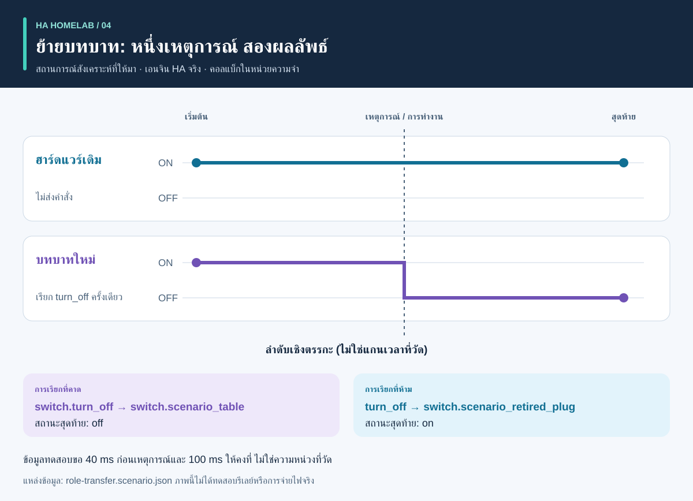

# กระบวนการและผลลัพธ์: คู่มือภาพ

<!-- language-navigation:start -->
<p dir="ltr">
<a href="process-and-results.md" lang="en" dir="ltr">English</a> · <a href="process-and-results.ar.md" lang="ar" dir="rtl">العربية</a> · <a href="process-and-results.bn.md" lang="bn" dir="ltr">বাংলা</a> · <a href="process-and-results.cs.md" lang="cs" dir="ltr">Čeština</a> · <a href="process-and-results.de.md" lang="de" dir="ltr">Deutsch</a> · <a href="process-and-results.es.md" lang="es" dir="ltr">Español</a> · <a href="process-and-results.fa.md" lang="fa" dir="rtl">فارسی</a> · <a href="process-and-results.fr.md" lang="fr" dir="ltr">Français</a><br>
<a href="process-and-results.he.md" lang="he" dir="rtl">עברית</a> · <a href="process-and-results.hi.md" lang="hi" dir="ltr">हिन्दी</a> · <a href="process-and-results.id.md" lang="id" dir="ltr">Bahasa Indonesia</a> · <a href="process-and-results.it.md" lang="it" dir="ltr">Italiano</a> · <a href="process-and-results.ja.md" lang="ja" dir="ltr">日本語</a> · <a href="process-and-results.ko.md" lang="ko" dir="ltr">한국어</a> · <a href="process-and-results.nl.md" lang="nl" dir="ltr">Nederlands</a> · <a href="process-and-results.pl.md" lang="pl" dir="ltr">Polski</a><br>
<a href="process-and-results.pt.md" lang="pt" dir="ltr">Português</a> · <a href="process-and-results.ru.md" lang="ru" dir="ltr">Русский</a> · <a href="process-and-results.th.md" lang="th" dir="ltr">ไทย</a> · <a href="process-and-results.tr.md" lang="tr" dir="ltr">Türkçe</a> · <a href="process-and-results.uk.md" lang="uk" dir="ltr">Українська</a> · <a href="process-and-results.vi.md" lang="vi" dir="ltr">Tiếng Việt</a> · <a href="process-and-results.zh-Hans.md" lang="zh-Hans" dir="ltr">简体中文</a> · <a href="process-and-results.zh-Hant.md" lang="zh-Hant" dir="ltr">繁體中文</a>
</p>
<!-- language-navigation:end -->

[ภาพรวมโครงการ](README.th.md)

ผลลัพธ์ที่มีประโยชน์ตอบคำถามเฉพาะและเก็บหลักฐานรองรับคำตอบ เครื่องมือทั้งสี่ทำงานเป็นอิสระ ผู้ตรวจทานเลือกการตรวจที่เกี่ยวข้องและแนบผลไว้กับการเปลี่ยนแปลง ลูกศรด้านล่างอธิบายกระบวนการตรวจทาน ไม่ใช่ไปป์ไลน์อัตโนมัติที่พัฒนาแล้ว


## 1. กำหนดการเปลี่ยนแปลงและรวบรวมข้อมูลเข้า

เมื่อเปลี่ยนอุปกรณ์ ให้แยก**บทบาท**ออกจาก**ฮาร์ดแวร์จริง** บทบาทหลอดไฟอาจย้ายไปปลั๊กอื่นขณะที่ปลั๊กเดิมจ่ายไฟให้สิ่งอื่น บันทึกการอ้างอิงที่ตามบทบาท ที่ตามฮาร์ดแวร์ และที่ควรเลิกใช้ ส่งมานิเฟสต์การย้าย ภาพสถานะเอนทิตี และไฟล์ต้นทางที่รองรับให้ Entity Migrations

สำหรับการวัด ให้ระบุขอบเขตจริง อัตลักษณ์แหล่งข้อมูล หน่วย และเวลาของมิเตอร์แต่ละตัว สำหรับระบบอัตโนมัติ ให้อธิบายสถานะเริ่มต้นสังเคราะห์ ลำดับเหตุการณ์ และผลที่คาดไว้อย่างชัดเจน สำหรับเสียง ให้ข้อมูลสังเกตเจตนา การทำงาน และเสียงตอบที่ได้ยิน เครื่องมือรับข้อมูลเข้าต่างกัน ขั้นตอนนี้ไม่ต้องใช้ข้อมูลส่งออกร่วมจากบ้านที่กำลังใช้งาน

## 2. อ่านผลส่งออกและข้อจำกัด


นี่คือคำสรุปอธิบายตัวอย่างที่รวมมา **ไม่ใช่ภาพหน้าจอรายงานดิบ**:

- **การย้าย:** ตัวอย่างเปลี่ยนโดเมนเสนอ `light.table` → `switch.table` และเปลี่ยนบริการที่สอดคล้องกัน ตรวจทานทุกการแก้ไขที่เสนอ ลายนิ้วมือ และข้อขัดแย้งที่บล็อก แผนไม่ใช้การเปลี่ยนแปลงเอง
- **การวัด:** ตัวอย่างมิเตอร์สามตัวที่ถูกต้องมีแหล่งแยกและสดใหม่ โดยมีค่า `700 W`, `0.02 kW` และ `0 W` เมื่อแปลงหน่วยค่าที่สองจะได้ `700 + 20 + 0 = 720 W` ผลนี้รองรับด้วยมิเตอร์สามตัว มิเตอร์ปลั๊กพ่วงเพียงตัวเดียวไม่ได้ให้ข้อมูลสังเกตสามปลั๊กแยกกัน ตัวอย่างขอบเขตร่วมและแหล่งซ้ำจงใจเผยสมมติฐานที่ผิด
- **ระบบอัตโนมัติ:** ข้อมูลทดสอบย้ายบทบาทคาดให้เรียกเอนทิตีใหม่หนึ่งครั้งและไม่เรียกฮาร์ดแวร์เดิม รายการเรียกกับสถานะสุดท้ายสำคัญทั้งคู่ สถานะจบที่ตรงเพียงอย่างเดียวอาจซ่อนคำสั่งเกินที่ไม่ต้องการ
- **เสียง:** ตัวอย่างไม่ครบขาดหลักฐานการได้ยินที่เพียงพอ จบด้วยรหัส `3` แม้ขั้น API เสร็จแล้ว หมายความว่าต้องมีหลักฐานเพิ่ม ไม่ใช่ว่าผู้ฟังได้ยินเพียงความเงียบแน่นอน

แหล่งข้อมูล: [ตัวอย่างการย้าย](https://github.com/ha-homelab/ha-entity-migrations/tree/main/examples/domain-change), [ข้อมูลเข้ามิเตอร์สามตัว](https://github.com/ha-homelab/ha-meter-contracts/blob/main/examples/valid-three-meters.json), [ข้อมูลเข้าเสียง](https://github.com/ha-homelab/assist-scenario-lab/blob/main/examples/synthetic-incomplete.json) คำสั่งติดตั้งและรันที่แน่นอนอยู่ใน[ขั้นตอนของภาพรวม](README.th.md#a-concrete-migration-to-test-workflow)

## 3. ตรวจการเปลี่ยนแปลงตามลำดับ



ใน [role-transfer.scenario.json](role-transfer.scenario.json) สวิตช์สังเคราะห์ทั้งสองเริ่มที่ `on` เหตุการณ์ `scenario_table_off` ทำให้เรียก `switch.turn_off` สำหรับ `switch.scenario_table` ผลที่คาดคือ `off` สำหรับตัวใหม่ และ `on` สำหรับ `switch.scenario_retired_plug` การปิดสวิตช์เดิมถูกห้ามไว้อย่างชัดเจน

กราฟใช้**ขั้นเชิงตรรกะ** ไม่ใช่แกนเวลาที่วัด ข้อมูลทดสอบขอรอ 40 ms ก่อนเหตุการณ์และ 100 ms เพื่อให้คงที่ นี่คือข้อมูลทดสอบ ไม่ใช่ความหน่วงรีเลย์ที่สังเกตหรือการรับประกันว่าเหตุการณ์จบใน 40 ms การทดสอบข้อมูลนี้ด้วย HA จริงผ่านใน[การรัน Linux ที่บันทึกไว้](https://github.com/ha-homelab/ha-scenario-tests/actions/runs/38843681199) คอลแบ็กอุปกรณ์ยังรันในหน่วยความจำ

## 4. เข้าใจว่าทดสอบอะไรแล้ว


กราฟอ่าน [validation-evidence.json](validation-evidence.json) แต่ละบันทึกเชื่อมไปยังการรัน GitHub Actions ต้นฉบับ นี่คือภาพข้อมูลตามวันที่ ไม่ใช่ป้าย CI แบบสด ความยาวแท่งคือจำนวนทดสอบที่ผ่าน **ไม่ใช่เปอร์เซ็นต์ความครอบคลุม ความเชื่อถือได้ ความเร็ว หรืออันดับโครงการ** ขอบเขตชุดทดสอบต่างกัน

Entity Migrations ข้ามกรณีพฤติกรรมระบบไฟล์ไม่แยกตัวพิมพ์เล็กใหญ่หนึ่งกรณีบน Linux ซึ่งตรวจใน macOS ภายในเครื่องแล้ว Scenario Tests มีเจ็ดกรณีรัน HA จริงในทั้งหมด 54 กรณี ข้อผิดพลาดการล้างงานก่อนจบบน macOS แบบเนทีฟยังเป็นข้อจำกัดแยก ผลผ่านบน Linux ไม่ได้ลบข้อจำกัดนี้

## 5. ตัดสินใจว่าจะดำเนินต่อหรือไม่

เก็บข้อมูลเข้าที่ตรวจแล้ว รุ่นเครื่องมือ รายงาน และประเด็นค้างกับการเปลี่ยนแปลง แก้การอ้างอิงที่ไม่รองรับ แหล่งมิเตอร์ขัดกัน การยืนยันที่ล้มเหลว และข้อสังเกตที่ขาด ก่อนตีความว่าผลเพียงพอต่อการใช้งานที่ตั้งใจ ใช้ข้อกำหนดสถานะและรหัสออกตามเอกสารแต่ละเครื่องมือ

การติดตั้งและการตรวจรับจริงยังแยกกัน ตรวจอุปกรณ์จริง การส่งวิทยุ พฤติกรรมรีเลย์ โหลดที่ต่อ เวลาต้นทาง และเสียงที่ได้ยินตามที่เกี่ยวข้อง การผ่านแบบสังเคราะห์ยืนยันพฤติกรรมซอฟต์แวร์ที่ทดสอบ ไม่ใช่การจ่ายไฟสำเร็จหรือการตั้งค่าทั้งบ้านที่ครบถ้วน

<a id="reproduce-or-translate-the-illustrations"></a>

## สร้างหรือแปลภาพประกอบซ้ำ

รันจากไดเรกทอรีนี้:

```sh
python3 render_architecture.py
python3 -m unittest discover -s . -p 'test_*.py'
```

ตัวสร้างผลิต SVG สี่ภาพต่อภาษาใน[ทะเบียนภาษาร่วม](../languages.json) ใช้เพียงไลบรารีมาตรฐาน Python ไม่ฝังทรัพยากรระยะไกล และมีชื่อกับคำอธิบายที่เข้าถึงได้ในทุกภาพ สีเดียวกันแทนเครื่องมือเดียวกันตลอดภาพ และป้ายกำกับยังระบุทุกชุดข้อมูล เมื่อทำภาพข้อมูลหลักฐานใหม่ ให้อัปเดตบันทึกต้นทางและคำอธิบายพร้อมกันโดยคงลิงก์การรันที่บันทึกไว้ ภาพทั้งหมดเป็นต้นฉบับภายใต้ [MIT](LICENSE)

