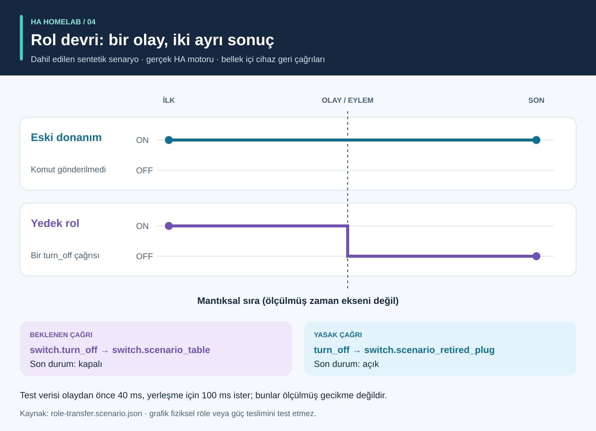

# Süreç ve sonuçlar: görsel anlatım

<!-- language-navigation:start -->
<p dir="ltr">
<a href="process-and-results.md" lang="en" dir="ltr">English</a> · <a href="process-and-results.ar.md" lang="ar" dir="rtl">العربية</a> · <a href="process-and-results.bn.md" lang="bn" dir="ltr">বাংলা</a> · <a href="process-and-results.cs.md" lang="cs" dir="ltr">Čeština</a> · <a href="process-and-results.de.md" lang="de" dir="ltr">Deutsch</a> · <a href="process-and-results.es.md" lang="es" dir="ltr">Español</a> · <a href="process-and-results.fa.md" lang="fa" dir="rtl">فارسی</a> · <a href="process-and-results.fr.md" lang="fr" dir="ltr">Français</a><br>
<a href="process-and-results.he.md" lang="he" dir="rtl">עברית</a> · <a href="process-and-results.hi.md" lang="hi" dir="ltr">हिन्दी</a> · <a href="process-and-results.id.md" lang="id" dir="ltr">Bahasa Indonesia</a> · <a href="process-and-results.it.md" lang="it" dir="ltr">Italiano</a> · <a href="process-and-results.ja.md" lang="ja" dir="ltr">日本語</a> · <a href="process-and-results.ko.md" lang="ko" dir="ltr">한국어</a> · <a href="process-and-results.nl.md" lang="nl" dir="ltr">Nederlands</a> · <a href="process-and-results.pl.md" lang="pl" dir="ltr">Polski</a><br>
<a href="process-and-results.pt.md" lang="pt" dir="ltr">Português</a> · <a href="process-and-results.ru.md" lang="ru" dir="ltr">Русский</a> · <a href="process-and-results.th.md" lang="th" dir="ltr">ไทย</a> · <a href="process-and-results.tr.md" lang="tr" dir="ltr">Türkçe</a> · <a href="process-and-results.uk.md" lang="uk" dir="ltr">Українська</a> · <a href="process-and-results.vi.md" lang="vi" dir="ltr">Tiếng Việt</a> · <a href="process-and-results.zh-Hans.md" lang="zh-Hans" dir="ltr">简体中文</a> · <a href="process-and-results.zh-Hant.md" lang="zh-Hant" dir="ltr">繁體中文</a>
</p>
<!-- language-navigation:end -->

[Projelere genel bakış](README.tr.md)

Yararlı bir sonuç belirli bir soruyu yanıtlar ve yanıtın dayandığı kanıtı korur. Dört araç bağımsız çalışır: inceleyen kişi ilgili denetimleri seçer ve sonuçlarını değişikliğe taşır. Aşağıdaki oklar bu inceleme sürecini anlatır, uygulanmış otomatik bir hattı değil.


## 1. Değişikliği tanımlayın ve girdileri toplayın

Cihaz değişiminde **rolü** **fiziksel donanımdan** ayırın. Eski priz başka bir şeyi beslemeye başlarken lamba rolü başka prize geçebilir. Hangi başvuruların rolü, hangilerinin donanımı izlediğini ve hangilerinin kaldırılacağını kaydedin. Entity Migrations'a geçiş manifestini, varlık durum görüntüsünü ve desteklenen kaynak dosyaları sağlayın.

Ölçüm için her sayacın fiziksel kapsamını, kaynak kimliğini, birimlerini ve zaman damgasını sağlayın. Otomasyon için sentetik başlangıç durumunu, olay sırasını ve açık beklentileri tanımlayın. Ses için niyet, eylem ve duyulabilir yanıt gözlemlerini sağlayın. Araçlar farklı girdiler kabul eder; bu iş akışı ortak bir canlı ev dışa aktarımı gerektirmez.

## 2. Çıktıyı ve sınırlarını okuyun


Bunlar dahil edilen örneklerin açıklayıcı özetleridir; **ham rapor ekran görüntüleri değildir**:

- **Geçiş:** alan değişikliği örneği `light.table` → `switch.table` ve ilgili hizmet değişikliğini önerir. Her düzenlemeyi, parmak izini ve engelleyici çakışmayı inceleyin. Plan kendini uygulamaz.
- **Ölçüm:** geçerli üç sayaç örneği `700 W`, `0.02 kW` ve `0 W` değerlerine sahip ayrı, güncel kaynaklar içerir. İkinci değer normalize edildiğinde `700 + 20 + 0 = 720 W` elde edilir. Sonuç üç sayaçla desteklenir; tek çoklu priz sayacı bu üç priz gözlemini sağlamaz. Ortak kapsam ve yinelenen kaynak örnekleri bilerek geçersiz varsayımları gösterir.
- **Otomasyon:** rol devri örneği yedek varlığa bir çağrı, eski donanıma sıfır çağrı bekler. Çağrı listesi ve son durumlar birlikte önemlidir: yalnızca eşleşen son durum, istenmeyen fazladan komutu gizleyebilir.
- **Ses:** eksik örnekte yeterli duyulabilir kanıt yoktur. API aşaması tamamlansa bile `3` koduyla çıkar. Bu daha fazla kanıt gerektiğini gösterir; dinleyicinin kesinlikle sessizlik duyduğunu değil.

Kaynaklar: [geçiş örneği](https://github.com/ha-homelab/ha-entity-migrations/tree/main/examples/domain-change), [üç sayaç girdisi](https://github.com/ha-homelab/ha-meter-contracts/blob/main/examples/valid-three-meters.json), [ses girdisi](https://github.com/ha-homelab/assist-scenario-lab/blob/main/examples/synthetic-incomplete.json). Kesin kurulum ve çalıştırma komutları [genel bakış anlatımındadır](README.tr.md#a-concrete-migration-to-test-workflow).

## 3. Değişikliği zaman içinde inceleyin



[role-transfer.scenario.json](role-transfer.scenario.json) içinde iki sentetik anahtar da `on` başlar. `scenario_table_off` olayı, `switch.scenario_table` için `switch.turn_off` çağırır. Beklenen sonuç yedek için `off`, `switch.scenario_retired_plug` için `on` olur. Eski anahtarı kapatmak açıkça yasaktır.

Grafik ölçülmüş zaman ölçeği değil, **mantıksal aşamalar** kullanır. Test verisi olaydan önce 40 ms bekleme ve yerleşme için 100 ms ister. Bunlar test girdileridir; gözlenen röle gecikmesi veya olayın 40 ms içinde biteceği garantisi değildir. Bu örneğin gerçek HA çalışma testi [kaydedilen Linux çalıştırmasında](https://github.com/ha-homelab/ha-scenario-tests/actions/runs/38843681199) geçti. Cihaz geri çağrıları hâlâ bellekte çalışır.

## 4. Nelerin test edildiğini anlayın


Grafik [validation-evidence.json](validation-evidence.json) dosyasını okur. Her kayıt orijinal GitHub Actions çalıştırmasına bağlanır. Tarihli bir görüntüdür, canlı CI rozeti değildir. Çubuk uzunluğu geçen test sayısıdır; **kapsam yüzdesi, güvenilirlik, hız veya proje sıralaması değildir**. Takımların kapsamı farklıdır.

Entity Migrations, Linux'ta büyük/küçük harf duyarsız dosya sistemi davranışı için yerel macOS'ta kontrol edilen bir durumu atlar. Scenario Tests toplam 54 test içinde yedi gerçek HA çalışma durumu içerir. Belgelenmiş yerel macOS kapanış hatası ayrı bir sınırlama olarak kalır; Linux testlerinin geçmesi onu kaldırmaz.

## 5. Devam edip etmeyeceğinize karar verin

İncelenen girdileri, araç sürümlerini, raporları ve açık bulguları değişiklikle saklayın. Sonucu amaçlanan kullanım için yeterli saymadan önce desteklenmeyen başvuruları, çakışan sayaç kaynaklarını, başarısız doğrulamaları ve eksik gözlemleri çözün. Her aracın belgelenmiş durum ve çıkış kodu sözleşmesini kullanın.

Dağıtım ve fiziksel kabul ayrı kalır. Uygunsa gerçek cihazı, radyo teslimini, röle davranışını, bağlı yükü, kaynak zaman damgasını ve duyulabilir çıktıyı doğrulayın. Geçen sentetik test, test edilen yazılım davranışını onaylar; başarılı güç teslimini veya tam ev yapılandırmasını değil.

<a id="reproduce-or-translate-the-illustrations"></a>

## Resimleri yeniden üretme veya çevirme

Bu dizinden çalıştırın:

```sh
python3 render_architecture.py
python3 -m unittest discover -s . -p 'test_*.py'
```

Üretici ortak [dil kaydında](../languages.json) listelenen her dil için dört SVG oluşturur. Yalnızca Python standart kitaplığını gerektirir; uzak varlık gömmez ve her görsele erişilebilir başlık ve açıklama ekler. Aynı renk tüm resimlerde aynı aracı belirtir; etiketler de her seriyi tanımlar. Yeni kanıt görüntüsü için kaynak kayıtları ve açıklamaları birlikte güncelleyip kaydedilen çalıştırmalara bağlantıları koruyun. Tüm görseller özgündür ve [MIT](LICENSE) kapsamındadır.
