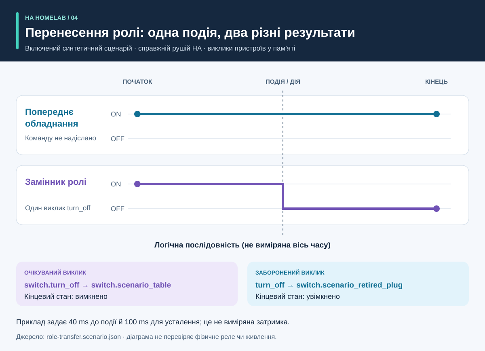

# Процес і результати: наочний посібник

<!-- language-navigation:start -->
<p dir="ltr">
<a href="process-and-results.md" lang="en" dir="ltr">English</a> · <a href="process-and-results.ar.md" lang="ar" dir="rtl">العربية</a> · <a href="process-and-results.bn.md" lang="bn" dir="ltr">বাংলা</a> · <a href="process-and-results.cs.md" lang="cs" dir="ltr">Čeština</a> · <a href="process-and-results.de.md" lang="de" dir="ltr">Deutsch</a> · <a href="process-and-results.es.md" lang="es" dir="ltr">Español</a> · <a href="process-and-results.fa.md" lang="fa" dir="rtl">فارسی</a> · <a href="process-and-results.fr.md" lang="fr" dir="ltr">Français</a><br>
<a href="process-and-results.he.md" lang="he" dir="rtl">עברית</a> · <a href="process-and-results.hi.md" lang="hi" dir="ltr">हिन्दी</a> · <a href="process-and-results.id.md" lang="id" dir="ltr">Bahasa Indonesia</a> · <a href="process-and-results.it.md" lang="it" dir="ltr">Italiano</a> · <a href="process-and-results.ja.md" lang="ja" dir="ltr">日本語</a> · <a href="process-and-results.ko.md" lang="ko" dir="ltr">한국어</a> · <a href="process-and-results.nl.md" lang="nl" dir="ltr">Nederlands</a> · <a href="process-and-results.pl.md" lang="pl" dir="ltr">Polski</a><br>
<a href="process-and-results.pt.md" lang="pt" dir="ltr">Português</a> · <a href="process-and-results.ru.md" lang="ru" dir="ltr">Русский</a> · <a href="process-and-results.th.md" lang="th" dir="ltr">ไทย</a> · <a href="process-and-results.tr.md" lang="tr" dir="ltr">Türkçe</a> · <a href="process-and-results.uk.md" lang="uk" dir="ltr">Українська</a> · <a href="process-and-results.vi.md" lang="vi" dir="ltr">Tiếng Việt</a> · <a href="process-and-results.zh-Hans.md" lang="zh-Hans" dir="ltr">简体中文</a> · <a href="process-and-results.zh-Hant.md" lang="zh-Hant" dir="ltr">繁體中文</a>
</p>
<!-- language-navigation:end -->

[Огляд проєктів](README.uk.md)

Корисний результат відповідає на конкретне запитання й зберігає докази відповіді. Чотири інструменти працюють незалежно: рецензент обирає доречні перевірки та переносить їхні результати до зміни. Стрілки нижче описують процес перевірки, а не реалізований автоматичний конвеєр.


## 1. Визначте зміну та зберіть входи

Під час заміни пристрою відокремлюйте **роль** від **фізичного обладнання**. Роль лампи може перейти до іншої розетки, а попередня почне живити щось інше. Запишіть, які посилання йдуть за роллю, які — за обладнанням, а які слід вилучити. Надайте Entity Migrations маніфест міграції, знімок сутностей і підтримувані вихідні файли.

Для вимірювань надайте фізичне охоплення кожного лічильника, ідентичність джерела, одиниці й часову мітку. Для автоматизації опишіть синтетичний початковий стан, послідовність подій і явні очікування. Для голосу надайте спостереження наміру, дії та чутної відповіді. Інструменти приймають різні входи; цей процес не потребує спільного експорту з робочої домівки.

## 2. Прочитайте вихід і його межі


Це пояснювальні підсумки включених прикладів, **не знімки необроблених звітів**:

- **Міграція:** приклад зміни домену пропонує `light.table` → `switch.table` і відповідну зміну сервісу. Перегляньте кожну запропоновану правку, її відбиток та блокувальні конфлікти. План не застосовує себе сам.
- **Вимірювання:** коректний приклад трьох лічильників має окремі актуальні джерела зі значеннями `700 W`, `0.02 kW` і `0 W`. Нормалізація другого дає `700 + 20 + 0 = 720 W`. Результат підтверджують три лічильники; один лічильник подовжувача не надає цих трьох спостережень за розетками. Приклади спільного охоплення й дубльованих джерел навмисно виявляють хибні припущення.
- **Автоматизація:** приклад перенесення ролі очікує один виклик сутності-замінника та жодного виклику попереднього обладнання. Важливі список викликів і кінцеві стани: сам відповідний кінцевий стан може приховати небажану додаткову команду.
- **Голос:** неповному прикладу бракує достатніх доказів чутності. Він завершується кодом `3`, навіть якщо етап API завершився. Це означає потребу в додаткових доказах, а не впевненість, що слухач чув тишу.

Джерела: [приклад міграції](https://github.com/ha-homelab/ha-entity-migrations/tree/main/examples/domain-change), [вхід трьох лічильників](https://github.com/ha-homelab/ha-meter-contracts/blob/main/examples/valid-three-meters.json), [голосовий вхід](https://github.com/ha-homelab/assist-scenario-lab/blob/main/examples/synthetic-incomplete.json). Точні команди встановлення й виконання наведені в [процесі огляду](README.uk.md#a-concrete-migration-to-test-workflow).

## 3. Перевірте зміну з часом



У [role-transfer.scenario.json](role-transfer.scenario.json) обидва синтетичні перемикачі починають зі стану `on`. Подія `scenario_table_off` викликає `switch.turn_off` для `switch.scenario_table`. Очікується `off` для замінника та `on` для `switch.scenario_retired_plug`. Вимкнення попереднього перемикача явно заборонене.

Діаграма використовує **логічні етапи**, а не виміряну шкалу часу. Приклад задає 40 ms очікування до події та 100 ms для усталення. Це тестові входи, не спостережувана затримка реле й не гарантія завершення події за 40 ms. Тест цього прикладу в справжньому середовищі HA пройшов у [зафіксованому запуску Linux](https://github.com/ha-homelab/ha-scenario-tests/actions/runs/38843681199). Зворотні виклики пристроїв залишаються в пам’яті.

## 4. Зрозумійте, що перевірено


Діаграма читає [validation-evidence.json](validation-evidence.json). Кожен запис посилається на початковий запуск GitHub Actions. Це датований зріз, не живий індикатор CI. Довжина смуги — кількість успішних тестів; це **не відсоток покриття, надійність, швидкість чи рейтинг проєктів**. Охоплення наборів відрізняється.

Entity Migrations пропускає на Linux один випадок нечутливої до регістру файлової системи, перевірений локально на macOS. Scenario Tests включає сім випадків виконання зі справжнім HA до загальної кількості 54. Задокументована помилка нативного завершення на macOS залишається окремим обмеженням; успіх тестів Linux її не усуває.

## 5. Вирішіть, чи продовжувати

Зберігайте перевірені входи, версії інструментів, звіти та відкриті зауваження разом зі зміною. Усуньте непідтримувані посилання, конфліктні джерела вимірювань, невдалі перевірки тверджень і відсутні спостереження, перш ніж вважати результат достатнім для цільового використання. Дотримуйтеся документованого контракту станів і кодів завершення кожного інструмента.

Розгортання й фізичне приймання залишаються окремими. За потреби перевірте фактичний пристрій, радіодоставку, поведінку реле, підключене навантаження, часову мітку джерела та чутний вихід. Успішний синтетичний тест підтверджує перевірену програмну поведінку, а не подачу живлення чи повну домашню конфігурацію.

<a id="reproduce-or-translate-the-illustrations"></a>

## Відтворення або переклад ілюстрацій

Запустіть із цього каталогу:

```sh
python3 render_architecture.py
python3 -m unittest discover -s . -p 'test_*.py'
```

Генератор створює чотири SVG для кожної мови зі спільного [реєстру мов](../languages.json). Потрібна лише стандартна бібліотека Python; він не вбудовує віддалені ресурси та додає доступні заголовок і опис до кожного зображення. Той самий колір позначає інструмент на всіх ілюстраціях; підписи також визначають кожен ряд. Для нового зрізу доказів оновлюйте вихідні записи й пояснення разом, зберігаючи посилання на зафіксовані запуски. Усі ілюстрації оригінальні й поширюються за [MIT](LICENSE).
