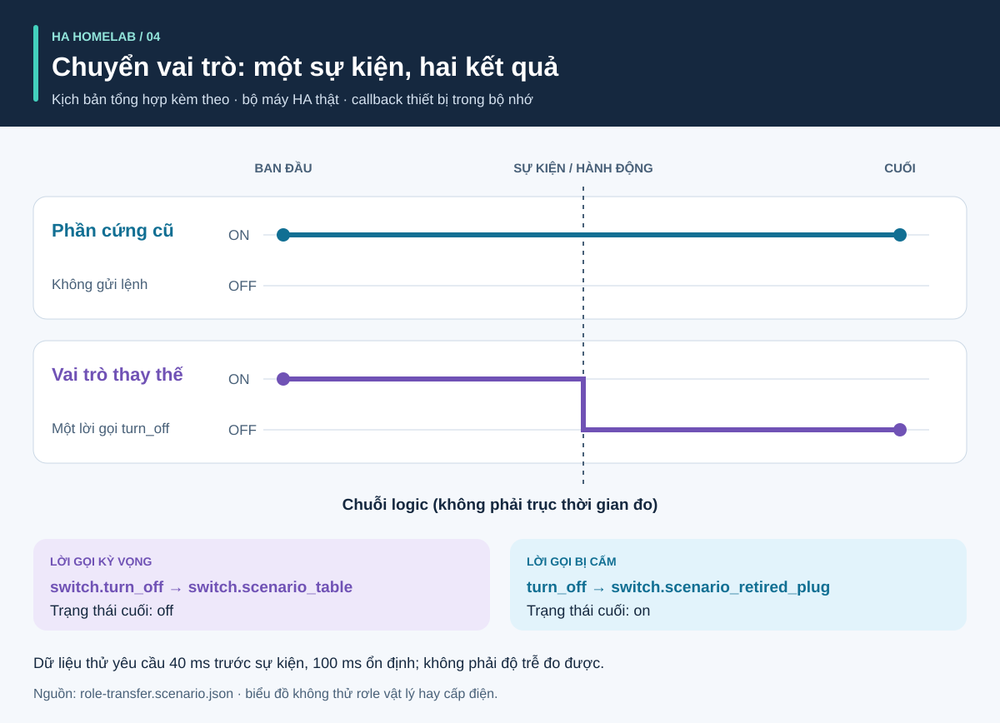

# Quy trình và kết quả: hướng dẫn hình ảnh

<!-- language-navigation:start -->
<p dir="ltr">
<a href="process-and-results.md" lang="en" dir="ltr">English</a> · <a href="process-and-results.ar.md" lang="ar" dir="rtl">العربية</a> · <a href="process-and-results.bn.md" lang="bn" dir="ltr">বাংলা</a> · <a href="process-and-results.cs.md" lang="cs" dir="ltr">Čeština</a> · <a href="process-and-results.de.md" lang="de" dir="ltr">Deutsch</a> · <a href="process-and-results.es.md" lang="es" dir="ltr">Español</a> · <a href="process-and-results.fa.md" lang="fa" dir="rtl">فارسی</a> · <a href="process-and-results.fr.md" lang="fr" dir="ltr">Français</a><br>
<a href="process-and-results.he.md" lang="he" dir="rtl">עברית</a> · <a href="process-and-results.hi.md" lang="hi" dir="ltr">हिन्दी</a> · <a href="process-and-results.id.md" lang="id" dir="ltr">Bahasa Indonesia</a> · <a href="process-and-results.it.md" lang="it" dir="ltr">Italiano</a> · <a href="process-and-results.ja.md" lang="ja" dir="ltr">日本語</a> · <a href="process-and-results.ko.md" lang="ko" dir="ltr">한국어</a> · <a href="process-and-results.nl.md" lang="nl" dir="ltr">Nederlands</a> · <a href="process-and-results.pl.md" lang="pl" dir="ltr">Polski</a><br>
<a href="process-and-results.pt.md" lang="pt" dir="ltr">Português</a> · <a href="process-and-results.ru.md" lang="ru" dir="ltr">Русский</a> · <a href="process-and-results.th.md" lang="th" dir="ltr">ไทย</a> · <a href="process-and-results.tr.md" lang="tr" dir="ltr">Türkçe</a> · <a href="process-and-results.uk.md" lang="uk" dir="ltr">Українська</a> · <a href="process-and-results.vi.md" lang="vi" dir="ltr">Tiếng Việt</a> · <a href="process-and-results.zh-Hans.md" lang="zh-Hans" dir="ltr">简体中文</a> · <a href="process-and-results.zh-Hant.md" lang="zh-Hant" dir="ltr">繁體中文</a>
</p>
<!-- language-navigation:end -->

[Tổng quan dự án](README.vi.md)

Kết quả hữu ích trả lời câu hỏi cụ thể và giữ bằng chứng hỗ trợ câu trả lời. Bốn công cụ hoạt động độc lập: người rà soát chọn kiểm tra liên quan rồi đưa kết quả vào thay đổi. Mũi tên dưới đây mô tả quy trình rà soát đó, không phải pipeline tự động đã triển khai.


## 1. Xác định thay đổi và thu đầu vào

Khi thay thiết bị, phân biệt **vai trò** với **phần cứng vật lý**. Vai trò đèn có thể sang ổ khác trong khi ổ cũ cấp điện cho thứ khác. Ghi lại tham chiếu nào theo vai trò, tham chiếu nào theo phần cứng và tham chiếu nào cần bỏ. Cấp manifest di chuyển, ảnh trạng thái thực thể và tệp nguồn được hỗ trợ cho Entity Migrations.

Với đo lường, cung cấp phạm vi vật lý, định danh nguồn, đơn vị và thời điểm của từng bộ đo. Với tự động hóa, mô tả trạng thái đầu tổng hợp, chuỗi sự kiện và kỳ vọng rõ ràng. Với giọng nói, cung cấp quan sát ý định, hành động và phản hồi nghe được. Công cụ nhận đầu vào khác nhau; quy trình không yêu cầu bản xuất dùng chung từ hệ thống gia đình đang chạy.

## 2. Đọc đầu ra và giới hạn


Đây là tóm tắt giải thích ví dụ kèm theo, **không phải ảnh báo cáo thô**:

- **Di chuyển:** ví dụ đổi miền đề xuất `light.table` → `switch.table` và thay đổi dịch vụ tương ứng. Rà soát từng sửa đổi đề xuất, dấu vân tay và mọi xung đột chặn. Kế hoạch không tự áp dụng.
- **Đo lường:** ví dụ ba bộ đo hợp lệ có nguồn riêng, mới, với giá trị `700 W`, `0.02 kW` và `0 W`. Chuẩn hóa giá trị thứ hai cho `700 + 20 + 0 = 720 W`. Kết quả được ba bộ đo hỗ trợ; một bộ đo toàn dải ổ không cung cấp ba quan sát theo ổ này. Ví dụ phạm vi chung và nguồn trùng cố ý nêu giả định sai.
- **Tự động hóa:** dữ liệu thử chuyển vai trò mong đợi một lời gọi tới thực thể thay thế và không gọi phần cứng cũ. Cả danh sách lời gọi lẫn trạng thái cuối đều quan trọng: chỉ trạng thái cuối khớp có thể che giấu lệnh thừa ngoài ý muốn.
- **Giọng nói:** ví dụ thiếu không có đủ bằng chứng nghe được. Nó thoát mã `3` ngay cả khi bước API đã xong. Điều đó nghĩa là cần thêm bằng chứng, không phải chắc chắn người nghe đã nghe sự im lặng.

Nguồn: [ví dụ di chuyển](https://github.com/ha-homelab/ha-entity-migrations/tree/main/examples/domain-change), [đầu vào ba bộ đo](https://github.com/ha-homelab/ha-meter-contracts/blob/main/examples/valid-three-meters.json), [đầu vào giọng nói](https://github.com/ha-homelab/assist-scenario-lab/blob/main/examples/synthetic-incomplete.json). Lệnh cài đặt và chạy chính xác nằm trong [quy trình tổng quan](README.vi.md#a-concrete-migration-to-test-workflow).

## 3. Kiểm tra thay đổi theo trình tự



Trong [role-transfer.scenario.json](role-transfer.scenario.json), cả hai công tắc tổng hợp bắt đầu ở `on`. Sự kiện `scenario_table_off` gây lời gọi `switch.turn_off` cho `switch.scenario_table`. Kết quả mong đợi là `off` cho thiết bị thay thế và `on` cho `switch.scenario_retired_plug`. Việc tắt công tắc cũ bị cấm rõ ràng.

Biểu đồ dùng **giai đoạn logic**, không phải thang thời gian đo được. Dữ liệu thử yêu cầu chờ 40 ms trước sự kiện và 100 ms để ổn định. Đây là đầu vào kiểm thử, không phải độ trễ rơle quan sát được hay bảo đảm xong sự kiện trong 40 ms. Kiểm thử runtime HA thật với dữ liệu này đã vượt qua ở [lượt Linux ghi nhận](https://github.com/ha-homelab/ha-scenario-tests/actions/runs/38843681199). Callback thiết bị vẫn chạy trong bộ nhớ.

## 4. Hiểu điều đã kiểm thử


Biểu đồ đọc [validation-evidence.json](validation-evidence.json). Mỗi bản ghi liên kết tới lượt GitHub Actions gốc. Đây là ảnh trạng thái có ngày, không phải huy hiệu CI trực tiếp. Chiều dài thanh là số bài vượt qua; **không phải tỷ lệ bao phủ, độ tin cậy, tốc độ hay thứ hạng dự án**. Phạm vi bộ kiểm thử khác nhau.

Entity Migrations bỏ qua một trường hợp Linux về hệ thống tệp không phân biệt hoa thường, đã kiểm tra cục bộ trên macOS. Scenario Tests gồm bảy trường hợp runtime HA thật trong tổng 54. Lỗi dọn dẹp cuối trên macOS gốc vẫn là giới hạn riêng; vượt qua trên Linux không loại bỏ nó.

## 5. Quyết định có tiếp tục hay không

Giữ đầu vào đã rà soát, phiên bản công cụ, báo cáo và phát hiện chưa xử lý cùng thay đổi. Giải quyết tham chiếu không hỗ trợ, nguồn đo xung đột, khẳng định thất bại và quan sát thiếu trước khi xem kết quả là đủ cho mục đích sử dụng. Dùng hợp đồng trạng thái và mã thoát trong tài liệu từng công cụ.

Triển khai và nghiệm thu phần cứng vẫn riêng biệt. Kiểm tra thiết bị thật, truyền vô tuyến, hành vi rơle, tải đã nối, thời điểm nguồn và đầu ra nghe được theo trường hợp. Vượt qua tổng hợp xác nhận hành vi phần mềm đã thử, không xác nhận cấp điện thành công hay cấu hình gia đình đầy đủ.

<a id="reproduce-or-translate-the-illustrations"></a>

## Tái tạo hoặc dịch hình minh họa

Chạy từ thư mục này:

```sh
python3 render_architecture.py
python3 -m unittest discover -s . -p 'test_*.py'
```

Bộ sinh tạo bốn SVG cho mỗi ngôn ngữ trong [danh sách ngôn ngữ chung](../languages.json). Nó chỉ cần thư viện chuẩn Python, không nhúng tài nguyên từ xa và có tiêu đề, mô tả hỗ trợ tiếp cận cho mọi ảnh. Màu giống nhau nhận diện cùng công cụ xuyên suốt; nhãn cũng nhận diện từng chuỗi. Với ảnh trạng thái bằng chứng mới, cập nhật bản ghi nguồn cùng phần giải thích, giữ liên kết lượt chạy đã ghi. Mọi hình đều nguyên bản và được cấp phép [MIT](LICENSE).

