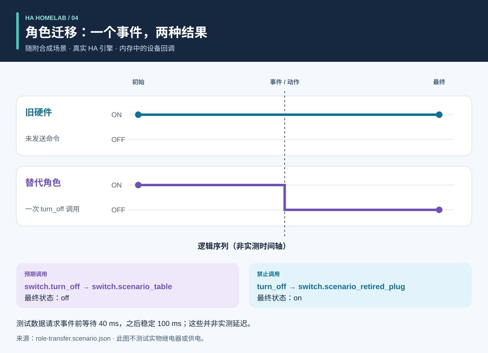

# 流程与结果图解

<!-- language-navigation:start -->
<p dir="ltr">
<a href="process-and-results.md" lang="en" dir="ltr">English</a> · <a href="process-and-results.ar.md" lang="ar" dir="rtl">العربية</a> · <a href="process-and-results.bn.md" lang="bn" dir="ltr">বাংলা</a> · <a href="process-and-results.cs.md" lang="cs" dir="ltr">Čeština</a> · <a href="process-and-results.de.md" lang="de" dir="ltr">Deutsch</a> · <a href="process-and-results.es.md" lang="es" dir="ltr">Español</a> · <a href="process-and-results.fa.md" lang="fa" dir="rtl">فارسی</a> · <a href="process-and-results.fr.md" lang="fr" dir="ltr">Français</a><br>
<a href="process-and-results.he.md" lang="he" dir="rtl">עברית</a> · <a href="process-and-results.hi.md" lang="hi" dir="ltr">हिन्दी</a> · <a href="process-and-results.id.md" lang="id" dir="ltr">Bahasa Indonesia</a> · <a href="process-and-results.it.md" lang="it" dir="ltr">Italiano</a> · <a href="process-and-results.ja.md" lang="ja" dir="ltr">日本語</a> · <a href="process-and-results.ko.md" lang="ko" dir="ltr">한국어</a> · <a href="process-and-results.nl.md" lang="nl" dir="ltr">Nederlands</a> · <a href="process-and-results.pl.md" lang="pl" dir="ltr">Polski</a><br>
<a href="process-and-results.pt.md" lang="pt" dir="ltr">Português</a> · <a href="process-and-results.ru.md" lang="ru" dir="ltr">Русский</a> · <a href="process-and-results.th.md" lang="th" dir="ltr">ไทย</a> · <a href="process-and-results.tr.md" lang="tr" dir="ltr">Türkçe</a> · <a href="process-and-results.uk.md" lang="uk" dir="ltr">Українська</a> · <a href="process-and-results.vi.md" lang="vi" dir="ltr">Tiếng Việt</a> · <a href="process-and-results.zh-Hans.md" lang="zh-Hans" dir="ltr">简体中文</a> · <a href="process-and-results.zh-Hant.md" lang="zh-Hant" dir="ltr">繁體中文</a>
</p>
<!-- language-navigation:end -->

[项目概览](README.zh-Hans.md)

有用的结果应回答具体问题，并保留支持答案的证据。四个工具独立运行：审查者选择相关检查，再将结果用于变更。下方箭头描述审查流程，而非已经实现的自动流水线。


## 1. 定义变更并收集输入

更换设备时，要区分**角色**与**实物硬件**。灯的角色可能移到另一个插座，而旧插座开始为其他设备供电。记录哪些引用跟随角色、哪些跟随硬件、哪些应移除。向 Entity Migrations 提供迁移清单、实体快照和受支持的源文件。

计量检查需要每个电表的物理范围、来源标识、单位和时间戳。自动化检查需要合成初始状态、事件序列和明确的预期。语音检查需要对意图、动作与可听响应的观测。各工具接受不同输入；该流程不要求共享真实家庭的运行数据导出。

## 2. 理解输出及其限制


以下是对随附示例的解释性概括，**并非原始报告截图**：

- **迁移：** 域变更示例提议将 `light.table` 改为 `switch.table`，并修改对应服务。审查每项建议编辑、文件指纹及所有阻塞冲突。计划不会自行应用。
- **计量：** 有效的三电表示例具有独立且及时的来源，值为 `700 W`、`0.02 kW` 和 `0 W`。归一化第二个值后得到 `700 + 20 + 0 = 720 W`。这一结果由三个电表支持；单个插排总表不能提供这三项逐插座观测。共享范围和重复来源示例专门用于暴露无效假设。
- **自动化：** 角色迁移测试数据预期对替代实体调用一次，对旧硬件不调用。调用列表和最终状态都很重要：仅匹配最终状态，可能掩盖多余的意外命令。
- **语音：** 不完整示例缺少足够的可听证据。即使某个 API 阶段已完成，它仍以状态码 `3` 退出。这表示需要更多证据，不表示听者一定没有听到声音。

来源：[迁移示例](https://github.com/ha-homelab/ha-entity-migrations/tree/main/examples/domain-change)、[三电表输入](https://github.com/ha-homelab/ha-meter-contracts/blob/main/examples/valid-three-meters.json)、[语音输入](https://github.com/ha-homelab/assist-scenario-lab/blob/main/examples/synthetic-incomplete.json)。具体安装与执行命令见[概览中的操作流程](README.zh-Hans.md#a-concrete-migration-to-test-workflow)。

## 3. 检查变化过程



在 [role-transfer.scenario.json](role-transfer.scenario.json) 中，两个合成开关初始都为 `on`。`scenario_table_off` 事件使 `switch.scenario_table` 执行 `switch.turn_off`。预期结果是替代设备为 `off`，而 `switch.scenario_retired_plug` 为 `on`。关闭旧开关是明确禁止的。

图表使用**逻辑阶段**，不是实测时间轴。测试数据请求在事件前等待 40 ms，再等待 100 ms 稳定。这些是测试输入，不是观察到的继电器延迟，也不保证事件会在 40 ms 内完成。此测试数据在[记录的 Linux 运行](https://github.com/ha-homelab/ha-scenario-tests/actions/runs/38843681199)中通过了真实 HA 运行时测试。设备回调仍在内存中执行。

## 4. 理解测试范围


图表读取 [validation-evidence.json](validation-evidence.json)。每条记录都链接到原始 GitHub Actions 运行。这是带日期的快照，不是实时 CI 徽章。条形长度是通过的测试数量；它**不是覆盖率、可靠性、速度或项目排名**。各测试集范围不同。

Entity Migrations 在 Linux 上跳过一个大小写不敏感文件系统用例，该用例已在本地 macOS 上检查。Scenario Tests 的 54 个测试包含七个真实 HA 运行时用例。已记录的 macOS 原生清理阶段故障仍是独立限制；Linux 测试通过不会消除它。

## 5. 决定是否继续

将已审查的输入、工具版本、报告和未解决发现与变更保存在一起。在认定结果足以支持预期用途之前，先解决不支持的引用、冲突的电表来源、失败的断言和缺失的观测。使用各工具文档定义的状态与退出码契约。

部署与实物验收仍然独立。按需核实实际设备、无线传输、继电器行为、所连负载、源时间戳和可听输出。合成测试通过确认的是被测软件行为，不是实际供电成功或整个家庭配置正确。

<a id="reproduce-or-translate-the-illustrations"></a>
## 复现或翻译图解

在本目录中运行：

```sh
python3 render_architecture.py
python3 -m unittest discover -s . -p 'test_*.py'
```

生成器为共享[语言列表](../languages.json)中的每种语言生成四个 SVG。仅需 Python 标准库，不嵌入远程资源，并为每张图片提供无障碍标题与描述。同一工具在各图中使用相同颜色，各数据系列也有文字标签。更新证据快照时，应同时更新源记录与说明，并保留已记录运行的链接。所有图解均为原创，采用 [MIT](LICENSE) 许可。
