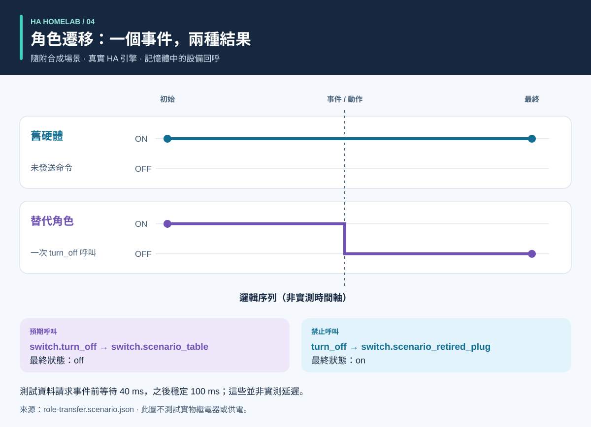

# 流程與結果圖解

<!-- language-navigation:start -->
<p dir="ltr">
<a href="process-and-results.md" lang="en" dir="ltr">English</a> · <a href="process-and-results.ar.md" lang="ar" dir="rtl">العربية</a> · <a href="process-and-results.bn.md" lang="bn" dir="ltr">বাংলা</a> · <a href="process-and-results.cs.md" lang="cs" dir="ltr">Čeština</a> · <a href="process-and-results.de.md" lang="de" dir="ltr">Deutsch</a> · <a href="process-and-results.es.md" lang="es" dir="ltr">Español</a> · <a href="process-and-results.fa.md" lang="fa" dir="rtl">فارسی</a> · <a href="process-and-results.fr.md" lang="fr" dir="ltr">Français</a><br>
<a href="process-and-results.he.md" lang="he" dir="rtl">עברית</a> · <a href="process-and-results.hi.md" lang="hi" dir="ltr">हिन्दी</a> · <a href="process-and-results.id.md" lang="id" dir="ltr">Bahasa Indonesia</a> · <a href="process-and-results.it.md" lang="it" dir="ltr">Italiano</a> · <a href="process-and-results.ja.md" lang="ja" dir="ltr">日本語</a> · <a href="process-and-results.ko.md" lang="ko" dir="ltr">한국어</a> · <a href="process-and-results.nl.md" lang="nl" dir="ltr">Nederlands</a> · <a href="process-and-results.pl.md" lang="pl" dir="ltr">Polski</a><br>
<a href="process-and-results.pt.md" lang="pt" dir="ltr">Português</a> · <a href="process-and-results.ru.md" lang="ru" dir="ltr">Русский</a> · <a href="process-and-results.th.md" lang="th" dir="ltr">ไทย</a> · <a href="process-and-results.tr.md" lang="tr" dir="ltr">Türkçe</a> · <a href="process-and-results.uk.md" lang="uk" dir="ltr">Українська</a> · <a href="process-and-results.vi.md" lang="vi" dir="ltr">Tiếng Việt</a> · <a href="process-and-results.zh-Hans.md" lang="zh-Hans" dir="ltr">简体中文</a> · <a href="process-and-results.zh-Hant.md" lang="zh-Hant" dir="ltr">繁體中文</a>
</p>
<!-- language-navigation:end -->

[專案概覽](README.zh-Hant.md)

有用的結果應回答具體問題，並保留支持答案的證據。四個工具獨立執行：審查者選擇相關檢查，再將結果用於變更。下方箭頭描述審查流程，而非已經實現的自動流水線。


## 1. 定義變更並收集輸入

更換設備時，要區分**角色**與**實物硬體**。燈的角色可能移到另一個插座，而舊插座開始為其他設備供電。記錄哪些引用跟隨角色、哪些跟隨硬體、哪些應移除。向 Entity Migrations 提供遷移清單、實體快照和受支援的來源檔案。

計量檢查需要每個電錶的物理範圍、來源標識、單位和時間戳。自動化檢查需要合成初始狀態、事件序列和明確的預期。語音檢查需要對意圖、動作與可聽回應的觀測。各工具接受不同輸入；該流程不要求共享真實家庭的執行資料匯出。

## 2. 理解輸出及其限制


以下是對隨附示例的解釋性概括，**並非原始報告截圖**：

- **遷移：** 域變更示例提議將 `light.table` 改為 `switch.table`，並修改對應服務。審查每項建議編輯、檔案指紋及所有阻塞衝突。計畫不會自行應用。
- **計量：** 有效的三電錶示例具有獨立且及時的來源，值為 `700 W`、`0.02 kW` 和 `0 W`。歸一化第二個值後得到 `700 + 20 + 0 = 720 W`。這一結果由三個電錶的觀測佐證；單個插排總表不能提供這三項逐插座觀測。共享範圍和重複來源示例專門用於暴露無效假設。
- **自動化：** 角色遷移測試資料預期對替代實體呼叫一次，對舊硬體不呼叫。呼叫列表和最終狀態都很重要：僅匹配最終狀態，可能掩蓋多餘的意外命令。
- **語音：** 不完整示例缺少足夠的可聽證據。即使某個 API 階段已完成，它仍以狀態碼 `3` 結束執行。這表示需要更多證據，不表示聽者一定沒有聽到聲音。

來源：[遷移示例](https://github.com/ha-homelab/ha-entity-migrations/tree/main/examples/domain-change)、[三電錶輸入](https://github.com/ha-homelab/ha-meter-contracts/blob/main/examples/valid-three-meters.json)、[語音輸入](https://github.com/ha-homelab/assist-scenario-lab/blob/main/examples/synthetic-incomplete.json)。具體安裝與執行命令見[概覽中的操作流程](README.zh-Hant.md#a-concrete-migration-to-test-workflow)。

## 3. 檢查變化過程



在 [role-transfer.scenario.json](role-transfer.scenario.json) 中，兩個合成開關初始都為 `on`。`scenario_table_off` 事件使 `switch.scenario_table` 執行 `switch.turn_off`。預期結果是替代設備為 `off`，而 `switch.scenario_retired_plug` 為 `on`。關閉舊開關是明確禁止的。

圖表使用**邏輯階段**，不是實測時間軸。測試資料請求在事件前等待 40 ms，再等待 100 ms 穩定。這些是測試輸入，不是觀察到的繼電器延遲，也不保證事件會在 40 ms 內完成。此測試資料在[記錄的 Linux 執行](https://github.com/ha-homelab/ha-scenario-tests/actions/runs/38843681199)中通過了真實 HA 執行時測試。設備回呼仍在記憶體中執行。

## 4. 理解測試範圍


圖表讀取 [validation-evidence.json](validation-evidence.json)。每條記錄都連結到原始 GitHub Actions 執行。這是帶日期的快照，不是實時 CI 徽章。條形長度是通過的測試數量；它**不是覆蓋率、可靠性、速度或專案排名**。各測試集範圍不同。

Entity Migrations 在 Linux 上跳過一個大小寫不敏感檔案系統用例，該用例已在本地 macOS 上檢查。Scenario Tests 的 54 個測試包含七個真實 HA 執行時用例。已記錄的 macOS 原生清理階段故障仍是獨立限制；Linux 測試通過不會消除它。

## 5. 決定是否繼續

將已審查的輸入、工具版本、報告和未解決發現與變更保存在一起。在認定結果足以支援預期用途之前，先解決不支援的引用、衝突的電錶來源、失敗的斷言和缺失的觀測。使用各工具文件定義的狀態與結束代碼契約。

部署與實物驗收仍然獨立。按需核實實際設備、無線傳輸、繼電器行為、所連負載、源時間戳和可聽輸出。合成測試通過確認的是被測軟體行為，不是實際供電成功或整個家庭設定正確。

<a id="reproduce-or-translate-the-illustrations"></a>
## 復現或翻譯圖解

在本目錄中執行：

```sh
python3 render_architecture.py
python3 -m unittest discover -s . -p 'test_*.py'
```

生成器為共享[語言列表](../languages.json)中的每種語言生成四個 SVG。僅需 Python 標準庫，不嵌入遠端資源，並為每張圖片提供無障礙標題與描述。同一工具在各圖中使用相同顏色，各資料系列也有文字標籤。更新證據快照時，應同時更新源記錄與說明，並保留已記錄執行的連結。所有圖解均為原創，採用 [MIT](LICENSE) 許可。
